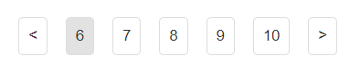

> **TL;DR** — Pagination은 결국 산수다. 현재 페이지와 페이지당 게시물 수로 슬라이스 구간을 구하고, 전체 페이지 수로 페이지 그룹을 나누고, 그룹 경계에서만 이전/다음 버튼을 숨기면 된다.

난이도 : ★★☆☆☆

1️⃣ `페이지별 게시물 슬라이싱` 2️⃣ `페이지 그룹 계산` 3️⃣ `이전/다음 버튼 분기`

## ✅ 왜 알아야 하나

Pagination은 게시판을 구현할 때 빠지지 않는 기능인데, 라이브러리를 가져다 쓰기만 하면 정작 동작 원리를 설명하지 못한다. 최소한 어떻게 계산되는지는 알고 있어야 한다는 생각으로 TypeScript + React + Hook만으로 직접 구현해봤다.



- 코드: [Github Repository](https://github.com/seong-ji-sue/react-project-board)


## ✅ 한눈에 보는 구현 순서

1. 페이지마다 해당하는 게시물 구하기
2. 전체 페이지 개수 구하기
3. 페이지 그룹마다 표시할 페이지 구하기
4. `<` `>` 표시 여부와 클릭했을 때 이동할 페이지 구하기
5. `<` `>` 클릭 이벤트 처리

## ✅ 페이지마다 해당하는 게시물 구하기

- 페이지당 게시물 개수: `a`
- 현재 페이지: `n`
- 현재 페이지의 마지막 게시물 인덱스: `a * n = lastPost`
- 현재 페이지의 첫 게시물 인덱스: `a * (n-1) = firstPost`
- 현재 페이지에 표시할 게시물: `posts.slice(firstPost, lastPost)`

```javascript
const _postPerPage: number = 5;//1페이지에 게시물 몇개?

//컴포넌트
export default function NoticeBoard({postList}:NoticeBoardProps) {
	//현재 페이지 구하는 state
	const [currentPage, setCurrentPage] = useState<number>(1);

	//게시글의 첫번째 index와 마지막 index를 구하고 현재 페이지에 맞는 게시글 5개
	const indexOfLastPostNum = _postPerPage * currentPage;
	const indexOfFirstPostNum = _postPerPage * (currentPage - 1) ;
	const currentPosts: Post[] = postList.slice(indexOfFirstPostNum, indexOfLastPostNum);
```

## ✅ 전체 페이지 개수 구하기

- 페이지당 게시물 개수: `a`
- 전체 게시물 개수: `posts.length = totalPost`
- 전체 페이지 개수: `Math.ceil(totalPost / a) = totalPage`

```cpp
const totalPages = Math.ceil(totalPosts/postPerPage)//페이지 갯수
```

## ✅ 페이지 그룹마다 표시할 페이지 구하기

`Array.from`을 쓰는 이유는 전체 페이지 수만큼 페이지 번호가 1씩 늘어난 배열이 필요하기 때문이다.

- 표시할 페이지 그룹: `g`
- 페이지 그룹당 페이지 개수: `n`
- 전체 페이지 개수: `totalPage`
- 페이지 배열: `Array.from({length: totalPage}, (_, i) => i + 1) = pages` → `[1, 2, 3, … n]`
- 표시할 그룹의 첫 페이지: `n * g - 5 = startPage`
- 표시할 그룹의 마지막 페이지: `n * g - 1 = lastPage`
- 실제로 보여줄 페이지: `pages.slice(startPage, lastPage) = visiblePage`

```php
/**
 * 페이지 네이션 만들기
 * @param paginate 클릭한 페이지 바꾸는 함수
 * @param totalPosts 총 게시글 수
 * @param postPerPage 5(표시해야될 페이지 수)
 * @param currentPage 현재 페이지
 * @constructor
 */
export default function Pagination({paginate,totalPosts,postPerPage,currentPage}:PaginationProps){
	const totalPages = Math.ceil(totalPosts/postPerPage)//페이지 갯수
	const [pageGroup, setPageGroup] = useState(1);//표시할 페이지 그룹

	//전체 페이지 얕은 복사 ex) totalPages 10 -> [1, 2, ..., 10]
	const pages = Array.from({length: totalPages}, (_, i) => i+1);

	const startPage = 5 * pageGroup - 5; //페이지 앞
	const endPage = 5 * pageGroup - 1; //페이지 끝
	const visiblePages = pages.slice(startPage, endPage + 1);//보여지는 페이지
```

## ✅ `<` `>` 표시 여부와 클릭했을 때 이동할 페이지

- 페이지 그룹당 페이지 개수: `n`
- `<`는 첫 페이지 그룹일 때, `>`는 마지막 페이지 그룹일 때 표시하지 않음
  - ex) 첫 페이지 그룹 → `(1, 2, 3, 4, 5 >)`
  - ex) 마지막 페이지 그룹 → `(< 11, 12, 13, 14, 15)`
- 마지막 페이지 그룹: `Math.ceil(totalPages / n)`
- `<` 클릭 시 이동할 페이지: `n * pageGroup - 5 = prevPage`
  - ex) `(6, 7, 8, 9, 10)` → `<` 클릭 → `prevPage: 5`
- `>` 클릭 시 이동할 페이지: `n * pageGroup + 1 = nextPage`
  - ex) `(6, 7, 8, 9, 10)` → `>` 클릭 → `nextPage: 11`

```javascript
//이전 버튼 레이아웃 이전 페이지 계산
const prevButton = () => {
    if(pageGroup === 1){
        return null;
    }
    const prevPage = 5 * pageGroup - 5;//눌러질 페이지
    return (
        <button onClick={() => handlePageClick(prevPage)}>
            {'<'}
        </button>
    )
}

//다음페이지 계산
const nextButton = () => {
    if(pageGroup === Math.ceil(totalPages/5)) {
        return null;
    }
    const nextPage = 5 * pageGroup + 1;//눌러질 페이지
    return (
        <button onClick={() => handlePageClick(nextPage)}>
            {'>'}
        </button>
    )
}
```

## ✅ `<` `>` 클릭 이벤트 처리

- 페이지 그룹당 페이지 개수: `n`
- 클릭된 페이지: `clickPage`
- 현재 페이지 업데이트: `setCurrentPage(clickPage)`
- 페이지 그룹 업데이트: `setPageGroup(Math.ceil(clickPage/n))`

```javascript
//버튼 클릭시 페이지 번호를 담기 위함
const paginate = useCallback((pageNumber:number):void => {setCurrentPage(pageNumber)},[])

//버튼을 클릭할 때 보여지는 페이지 그룹과 선택되어지는 페이지 랜더링
const handlePageClick = (clickPage:number):void => {
    if(clickPage<=0 || clickPage>totalPages) {
        return;
    }
    paginate(clickPage)//현재 페이지 업뎃 함수
    const newPageGroup = Math.ceil(clickPage/5);//페이지 그룹
    setPageGroup(newPageGroup);//페이지 그룹 업뎃
}
```

## ✅ 정리

- 현재 페이지에 보일 게시물은 `slice(firstPost, lastPost)`로 구함
- 전체 페이지 수는 `Math.ceil(totalPost / postPerPage)`로 구함
- 페이지 그룹은 `pages` 배열을 그룹 단위로 다시 `slice`해서 표시함
- `<`/`>` 버튼은 그룹의 처음·끝에서만 숨기고, 클릭 시 그룹 경계값으로 페이지를 이동시킴


## 참고한 링크

- [Github Repository — react-project-board](https://github.com/seong-ji-sue/react-project-board)
