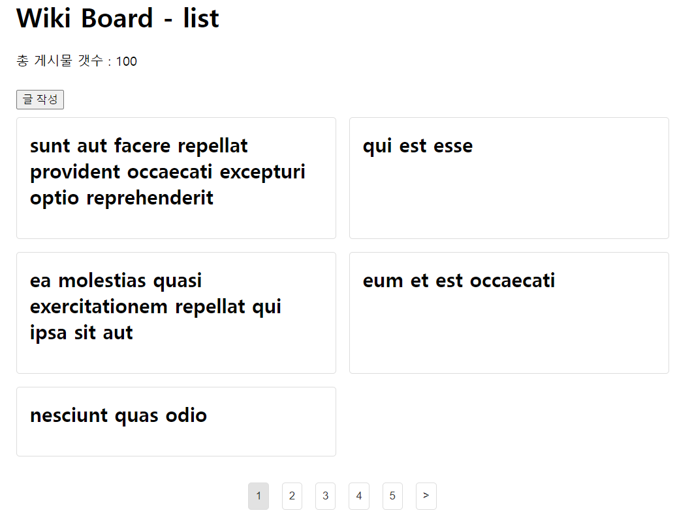
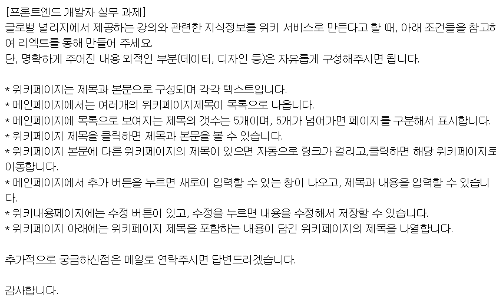

> **TL;DR** — 이력서 지원 회사의 과제로 Wiki형 게시판 CRUD를 React + TypeScript로 혼자 구현했다. 상태관리를 props 전달에서 `useReducer` + `useContext` 조합으로 옮기고, 페이지 이동 로직을 커스텀 훅으로 분리하면서 Hooks를 실전에서 언제·왜 쓰는지 체감했다.

## ✅ 상황 (Situation)

이력서를 넣은 회사에서 사전 과제를 줬다. SI 업체는 입사 초반에 테이블 짜는 작업을 많이 시킨다는 얘기를 들었던 터라, CRUD의 기본기를 다시 다져볼 좋은 기회라고 생각했다. 백엔드는 SpringBoot로 붙일 계획이었지만, 이번 과제 자체는 프론트엔드 단독 구현이 요구 조건이었다.

과제 내용은 실제 서비스에 가까운 Wiki형 게시판이었다.

- framework는 React 사용
- 데이터·디자인(레이아웃)은 자유
- 게시물은 제목과 본문으로만 구성
- 메인 페이지는 게시물 5개짜리 리스트 + pagination
- 게시글 클릭 → detail 페이지(제목·본문 표시, 수정 가능)
- 메인 페이지 추가 버튼 → 작성 페이지



## ✅ 목표와 내 역할 (Task)

프론트엔드 전체를 혼자 담당했다. 단순히 화면만 붙이는 게 아니라 세 가지를 의도적으로 목표에 넣었다.

- JavaScript 대신 TypeScript로 짜서 타입 오류를 컴파일 시점에 잡아내는 경험 쌓기
- React Hooks(`useReducer`, `useContext`, `useRef`, `useCallback`)를 실제로 언제 쓰는지 감 잡기
- pagination을 직접 구현해서 리스트 화면의 기본기 다지기

스택은 JavaScript, TypeScript, React, React Hooks, React Router, webpack, babel로 구성했다.

## ✅ 한 것 (Action)

### 라우팅 구조

페이지는 리스트/상세/작성/수정 네 종류였고, 상세·작성·수정 페이지는 게시글 ID를 공유하는 구조라 라우트를 두 개로 압축했다.

```javascript
<Switch>
    <Route exact path={'/'} render={()=><NoticeBoard />}/>
    <Route path={'/:page/:postId'} render={()=><BulletinBoard />} />
</Switch>
```

페이지 흐름은 다음과 같이 짰다.

- 글 생성: list → create 버튼 → create 페이지 → 완료 버튼 → detail 페이지
- 글 수정: list → 게시글 클릭 → detail 페이지 → 수정 버튼 → update 페이지 → 수정 완료 → detail 페이지
- 리스트 복귀: detail → 리스트 이동 버튼 → list 페이지


### 상태관리 — props 전달에서 Context로

처음에는 최상단 컴포넌트인 `App.js`에서 상태를 들고 자식에게 props로 내려주는 방식으로 짰다.

<!-- 이미지 제안: props drilling 구조와 useReducer+useContext(State/Dispatch 분리) 구조를 비교하는 다이어그램 -->

```javascript
// App.js
const [postList, setPostList] = useState<post[]>([]) // 게시글 데이터

useEffect(() => {
  fetch('https://jsonplaceholder.typicode.com/posts/')
    .then((res) => res.json())
    .then((data) => setPostList(data))
}, [])

const addPostList = (post: Post) => {
  setPostList([...postList, post])
}

const editPostList = (editPost: Post) => {
  setPostList(
    postList.map((post) =>
      post.id === editPost.id ? editPost : post
    )
  )
}
```

컴포넌트 depth가 깊어지면서 props 전달이 번거로워졌다. Redux나 Recoil을 쓰면 깔끔하겠지만, 프로젝트 규모가 작아서 별도 라이브러리 설치 없이 내장 훅으로 해결하는 쪽을 선택했다. `useReducer` + `useContext` 조합으로 전역 상태를 만들고, 로딩·에러 상태까지 리듀서 액션으로 관리했다.

```javascript
interface State {
  loading: boolean,
  data: any | null,
  error: any | null,
}

type Action =
  | { type: 'FETCH_INIT' }
  | { type: 'FETCH_SUCCESS', payload: Post[] }
  | { type: 'FETCH_FAILURE', payload: any }
  | { type: 'ADD_POST', payload: Post }
  | { type: 'UPDATE_POST', payload: Post }

type PostDispatch = Dispatch<Action>

const PostStateContext = createContext<State | null>(null);
const PostDispatchContext = createContext<PostDispatch | null>(null);

function reducer(state: State, action: Action): State {
  switch (action.type) {
    case 'FETCH_INIT':
      return { ...state, loading: true }
    case 'FETCH_SUCCESS':
      return { ...state, loading: false, data: action.payload, error: null }
    case 'FETCH_FAILURE':
      return { ...state, loading: false, data: null, error: action.payload }
    case 'ADD_POST':
      return { ...state, loading: false, data: state.data.concat(action.payload), error: null }
    case 'UPDATE_POST':
      const updateData = state.data.map((post: any) =>
        post.id === action.payload.id ? action.payload : post)
      return { ...state, loading: false, data: updateData, error: null }
    default:
      throw new Error('Unhandled action')
  }
}
```

Provider와 커스텀 훅으로 감싸서 컴포넌트에서는 `usePostState()` / `usePostDispatch()`만 호출하면 되도록 정리했다.

```javascript
export function PostProvider({ children }: { children: React.ReactNode }) {
  const [state, dispatch] = useReducer(reducer, {
    loading: false,
    data: null,
    error: null,
  });

  useEffect(() => {
    dispatch({ type: 'FETCH_INIT' })
    fetch('https://jsonplaceholder.typicode.com/posts/')
      .then((res) => res.json())
      .then((data) => { dispatch({ type: 'FETCH_SUCCESS', payload: data }); })
      .catch((error) => { dispatch({ type: 'FETCH_FAILURE', payload: error }); })
  }, [])

  if (state.loading || !state.data) {
    return <div>Loading....</div>
  }
  if (state.error) {
    return <div>Error: {state.error.message}</div>
  }

  return (
    <PostStateContext.Provider value={state}>
      <PostDispatchContext.Provider value={dispatch}>
        {children}
      </PostDispatchContext.Provider>
    </PostStateContext.Provider>
  )
}

export function usePostState() {
  const state = useContext(PostStateContext);
  if (!state) throw new Error('Cannot find PostStateContext');
  return state;
}

export function usePostDispatch() {
  const dispatch = useContext(PostDispatchContext);
  if (!dispatch) throw new Error('Cannot find PostDispatchContext');
  return dispatch;
}
```

Context를 State/Dispatch 두 개로 쪼갠 이유도 있다. Context는 값이 하나라도 바뀌면 그 Context를 구독하는 컴포넌트가 전부 리렌더링되는 특성이 있다. State와 Dispatch를 하나의 Context에 합쳐뒀다면, `dispatch` 함수 자체는 안 바뀌어도 `state`가 바뀔 때마다 dispatch만 쓰는 컴포넌트까지 같이 리렌더링됐을 것이다. 두 Context로 분리하면 상태값만 구독하는 컴포넌트와 dispatch 함수만 구독하는 컴포넌트를 구분할 수 있어 불필요한 리렌더링을 줄일 수 있다.

사용하는 쪽은 이렇게 단순해졌다.

```javascript
const state = usePostState();
const dispatch = usePostDispatch();
dispatch({ type: 'ADD_POST', payload: newPost })
```

### 페이지 이동 로직 분리

페이지 종류가 고정돼 있어서 `enum`으로 타입을 두고, 컴포넌트마다 `useHistory`를 직접 쓰지 않도록 페이지 이동 전용 훅을 만들었다.

```typescript
export enum Page {
  list = 'list',
  detail = 'detail',
  create = 'create',
  update = 'update'
}
```

```typescript
const pageUrl = (page: Page, postId?: number) => {
  switch (page) {
    case Page.create:
    case Page.detail:
    case Page.update:
      return `/${page}/${postId}`;
    case Page.list:
      return '/';
  }
}

export function usePageNavigation() {
  const history = useHistory()
  const navigateTo = (page: Page, postId?: number) => {
    history.push(pageUrl(page, postId))
  };
  return { navigateTo }
}
```

```typescript
const { navigateTo } = usePageNavigation();
navigateTo(Page.detail, newPost.id)
```

### 렌더링마다 재생성되는 함수·변수 최적화

`useState`만 쓰면 상태가 바뀔 때마다 컴포넌트(함수) 전체가 다시 호출되면서 내부 함수·변수도 매번 재할당된다. 이 문제를 줄이려고 값 캐싱에는 `useRef`, 함수 캐싱에는 `useCallback`을 썼다. `useEffect`는 데이터 요청 로직 외에는 최대한 쓰지 않으려 했다.

```typescript
// 페이지 그룹 ex) 1, 2, 3, 4, 5 -> 1그룹
const pageGroup = useRef<number>(1)

// props로 넘기는 페이지 변경 함수
const paginate = useCallback((pageNumber: number): void => { setCurrentPage(pageNumber) }, [])
```




## ✅ 결과 (Result)

- 요구사항이었던 목록·상세·작성·수정 4개 화면 CRUD와 pagination을 기한 내에 혼자 완성함
- TypeScript로 짜면서 컴파일 단계에서 타입 오류를 미리 잡아, 런타임 디버깅 시간이 줄어드는 걸 체감함
- `useReducer` + `useContext`, `useRef`, `useCallback`을 실제 문제(props drilling, 불필요한 재생성)를 풀기 위해 써보면서 각 Hook을 언제 꺼내야 하는지 판단 기준이 생김

## ✅ 배운 점 / 아쉬운 점

- 잘한 점: Context를 목적별로 분리(State/Dispatch)해서 불필요한 리렌더링을 줄인 것, 페이지 이동 로직을 훅으로 뽑아 컴포넌트를 얇게 유지한 것
- 아쉬운 점: Context를 쓰임새마다 새로 만들어야 해서 상태 종류가 늘어나면 보일러플레이트가 같이 늘어난다는 걸 체감함 — 규모가 더 커지면 Redux나 Recoil 도입이 필요하다는 걸 직접 겪고 나서야 알았음
- 다음에는: 상태관리 라이브러리 선택을 "규모가 작으니까 내장 훅"으로 끝내지 않고, 프로젝트 성장 가능성까지 고려해서 초기에 검토해보려 함

## 참고한 링크

- [pagination 처리 TIL](https://zibu-story.tistory.com/205)
- [Context API 사용법 — react-vlpt](https://react.vlpt.us/using-typescript/04-ts-context.html)
- [상태 관리 실습 — react-vlpt](https://react.vlpt.us/mashup-todolist/02-manage-state.html)
