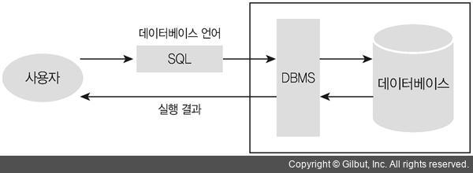
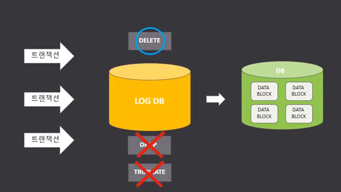
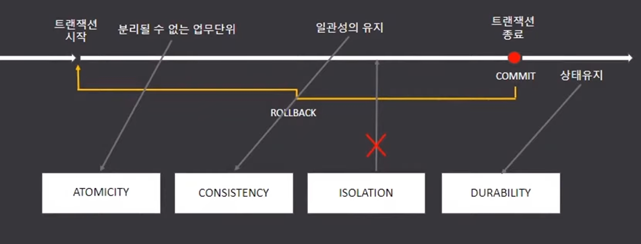
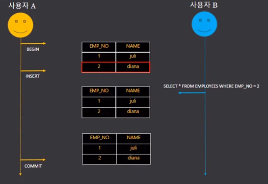
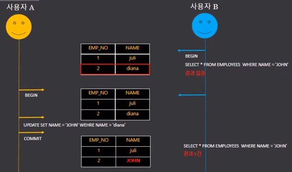
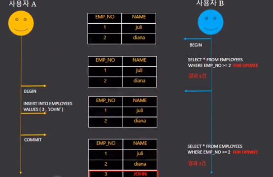
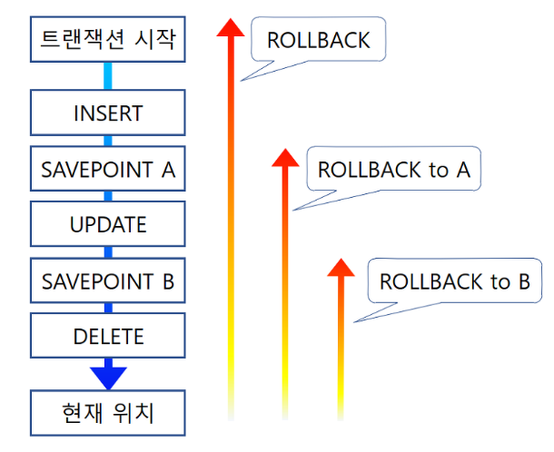

> **TL;DR** — SQL 명령어는 DML(조작)·DDL(정의)·DCL(제어)·TCL(트랜잭션 제어) 네 종류로 나뉜다. 트랜잭션의 ACID 특성과 COMMIT/ROLLBACK 동작 원리, CHAR·VARCHAR 비교 방식까지 알아두면 실무 쿼리를 짤 때 실수가 줄어든다.

난이도 : ★★☆☆☆

1️⃣ `DDL / DML / DCL / TCL` 2️⃣ `트랜잭션 ACID` 3️⃣ `NULL 처리 함수`

## ✅ 왜 알아야 하나

SQL 개발자(SQLD) 자격증을 공부하면서 정리한 내용이다. 패스트캠퍼스 강의로 개념을 잡고, 문제집이나 유튜브로 보완하는 방식으로 공부했다. 개인적으로는 개념만 강의로 잡아두는 게 효율이 좋았다. 참고로 SQLD는 필기만 통과하면 학점은행제에서 6학점을 인정받을 수 있다.


SQL 문을 작성할 때 DDL, DML, TCL은 기본이다.

**목차**

1. SQL 정의와 종류
2. 트랜잭션이란?
3. DDL(정의어)
4. TCL(트랜잭션 제어)
5. DML(조작어)
6. WHERE 절
7. 함수
8. NULL
9. GROUP BY, ORDER BY
10. 터미널에서 DB 생성 및 초기 세팅 방법

## ✅ SQL 정의와 종류

**정의**

- SQL은 Structured Query Language의 약자로, 데이터베이스로부터 데이터를 조회·삭제하는 등의 작업을 수행할 때 쓰는 언어다
- DBMS와 직접 소통할 수 있는 언어다
- 대문자·소문자를 구분하지 않는다
- 다만 식별자나 문법 언어는 관례상 대문자로 표기한다



**종류**

- **DML(조작어)** — 데이터를 조회·검색·변형함. `SELECT`, `INSERT`, `UPDATE`, `DELETE`
- **DDL(정의어)** — 테이블 구조를 생성·변경·삭제·이름 변경함. `CREATE`, `ALTER`, `DROP`, `RENAME`
- **DCL(제어어)** — 권한을 부여하거나 회수함. `GRANT`, `REVOKE`
- **TCL(트랜잭션 제어어)** — 작업 결과를 적용하거나 취소함. `COMMIT`, `ROLLBACK`

## ✅ 트랜잭션이란

**정의**

트랜잭션은 논리적 연산 단위다. 하나의 SQL 문장 실행 단위로 볼 수 있다.



**ACID 특성**

- **원자성(Atomicity)** — 모두 성공적으로 끝나거나 전부 실패해야 함
- **일관성(Consistency)** — 실행 전에 잘못된 내용이 없었다면 실행 후에도 DB에 잘못된 내용이 있으면 안 됨
- **고립성(Isolation)** — 실행 도중 다른 트랜잭션의 영향을 받아 결과 값이 바뀌면 안 됨
- **지속성(Durability)** — 성공적으로 수행되면 갱신 내용이 영구적으로 저장됨



**고립성이 낮을 때 생기는 문제**

- **Dirty Read** — 커밋되기 전 값을 조회할 때
- **Non-Repeatable Read** — 커밋 전과 후에 값이 다를 때
- **Phantom Read** — 커밋 전과 후 사이에 값이 추가됐을 때







## ✅ DDL(정의어)

**타입 종류**

- **CHAR(L)** — 고정 길이. 값이 지정 길이보다 짧으면 공백으로 채움
- **VARCHAR2(L)** — 가변 길이. 값 만큼만 공간을 차지함
- **NUMBER(L,D)** — 정수·실수 저장. L은 전체 길이, D는 소수점 자리
- **DATE** — 날짜와 시간 정보(년월일시분초)

**테이블 이름 조건**

- 이름은 단수형으로 한다
- 같은 이름의 테이블이 존재하면 안 된다
- 테이블 내 칼럼명이 중복되면 안 된다
- SQL 문 뒤에는 `;`로 끝나야 한다
- 타입을 반드시 적어야 한다
- 문자로 시작해야 하고 `A-Z`, `a-z`, `0-9`, `_`, `$`, `#`만 허용된다

**테이블 생성**

```sql
--테이블 생성
CREATE TABLE SQLD.TB_DEPT_TEMP
(
    DEPT_CD CHAR(6) NOT NULL,
    DEPT_NM VARCHAR2(150) NOT NULL,
    UPPER_DEPT_CD CHAR(6),
    CONSTRAINT DEPT_CD_KEY PRIMARY KEY(DEPT_CD),
    CONSTRAINT DEPT_CD_FOREIGN FOREIGN KEY(외래키)
    REFERENCES 부모테이블이름(부모테이블키) ON DELETE CASCADE
);
--테이블 조회
DESC SQLD.TB_DEPT_TEMP;
```

**테이블 삭제 종류와 특징**

- **TRUNCATE** — DDL. 롤백 불가, 자동 커밋, 정의 자체는 남기고 데이터를 완전 삭제
- **DROP** — DDL. 롤백 불가, 자동 커밋, 테이블을 최초 상태(존재하지 않는 상태)로 만듦
- **DELETE** — DML. 롤백 가능, 수동 커밋, 데이터만 삭제

```sql
--테이블 삭제
DROP TABLE SQLD.TB_DEPT_TEMP PURGE;
--테이블 데이터 제거
TRUNCATE TABLE SQLD.TB_EMP_TEMP;
--테이블 제거
DROP TABLE SQLD.TB_EMP_TEMP CASCADE CONSTRAINT;
```

**개별 속성 부여 및 이름 변경**

```sql
--칼럼 추가
ALTER TABLE SQLD.TB_EMP_TEMP ADD (MARRIED_YN CHAR(1));
--칼럼 제거
ALTER TABLE SQLD.TB_EMP_TEMP DROP COLUMN MARRIED_YN;
--칼럼 수정
ALTER TABLE SQLD.TB_EMP_TEMP MODIFY(MARRIED_YN CHAR(1) DEFAULT 'N' NOT NULL NOVALIDATE);
ALTER TABLE SQLD.TB_EMP_TEMP RENAME COLUMN TEL_NO TO PHONE_NO;
ALTER TABLE SQLD.TB_EMP_TEMP RENAME COLUMN PHONE_NO TO TEL_NO;
--권한 제거
ALTER TABLE SQLD.TB_EMP_TEMP DROP CONSTRAINT FK_TB_EMP_TEMP_01;
--로그 파일 기록 최소화
ALTER TABLE SQLD.TB_EMP_TEMP NOLOGGING;
--테이블 이름 변경
RENAME TB_EMP_TEMP TO TB_EMP_TEMP_02;
RENAME TB_EMP_TEMP_02 TO TB_EMP_TEMP;
```

**옵션 정리**

- **CASCADE** — 참조 관계에 있는 테이블 데이터도 함께 삭제
- **PURGE** — 안 쓰면 휴지통, 쓰면 영구 삭제
- **NOVALIDATE** — 현재 저장된 데이터와 무관하게 처리
- **CHECK** — 입력 가능한 값의 종류·범위를 제한
- **SET NULL** — 참조 관계 있는 데이터 삭제 시 NULL로 세팅
- **RESTRICT** — 자식에 PK 참조가 없는 경우만 부모 칼럼 삭제 허용
- **NO ACTION** — 참조 무결성 위반에 영향받지 않음

## ✅ TCL(트랜잭션 제어)

> DDL 문장을 실행하거나 DB·애플리케이션이 정상 종료되면 자동으로 COMMIT된다. COMMIT과 ROLLBACK은 둘 다 데이터 무결성을 보장하기 위한 것이다.

**COMMIT**

트랜잭션을 완료하는 구문이다. 전혀 문제없다고 판단할 때만 실행해야 한다.

```sql
COMMIT;
```

- COMMIT 이전 — 이전 상태로 복구 가능. 다른 사용자는 결과를 볼 수 없음. 변경된 행은 잠금 설정돼 다른 사용자가 변경 불가
- COMMIT 이후 — DB에 반영됐기 때문에 이전 상태로 복구 불가. 모든 사용자가 결과 확인 가능하고 조작도 가능

**ROLLBACK**

COMMIT 하기 전 이전 상태로 돌아가고 싶을 때 쓴다(COMMIT 후에는 ROLLBACK 안 됨).

```sql
ROLLBACK;
ROLLBACK TO SV1;
```

**SAVEPOINT**

포인트를 정해두면 롤백할 때 전체 작업이 아니라 포인트까지만 부분 롤백할 수 있다. 에러가 발생한 경우 포인트까지의 트랜잭션만 롤백하고 실패한 부분을 다시 실행하면 된다.

```sql
SAVEPOINT SV1;
```



## ✅ DML(조작어)

**INSERT(추가)**

- **Automatic** — 부모 PK가 없으면 부모 PK를 먼저 생성한 뒤 자식을 입력
- **SET NULL** — 부모 PK가 없으면 자식을 NULL 처리
- **Dependent** — 부모 PK가 존재할 때만 자식 입력을 허용

```sql
INSERT INTO sqld.tb_certi t (t.certi_cd, t.certi_nm, t.issue_insti_nm)
VALUES ('100021','SQLD합격패스','패스트캠퍼스');
```

**UPDATE(수정)**

```sql
UPDATE sqld.tb_certi a SET a.issue_insti_nm = '패스트캠퍼스온라인'
WHERE a.certi_cd = '100021';
```

**DELETE(삭제)**

- **DELETE** — 삭제해도 테이블 용량은 감소하지 않음
- **TRUNCATE** — 삭제하면 테이블 용량이 초기화됨

```sql
DELETE FROM sqld.tb_certi a WHERE a.certi_cd = '100021';
TRUNCATE TABLE sqld.tb_certi;
```

**SELECT(조회)**

`DISTINCT`는 중복 데이터를 제거한다.

**실행 순서**: `FROM` → `WHERE` → `GROUP BY` → `HAVING` → `SELECT` → `ORDER BY`

`DUAL` 테이블은 오라클에서 제공하는 테이블로, 연산할 때 주로 사용한다.

```sql
--전체 조회
SELECT * FROM SQLD.TB_CERTI A;
--특정 칼럼 지정 조회
SELECT a.issue_insti_nm FROM SQLD.TB_CERTI A;
--중복 제거 조회
SELECT DISTINCT a.issue_insti_nm FROM sqld.tb_certi a;
--칼럼 이름 변경 조회(ALIAS)
SELECT a.issue_insti_nm AS 발급기관명 FROM SQLD.TB_CERTI A;
--합성 연산자 조회
SELECT a.certi_nm || '(' || a.certi_cd || ')' || '-' || a.issue_insti_nm
FROM sqld.tb_certi a;
--연산 수행
SELECT ((1+1)*3) / 6 AS 연산결과 FROM DUAL;
```

## ✅ WHERE 절

원하는 자료만 검색하기 위해 사용한다. 컬럼명, 비교 연산자, 문자·숫자 표현식, 비교 칼럼명이 들어간다. 조건식이 `1=2`이면 공집합이 나온다. ALIAS는 사용할 수 없다.

```sql
SELECT * FROM 테이블명 WHERE 조건식;
```

**연산자 종류**

- **BETWEEN A AND B** — A와 B 사이에 있으면 참
- **IN (LIST)** — 리스트에 있는 값 중 하나라도 일치하면 참
- **LIKE '비교문자열'** — 비교문자열의 형태와 일치하면 참(`%`는 0개 이상의 문자, `_`는 1개의 단일 문자)
- **IS NULL** — 값이 NULL이면 참

**문자 비교 방법**

`CHAR`는 빈 공간을 공백으로 채운다(예: `CHAR(6)`에 `'1234'`를 넣으면 `'1234  '`). 공백 수만 다르면 짧은 쪽에 공백을 채워 같은 값으로 만든 뒤, 서로 다른 문자가 나올 때까지 비교한다.

```sql
--테이블 생성
CREATE TABLE SQLD.CHAR_COMPARE
(SN CHAR(10)
, CHAR_COMPARE_4 CHAR(4)
, CHAR_COMPARE_6 CHAR(6));
--데이터 추가
INSERT INTO SQLD.CHAR_COMPARE VALUES ('1000000001', 'SQLD', 'SQLD');
INSERT INTO SQLD.CHAR_COMPARE VALUES ('1000000002', 'SQLD', 'SQLA');
COMMIT;
--같은지 비교
SELECT
REPLACE(CHAR_COMPARE_4, ' ', '_') AS CHAR_COMPARE_4
, REPLACE(CHAR_COMPARE_6, ' ', '_') AS CHAR_COMPARE_6
FROM SQLD.CHAR_COMPARE
WHERE SN = '1000000001'
AND CHAR_COMPARE_4 = CHAR_COMPARE_6;
```

반면 `VARCHAR`는 공백도 문자로 취급한다. 길이가 다르면 짧은 쪽이 끝날 때까지만 비교하고, 그 시점에서 길이가 더 긴 쪽을 크다고 판단한다. 길이가 같고 다른 문자가 없으면 같다고 판단한다.

```sql
--테이블 생성
CREATE TABLE SQLD.VARCHAR_COMPARE
(SN CHAR(10)
, CHAR_COMPARE_4 CHAR(4)
, VARCHAR_COMPARE_6 VARCHAR2(6));
--데이터 추가
INSERT INTO SQLD.VARCHAR_COMPARE VALUES ('1000000001', 'SQLD', 'SQLD ');
INSERT INTO SQLD.VARCHAR_COMPARE VALUES ('1000000003', 'SQLD', 'SQLD');
INSERT INTO SQLD.VARCHAR_COMPARE VALUES ('1000000002', 'SQLD', 'SQLA ');
COMMIT;
--같은지 비교
SELECT
REPLACE(CHAR_COMPARE_4, ' ', '_') AS VARCHAR_COMPARE_4
, REPLACE(VARCHAR_COMPARE_6, ' ', '_') AS VARCHAR_COMPARE_6
FROM SQLD.VARCHAR_COMPARE
WHERE SN = '1000000001'
AND CHAR_COMPARE_4 = VARCHAR_COMPARE_6 --TRIM 함수로 공백 제거 가능
;
```

상수와 비교할 때는 상수 쪽을 변수 타입에 맞춰 바꾼 뒤 비교한다. 변수가 `CHAR`면 `CHAR` 규칙을, `VARCHAR`면 `VARCHAR` 규칙을 적용한다.

```sql
SELECT
REPLACE(CHAR_COMPARE_4, ' ', '_') AS VARCHAR_COMPARE_4
, REPLACE(VARCHAR_COMPARE_6, ' ', '_') AS VARCHAR_COMPARE_6
FROM SQLD.VARCHAR_COMPARE
WHERE SN = '1000000001'
AND VARCHAR_COMPARE_6 = 'SQLD'
```

## ✅ 함수

**단일 행 함수**

`SELECT`, `WHERE`, `ORDER BY` 절에서 쓰고, 각 행에 개별적으로 작용한다. 여러 인자를 넣어도 결과는 하나로 리턴되며, 중첩해서 쓸 수 있다.

- **SIGN** — 양수·음수·0을 구분(양수 1, 음수 -1)
- **CEIL** — 숫자보다 크거나 같은 최소 정수 반환
- **FLOOR** — 숫자보다 작거나 같은 최대 정수 반환
- **EXTRACT** — 특정 날짜·시간 추출
- **TRIM** — 공백 제거
- **MAX** — 최댓값을 구함. 공집합이면 NULL 반환

```sql
SELECT
TO_NUMBER(TO_CHAR(SYSDATE, 'SS')) AS "초출력" --초 출력
, TO_CHAR(SYSDATE, 'YYYY/MM/DD')  "TO_CHAR(SYSDATE, 'YYYY/MM/DD')" --AS 생략 가능
, EXTRACT(YEAR FROM SYSDATE) AS "년 출력"
, SYSDATE - (1/24/60/60) * 40 AS "30초뺀날짜"
FROM DUAL;

--CASE 문
SELECT
CASE WHEN sal_cd = '100001' THEN '1'
ELSE '나머지'
END sal_nm
FROM tb_sal;

--DECODE 문
SELECT DECODE(sal_cd,'100001', '1', '나머지') AS sal_nm
FROM tb_sal;
```

**집계 함수**

여러 행의 그룹당 결과 하나를 돌려준다. `SELECT`, `HAVING`, `ORDER BY` 절에서 쓸 수 있고 `WHERE` 절에는 못 온다. `GROUP BY` 절이 행들을 소그룹화하며, NULL 값을 가진 행은 제외한다.

- **ALL** — 기본 옵션, 생략 가능
- **DISTINCT** — 중복 값 제거
- **COUNT(\*)** — NULL 포함 행의 개수. 조건절이 거짓이면 0 반환
- **COUNT(표현식)** — NULL이 아닌 행의 개수
- **SUM, AVG** — 합계·평균을 구하되 NULL은 제외

## ✅ NULL

- `unknown`, `N/A`와 비슷한 의미다 — 아직 정의되지 않았거나 존재하지 않는 값이며, 0이나 공백과는 다르다
- NULL은 `=` 연산자로 비교할 수 없다
- 어떤 연산을 해도 결과는 NULL이다
- `SUM`, `AVG` 같은 함수는 NULL 값을 무시하고 계산한다
- `IS NULL` — NULL인 행 조회
- `IS NOT NULL` — NULL이 아닌 행 조회

**NULL 처리 함수**

- **NVL** — 첫 번째 값이 NULL이면 두 번째 값을 반환, 아니면 첫 번째 값을 반환
- **NVL2** — 첫 번째 값이 NULL이 아니면 두 번째 값을 반환, NULL이면 첫 번째 값을 반환
- **NULLIF** — 첫 번째와 두 번째가 같으면 NULL, 다르면 첫 번째 값을 반환
- **COALESCE** — NULL이 아닌 첫 번째 값을 반환

```sql
-- NVL: 보너스가 NULL이면 0으로 취급해서 급여에 더함
SELECT emp_no, sal + NVL(bonus, 0) AS total_pay FROM tb_emp;

-- NVL2: 보너스가 있으면 '지급', 없으면 '미지급'
SELECT emp_no, NVL2(bonus, '지급', '미지급') AS bonus_status FROM tb_emp;

-- COALESCE: 휴대폰 -> 집전화 -> 없으면 '연락처없음' 순으로 첫 번째 값 채택
SELECT emp_no, COALESCE(mobile_no, home_no, '연락처없음') AS contact FROM tb_emp;
```

실무에서 자주 하는 실수는 `SUM(bonus)`처럼 집계 함수 안에 NULL이 섞여 있는데 이를 0으로 착각하는 것이다. `SUM`은 NULL을 무시하고 계산하므로 값 자체는 맞게 나오지만, 행 전체가 NULL이라 아무 것도 없으면 `SUM` 결과도 NULL이 된다. 이때 `NVL(SUM(bonus), 0)`으로 감싸지 않으면 "합계가 0"이 아니라 "합계가 NULL"인 화면이 나가서 혼동을 준다.

## ✅ GROUP BY, ORDER BY

**GROUP BY**

`GROUP BY` 절로 소그룹 기준을 정한 뒤 `SELECT` 절에서 집계 함수를 쓴다. NULL 값을 가진 행은 제외하고, ALIAS는 사용할 수 없다. `WHERE` 절이 먼저 적용되고 `HAVING`은 그룹에 대한 조건절이다.

```sql
SELECT
A.EMP_NO
, (SELECT L.EMP_NM FROM TB_EMP L WHERE L.EMP_NO = A.EMP_NO) AS EMP_NM
, MAX(A.PAY_AMT) AS MAX_PAY_AMT
, MIN(A.PAY_AMT) AS MIN_PAY_AMT
, ROUND(AVG(A.PAY_AMT), 2) AS AVG_PAY_AMT
FROM TB_SAL_HIS A
WHERE A.PAY_DE BETWEEN '20190101' AND '20191231'
GROUP BY A.EMP_NO
HAVING(ROUND(AVG(A.PAY_AMT), 2)) >= 4700000
ORDER BY A.EMP_NO
;
```

**ORDER BY**

특정 컬럼을 기준으로 정렬해서 출력할 때 쓴다. ALIAS명이나 정수도 사용할 수 있다. 기본은 오름차순이고 날짜는 빠른 순이다. 오라클은 NULL이 마지막, SQL Server는 NULL이 처음에 온다.

> 인덱스 정렬 힌트를 쓰면 인덱스를 스캔한 뒤 정렬에 맞게 읽는다. 예) `SELECT /*+ INDEX_DESC */ ... FROM ...`

```sql
SELECT
A.CERTI_CD
, A.CERTI_NM
, A.ISSUE_INSTI_NM
FROM TB_CERTI A
ORDER BY A.CERTI_NM DESC; --내림차순
```

## ✅ 직접 확인해보기 — 터미널에서 DB 생성 및 초기 세팅

```sql
$ mysql -u root -p                              # mysql 접속, root는 계정명
$ password:                                     # 설치 시 설정한 root 비밀번호 입력

$ CREATE DATABASE 이름;                          # 데이터베이스 생성
$ SHOW DATABASES;                                # 전체 데이터베이스 목록 조회
$ USE 이름;                                      # 생성한 데이터베이스 접근
$ SHOW tables;                                   # 현재 데이터베이스의 테이블 목록 조회

$ CREATE table 테이블이름 (                       # 테이블 생성
    칼럼명 데이터타입 부가정보(NOT NULL 등),
    칼럼명 데이터타입 부가정보(NOT NULL 등),
    칼럼명 데이터타입 부가정보(NOT NULL 등)
);

$ INSERT INTO 테이블이름 (칼럼명) VALUES (데이터), (데이터), (데이터); # 데이터 추가
$ SELECT 칼럼명 FROM 테이블명 WHERE 조건;          # 조건에 맞는 칼럼 조회
$ UPDATE 테이블이름 SET 변경할것 = 값 WHERE 조건;   # 조건에 맞는 칼럼 값 변경
$ DELETE FROM 칼럼명 WHERE 조건;                  # 조건에 맞는 칼럼 삭제
$ DROP table 테이블이름;                          # 테이블 삭제(실패 시 종속관계 확인)
$ DROP 데이터베이스;                              # 데이터베이스 삭제
```


## ✅ Summary

- SQL 명령어는 DML(조작)·DDL(정의)·DCL(제어)·TCL(트랜잭션 제어) 네 가지로 나뉨
- 트랜잭션은 ACID(원자성·일관성·고립성·지속성)를 보장해야 하고, 고립성이 낮으면 Dirty/Non-Repeatable/Phantom Read 문제가 생김
- CHAR는 공백을 채워 비교하고 VARCHAR는 공백도 문자로 취급함 — 타입 차이를 모르면 비교 결과가 예상과 달라질 수 있음

## 참고한 링크

- [SQLD 강의 참고 영상](https://www.youtube.com/watch?v=JxyMJNX24LY)
