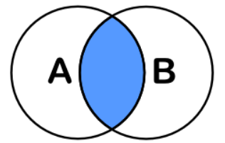
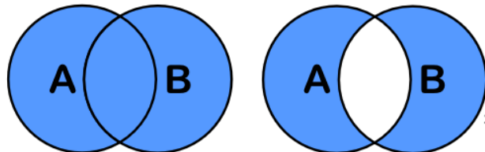
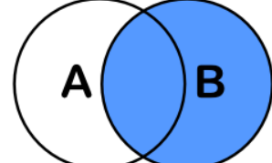
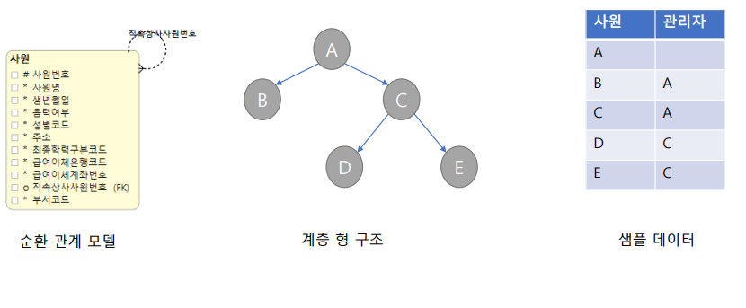
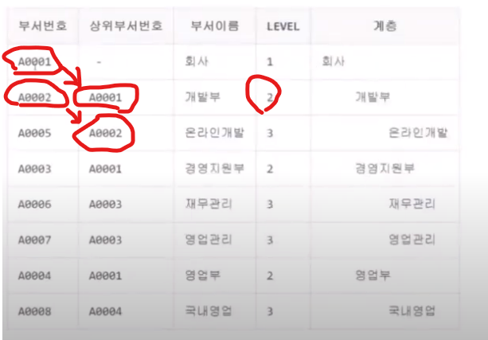
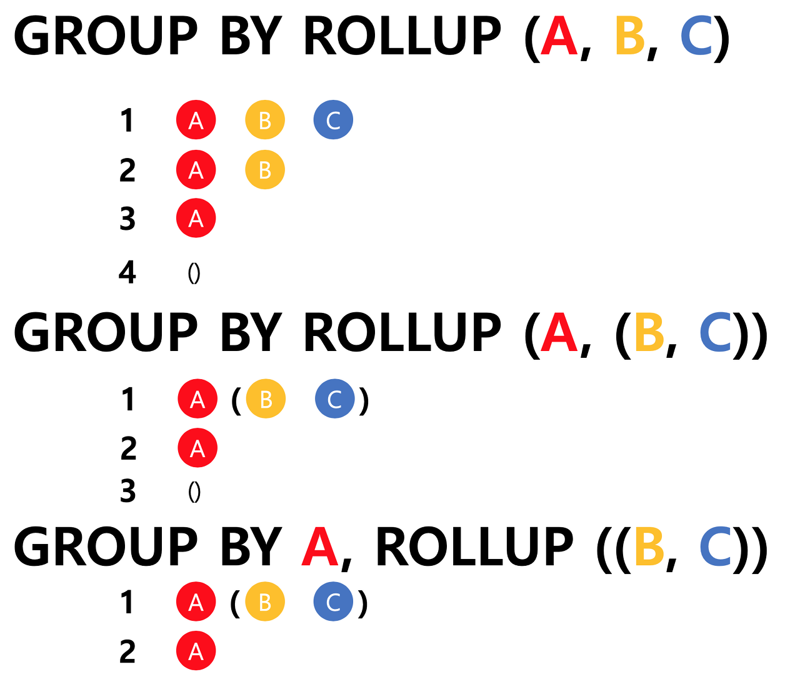
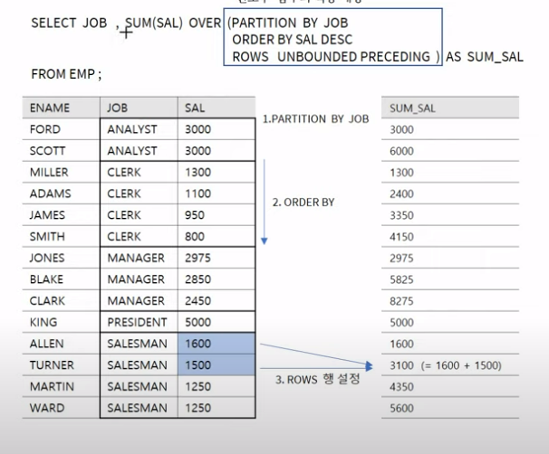
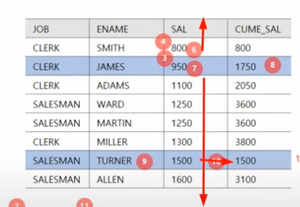

> **TL;DR** — SQL에서 자주 헷갈리는 여섯 영역(집합 연산자, JOIN, 계층 쿼리, 그룹 함수, 윈도우 함수, 서브쿼리)을 한 번에 정리했다. 핵심은 각 문법이 **"어떤 단위로 행을 묶고 어떤 순서로 계산하는가"**를 구분하는 것이다.

난이도 : ★★★☆☆

1️⃣ `JOIN 종류` 2️⃣ `계층형 쿼리(CONNECT BY)` 3️⃣ `윈도우 함수`

## ✅ 왜 알아야 하나

SQL 개발자(SQLD) 자격증을 준비하면서 JOIN·그룹 함수·윈도우 함수·서브쿼리를 한 번에 정리할 필요를 느꼈다. 실무에서도 리포트성 쿼리를 짤 때 이 여섯 가지를 얼마나 정확히 구분하느냐에 따라 쿼리 성능과 가독성이 크게 갈린다.

## ✅ 집합 연산자

### UNION / UNION ALL

여러 SELECT 결과의 합집합을 구한다. `UNION`은 중복 행을 하나로 합쳐서 정렬된 결과를 내고, `UNION ALL`은 중복을 그대로 두는 대신 성능이 더 좋다.

```sql
SELECT 조회할컬럼
FROM A
UNION (ALL)
SELECT 조회할컬럼
FROM B
```

### INTERSECT

교집합이며 중복 행은 하나로 표시된다. 실무에서 자주 쓰이지는 않는다.

```sql
SELECT 조회할컬럼
FROM A
INTERSECT
SELECT 조회할컬럼
FROM B
```

### EXCEPT (MINUS)

A에서 B를 뺀 나머지 행을 반환하고 중복 행은 제거한다.

```sql
SELECT 조회할컬럼
FROM A
MINUS
SELECT 조회할컬럼
FROM B
```

### DIFFERENCE / PRODUCT 연산

- DIFFERENCE — 차집합. 공통되는 부분을 제외함. 대다수 DB는 `EXCEPT`, Oracle은 `MINUS`를 씀
- PRODUCT — 곱집합. JOIN 조건이 없을 때 생길 수 있는 모든 데이터 조합(M × N건). `CROSS JOIN`으로 구현됨

## ✅ 조건절

### USING

`FROM` 절에서 같은 이름을 가진 칼럼 중 원하는 칼럼만 골라 교집합 조인할 수 있다. ALIAS는 쓸 수 없다.

```sql
SELECT
  a.emp_no, a.emp_nm, a.addr, dept_cd, b.dept_nm
FROM sqld.tb_emp a
JOIN sqld.tb_dept b USING (dept_cd)
WHERE a.addr LIKE '%수원%'
ORDER BY a.emp_no;
```

### ON

JOIN 조건을 명시적으로 적을 수 있고, 칼럼명이 달라도 조인할 수 있다는 장점이 있다. ALIAS는 반드시 사용해야 한다.

```sql
SELECT
  a.emp_no, a.emp_nm, a.addr, b.dept_cd, b.dept_nm
FROM sqld.tb_emp a
JOIN sqld.tb_dept b
ON a.dept_cd = b.dept_cd
AND a.addr LIKE '%수원%'
ORDER BY a.emp_no;
```

## ✅ JOIN 종류

부모 테이블이 기준이 돼서 조인이 일어난다. 부모에 데이터가 있고 자식에 없을 때 `INNER JOIN`은 그 행을 보여주지 않고, `OUTER JOIN`은 보여준다.

### Inner Join, Natural Join

```sql
SELECT 조회할 컬럼
FROM A, B
[WHERE 조건문]

SELECT *
FROM A
NATURAL JOIN B
```

- Inner — 조인 조건에서 동일한 값이 있는 행만 반환
- Natural — 두 테이블에서 이름이 같은 모든 칼럼을 기준으로 자동 조인. ALIAS를 주면 안 됨



### Full Outer Join

```sql
SELECT 조회할 컬럼
FROM A
FULL OUTER JOIN B
ON 조건문
[WHERE 추가조건문]
```

공통되지 않는 행도 유지한다. MySQL에는 `FULL OUTER JOIN`이 없어서 `LEFT`와 `RIGHT`를 `UNION`으로 묶어 구현해야 한다.



### Left / Right Outer Join

```sql
-- LEFT
SELECT 조회할 컬럼
FROM A, B
[WHERE 추가조건문]
AND A칼럼 = B칼럼(+)

SELECT 조회할 컬럼
FROM A
LEFT OUTER JOIN B
ON 조건문
[WHERE 추가조건문]

-- RIGHT
SELECT 조회할 컬럼
FROM A
RIGHT OUTER JOIN B
ON 조건문
[WHERE 추가조건문]

SELECT 조회할 컬럼
FROM A, B
[WHERE 추가조건문]
AND A칼럼(+) = B칼럼
```

마찬가지로 공통되지 않는 행도 유지한다.



## ✅ 계층 구조(LEVEL) 쿼리

> 순환 관계 모델: 하나의 엔터티 내부에 계층 형식으로 존재하는 데이터를 조회하는 쿼리. Oracle만 지원한다.

계층형 데이터에서 상위·하위 관계를 조회할 때 쓴다.

- LEVEL — 각 계층
- NODE — 각 데이터
- ROOT — 가장 첫 번째 노드
- Leaf — 가장 아래 노드



### 구문

```sql
SELECT 컬럼리스트
FROM 테이블
WHERE (조건)
START WITH (시작위치조건)
CONNECT BY <NOCYCLE> PRIOR 하위코드 = 상위코드
ORDER SIBLINGS BY (정렬기준)
```

- `START WITH` — 어떤 행을 최상위(LEVEL 1, 루트)로 정할지 결정. 서브쿼리 사용 가능
- `CONNECT BY PRIOR A AND B` — 다음에 전개될 자식 데이터 지정. 서브쿼리는 사용 불가. 부모 칼럼은 상위, 자식 칼럼은 하위 LEVEL임

```sql
CONNECT BY PRIOR 자식칼럼 = 부모칼럼 -- 부모에서 자식(순방향)
CONNECT BY 자식칼럼 = PRIOR 부모칼럼 -- 자식에서 부모(역방향)
CONNECT BY PRIOR 부모칼럼 = 자식칼럼 -- 자식에서 부모(역방향)
CONNECT BY 부모칼럼 = PRIOR 자식칼럼 -- 부모에서 자식(순방향)
```

- `ORDER SIBLINGS BY 컬럼` — 형제 노드(동일 LEVEL) 사이에서 정렬
- `NOCYCLE` — 무한 사이클이 될 수 있는 계층 구조를 한 번만 돌게 함

### 키워드(SELECT 뒤에 사용)

- `CONNECT_BY_ROOT` — 계층구조에서 가장 최상위 값을 표시
- `CONNECT_BY_ISLEAF` — 최하위 여부. 리프 데이터면 1, 아니면 0
- `SYS_CONNECT_BY_PATH` — 계층 구조의 전체 전개 경로를 표시
- `CONNECT_BY_ISCYCLE` — 가상 칼럼. 순환 노드면 1, 아니면 0
- `LEVEL` — 가상 칼럼. 루트면 1, 그 아래는 2
- `LPAD(' ', 4*(LEVEL-1))` — 왼쪽 기준으로 지정된 문자(주로 공백)를 채워 계층을 시각화
- `NTILE` — 행 데이터를 그룹별로 나눠 순서대로 행 번호를 부여하는 분석 함수

### 예시

상위부서번호가 NULL인 행(회사)이 `START WITH` 조건으로 LEVEL 1이 되고, A0001(LEVEL 1)과 같은 상위부서번호를 가진 개발부·경영지원부·영업부가 다음 LEVEL이 된다.

```sql
SELECT
  부서번호, 상위부서번호, 부서이름, level,
  LPAD(' ', 5*(LEVEL-1)) || 부서이름 AS 계층
FROM dept
START WITH 상위부서번호 IS NULL
CONNECT BY PRIOR 부서번호 = 상위부서번호;
```



## ✅ 그룹 함수

> `GROUP BY`는 그룹 합계를 구하고, 아래 함수를 붙이면 소그룹 집계까지 구할 수 있다. `SELECT GROUPING(A)`로 A에 대해 그룹핑이 일어났는지(1) 아닌지(0) 체크할 수 있다.

### ROLLUP

지정한 칼럼에 대한 소그룹 집계를 계산해준다. 원하는 소그룹만 골라서 보는 건 불가능하다.

```sql
-- 전체 합계, 칼럼 A 조회
GROUP BY ROLLUP(A)
-- 전체 합계, 칼럼 A 조회, 칼럼 A·B 조합 조회
GROUP BY ROLLUP(A,B)
-- 전체 합계, A, A·B, A·B·C 조합까지 조회
GROUP BY ROLLUP(A,B,C)
-- A 별로 그룹핑 -> 전체 합계, 칼럼 B 조합 조회
GROUP BY A ROLLUP(B)
```

### CUBE

가능한 모든 조합의 소계를 생성한다. 조합 수가 많아서 시스템에 부하가 갈 수 있다.

```sql
-- 전체 합계, 칼럼 A 조회
GROUP BY CUBE(A)
-- 전체 합계, A, B, A·B 조합 조회
GROUP BY CUBE(A,B)
```

### GROUPING SETS

원하는 칼럼의 소그룹 집계만 골라서 보여준다.

```sql
-- 칼럼 A 조회
GROUP BY GROUPING SETS(A)
-- 칼럼 A, 칼럼 B 조회
GROUP BY GROUPING SETS(A,B)
```



## ✅ 윈도우 함수

특정 칼럼을 기준으로 행 집합을 연산하는 함수다. 다른 함수처럼 중첩해서 쓸 수는 없지만 서브쿼리 안에서는 사용 가능하며, 테이블 스캔 횟수를 줄여준다.

```sql
SELECT WINDOW 함수()
OVER([PARTITION BY 컬럼] [ORDER BY 컬럼] [ROWS OR RANGE])
FROM 테이블명;
```

- `PARTITION BY` — 행을 분할하는 기준
- `ORDER BY` — 분할된 행의 정렬 기준
- `ROWS OR RANGE` — 연산 대상 행의 범위. `ROWS`는 행 단위, `RANGE`는 값 단위



### 대상 행 지정

- `UNBOUNDED PRECEDING` — 맨 위 행부터 지금까지 연산
- `PRECEDING` — 이전 행부터 지금까지 연산
- `CURRENT ROW` — 현재 행
- `FOLLOWING` — 바로 다음 행까지 연산
- `UNBOUNDED FOLLOWING` — 맨 아래까지 연산

```sql
-- 현재 칼럼 값보다 작은 값들을 모두 선택
RANGE UNBOUNDED PRECEDING
-- 현재 칼럼 값 기준 150 이하로 차이나는 행
RANGE 150 PRECEDING
```

### 순위 함수

- `RANK` — 동순위가 있으면 다음 순번을 건너뜀
- `DENSE_RANK` — 동순위가 있어도 다음 순번을 바로 매김
- `ROW_NUMBER` — 동순위 개념 없이 먼저 나온 행 순서로 순위 부여
- `PERCENT_RANK` — 가장 먼저 나온 행을 0, 가장 나중을 1로 두고 백분율 산출. 동일 값이면 같은 백분율로 묶임
- `CUME_DIST` — 각 행 개수에 맞게 누적 백분율 산출. 동일 값이면 합산된 백분율로 나옴
- `NTILE(N)` — 전체를 N등분해서 각 타일 번호를 부여
- `RATIO_TO_REPORT` — 현재 행의 값 ÷ 전체 값
- `RANK`(파티션별) — 특정 항목·파티션에 대해 순위를 계산. 동일 순위는 동일 값 부여
- `FIRST_VALUE` — 처음 나온 행 값(`MIN`과 동일 효과)
- `LAST_VALUE` — 마지막 행 값(`MAX`와 동일 효과)
- `LAG` — 이전 값 반환
- `LEAD` — 다음 값 반환

### 예시

`SAL`을 오름차순 정렬한 뒤, 현재 행과 이전 행의 `SAL` 차이가 150 이하인 행들을 모두 더한 누적합을 구한다.

```sql
SELECT JOB, ENAME, SAL, SUM(SAL) OVER(ORDER BY SAL RANGE 150 PRECEDING) AS CUME_SAL
FROM EMP
WHERE JOB='CLEAR' OR JOB='SALESMAN';
```



## ✅ 서브쿼리

하나의 SQL문 안에 또 다른 SQL문이 들어있는 형태다. 메인 쿼리는 서브쿼리의 칼럼을 직접 사용할 수 없고, `ORDER BY` 절에는 서브쿼리를 쓸 수 없다.

### 사용 가능한 위치

`SELECT` 절, `FROM` 절, `WHERE` 절, `HAVING` 절, `INSERT`문의 `VALUES` 절, `UPDATE`문의 `SET` 절

### 다중행 서브쿼리 연산자

- `ANY` — 메인 쿼리 조건이 서브쿼리 결과 중 하나 이상과 같으면 참
- `IN` — 메인 쿼리 조건이 서브쿼리 결과 중 하나와만 같아도 참
- `ALL` — 메인 쿼리 조건이 서브쿼리 결과 전체와 같아야 참

```sql
-- DEPTNO가 20, 30보다 작은 값(즉 30보다 작은 것)
SELECT * FROM EMP
WHERE DEPTNO <= ALL (20, 30)
```

- `EXISTS` — 메인 쿼리와 서브쿼리 결과가 하나라도 존재하면 참

### 서브쿼리 종류

**상호 연관 쿼리(Correlated Subquery)** — 메인 쿼리 값을 서브쿼리에서 쓰고, 그 결과를 다시 메인 쿼리 계산에 사용

```sql
SELECT * FROM A WHERE 조건 = (SELECT ~)
```

**스칼라 서브쿼리(단일 값)**

```sql
SELECT (SELECT ~) FROM A
```

**인라인 서브쿼리(동적 뷰)**

```sql
SELECT * FROM (SELECT ~)
```


## ✅ Summary

- JOIN은 "부모 기준으로 무엇을 보여줄지"로 구분됨 — Inner는 교집합만, Outer 계열은 짝 없는 행도 유지함
- 계층 쿼리는 `START WITH`(루트 지정)와 `CONNECT BY`(부모-자식 연결 방향)의 조합으로 동작함
- 그룹 함수(ROLLUP/CUBE/GROUPING SETS)와 윈도우 함수는 모두 "행을 어떻게 묶어서 계산하느냐"의 문제라 구문 형태를 비교하면서 외우는 게 효율적임

## 참고한 링크

- [SQLD 강의 — YouTube](https://www.youtube.com/watch?v=JxyMJNX24LY)
