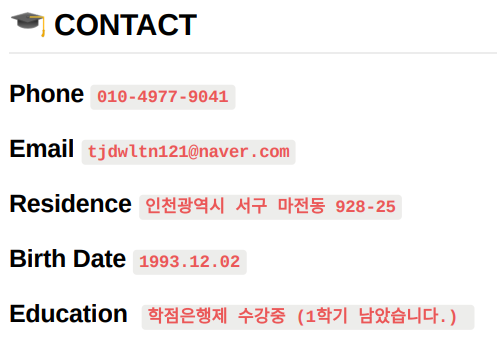
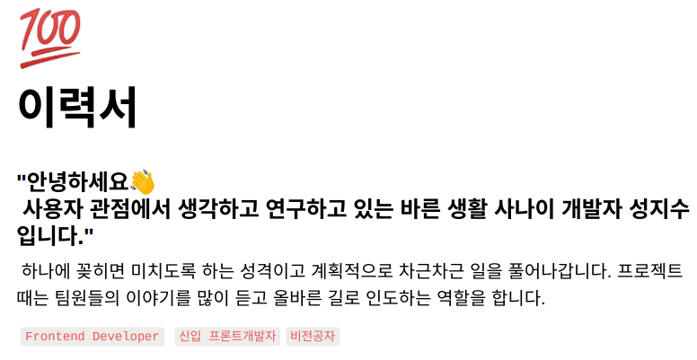
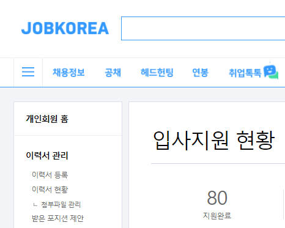
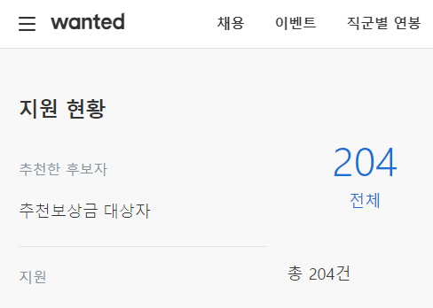
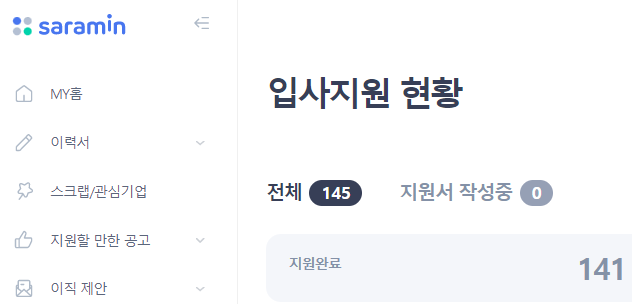

> **TL;DR** — 이력서·자소서·포트폴리오를 만들어 300군데에 지원했고, 그중 30곳에서 면접을 봤다. 가장 크게 배운 것은 "제3자에게 물어봐라 — 내가 보는 눈이 무조건 답은 아니다"라는 것이다.

## ✅ 상황 (Situation)

고졸에 비전공자, 나이는 서른. 지원할 수 있는 회사 자체가 적은 조건에서 취업을 준비해야 했다. 이력서와 자소서를 만드는 것부터 지원하는 것까지 전 과정을 혼자 서칭하며 진행했고, 그중 자소서 쓰는 게 가장 어려웠다. 주제가 너무 다양하고 포괄적이라 어떤 방향으로 써야 할지 고민이 컸다.

## ✅ 목표와 내 역할 (Task)

목표는 명확했다 — 나를 제대로 표현하는 이력서·자소서·포트폴리오를 만들고, 조건을 가리지 않고 최대한 많이 지원해서 면접 기회를 늘리는 것. 이력서·자소서·포트폴리오 작성부터 지원 전략까지 전부 직접 맡았다.

## ✅ 한 것 (Action)

### 이력서 작성 원칙

1. **나이·학력·거주지·연락처·이메일은 필수로 기재** — 처음엔 나이와 학력이 장점이 아니라고 생각해 빼봤는데, 면접마다 "왜 안 적었냐"는 질문을 받고 제대로 답을 못 했다. 이력서에 적으나 면접에서 말하나 어차피 알려지는 정보라 이후로는 그대로 적었다.

   

2. **초반에 나를 한 문장으로 요약** — "프론트 개발자", "열심히 하는 개발자" 같은 누구나 쓸 법한 문장 대신, 한눈에 이해되는 구체적인 문장으로 시작하도록 고쳤다.

   

3. **형식은 자유롭게, 노션 활용** — 딱딱한 증명사진형 이력서보다 노션 같은 도구로 개성 있게 만드는 쪽을 택했다. 다만 개발과 무관한 내용은 면접에서 오히려 걸림돌이 될 수 있어 배제했다.
4. **이력은 간단하게** — 프로젝트 경력을 이력서에 길게 늘어놓지 않고, 대신 포트폴리오로 링크만 연결했다.
5. **구인 사이트 자체 이력서도 병행 작성** — 잡코리아·사람인·프로그래머스에는 정해진 형식의 이력서 작성란이 있는데, 면접관이 실제로 그 형식으로 출력해서 보는 경우가 많아 직접 만든 이력서와 함께 챙겼다.
6. **맞춤법 검사는 필수** — 오타 하나가 예민한 사람에게는 중요한 정보를 놓치게 만드는 리스크가 될 수 있어 항상 맞춤법 검사기를 돌리고 제출했다.

### 자기소개서 작성 원칙

- 단점을 부각하는 문장은 배제하고 장점을 어필하는 문장 위주로 작성
- 속담·사자성어보다 누구나 이해할 수 있는 쉬운 문장으로 문맥에 맞게 작성
- 추천 주제로는 "나의 성장 배경(핵심 시기만)", "왜 개발자를 택했는지", "나의 성격(장점은 부풀리고 단점은 보완 가능한 형태로)", "회사에서 하고 싶은 역할", "문제 해결 방식" 등을 활용

### 지원 전략

- 조건(인원수·연봉·거리)으로 필터링하지 않고 가리지 않고 지원 — 처음엔 조건을 걸고 지원했다가 면접 일정이 거의 안 잡혀서, 이후로는 조건 없이 최대한 넓게 지원했다
- 원티드처럼 한 곳을 지원하면 유사 회사를 한꺼번에 지원할 수 있는 기능을 적극 활용
- 대기업(네이버·카카오·토스 등)도 결과와 무관하게 지원 — 자소서·이력서 프로세스를 경험하는 것 자체가 도움이 됐다
- 잡코리아·사람인·원티드·잡플래닛·프로그래머스를 상황에 맞게 병행 사용

## ✅ 결과 (Result)

원티드에서만 250군데, 전체로는 약 300군데에 지원했고 그중 30군데에서 면접을 봤다. 이력서 합격률 자체는 체감상 10% 정도였다. 면접관들이 가장 좋아하고 칭찬을 많이 한 부분은 개인 포트폴리오 사이트를 직접 만든 것이었고, 프로젝트 개수와 포트폴리오를 함께 갖춘 것이 강점으로 작용해 여러 곳에서 합격 제의를 받았다.

## ✅ 배운 점 / 아쉬운 점

**잘한 것**
- 조건을 걸지 않고 넓게 지원한 덕분에 면접 기회 자체를 늘릴 수 있었음
- 포트폴리오 사이트를 직접 만들어 차별화 포인트를 확보함

**아쉬운 점**
- 신입 기준 프로젝트 4개 + 기업 협업 경험은 나쁘지 않은 이력이지만, 오픈소스나 해커톤 참여 경험이 없었던 점은 다음 기회에 채우고 싶음
- 이력서를 노션으로 작성한 이유는 부트캠프(Wecode) 때부터 익숙했고 형식을 자유롭게 바꿀 수 있어서였는데, 회사에 따라 노션 링크 접근성이 떨어지는 경우도 있어 PDF 병행이 아쉬웠음

**다음에 다르게 할 것**
- 단점을 보완하는 데 집중하기보다, 이미 강점인 부분(포트폴리오 등)을 더 뾰족하게 만드는 방향으로 갈 것

## 참고한 링크

- [커리어리 프로필](https://careerly.co.kr/profiles/472645?from=newsfeed&location=gnb)
