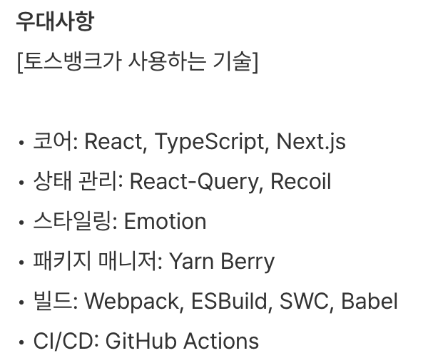

> **TL;DR** TypeScript의 트랜스파일 원리부터 타입 시스템, type vs interface 차이, 클래스 접근 제어자, 싱글톤 패턴까지 한 번에 정리한다.

난이도 : ★★☆☆☆

1️⃣ **트랜스파일 vs 컴파일** — TS→JS 변환 과정과 d.ts의 역할
2️⃣ **any / unknown / never / void** — 네 가지 특수 타입의 용도와 차이
3️⃣ **type vs interface** — 언제 무엇을 쓸지, 타입 가드와 서브/슈퍼타입
4️⃣ **Class 접근 제어자** — static의 함정, 싱글톤 구현
5️⃣ **몰랐던 것** — 객체 const 고정법, `!:` 연산자

---

## ✅ 왜 알아야 하나



채용 공고를 보면 TS가 '우대'가 아니라 '필수'인 포지션이 대다수다. 그 이유는 단순하다 — 런타임에서 터지는 타입 에러를 트랜스파일 단계에서 미리 잡아주기 때문이다. 특히 팀 규모가 커질수록 타입 정보가 명시된 코드는 협업 비용을 크게 줄여 준다.

---

## ✅ 기본 개념

### 트랜스파일 vs 컴파일

두 용어는 종종 혼용되지만 의미가 다르다.

- **트랜스파일**: 비슷한 추상화 수준의 언어로 변환하는 것 — `TS → JS`가 대표적임
- **컴파일**: 추상화 수준이 낮아지는 변환 — `Java(.java) → 바이트코드(.class)`, `C → 기계어`

### TS를 쓰는 이유

- 타입 에러를 런타임이 아닌 **트랜스파일 단계**에서 잡음
- JS는 문자열과 숫자를 자동 변환하기 때문에 에러를 추적하기 어려움
- 최신 JS 문법(ES Next)도 구형 환경에 맞게 다운컴파일 가능
- TS는 **정적 타이핑**, JS는 **동적 타이핑**

### 구조적 타입 vs 명목적 타입

Java는 **명목적 타입** — 클래스 이름(네임스페이스)이 같아야 호환된다.
TypeScript/JavaScript는 **구조적 타입** — 내부 구조(프로퍼티·타입)가 같으면 호환된다.

```typescript
// Java — 이름이 달라서 에러
class A { String name; }
class B { String name; }
A a = new B(); // ERROR

// TypeScript — 구조가 같아서 OK
class A { name: string; }
class B { name: string; }
let a: A = new B(); // 정상
```

### tsconfig 주요 속성

```json
{
  "compilerOptions": {
    "watch": true,              // 파일 변경 시 자동 재컴파일
    "target": "es2016",         // 컴파일 대상 JS 버전
    "outDir": "./dist",         // 트랜스파일 결과 저장 경로
    "lib": ["es2016", "dom"]    // 타입 정보로 인식할 라이브러리 버전
  }
}
```

```json
{
  "compilerOptions": {
    "noEmitOnError": true,            // 에러가 있으면 JS 파일 미생성
    "noImplicitAny": true,            // 암묵적 any 금지
    "strictNullChecks": true,         // null·undefined 조작 오류 감지
    "strictFunctionTypes": true,      // 함수 매개변수 타입 엄격 검사
    "strictPropertyInitialization": true, // 생성자에서 초기화 안 된 속성 에러
    "noImplicitReturns": true         // 모든 코드 경로에서 반환 여부 확인
  }
}
```

### TS 배포 흐름

1. TS → JS 트랜스파일
2. webpack / rollup으로 `main.js` 번들링
3. `<script src="main.js">`로 JS 엔진이 실행

### d.ts 파일

타입만 선언하는 모듈이다. 라이브러리는 원래 JS 환경에서 동작하도록 만들어지지만, TS 프로젝트에서도 쓸 수 있도록 타입 정보를 `.d.ts`로 제공한다.

- `tsconfig`에서 `"declaration": true` 설정 시 JS 트랜스파일과 함께 `.d.ts`도 자동 생성됨
- `declare` 키워드를 붙이면 JS 파일로 트랜스파일되지 않고 **컴파일러에 타입 정보만 제공**함

```typescript
// node_modules/@types/react/index.d.ts 예시
declare namespace React {
  type ElementType<P = any> = ...
}
```

---

## ✅ 타입 종류

### any

모든 타입을 허용하고, 반대로 모든 타입에 할당 가능하다. 타입 시스템을 우회하기 때문에 **사이드 이펙트가 크고 사용 비권장**이다.

```typescript
let a: any = 123;
let str: string = a; // 에러 없음 — but 위험
a = '123';           // 어디든 할당 가능
```

### unknown

아직 타입이 확정되지 않은 상태다. **어떤 값이든 할당은 가능하지만**, 다른 타입 변수에 대입하거나 연산할 때는 반드시 타입을 좁혀야 한다. `any`보다 안전하므로 **사용 권장**이다.

```typescript
let a: unknown = 123;
let str: string = a;     // ERROR
let b: number = a - 1;   // ERROR
let c: number = a as number; // 타입 단언으로 해결

function fn(a: unknown) {
  if (typeof a === 'number') {
    a + 1; // 이 블록 안에서만 number로 좁혀짐
  }
}
```

### never

- 예외를 던지는 함수의 반환 타입
- 무한 루프 함수의 반환 타입
- 특정 타입을 사용 불가로 막을 때 (조건부 타입)
- 타입 추론이 불가능한 경우

모든 타입의 하위 타입이라 어디에도 할당 가능하지만, 어떤 값도 `never`에 할당할 수 없다.

```typescript
// 에러를 던지는 함수
function throwError(msg: string): never {
  throw new Error(msg);
}

// 무한 루프
function infiniteLoop(): never {
  while (true) {}
}

// 특정 타입 제외
type NonString<T> = T extends string ? never : T;
const c: NonString<string> = '1'; // ERROR
```

### void

반환 값이 없어야 할 때 사용한다. JS 함수는 기본적으로 `undefined`를 반환하므로 `return;`과 `return undefined;` 모두 허용된다.

```typescript
function log(a: string): void {
  console.log(a);
}

function f1(): void { return; }          // 성공
function f2(): void { return undefined; } // 성공
```

---

## ✅ type vs interface

### 핵심 차이

| 항목 | type | interface |
|------|------|-----------|
| 트랜스파일 포함 여부 | 포함 안 됨 | 포함됨 |
| 사용 가능 대상 | 모든 타입 (원시값·유니온·튜플 등) | 객체 타입만 |
| 확장 | 교차(`&`)로 확장 | `extends`로 확장 |
| 유니온 | 가능 | 불가 |
| 선언 병합 | 불가 | 가능 (같은 이름 재선언 시 합쳐짐) |

한 곳에서만 쓸 타입이라면 `type`이 더 가볍다. 재활용이 많고 확장이 필요하다면 `interface`가 적합하다.

### 주요 예시

```typescript
// 함수 타입
type FType = (a: string) => void;
interface FInter { (a: string): void; }

// 배열 타입
type AType = string[];
interface AInter { [index: number]: string; }

// 교차 확장
interface ErrorHandle {
  success: boolean;
  error?: { message: string };
}
interface ErrorData {
  data?: object;
}
type TResponseType = ErrorHandle & ErrorData;
interface TResponseInter extends ErrorHandle, ErrorData {}

// 유니온 (interface 불가)
interface Bird { fly(): void; }
interface Dog  { talk(): void; }
type AnimalType = Bird | Dog; // type만 가능

// 선언 병합 (type 불가)
interface AInter { a: string; }
interface AInter { b: string; }
// 결과: { a: string; b: string }
```

### 구조적 타입의 함정 — 브랜드 타입

이름이 달라도 구조가 같으면 같은 타입으로 인식되는 문제가 있다.

```typescript
// 문제: PersonId와 string이 구분되지 않음
type PersonId = string;

// 해결: 브랜드 타입으로 고유성 부여
type PersonId1 = string & { readonly _brand: unique symbol };
const person1: PersonId1 = 'js'; // ERROR — 명시적 변환 필요
```

### 타입 가드 — typeof / instanceof

특정 타입이 올 때 분기 처리가 가능하다. 처리 불가능한 케이스는 `never`로 지정해 안전하게 막을 수 있다.

```typescript
class Student { name: string = ''; }
class School  { location: string = ''; }

function testFunc(arg: Student | School) {
  if (arg instanceof Student) {
    console.log('학생');
  } else {
    console.log('학교');
  }
}

const student = new Student();
testFunc(student); // "학생"
```

### 서브타입 / 슈퍼타입

- **객체**: 같거나 서브타입(더 구체적인 타입)이어야 할당 가능
- **함수 매개변수**: 같거나 슈퍼타입(더 넓은 타입)이어야 할당 가능

```typescript
// 객체 — 서브타입 할당
let A: Array<{ a: string; b: string }> = [{ a: '1', b: '1' }];
let B: Array<{ a: string | number; b: string }> = A; // 가능

// 함수 — 매개변수 공변/반변
class Person {}
class Develop extends Person {}
class StudentDevelop extends Develop {}

function fuc(f: (d: Develop) => Develop) {}

fuc((d: Develop): Develop => new Develop());          // OK
fuc((d: Person): Develop => new Develop());           // OK — 슈퍼타입 매개변수
fuc((d: StudentDevelop): Develop => new Develop());   // ERROR — 서브타입 매개변수
```

---

## ✅ Class에서 주의할 점

### 생성자 안에서만 초기화

`init()` 같은 메서드에서도 속성을 바꿀 수 있지만, 초기 타입 할당은 **생성자 안에서** 이루어져야 한다.

```typescript
class A {
  a: number;
  constructor(a: number) {
    this.a = a;
    this.init(a); // 생성자 안에서 호출
  }
  init(a: number) {
    this.a = a;
  }
}
```

### 접근 제어자 — 잘못된 부분을 찾아라

아래 코드에서 주석 `ERROR`가 붙은 곳이 잘못된 부분이다.

```typescript
class e {
  public publicN: number;
  private privateN: number;
  static staticN: number;

  constructor(publicN: number, privateN: number, staticN: number) {
    this.publicN = publicN;
    this.privateN = privateN;
    this.staticN = staticN; // ERROR — static은 this로 접근 불가
  }

  public one() {
    this.publicN = 1;
    this.privateN = 1;
    this.staticN = 1; // ERROR
  }

  private two() {
    this.publicN = 2;
    this.privateN = 2;
    this.staticN = 2; // ERROR
  }

  static three() {
    this.publicN = 3;   // ERROR — static 메서드에서 인스턴스 멤버 접근 불가
    this.privateN = 3;  // ERROR
    this.staticN = 3;   // OK
  }
}

const obj = new e(0, 0, 0);
obj.one();
obj.two();   // ERROR — private 메서드 외부 호출 불가
obj.three(); // ERROR — static 메서드는 클래스명으로 호출
```

핵심 정리:
- `static`은 클래스 범위에 있어서 인스턴스 멤버보다 먼저 생성됨 — `three()`에서 `publicN`, `privateN`에 접근 불가
- `private`는 클래스 내부에서만 사용 가능 — 외부 접근이 필요하면 getter/setter를 사용

### 싱글톤

여러 인스턴스를 생성하지 않고 **하나의 인스턴스를 공유**하는 패턴이다.

```typescript
class Singleton {
  private static instance: Singleton | null = null;
  private url: string;

  private constructor() {
    this.url = '';
  }

  public static getInstance(): Singleton {
    if (!Singleton.instance) {
      Singleton.instance = new Singleton();
    }
    return Singleton.instance;
  }

  public setUrl(url: string): void {
    this.url = url;
  }

  public getUrl(): void {
    console.log(this.url);
  }
}

const instance1 = Singleton.getInstance();
const instance2 = Singleton.getInstance();

console.log(instance1 === instance2); // true — 같은 인스턴스

instance1.setUrl('asd');
instance2.setUrl('ddd'); // instance1과 같은 객체이므로 덮어씀

instance1.getUrl(); // "ddd"
instance2.getUrl(); // "ddd"
```

---

## ✅ 몰랐던 것

### 객체를 완전히 const로 고정하는 방법

`const`로 선언해도 객체의 **프로퍼티 값**은 변경 가능하다. 진짜 읽기 전용으로 만들려면 `as const` 또는 `readonly`를 써야 한다.

```typescript
// 일반 const — 객체 자체 재할당만 막힘
const obj = { a: 1, b: 2 };
obj = { a: 1, b: 2 }; // ERROR
obj.a = 10;            // 가능

// as const — 모든 프로퍼티가 읽기 전용
const objConst = { a: 1, b: 2 } as const;
objConst.a = 1; // ERROR

// interface의 readonly — 프로퍼티별 지정
interface ReadOnly {
  readonly a: number;
  readonly b: number;
}
const objReadonly: ReadOnly = { a: 1, b: 2 };
objReadonly.a = 5; // ERROR
```

### `!:` — Non-null 단언 할당

`!:`는 "이 변수에는 반드시 값이 온다, 걱정하지 마라"는 의미다.
반면 `?:`는 "이 변수에 값이 안 올 수도 있다"는 의미다.

```typescript
let x!: number; // undefined가 아님을 단언
console.log(x + x); // 컴파일 통과 — 실제 런타임은 주의 필요
```

---

## ✅ 정리

- TS → JS 변환은 컴파일이 아닌 트랜스파일이며, 타입 오류는 이 단계에서 잡힘
- `any`는 타입 시스템을 무력화하므로 지양, `unknown`으로 대체하고 타입 가드로 좁힐 것
- `never`는 예외·무한루프·타입 제외 등 "이 코드는 절대 도달하지 않는다"는 표현에 씀
- `type`은 가볍고 유니온에 강점, `interface`는 확장·선언 병합이 필요할 때 적합
- `static`은 인스턴스 멤버와 분리된 클래스 스코프이므로 혼용 시 에러에 주의

다음 편에서는 Enum, 제네릭, 내장 유틸리티 타입을 정리한다.

---

## 참고한 링크


- <https://zibu-story.tistory.com/209>
- <https://www.youtube.com/live/ViS8DLd6o-E?si=ETqGXVRUC07q_XxA>
