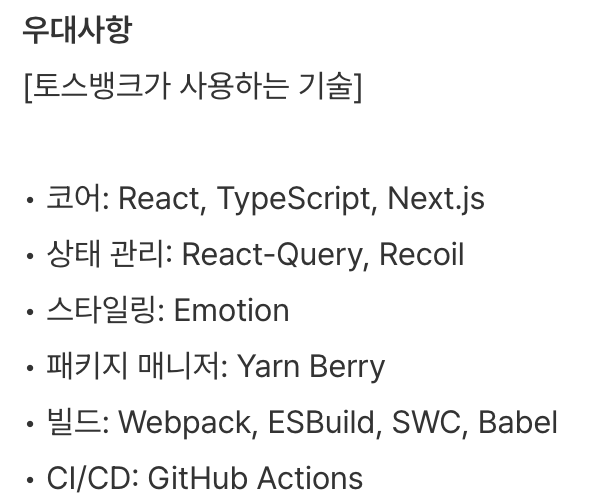

> **TL;DR** — Enum은 객체 + `as const`로 대체하고, `extends`·`keyof`·`infer`로 타입을 조건부로 좁히며, 내장 유틸리티 타입으로 반복 없는 타입 변환이 가능하다.

난이도 : ★★☆☆☆

1️⃣ **Enum vs 객체** 2️⃣ **extends · keyof · infer** 3️⃣ **제네릭 활용 패턴** 4️⃣ **내장 유틸리티 타입 총정리**

---

## ✅ 왜 알아야 하나



취업 시장에서 TypeScript는 이제 선택이 아니라 기본 스펙이다. 채용 공고 대부분이 TS 경험을 요구하고, 코드 리뷰에서도 `any` 남발이나 타입 단언 오남용은 즉시 지적받는다.

이번 글은 시리즈 마지막 편으로, 앞서 다룬 기초·심화 내용 위에서 **Enum의 실체**, **타입 연산 키워드 3종**, **제네릭 응용**, **유틸리티 타입 전체**를 한 번에 정리한다.

---

## ✅ 헷갈리는 키워드 정리

실무 코드에서 자주 보이지만 막상 설명하기 어려운 키워드 6개를 먼저 짚고 넘어간다.

| 키워드 | 의미 |
|--------|------|
| `as` | 타입을 강제하는 것 |
| `infer` | 타입을 추론하는 것 |
| `!:` | `null` 또는 `undefined`가 아니라고 단언하는 것 |
| `in` | 객체의 속성(프로퍼티)이 존재하는지 확인할 때 사용 |
| `is` | 해당 타입이 맞는지 런타임 전에 체크. 예: `value is number` |
| `instanceof` | 객체가 특정 클래스 또는 생성자 함수의 인스턴스인지 확인할 때 사용 |

---

## ✅ Enum

### 특징

- 일정 수의 상수로 구분되는 집합이며, 기본값은 0에서 시작함
- 특정 값의 범위를 제한하고 싶을 때 사용함

### 문자형·숫자형 열거형 사용 시 주의

- 숫자형 표현식 값이 `NaN`이거나 `Infinity`이면 컴파일 시점에 오류 발생
- 숫자형의 기본값은 0이고, 할당을 생략하면 자동으로 1, 2, … 로 세팅됨
- 열거형 자체의 프로퍼티로 모든 멤버에 접근하며, 열거형의 이름으로 타입을 선언함
- 문자형 열거형에서 각 멤버는 문자열 리터럴 또는 다른 문자열 열거형 멤버로 상수 초기화해야 함
- 문자형은 값이 불안정한 경우에 사용함
- 문자형과 숫자형을 혼합해서 쓰는 경우, 런타임 장점을 취하려는 것이 아니라면 사용하지 않는 편이 권장됨

```typescript
enum DirectionString {
  MIDDLE,  // 0으로 할당
  UP = "up",
  DOWN = "down",
  RIGHT = "right",
  CENTER, // error — 숫자형 뒤에 자동 증분이 불가능
  LEFT = "left",
}
```

### 왜 Enum 대신 객체를 선호하는가

- 값을 변경할 수 없고 추가도 불가능함
- key-value를 뒤집어 접근하는 reverse mapping이 가능한데, 이로 인해 트랜스파일 결과물이 커짐

아래 코드를 보면 enum은 즉시실행함수(IIFE)로 변환되어 코드량이 많아진다. 반면 객체는 선언만으로 끝난다.

```typescript
// Enum → 트랜스파일 결과
enum WeekdaysEnum {
  Monday = 1,
  Tuesday = 2,
}
var Weekdays;
(function (Weekdays) {
    Weekdays[Weekdays["Monday"] = 1] = "Monday";
    Weekdays[Weekdays["Tuesday"] = 2] = "Tuesday";
})(Weekdays || (Weekdays = {}));

// 객체 → 훨씬 간결
const WeekdaysConst = {
  Monday: 1,
  Tuesday: 2,
} as const;
```

---

## ✅ extends, keyof, infer

### typeof / keyof

`keyof`는 객체 타입의 키를 유니온으로 추출한다.

```typescript
// 'x' | 'y'
type Point = { x: number; y: number };
type P = keyof Point;

// 'x' | 'y' — 값으로 선언된 경우 typeof와 함께 사용
let point = { x: 1, y: 2 };
type P2 = keyof typeof point;

// number | string — 값 타입 추출
let point2 = { x: 1, y: 's' };
type P3 = typeof point2[keyof typeof point2];
```

### extends

`T extends U`는 T가 U에 포함되는 관계, 즉 T ≤ U로 이해하면 된다.

```typescript
64 extends number       // true
number extends 64       // false
string[] extends any    // true
string[] extends any[]  // true
never extends any       // true
any extends any         // true
```

조건부 타입에서 자주 쓰이며, `T extends U ? X : Y` 형태로 3항 연산자처럼 동작한다.

### infer

`infer`는 조건부 타입 안에서 타입을 자동으로 추론하게 만드는 키워드다.

공장 생산 라인에 비유하면 이해하기 쉽다. 상자를 만드는 라인에서 어떤 물건이 담길지 미리 알 수 없지만, 담긴 물건의 종류를 자동으로 판단하는 장치가 있다면 유용하다. `infer`가 바로 그 역할을 한다.

```typescript
type Box<T> = {
  item: T;
};

type Unbox<T> = T extends Box<infer U> ? U : never;

const stringBox: Box<string> = { item: "Hello, TypeScript!" };
const numberBox: Box<number> = { item: 42 };

type UnboxedString = Unbox<typeof stringBox>; // string
type UnboxedNumber = Unbox<typeof numberBox>; // number

const str: UnboxedString = "Hello, TypeScript!";
const num: UnboxedNumber = 42;
```

---

## ✅ 제네릭 Generic

### 특징

- 원하는 타입에 맞게 로직을 구성할 수 있음
- 객체 인스턴스를 통합하고 싶을 때 유용하게 쓰임

### 함수 파라미터로 사용

```typescript
function getText<T>(text: T): T {
  return text;
}
getText<string>('hi');
getText<number>(10);
getText<boolean>(true);
```

### 3항으로 조건부 타입 처리

```typescript
type StringContainer = string | string[];
type NumberContainer = number | number[];

// 기본 3항
type ItemType<T> = {
  id: T;
  pw: T extends string ? StringContainer : NumberContainer;
};

// never로 else 처리
type ItemTypeNever<T> = {
  id: T extends string | number ? T : never;
  pw: T extends string ? StringContainer
    : T extends number ? NumberContainer : never;
};

const item: ItemType<string> = {
  id: 'asdsasd',
  pw: ['qwe', 'qweqwe'],
};
```

### 배열 filter

```typescript
type ArrayFilter<T> = T extends any[] ? T : never;
type StringArray = ArrayFilter<string | string[]>; // string[]
```

### 객체 인스턴스 통합

구조적 타이핑 덕분에 `Animal`처럼 직접 상속하지 않아도 같은 구조면 배열에 넣을 수 있다.

```typescript
class Person {
  name: string;
}

class Employee extends Person {
  department: number;
}

class Animal {
  name: string;
}

const work: Array<Person> = [new Person(), new Employee(), new Animal()];

work.map((person) => {
  if (person instanceof Person) {
    return '사람';
  }
});
```

### interface 통합

```typescript
interface People {
  id: string;
  pw: string[];
}
interface Employee {
  id: number;
  pw: number;
}

interface World {
  getInfo<T extends string | number>(id: T): T extends string ? People : Employee;
}

let world: World = null as any;

const people = world.getInfo('123123');    // People
const employee = world.getInfo(123123);   // Employee
```

### 배열·객체 Flatten

```typescript
// T === [] → T[number], T === {} → T[keyof T], 그 외 → T
type Flatten<T> = T extends any[]
  ? T[number]
  : T extends object
  ? T[keyof T]
  : T;

const numbers = [1, 2, 3];
type NumberArrayFlattened = Flatten<typeof numbers>; // number

const obj = { name: 'qwe', age: 20 };
// T[name] | T[age] → string | number
type ObjectFlattened = Flatten<typeof obj>;

const bool = true;
type BoolFlatten = Flatten<typeof bool>; // true
```

### 함수 return 타입 추출

```typescript
type ReturnTypeOfFunction<T> = T extends (...args: any) => infer R ? R : any;

function add(a: number, b: number): number {
  return a + b;
}

function greet(name: string): string {
  return `Hello, ${name}!`;
}

type AddReturnType = ReturnTypeOfFunction<typeof add>;     // number
type GreetReturnType = ReturnTypeOfFunction<typeof greet>; // string
```

### Promise 객체 타입 확인

```typescript
type UnpackPromise<T> = T extends Promise<infer K>[] ? K : any;

const promise = [Promise.resolve("Mark"), Promise.resolve(38)];

type Expected = UnpackPromise<typeof promise>; // string | number
```

---

## ✅ ReadonlyArray vs as const

### ReadonlyArray\<T\>

- TypeScript에서 제공하는 내장 타입으로, 배열의 모든 요소를 읽기 전용으로 만듦
- 배열에만 사용 가능
- 배열 전체의 타입을 추출하며, 개별 요소 타입은 별도로 추출하기 어려움

```typescript
const numbers: ReadonlyArray<number> = [1, 2, 3];
numbers[0];       // readonly number[]
numbers.push(4);  // error
numbers[0] = 10;  // error
```

### as const

- 리터럴 타입(`string`, `number`)을 유지하는 데 도움을 주는 문법
- 변수, 배열, 객체 모두에 사용 가능
- 각 요소의 타입을 개별로 추출할 수 있음

```typescript
const person = {
  name: "John",
  age: 30,
} as const;

person.name = "Alice"; // error

const weekdays = ["Monday", "Tuesday", "Wednesday"] as const;
weekdays[0];              // "Monday" (리터럴 타입)
weekdays.push("Thursday"); // error
```

### DeepReadonly

중첩 객체까지 재귀적으로 읽기 전용으로 만들 수 있다.

```typescript
type DeepReadonly<T> = T extends (infer R)[]
  ? ReadonlyArray<DeepReadonly<R>>
  : T extends object
  ? { readonly [K in keyof T]: DeepReadonly<T[K]> }
  : T;

const obj = {
  name: "John",
  age: 30,
  address: {
    city: "New York",
    postalCode: "10001",
  },
};

const arr = [{ name: "Alice" }, { name: "Bob" }];

const deepReadonlyObj: DeepReadonly<typeof obj> = obj;
const deepReadonlyArr: DeepReadonly<typeof arr> = arr;

deepReadonlyObj.name = "Jane";           // error
deepReadonlyObj.address.city = "LA";     // error
deepReadonlyArr.push({ name: "Charlie" }); // error
```

---

## ✅ 내장 Conditional 타입

### `Partial<T>`

제공된 타입의 모든 속성을 선택적으로 만드는 타입. 모든 속성이 선택사항이 되어 포함하지 않아도 됨.

```typescript
interface User {
  name: string;
  age: number;
  email: string;
}

type PartialUser = Partial<User>;

const partialUser: PartialUser = {};
const partialUser2: PartialUser = { name: "John" };
```

### `Required<T>`

제공된 타입의 모든 속성을 필수로 만드는 타입. 모든 속성이 반드시 포함되어야 함.

```typescript
interface User {
  name?: string;
  age?: number;
  email?: string;
}

type RequiredUser = Required<User>;

const requiredUser: RequiredUser = {
  name: "Alice",
  age: 30,
  email: "alice@example.com",
};
```

### `Readonly<T>`

제공된 타입의 모든 속성을 읽기 전용으로 만드는 타입. 한 번 값을 할당하면 수정 불가.

```typescript
interface User {
  name: string;
  age: number;
}

type ReadonlyUser = Readonly<User>;

const user: ReadonlyUser = { name: "Bob", age: 25 };
user.name = "Alice"; // error
```

### `Record<K, T>`

주어진 키 타입(K)에 해당하는 모든 속성을 값 타입(T)으로 매핑하는 타입.

```typescript
type Weekday = "Monday" | "Tuesday" | "Wednesday" | "Thursday" | "Friday";

type WeekdaySchedule = Record<Weekday, string>;

const schedule: WeekdaySchedule = {
  Monday: "Work from home",
  Tuesday: "Meeting at 3 PM",
  Wednesday: "Gym at 6 PM",
  Thursday: "Code review",
  Friday: "Retrospective",
};
```

### `Pick<T, K>`

제공된 타입(T)에서 특정 키(K)에 해당하는 속성만 선택해 새로운 타입을 만드는 타입.

```typescript
interface User {
  name: string;
  age: number;
  email: string;
  address: string;
}

type UserBasicInfo = Pick<User, "name" | "email">;

const userBasicInfo: UserBasicInfo = {
  name: "John",
  email: "john@example.com",
};
```

### `Omit<T, K>`

제공된 타입(T)에서 특정 키(K)에 해당하는 속성을 제외하고 새로운 타입을 만드는 타입. 2개 이상 제외 시 `"address" | "age"` 형태로 사용.

```typescript
interface User {
  name: string;
  age: number;
  email: string;
  address: string;
}

type UserWithoutAddress = Omit<User, "address">;

const userWithoutAddress: UserWithoutAddress = {
  name: "Alice",
  age: 30,
  email: "alice@example.com",
};
```

### `Exclude<T, K>`

제공된 타입(T)에서 특정 타입(K)에 해당하는 유니온 멤버를 제외한 새로운 타입을 만드는 타입.

```typescript
type NumberOrString = number | string;

type OnlyNumber = Exclude<NumberOrString, string>;

const num: OnlyNumber = 42;
```

### `NonNullable<T>`

제공된 타입(T)에서 `null` 또는 `undefined`를 제거한 새로운 타입을 만드는 타입.

```typescript
type NullableString = string | null | undefined;

type NonNullableString = NonNullable<NullableString>;

function printMessage(message: NonNullableString) {
  console.log(message);
}

printMessage("Hello, TypeScript!"); // Hello, TypeScript!
printMessage(null); // error
```

### `Parameters<T>`

제공된 함수 타입(T)의 매개변수 타입들을 튜플로 가져오는 타입.

```typescript
type AddFunc = (a: number, b: number) => number;

type AddFuncParams = Parameters<AddFunc>;

function add(a: number, b: number): number {
  return a + b;
}

const params: AddFuncParams = [10, 5];
const result = add(...params); // 15
```

### `InstanceType<T>`

제공된 클래스 타입(T)의 인스턴스 타입을 가져오는 타입.

```typescript
class Car {
  constructor(public brand: string) {}
}

type CarInstance = InstanceType<typeof Car>;

const carInstance: CarInstance = new Car("Toyota");
console.log(carInstance); // Car { brand: 'Toyota' }
```

### `ReadonlyArray<T>`

배열의 모든 요소를 읽기 전용으로 만드는 내장 타입.

```typescript
interface Todo {
  id: number;
  task: string;
}

type ReadonlyTodoArray = ReadonlyArray<Todo>;

const todos: ReadonlyTodoArray = [
  { id: 1, task: "Buy groceries" },
  { id: 2, task: "Clean the house" },
];

todos.push({ id: 3, task: "Go for a walk" }); // error
todos[0].task = "Buy fruits"; // error
```

---

## ✅ 정리

- Enum은 트랜스파일 코드량이 크고 값 변경이 불가하므로 `as const` 객체로 대체하는 것이 권장됨
- `keyof`는 키 유니온 추출, `extends`는 타입 포함 관계 검사, `infer`는 타입 자동 추론에 사용됨
- 제네릭은 함수·인터페이스·클래스 전반에서 타입을 유연하게 재사용할 수 있게 해줌
- `ReadonlyArray<T>`는 배열 전용, `as const`는 객체·배열 모두에 적용되며 각 요소의 리터럴 타입을 보존함
- `Partial` · `Required` · `Pick` · `Omit` · `Record` · `Exclude` · `NonNullable` 등 내장 유틸리티 타입으로 반복 없는 타입 변환이 가능함

TypeScript 파고들기 시리즈는 여기서 마무리. 이유 → 기초 → 심화 순서로 정리하고 나니 TS 타입 시스템의 큰 그림이 잡힌다!

---

## 참고한 링크

- [원글 — 지부 스토리 티스토리](https://zibu-story.tistory.com/210)
- [유튜브 라이브 강의](https://www.youtube.com/live/ViS8DLd6o-E?si=ETqGXVRUC07q_XxA)
- [TypeScript 공식 문서 — Utility Types](https://www.typescriptlang.org/docs/handbook/utility-types.html)


