> **TL;DR** — 자바스크립트는 클래스가 없는 대신 **프로토타입**으로 상속을 구현한다. 함수가 일급 객체이기 때문에 가능한 구조다. `prototype`, `[[Prototype]]`, `__proto__` 세 가지를 구분하면 동작 원리가 보인다.

난이도 : ★★★☆☆

1️⃣ `일급 객체` 2️⃣ `prototype / [[Prototype]] / __proto__` 3️⃣ `프로토타입 체인`

## ✅ 왜 알아야 하나

자바스크립트를 쓰면서 프로토타입을 들어보지 않은 사람은 없다. 그런데 `prototype`과 `__proto__`의 차이를 물어보면 막히는 경우가 많다. 이 개념을 모르면 `new`로 객체를 만들 때 무슨 일이 일어나는지, 상속이 어떻게 연결되는지 설명하기 어렵다.

면접에서도 자주 나오는 주제고, 실무에서 클래스 문법을 써도 내부는 프로토타입이라 동작 원리를 알아야 디버깅이 된다.

## ✅ 일급 객체란

자바스크립트에서 함수는 **일급 객체(First-class Object)**다. 다른 객체들에 일반적으로 적용 가능한 연산을 모두 지원한다는 뜻이다. 구체적으로는 다음 조건을 만족해야 한다.

- 함수를 변수나 객체·배열에 저장할 수 있음
- 함수를 다른 함수의 인자로 전달할 수 있음
- 함수를 반환 값으로 사용할 수 있음
- 런타임에 함수 객체를 생성하고 할당할 수 있음

```javascript
// 1. 런타임에 함수 객체를 생성하고 할당
const increase = function(num) {
    return ++num;
};

// 2. 변수·객체·배열에 저장
const group = { increase };

// 3. 함수를 반환 값으로 사용
function makeCounter(group) {
    let num = 0;
    return function() {
        num = group(num);
        return num;
    };
}

// 4. 함수를 매개변수로 전달
const increaser = makeCounter(group.increase);
console.log(increaser()); // 1
console.log(increaser()); // 2
```

객체는 호출이 안 되지만 함수는 호출 가능하고, 함수는 고유의 프로퍼티(`arguments`, `caller`, `length`, `name`, `prototype`)를 소유한다. 자바스크립트를 이루는 거의 모든 것이 객체다(원시 타입 제외).

## ✅ 프로토타입이란

원본 객체를 기반으로 새로운 객체를 만들고, 부모의 프로퍼티를 자식 객체에서 사용할 수 있게 해주는 메커니즘이다.

먼저 용어 세 가지를 구분해야 한다.

| 용어 | 의미 |
|------|------|
| `prototype` | 함수 객체가 가진 프로퍼티. 생성자 함수로 만든 인스턴스가 상속받을 객체를 가리킴 |
| `[[Prototype]]` | 모든 객체가 내부에 갖는 슬롯. 자신의 부모(프로토타입 객체)를 가리킴 |
| `__proto__` | `[[Prototype]]`에 접근하기 위한 접근자 프로퍼티. `Object.prototype`으로부터 상속받음 |

```javascript
// __proto__는 함수의 프로퍼티가 아님 — Object.prototype으로부터 상속받음
console.log(Object.getOwnPropertyDescriptors(함수));
```

## ✅ 프로토타입 객체의 종류

함수 객체가 가진 대표적인 프로퍼티들이다.

### arguments

함수의 인자로 받은 정보를 담고 있는 순회 가능한 유사 배열 객체다.

> 유사 배열 객체: key와 value로 이루어지고 `length`도 갖지만, 배열 메서드를 직접 사용할 수는 없음

- 파라미터와 인수 개수를 일치시키지 않아도 됨
- 함수 선언 시 매개변수가 선언되고 `undefined`로 초기화됨
- 인수가 전달 안 되면 `undefined`, 초과 전달되면 초과분 무시

```javascript
function mul(x, y) {
    console.log(arguments);
    return x * y;
}

console.log(mul());       // arguments 출력 후 NaN
console.log(mul(1));      // arguments 출력 후 NaN
console.log(mul(1, 2, 3)); // arguments 출력 후 2
```

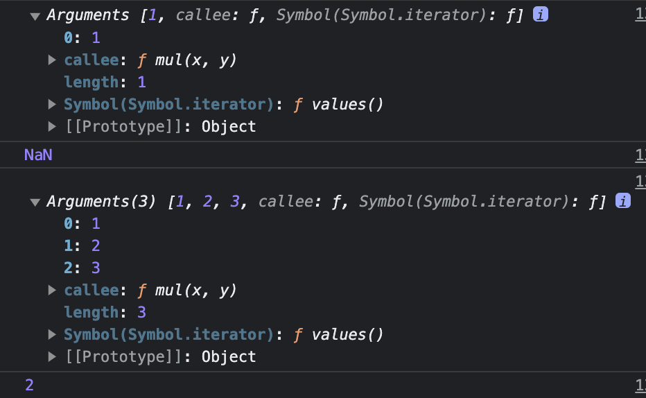

### prototype

생성자 함수로 호출할 수 있는 함수 객체(`constructor`)만 소유하는 프로퍼티다.

```javascript
(function(){}).hasOwnProperty('prototype'); // true
({}).hasOwnProperty('prototype');           // false
```

### __proto__

- 모든 객체는 `[[Prototype]]` 내부 슬롯을 가짐 — 객체지향 구현을 위한 내부 장치
- 프로토타입 객체에 간접적으로 접근하기 위해 사용
- 내부에 getter/setter가 있어 프로토타입을 호출·할당할 수 있음
- 상호 참조(순환 참조)를 방지하기 위해 접근자 프로퍼티 방식 채택
- 코드에서 직접 쓰기보다는 `Object.getPrototypeOf()` 같은 메서드를 쓰는 것이 권장됨

```javascript
const obj = { a: 1 };
console.log(obj.__proto__ === Object.prototype); // true
console.log(obj.hasOwnProperty('a'));            // true — 상속받은 프로퍼티인지 체크
console.log(Object.getPrototypeOf(obj));         // 프로토타입 가져오기
```

### name

ES5에서는 빈 문자열을, ES6에서는 함수 객체를 가리키는 변수 이름을 값으로 갖는다.

```javascript
var func = function(){};
console.log(func.name); // ES5 — 빈 문자열, ES6 — 'func'
```

## ✅ 프로토타입 객체 생성과 원리

> `non-constructor`, 화살표 함수, 메서드 축약 표현은 `prototype` 프로퍼티를 소유하지 않아 프로토타입을 생성하지 않음

### 왜 쓰는가

`new`로 인스턴스를 생성할 때, 프로토타입을 쓰지 않으면 인스턴스마다 메서드가 별도로 생성된다.

```javascript
// prototype 사용 안 했을 때 — 메서드가 인스턴스마다 따로 생김
function Example(str) {
    this.text = str;
    this.console = function() {
        console.log(str);
    };
}
const example1 = new Example('example1');
const example2 = new Example('example2');
console.log(example1.console === example2.console); // false — 다른 함수 객체

// prototype 사용할 때 — 메서드를 공유
function Example(str) {
    this.text = str;
}
Example.prototype.console = function() {
    console.log(this.text);
};
const example1 = new Example('example1');
const example2 = new Example('example2');
console.log(example1.console === example2.console); // true — 같은 함수 객체 공유
```

메모리 효율이 핵심이다.

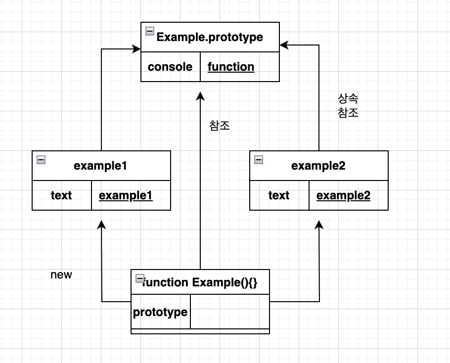

### 동작 방식 (중요)

> 모든 객체의 프로퍼티는 `Object.prototype`을 상속받음
> `constructor`, `__proto__`는 `Object.prototype`의 프로퍼티임. 인스턴스 생성 시 `[[Prototype]]`에 할당됨

**큰 그림**

- 원본 함수의 `prototype` → 프로토타입 객체(`[[Prototype]]`)를 가리킴
- 프로토타입 객체의 `constructor` → 원본 함수를 가리킴
- 인스턴스의 `__proto__` → 프로토타입 객체(`[[Prototype]]`)를 가리킴

**과정**

1. 함수를 정의하면 `Person` 객체를 기반으로 프로토타입 객체(`[[Prototype]]`)를 만들고, `prototype` 속성으로 그 객체를 가리킴
2. `new` 키워드로 인스턴스를 생성할 때 `constructor`가 `Person` 객체를 가리킴
3. 변수에 할당하면 `__proto__` 속성으로 프로토타입 객체(`[[Prototype]]`)를 가리킴

```javascript
function Person() {} // Person 함수 정의
let name = new Person('jisue'); // jisue 인스턴스 생성
Person.prototype; // [[Prototype]] 객체 출력 (constructor 포함)
```

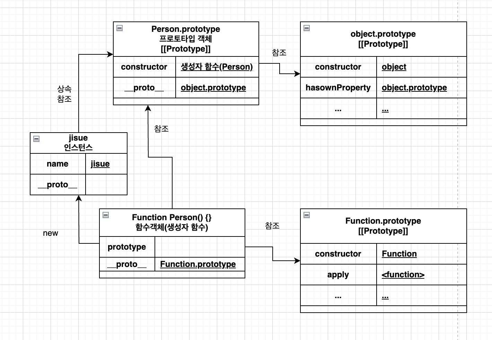

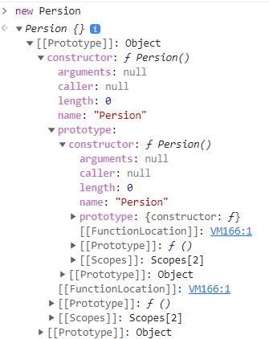

## ✅ 프로토타입 체인

### 체인 동작 원리와 정적 메서드

내부 슬롯의 참조를 따라 부모 역할을 하는 프로토타입의 프로퍼티를 순차적으로 검색하는 것이 프로토타입 체인이다.

- 단방향이어야 함 (순환 참조 불가)
- 프로토타입 메서드는 하위 객체에서 같은 이름으로 재정의하면 가려짐 — **섀도잉(shadowing)**
- 하위 객체에서 `delete`로 프로토타입 메서드를 삭제할 수는 없음

```javascript
const Person = (function() {
    function Person(name) {
        this.name = name;
    }
    // 프로토타입 메서드
    Person.prototype.call = function() {
        console.log('haha ' + this.name);
    };
    return Person;
}());

// 정적 메서드 — 인스턴스 없이 클래스(함수)에서 직접 호출
Person.staticMethod = function() {
    console.log('static');
};

const me = new Person('jisue');

// 섀도잉 — 인스턴스에 같은 이름의 메서드 추가
me.call = function() {
    console.log('hihi ' + this.name);
};
me.call();        // 'hihi jisue' — 인스턴스 메서드가 먼저
delete me.call;
me.call();        // 'haha jisue' — 프로토타입 메서드로 복귀
delete Person.prototype.call;
me.call();        // TypeError: me.call is not a function
```

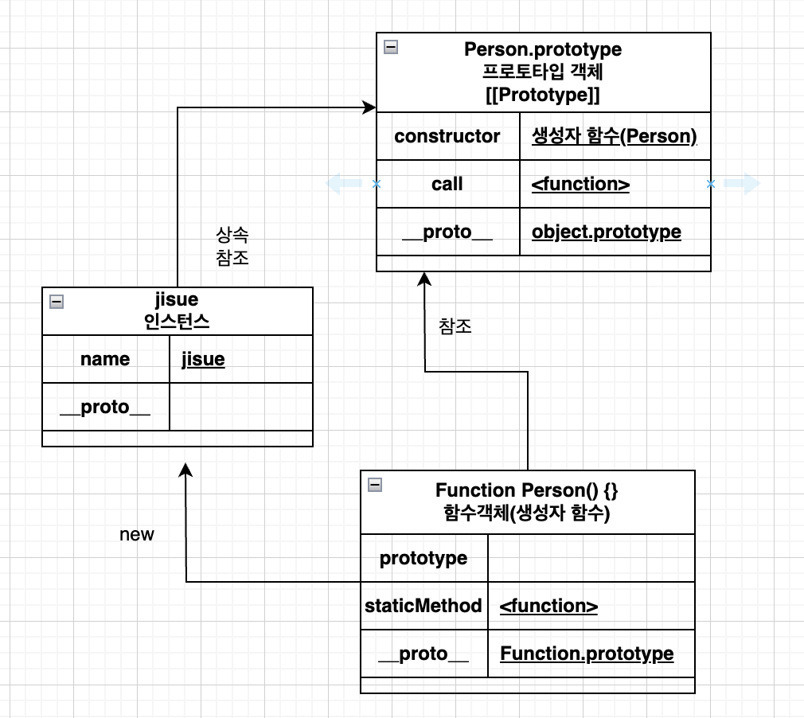

### instanceof, in, for...in 원리

- `instanceof` — 프로토타입 체인 상에 존재하는지 확인
- `in` — 상속받은 모든 프로토타입의 프로퍼티까지 확인
- `for...in` — `[[Enumerable]]: true`인 것만 열거함. 상속 프로퍼티도 포함되므로 `Object.prototype.hasOwnProperty` 체크가 필요함
- `for...in` 대신 `for...of`나 `forEach`를 쓰는 것이 권장됨

## ✅ Prototype 교체

### 생성자 함수에서 교체

`prototype`을 통째로 교체하면 `constructor`가 끊긴다. 명시적으로 연결해줘야 한다.

```javascript
const Person = (function() {
    function Person(name) {
        this.name = name;
    }
    // prototype 교체 — constructor가 끊김
    Person.prototype = {
        constructor: Person, // 직접 연결 필요
        greet() {
            console.log('haha ' + this.name);
        }
    };
    return Person;
}());
```

### 이미 생성된 인스턴스의 프로토타입 교체

```javascript
function Person(name) {
    this.name = name;
}

const me = new Person('jisue');

const person = {
    constructor: Person, // 직접 연결
    greet() {
        console.log('haha ' + this.name);
    }
};

// 생성자 함수의 prototype 교체
Person.prototype = person;
// 이미 생성된 인스턴스의 프로토타입도 교체
Object.setPrototypeOf(me, person);
```

## ✅ 프로토타입 응용

> **`[[Prototype]]`과 `prototype`의 차이**
> - `prototype` — 생성자 함수가 갖는 프로퍼티. 생성된 인스턴스는 갖지 않음
> - `[[Prototype]]` — 모든 객체가 내부에 갖는 슬롯. 부모 프로토타입 객체를 가리킴
> - `prototype` 안의 `[[Prototype]]`에는 복사된 생성자 함수가 들어 있음

### `[[Prototype]]` 객체에 값 추가하는 방법

1. 인스턴스 객체는 `prototype` 속성이 없어서 `[[Prototype]]` 객체의 속성을 추가·변경·삭제할 수 없음
2. 인스턴스 객체 자체에서 변경한 값은 `[[Prototype]]` 객체에 영향을 주지 않음
3. 인스턴스는 `[[Prototype]]` 객체에 직접 접근하지 못함

```javascript
// [[Prototype]]에 추가
Person.prototype.age = 20;     // [[Prototype]]에 age 추가
Person.prototype;              // [[Prototype]] 출력 — age와 constructor 확인
jisoo;                         // [[Prototype]]으로 링크돼 있어서 age와 constructor 출력

// 인스턴스에 추가 (프로토타입에는 영향 없음)
jisoo.prototype;               // undefined — 인스턴스는 prototype 속성이 없음
jisoo.age = 10;                // 인스턴스에만 추가됨
```

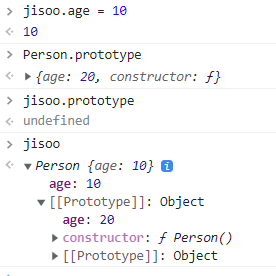

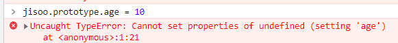

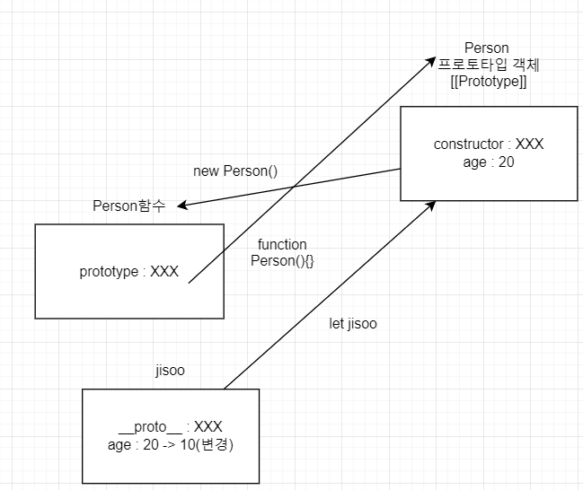

### 인스턴스에서 `[[Prototype]]` 접근

`__proto__`를 통해 접근할 수 있다. 값을 조회할 때 활용한다.

```javascript
jisoo.__proto__.age = 50;  // __proto__로 프로토타입 값 수정
Person.prototype;          // 프로토타입 객체 직접 수정
```

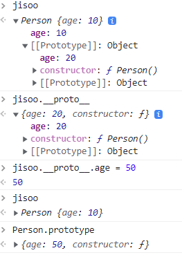

### 프로토타입 공유 패턴

**패턴 1 — prototype만 지정**

자식 객체에서 값을 변경해도 부모의 프로토타입에서 받은 값이 그대로 사용된다.

```javascript
function Person(name) {
    this.name = name || '혁준';
}
Person.prototype.getName = function() {
    return this.name;
};
function Korea(name) {
    Korea.prototype = new Person();
}
const kor = new Korea('지수');
kor.getName(); // '혁준' — 인스턴스 생성 시점의 prototype이 이미 결정되어 있음
```

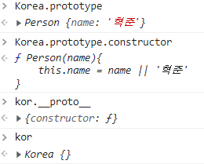

**패턴 2 — 생성자 빌려주기 (call/apply)**

`this`로 바인딩된 속성만 사용 가능하고 프로토타입 메서드는 쓸 수 없다.

```javascript
function Person(name) {
    this.name = name || '혁준';
}
Person.prototype.getName = function() {
    return this.name;
};
function Korea(name) {
    // Person 생성자를 빌림 — getName은 사용 불가
    Person.apply(this, arguments);
}
const kor = new Korea('지수');
kor.getName(); // TypeError: kor.getName is not a function
```

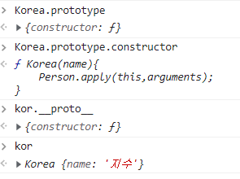

**패턴 3 — 생성자 빌려주고 prototype도 지정**

프로토타입 메서드도 사용 가능하지만 부모 생성자를 두 번 호출해야 한다.

```javascript
function Person(name) {
    this.name = name || '혁준';
}
Person.prototype.getName = function() {
    return this.name;
};
function Korea(name) {
    Person.apply(this, arguments); // 1번째 호출
}
Korea.prototype = new Person(); // 2번째 호출
const kor = new Korea('지수');
kor.getName(); // '지수'
```

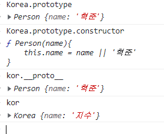

**패턴 4 — prototype 직접 공유**

부모 생성자를 한 번만 호출하고 프로토타입을 직접 연결한다. 단, 한 객체의 프로토타입을 변경하면 다른 객체도 영향을 받는다.

```javascript
function Person(name) {
    this.name = name || '혁준';
}
Person.prototype.getName = function() {
    return this.name;
};
function Korea(name) {
    this.name = name;
}
Korea.prototype = Person.prototype;
const kor = new Korea('지수');
kor.getName(); // '지수'
```

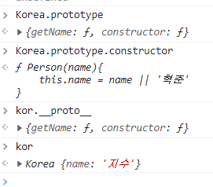

## ✅ 정리

- `prototype` — 생성자 함수가 인스턴스에게 물려줄 객체를 가리키는 프로퍼티
- `[[Prototype]]` — 모든 객체가 내부에 갖는 슬롯. 자신의 부모 프로토타입 객체를 참조함
- `__proto__` — `[[Prototype]]`에 접근하기 위한 접근자. 직접 쓰기보다 `Object.getPrototypeOf()` 권장
- 프로토타입 체인 — `[[Prototype]]` 링크를 따라 부모 프로퍼티를 순차 탐색. 단방향이어야 함
- `prototype` 공유로 메서드를 한 번만 정의하고 모든 인스턴스가 공유하면 메모리 효율이 높아짐!

## 참고한 링크

- [JavaScript : 프로토타입(prototype) 이해](https://www.nextree.co.kr/p7323/)
- [MDN — Object prototypes](https://developer.mozilla.org/ko/docs/Learn/JavaScript/Objects/Object_prototypes)
