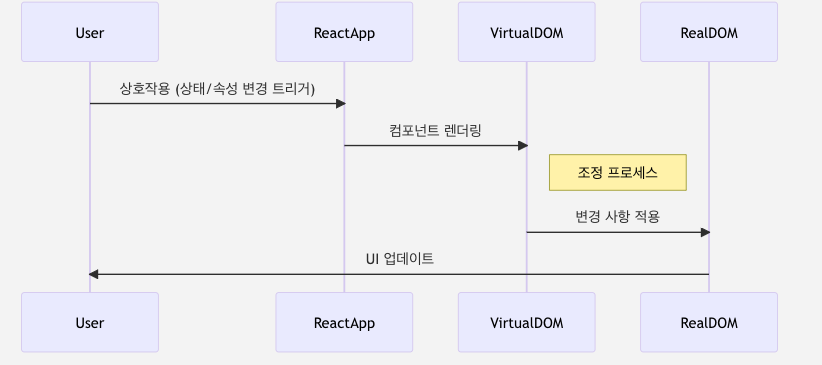
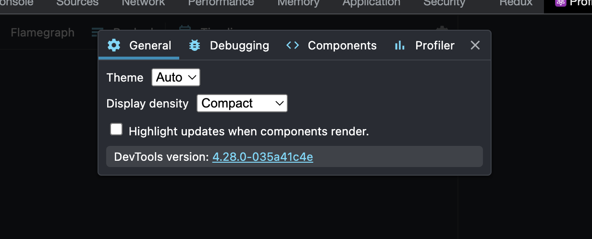
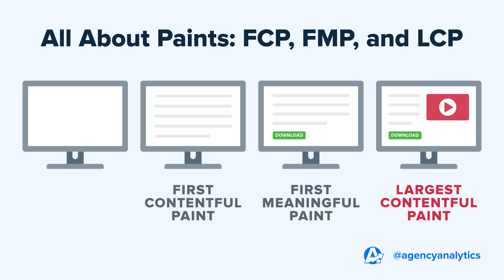
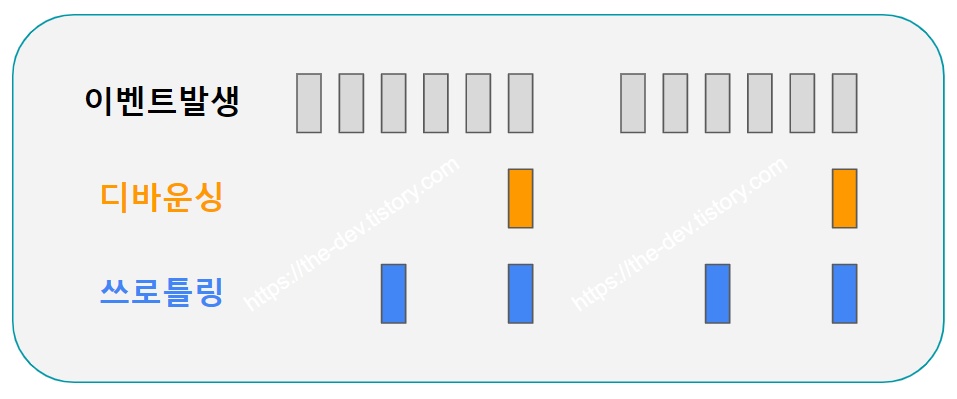

> **TL;DR** — 사용자는 3초만 지나면 페이지를 떠난다. 렌더링이 "언제" 일어나는지 알고, "측정"부터 한 뒤에, 아래 5가지 방법을 골라 쓰면 된다.

난이도 : ★★☆☆☆

1️⃣ `렌더링 조건` 2️⃣ `측정 도구` 3️⃣ `최적화 5가지 방법`

## ✅ 왜 알아야 하나

리액트에서 렌더링 최적화는 피할 수 없는 문제다. 사용자는 3초만 지나면 페이지를 떠난다. 그런데 최적화를 하려면 먼저 **렌더링이 언제 일어나는지**부터 알아야 한다.

**리렌더링이 되는 경우**

- 부모 컴포넌트가 렌더링될 때
- props 값이 변경되었을 때
- 자신의 state가 변경되었을 때

**습관적으로 주의할 것**

- props를 넘겨줄 때 객체 형태를 매번 새로 만들지 않기
- 컴포넌트를 매핑할 때 key 값으로 index를 사용하지 않기
- state 변경 시 함수 콜백(`setState(prev => ...)`)을 쓰면 의존성 배열에 추가하지 않아도 됨

**렌더링 과정과 조정(reconciliation)**

1. React가 DOM 트리를 구성하는 초기 렌더링을 함
2. state 또는 props 변경으로 재렌더링이 발생함
3. React는 새 가상 DOM을 만들어 이전 가상 DOM과 비교(diffing)함
4. 변경된 컴포넌트만 실제 DOM에 반영함



## ✅ 측정부터 — 렌더링 체크 방법

최적화의 시작은 감이 아니라 측정이다.

- **크롬 개발자도구 Performance 탭** — 페이지 렌더링에 걸리는 시간, 어느 구간에서 병목이 나는지 분석해줌
- **React DevTools Profiler** — 컴포넌트 렌더링 타임라인을 보여줌. 하이라이트 옵션을 켜면 어떤 요소가 렌더링되는지 깜빡임으로 표시됨



사용자 기준의 지표도 챙겨야 한다. DOMContentLoaded만 빨라지면 로딩바만 빨리 나오고 체감 최적화는 안 된 것이다.

- **FMP(First Meaningful Paint)** — 사용자에게 의미 있는 콘텐츠가 처음 나타나는 시점
- **LCP(Largest Contentful Paint)** — 가장 큰 콘텐츠 요소가 완전히 렌더링되는 시점. Lighthouse·Performance 탭에서 확인함



## ✅ 방법 1. Hook 개선

> useMemo·useCallback은 commit phase에는 실행이 안 되지만 render phase에는 실행된다.

메모이제이션을 남발하면 오히려 메모리 사용량이 늘고, 의도와 다르게 불필요한 렌더링이 남는다.

- 메모이제이션은 **비용이 많이 드는 함수·값일 때만** 사용함
- 컴포넌트가 props 바뀔 때만 렌더링되게 하고 싶으면 `React.memo` 사용함
- 렌더링과 무관한 값은 `useRef`에 저장함 — state와 달리 리렌더링을 일으키지 않음

```javascript
import React from 'react';

const ExampleComponent = React.memo(({ text }) => {
  console.log('Component re-rendered');
  return <h1>{text}</h1>;
});
```

```javascript
// 변경 전 — 단순 범위 값인데 state라 리렌더링 유발
const [range, setRange] = useState(0);
setRange(2);

// 변경 후 — 리렌더링 없음
const contentRange = useRef(0);
contentRange.current = 2;
```

한번 짤 때 잘 짜자.

## ✅ 방법 2. lazy + Suspense

> 💡 코드 스플리팅 — 애플리케이션 번들을 여러 조각으로 나눠, 필요한 코드만 로드해서 초기 로딩을 줄이는 기술

문제: 컴포넌트가 렌더링될 때 동적 import가 전부 로드되고, 로딩되는 동안 화면에 콘텐츠가 없다.

- **lazy** — 동적 import를 일반 컴포넌트처럼 렌더링함. 특정 라우트로 이동할 때 필요한 컴포넌트만 로드함
- **Suspense** — 지연 로딩 컴포넌트가 준비될 때까지 `fallback`으로 대체 콘텐츠를 보여줌

```javascript
import React, { lazy, Suspense } from 'react';
import LightComponent from './LightComponent';

const HeavyComponent = lazy(() => import('./HeavyComponent'));

function App() {
  return (
    <div>
      <Suspense fallback={<div>Loading...</div>}>
        <HeavyComponent />
      </Suspense>
      <LightComponent />
    </div>
  );
}
```

## ✅ 방법 3. 디바운싱과 스로틀링



**디바운싱(Debouncing)** — 요청이 연속으로 들어오면 delay 뒤에 **마지막 요청만** 실행함

- 검색 자동완성처럼 "입력이 멈출 때까지" 기다렸다 실행하는 곳에 씀
- 비유: 메뉴를 다 고를 때까지 기다렸다가 한 번에 주문

```javascript
// lodash로도 가능하지만 직접 구현하면 이렇다
function debounce(fn) {
  let timerId; // 클로저를 이용한 함수 내부 변수
  return (e) => {
    if (timerId) clearTimeout(timerId); // 기존 타이머 취소
    timerId = setTimeout(() => fn(e), 500); // 500ms 뒤 실행
  };
}

const debouncedSearch = debounce(searchFunction);
searchInput.addEventListener('input', debouncedSearch);
```

**스로틀링(Throttling)** — 이벤트를 **일정 주기마다 한 번만** 실행함

- 무한 스크롤, 리사이징처럼 지속 발생하는 이벤트에 씀
- 비유: 주문 후 30분 안에 또 오면 무시

```javascript
function throttle(fn) {
  let timerId;
  return () => {
    if (!timerId) {
      timerId = setTimeout(() => {
        timerId = null;
        fn();
      }, 1000); // 1000ms 동안 추가 호출 무시
    }
  };
}

const throttledScroll = throttle(scrollFunction);
window.addEventListener('scroll', throttledScroll);
```

## ✅ 방법 4. 비동기 automatic batching

React는 여러 state 변경을 한 번에 묶어(batching) 중복 렌더링을 막는다. 다만 비동기 콜백 안에서는 배칭이 깨질 수 있는데, 함수형 업데이트를 쓰면 묶인다.

```javascript
function asyncFunction() {
  setTimeout(() => {
    setState1(newValue1); // batching 적용 안 됨
    setState2(newValue2);
  }, 1000);
}
```

```javascript
function asyncFunction() {
  setTimeout(() => {
    setState1(prev => newValue1); // batching 작동함
    setState2(prev => newValue2);
  }, 1000);
}
```

## ✅ 방법 5. useTransition과 useDeferredValue

무거운 계산 로직이 실행되면 메인 스레드가 블록돼서, 극단적으로는 다음 입력을 못 받을 정도로 프레임이 떨어진다. React 18은 상태 변화에 **우선순위**를 매겨 급한 것(입력)부터 처리하게 해준다.

- **useDeferredValue** — 상태 **값**의 우선순위를 낮춤. deferred 값은 마지막에 갱신됨
- **useTransition** — 상태 변화를 일으키는 **함수**의 우선순위를 낮춤. `isPending`으로 로딩 표시 가능

```javascript
import { useState, useTransition } from "react";

export default function Home() {
  const [text, setText] = useState("");
  const [value, setValue] = useState("");
  const [isPending, startTransition] = useTransition();

  const onChange = (e) => {
    startTransition(() => {
      setText(e.target.value); // 낮은 우선순위
    });
    setValue(e.target.value);  // 즉시 반영
  };

  return <input type="text" onChange={onChange} />;
}
```

## ✅ Summary

1. 최적화 전에 측정함 — Performance 탭, React Profiler
2. 메모이제이션(useMemo·useCallback·React.memo)은 비쌀 때만 씀
3. 초기 로딩은 lazy + Suspense로 코드 스플리팅함
4. 연속 이벤트는 디바운싱(마지막만)·스로틀링(주기마다)으로 줄임
5. React 18이면 automatic batching과 useTransition·useDeferredValue를 활용함

## 참고한 링크

- [[10분 테코톡] 앨버의 리액트 렌더링 최적화](https://youtu.be/1YAWshEGU6g)
- [코드 분할과 지연 로딩](https://wikidocs.net/197644)
- [디바운싱과 쓰로틀링 이해하기](https://medium.com/%EC%98%A4%EB%8A%98%EC%9D%98-%ED%94%84%EB%A1%9C%EA%B7%B8%EB%9E%98%EB%B0%8D/%EB%94%94%EB%B0%94%EC%9A%B4%EC%8B%B1%EA%B3%BC-%EC%93%B0%EB%A1%9C%ED%8B%80%EB%A7%81-%EC%9D%B4%ED%95%B4%ED%95%98%EA%B8%B0-e02f6bb14627)
- [Code splitting with React.lazy and Suspense](https://web.dev/code-splitting-suspense/)
