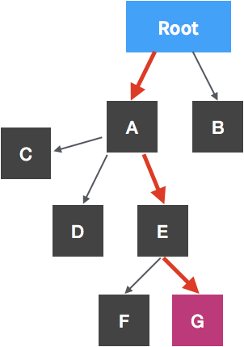

> **TL;DR** — Recoil은 React 전용 전역 상태관리 라이브러리로, `atom`(공유 상태)에서 `selector`(순수 함수)를 거쳐 컴포넌트로 내려가는 data-flow 그래프로 동작한다. Context의 리렌더링 문제, Redux의 보일러플레이트 문제를 각각 어떻게 해결하는지 알아야 왜 Recoil을 쓰는지 설명할 수 있다.

난이도 : ★☆☆☆☆

1️⃣ `atom / selector` 2️⃣ `Recoil Hooks` 3️⃣ `atomFamily / selectorFamily`

## ✅ 왜 알아야 하나

Context, Redux, Recoil은 요즘 프론트엔드 시장에서 거의 필수로 다뤄야 하는 상태관리 개념이다. 셋의 차이와, 왜 결국 Recoil까지 쓰게 됐는지를 설명할 수 있어야 한다.

## ✅ 전역 상태를 쓰는 이유

- props로 필요한 컴포넌트까지 값을 계속 내려서 관리해야 하는 번거로움을 줄일 수 있음
- 불필요한 리렌더링을 줄일 수 있음



### Context의 문제점

- 컴포넌트가 리렌더링될 때마다 그 하위 컴포넌트가 전부 다시 렌더링돼 성능 문제가 생길 수 있음
- 복잡한 상태 관리에는 한계가 있음

```javascript
// Context 선언 (초기값 설정 가능)
export const ThemeContext = createContext(null);

// 최상위 계층에서 감싸주고, state도 최상위에 선언
const [isDark, setIsDark] = useState(false);

// index에서 Provider로 감싸기
<ThemeContext.Provider value={{ isDark, setIsDark }}>
  <PageContext isDark={isDark} setIsDark={setIsDark} />
</ThemeContext.Provider>

// 사용
const { isDark } = useContext(ThemeContext);
```

### Redux의 문제점

- React 전용 라이브러리가 아니라서, React 관점에서는 Store가 외부 요인으로 취급되고 동시성 모드와의 호환성이 부족함
- Store, Action, Reducer 등 구성 요소가 많아 초기 세팅(보일러플레이트)이 번거롭고 러닝커브가 높음
- 비동기 데이터를 다루려면 `redux-saga` 같은 서드파티 라이브러리가 추가로 필요함

```javascript
// action 정의
export const addCart = (item) => {
  return {
    type: "ADD_ITEM",
    payload: item
  }
}

// reducer 정의
const cartReducer = (state = INITIAL_STATE, action) => {
  switch (action.type) {
    case "ADD_ITEM":
      return [...state, action.payload]
    case "DELETE_ITEM":
      return [...action.payload]
    default:
      return state
  }
}

// combineReducers로 reducer 병합
export default combineReducers({ cartReducer });

// store 생성 및 Provider로 전달
const store = createStore(rootReducer)
// ...(생략)
ReactDOM.render(
  <React.StrictMode>
    <Provider store={store}>
      <Routes />
      <GlobalStyle />
    </Provider>
  // ...(생략)

// useSelector로 state 읽기
const cartItems = useSelector((store) => store.cartReducer);

// useDispatch로 state 수정
const dispatch = useDispatch()
return (
  <Card>
    {/* ...(생략) */}
    <AddCartBtn onClick={() => dispatch(addCart(item))}>
    {/* ...(생략) */}
```

## ✅ 초기 세팅

### Recoil을 쓰는 이유

- React 전용 라이브러리라서 React 내부 접근성이 좋음
- React 동시성 모드, Suspense를 지원해 사용자 경험 측면에서 유리함
- 전역 상태 정의가 쉽고, get/set을 Hooks로 처리하기 때문에 React 문법과 매우 유사함

### 설치

```bash
# npm(yarn)
npm install recoil
yarn add recoil

# CDN
<script src="https://cdn.jsdelivr.net/npm/recoil@0.0.11/umd/recoil.production.js"></script>
```

### index 설정

```tsx
const root = ReactDOM.createRoot(
  document.getElementById('root') as HTMLElement,
);
root.render(
  <React.StrictMode>
    <Router />
  </React.StrictMode>,
);
```

## ✅ Recoil 기본 문법

> 💡 atom(공유 상태)에서 selector(순수 함수)를 거쳐 React 컴포넌트로 내려가는 data-flow 그래프

### atom — 상태 단위

Recoil 상태의 최소 단위다. atom 상태가 업데이트되면 이를 구독하던 컴포넌트가 전부 리렌더링된다. `default` 값에 Promise 객체를 넣을 수는 있지만, atom 안에서 직접 비동기 요청을 하지는 못한다.

- `key` — 고유 key 값(보통 atom을 생성하는 변수명으로 지정)
- `default` — atom의 초기값. 정적인 값(int, string 등), promise, 다른 atom 값으로 설정 가능

```javascript
// store/atom.js
export const todoListState = atom({
  key: 'todoListState',
  default: [
    { id: 1, text: 'clean', status: false },
    { id: 2, text: 'door', status: true },
  ],
});
```

### Hooks 종류

atom·selector 상태를 get/set하기 위해 Recoil이 제공하는 Hooks들이다.

- `useRecoilState()` — `useState()`와 유사. `[state, setState]` 튜플에 할당하며 인자로 atom(또는 selector)을 넣음
- `useRecoilValue()` — 전역 상태의 값만 참조할 때 사용
- `useSetRecoilState()` — 전역 상태의 setter 함수만 필요할 때 사용
- `useResetRecoilState()` — 전역 상태를 초기값(default)으로 되돌릴 때 사용

```typescript
const todoList = useRecoilValue<TodoType[]>(todoListState);
const setTodoList = useSetRecoilState<TodoType[]>(todoListState);
const [todoList, setTodoList] = useRecoilState<string>(todoListState);
```

### selector — 값 핸들링

atom 또는 다른 selector 상태를 입력받아 동적인 데이터를 반환하는 순수 함수다. 참조하던 상태가 바뀌면 함께 업데이트되고, 이를 바라보던 컴포넌트도 리렌더링된다.

- `key` — 고유 key 값
- `get` — selector 순수 함수. 콜백 객체의 `get()` 메서드로 다른 atom·selector를 참조해 값을 반환

```typescript
// atom.js
const listCountState = selector({
  key: 'listCountState',
  get: ({ get }) => {
    const list = get(todoListState);
    return list.length;
  },
});

// 사용
const listCount = useRecoilValue<number>(listCountState);
```

## ✅ Selector 활용

> 💡 selector는 값 자체를 캐싱한다.

### 쓰기 가능한 selector

읽기 전용이 아니라 쓰기 모드도 지원한다. selector 내부 값은 직접 수정할 수 없고, setter를 통해 수정해야 한다. setter로 넘긴 새 값이 `newValue`로 들어와 다른 atom을 그 값으로 세팅한다.

```typescript
// atom.js
const listCountState = selector({
  key: 'listCountState',
  get: ({ get }) => {
    const list = get(todoListState);
    return list.length;
  },
  set: ({ set }, newValue) => set(todoListState, newValue),
});

// 사용
const [listCount, setListCount] = useRecoilState<number>(listCountState);
setListCount('새로운 값!');
```

### 비동기 selector

비동기 요청 결과를 전역 상태에 바로 넣고 싶을 때 사용한다. `async`/`await`만 쓰면 에러가 나고, `Suspense` 처리가 필요하다.

```javascript
// atom.js
const myQuery = selector({
  key: 'MyQuery',
  get: async ({ get }) => {
    return await api(get(queryParamState)); // 비동기 호출
  },
});

// index
<React.Suspense fallback={<div>Loading...</div>}>
  <Component />
</React.Suspense>
```

### 또 다른 비동기 제어 방법 — Loadable

`useRecoilValueLoadable`, `useRecoilStateLoadable`을 사용한다.

- `state` — `hasValue`, `hasError`, `loading` 세 가지 상태 중 하나를 반환
- `contents` — atom·selector의 상태값. `hasValue`일 때는 value, `hasError`일 때는 Error 객체, `loading`일 때는 Promise를 가짐

```javascript
const Component = () => {
  const loadState = useRecoilValueLoadable(loadSelector);

  switch (loadState.state) {
    case 'hasValue':
      return <div>{loadState.contents}</div>
    case 'loading':
      return <Loading />;
    case 'hasError':
      throw loadState.contents;
  }
}
```

## ✅ 리턴하는 팩토리 함수

> 💡 다른 atom이 아니라 외부 인자에 따라 상태를 관리하고 싶을 때 사용한다.

### atomFamily

```javascript
// atom.js
export const todoListState = atom({
  key: 'todoListState',
  default: (init) => {
    return [...init, 추가]
  }
});

// 사용
const [todoList, setTodoList] = useRecoilState<string>(todoListState([
  { id: 1, text: 'clean', status: false },
  { id: 2, text: 'door', status: true },
]));
```

### selectorFamily

비동기 데이터를 상태값으로 바로 쓰기 위한 용도다.

```javascript
// atom.js
export const githubRepo = selectorFamily({
  key: "github/get",
  get: (githubId) => async () => {
    if (!githubId) return "";

    const { data } = await axios.get(
      `https://api.github.com/repos/${githubId}`
    );
    return data;
  },
});

// 사용
const githubRepos = useRecoilValue(githubRepo(githubId));
```


## ✅ Summary

- Recoil은 Context의 리렌더링 문제와 Redux의 보일러플레이트 문제를 동시에 완화하려고 등장한 React 전용 상태관리 라이브러리임
- atom은 상태의 최소 단위, selector는 atom을 가공하는 순수 함수 — 이 둘의 조합으로 data-flow 그래프가 만들어짐
- 비동기 처리는 `Suspense`나 `Loadable`로 감싸야 하고, 외부 인자 기반 상태는 `atomFamily`/`selectorFamily`로 처리함

## 참고한 링크

- [Recoil 공식 문서](https://recoiljs.org/)
