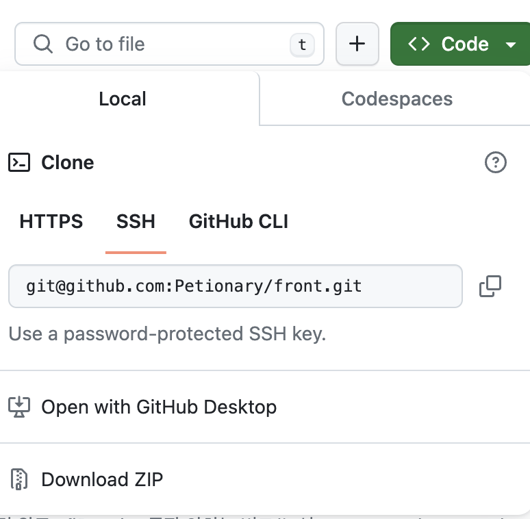

> **TL;DR** — 회사 계정과 개인 계정을 동시에 쓰거나 push할 때마다 인증을 반복하고 싶지 않다면 HTTPS 대신 SSH로 clone 받는 게 낫다. 계정별로 키를 따로 만들고 `~/.ssh/config`에 Host를 나눠 등록하면 계정마다 자동으로 올바른 키가 붙는다.

난이도 : ★☆☆☆☆

1️⃣ `HTTPS vs SSH` 2️⃣ `ssh-keygen` 3️⃣ `~/.ssh/config`

## ✅ 왜 알아야 하나

> 💡 시작 전에 SSH로 접근 자체가 불가능한 서버인지부터 확인해야 한다.

다음 상황에서 SSH 다중 계정 설정이 필요하다.

- 회사 계정 외에 개인 프로젝트용 계정을 따로 쓰고 싶을 때
- push할 때마다 아이디·비밀번호(또는 토큰)를 입력하는 게 번거로울 때

## ✅ HTTPS vs SSH 프로토콜

### HTTPS

- HTTP의 암호화된 버전
- 브라우저와 서버 간 데이터 교환에 쓰는 프로토콜
- SSL/TLS 인증서로 데이터를 암호화해 인터넷 통신을 보호함

### SSH

- 보안되지 않은 네트워크에서도 안전한 통신을 가능하게 하는 암호화 프로토콜
- 원격 서버 접근, 파일 전송, 네트워크 인프라 관리에 주로 쓰임
- 인증에 공개 키 암호화를 쓰고, 전송 데이터의 기밀성·무결성을 보장함

### SSH로 clone 받는 이유

- HTTPS는 별도 설정 없이 바로 쓸 수 있지만, push할 때마다 인증이 필요함
- HTTPS는 통신 자체는 안전해도 매번 암호·토큰을 입력해야 해서 번거롭고, 관리가 허술하면 오히려 취약해질 수 있음
- HTTPS는 SSL/TLS 연결 설정 오버헤드 때문에 SSH보다 느릴 수 있음
- SSH는 키(공개/개인) 등록이라는 초기 비용이 있지만, 이후로는 별도 설정 없이 바로 사용 가능함
- HTTPS는 표준 포트 443을 써서 방화벽·프록시를 잘 통과하는 반면, SSH는 22번 포트를 써서 네트워크 환경에 따라 막힐 수 있음

## ✅ ssh-keygen이란

SSH 프로토콜을 이용해 원격 컴퓨터 간 안전한 셸 세션을 확립하는 데 필요한 암호화 키를 생성·관리·변환하는 도구다. 공개 키(Public key)와 비공개 키(Private key)를 쌍으로 만들어 제어한다.

### 생성 방식 2가지

```bash
ssh-keygen -t rsa -b 4096 -C "github 계정"
ssh-keygen -t ed25519 -C "github 계정" -f "id_ed25519_github_ashappy"
```

**RSA 키**
- 키 타입: RSA, 비트 수: 4096
- 키 파일 이름: 기본값(`id_rsa`, `id_rsa.pub`)
- 전통적인 방식으로 대부분의 Git 호스팅 서비스와 GitHub에서 지원함

**Ed25519 키**
- 키 타입: Ed25519
- 키 파일 이름을 직접 지정(예: `id_ed25519_github_ashappy`)
- 최신 알고리즘이라 더 강력하고 보안성이 높지만, 모든 Git 호스팅 서비스가 지원하는 건 아님. GitHub는 지원함

## ✅ ssh-keygen 적용

### 키 생성

```bash
ssh-keygen -t rsa -b 4096 -C "github 계정"
ssh-keygen -t rsa -b 4096 -C "gitlab 계정"
```

```text
Generating public/private rsa key pair.
Enter file in which to save the key (/c/Users/Karim/.ssh/id_rsa): hub
Enter passphrase (empty for no passphrase):
Enter same passphrase again:
Your identification has been saved in /c/Users/Karim/.ssh/hub
Your public key has been saved in /c/Users/Karim/.ssh/hub.pub
The key fingerprint is:
SHA256:P/PLrFQoFM4iWgLHtH+wzfsvGNlCIFERW2RJvUmpKFc aaa@gmail.com
The key's randomart image is:
+---[RSA 4096]----+
|.o+o+==o..       |
| oo..+Eo+.       |
|  o.=+.o+o       |
|  .=o*ooo  .     |
|  .oo.+oS . .    |
|     .+..o .     |
|      .+  =      |
|      .... *     |
|        .oo.=.   |
+----[SHA256]-----+
```

### ssh 에이전트 실행 및 키 등록

```bash
# 등록
$ eval $(ssh-agent)
Agent pid 3215

# 실행
$ ssh-add ~/.ssh/hub
$ ssh-add ~/.ssh/lab
```

### config 설정

```bash
# config 수정
vi ~/.ssh/config
```

```text
Host github.com
        HostName github.com
        User git
        IdentityFile ~/.ssh/hub    # keygen에서 지정한 파일명
Host gitlab.com
        HostName gitlab.com
        User git
        IdentityFile ~/.ssh/lab    # keygen에서 지정한 파일명
```

### 연결 테스트

```bash
$ ssh -T gitlab.com
Welcome to GitLab
$ ssh -T github.com
Hi! You've successfully authenticated, but GitHub does not provide shell access.
```

### 겪은 문제 — 사내 GitLab 접근 불가

GitLab 쪽으로 설정한 계정이 연결되지 않았다. 원인은 SSH로 접근 자체가 불가능한 서버였기 때문이다.

```text
ssh -Tvv git@git.netand.co.kr
# 'ssh: connect to host git.netand.co.kr port 22: Operation timed out'
```

이런 경우는 SSH 설정 문제가 아니라 서버·네트워크 정책 문제이므로, config를 아무리 손봐도 해결되지 않는다. 먼저 해당 서버가 SSH 접근을 허용하는지부터 확인해야 한다.

## ✅ git clone 잘 되는지 확인

### SSH clone 주소 형식

```text
git@<config에 설정한 Host>:<git주소>/<Repository명>.git
```



### 계정 초기 등록

나중에 커밋 이력에 남는 정보이므로 레포지토리 단위로 등록해두는 게 안전하다.

```bash
git config --local user.name "git 이름"
git config --local user.email "git 계정"
```

## ✅ Summary

- HTTPS는 초기 설정이 간단하지만 매번 인증이 필요하고, SSH는 초기 키 등록만 해두면 이후 인증 없이 사용 가능함
- 계정마다 키를 따로 만들고 `~/.ssh/config`에서 Host별로 `IdentityFile`을 지정하면 여러 계정을 한 번에 관리할 수 있음
- 연결이 안 될 때는 config 문제인지, 애초에 서버가 SSH 접근을 막고 있는지부터 구분해서 확인해야 함

## 참고한 링크

- [\[GitHub\] 여러 계정에서 ssh로 git clone 하기 — velog](https://velog.io/@ashappyasikonw/GitHub-%EC%97%AC%EB%9F%AC-%EA%B3%84%EC%A0%95%EC%97%90%EC%84%9C-ssh%EB%A1%9C-git-clone-%ED%95%98%EA%B8%B0)
- [SSH config를 통해 간편하게 SSH 연결하기 — hudi.blog](https://hudi.blog/ssh-config/)
