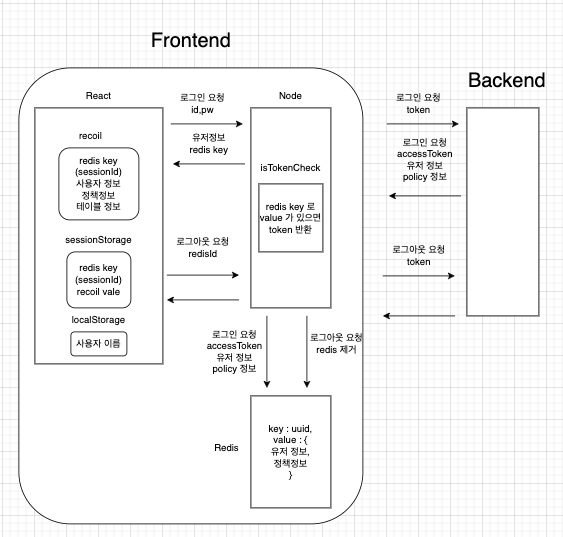

> **TL;DR** — 탭마다 독립 로그인이 필요할 때, 프론트는 sessionStorage로 탭 격리를, 백엔드는 Redis로 빠른 세션 저장을 처리한다.

난이도 : ★★☆☆☆

1️⃣ `sessionStorage` 2️⃣ `Redis`

## ✅ 상황 (요구사항)

> 기획 담당자 : 우리 제품은 한 브라우저에서 탭마다 다른 계정으로 동시에 로그인이 가능해야 해~
> 예스맨 : YES! 탭마다 완전히 독립적인 세션으로 동작하게 구현~

네이버나 구글은 탭을 새로 열어도 같은 계정이 유지된다. 하지만 이 요구사항은 정반대였다 — 탭마다 서로 다른 사용자로 로그인이 가능해야 하고, 다른 탭의 로그인 상태가 영향을 받아선 안 됐다. 모노레포 구조에서 Node.js 서버 사이드와 React 클라이언트 사이드 모두 고려해야 했다.

## ✅ 개념 — 프론트엔드 웹 스토리지 종류

key-value로 데이터를 저장하는 브라우저 스토리지는 두 종류다.

**localStorage**

- 브라우저가 종료되어도, OS를 재시작해도 데이터가 유지됨
- 오리진(domain/port/protocol)이 같으면 모든 탭에서 공유됨

```js
localStorage.setItem('name', 'jisu');
localStorage.setItem('birth', 1993);
localStorage.getItem('name');   // 'jisu'
localStorage.getItem('birth');  // '1993' (문자열)
localStorage.removeItem('birth');
localStorage.getItem('birth');  // null
localStorage.clear();           // 전체 삭제
```

**sessionStorage**

- 현재 탭 내에서만 유지됨
- 같은 페이지라도 다른 탭이면 완전히 별개의 저장소로 취급됨
- 한 탭 안에 여러 iframe이 있는 경우에는 같은 오리진으로 공유됨

```js
sessionStorage.setItem('test', 1);
sessionStorage.getItem('test');
```

**왜 localStorage는 탭마다 공유되는가?**

localStorage 데이터가 갱신될 때 같은 오리진에 접근 가능한 모든 window 객체에 storage 이벤트가 발생한다. 두 창이 모두 이벤트를 수신하고 있기 때문에 한 탭에서 값을 바꾸면 다른 탭에 즉시 반영된다. `event.url`로 어느 문서에서 갱신이 일어났는지도 알 수 있다.

탭마다 독립 로그인이 필요한 상황에서는 이 공유 특성이 오히려 문제가 된다. 그래서 탭 단위로 격리되는 sessionStorage를 선택했다.

## ✅ 구현 — Recoil + sessionStorage + Redis

**Recoil atom으로 전역 상태 관리**

atom의 상태가 업데이트되면 이를 구독하는 컴포넌트들이 모두 리렌더링된다.

```js
// store/atom.js
export const loginState = atom({
  key: 'loginState',
  default: null,
});
```

Recoil이 제공하는 주요 훅:

- `useRecoilState()` — `useState()`처럼 [state, setState] 튜플로 사용
- `useRecoilValue()` — 읽기 전용으로 상태값만 참조
- `useSetRecoilState()` — setter 함수만 필요할 때
- `useResetRecoilState()` — 초기값으로 리셋

```js
const loginInfo = useRecoilValue(loginState);
const setLoginInfo = useSetRecoilState(loginState);
const [loginInfo, setLoginInfo] = useRecoilState(loginState);
```

**전체 흐름**

Redis ID를 프론트에서 sessionStorage에 session ID로 저장하는 방식이다. Node.js 서버에서 UUID를 생성하고, Redis에는 해당 UUID를 key로 사용자 정보를 저장한다. 탭마다 다른 UUID가 sessionStorage에 보관되므로 완전히 독립된 세션이 된다.



**왜 Session이 아닌 Redis인가?**

세션은 기본적으로 서버 메모리에 생성된다. 탭마다 다른 사용자 정보를 저장해야 한다는 특성상, 무한히 늘어날 수 있는 세션 데이터를 서버 메모리에 두는 건 부담이 크다. 그렇다고 RDB에 저장하기엔 임시 인증 데이터라 적합하지 않았다.

Redis는 key-value 쌍으로 데이터를 관리하는 인메모리 데이터 스토리지다. 모든 데이터를 RAM에 저장하고 조회하기 때문에 다른 DB보다 빠르고 가볍다. 비슷한 역할의 Memcached도 있지만 문자열만 지원하는 한계가 있고, Redis는 다양한 자료구조를 지원하므로 Redis를 선택했다.


## ✅ 결과 & 배운 점

- 탭마다 독립적인 로그인 세션 구현 완료함
- localStorage vs sessionStorage의 차이는 "탭 간 공유 여부"가 핵심임 — 탭 격리가 필요하면 sessionStorage가 정답
- Redis는 세션처럼 짧은 수명·빠른 조회가 필요한 인증 데이터에 최적화됨
- Recoil atom의 key는 전역 유일해야 하므로 네이밍 규칙 잡는 게 중요하다!

## 참고한 링크

- [javascript.info — localStorage와 sessionStorage](https://ko.javascript.info/localstorage)
- [RefreshToken + Redis 활용](https://inkyu-yoon.github.io/docs/Language/SpringBoot/RefreshToken)
