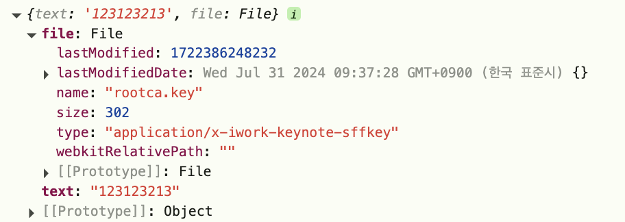

> **TL;DR** — 파일은 바이너리라 JSON으로 못 보낸다. FormData에 담아 `multipart/form-data`로 보내야 하고, 파일 첨부 UI는 기본 input을 숨기고 ref로 클릭을 위임하면 깔끔하게 만들 수 있다.

난이도 : ★★★☆☆

1️⃣ `FormData` 2️⃣ `multipart/form-data`

## ✅ 상황 (요구사항)

> 설계 부장님 : 배포 서버 인증서를 관리자가 UI에서 직접 첨부해야 되고, 플랫폼마다 라이센스 파일들을 업로드할 수 있어야 돼~
> 백엔드 대리님 : 프론트엔드에서 파일만 전송해주면 쿠버 환경에서 파일이 주입될 수 있게 처리하려고요. 지금 세팅된 커스텀 서버(server.js)에 설정들이 있어서 그것만 제거하면 될 것 같아요!
> 예스맨 : YES! 인증서는 단건인데 다른 데이터와 같이 전송, 라이센스는 3개 파일 전송~

일감을 받았을 때 가장 먼저 든 생각은 두 가지였다. '파일 첨부하려면 UI를 어떻게 그릴까?', '첨부한 파일을 어떻게 데이터로 보관하고 전송할까?'

## ✅ 문제

기본적으로 백엔드로 데이터를 보낼 때는 `Content-Type: application/json`을 헤더에 실어 보낸다. 하지만 File은 이진수로 되어 있는 **바이너리 데이터**라 JSON에 직접 담을 수 없다. 게다가 파일과 함께 텍스트 데이터도 같이 보내야 하는 요구사항이라, 전송 형태 자체를 다시 잡아야 했다.

UI도 문제였다. HTML이 제공하는 `<input type="file">`은 기능은 다 있지만 스타일이 그대로는 못 쓸 수준이다.


## ✅ 원인 분석 — File 전용 데이터, Multipart Type

File 인터페이스는 `<input type="file">` 요소로 파일 데이터를 받을 수 있고, Blob 인터페이스를 상속받는다.



**파일 요청 인터페이스 — FormData**

File 데이터를 전송하기 위해 FormData를 사용한다. 자바스크립트 제공 인터페이스지만 Web UI에서 파일+텍스트를 같이 전달하는 용도라 Node.js에서는 사용이 불가능하다. 내부적으로 key-value 쌍을 저장하지만 일반 객체처럼 직렬화되지 않아서 콘솔에 바로 찍히지 않는다 — `entries()`로 순회해야 보인다.

```javascript
// 데이터 저장
formData.append('data', JSON.stringify({ data: data.text }));
formData.append(data.file.type, data.file);

// 출력 — FormData는 console.log로 바로 안 보임
for (const pair of formData.entries()) {
  console.log(pair[0] + ': ' + pair[1]);
}
```

**multipart/form-data**

파일을 포함한 폼 데이터를 서버로 보낼 때 쓰는 Content-Type이다. 이름 그대로 단일 HTTP 요청 안에 여러 종류의 데이터(텍스트, 파일)를 각각의 "파트(part)"로 나눠 전송한다. 요청 본문을 보면 파트마다 boundary로 구분되어 data와 file이 나뉘는 걸 볼 수 있다.

```bash
Content-Type: multipart/form-data; boundary=----WebKitFormBoundaryxxxx  # boundary는 자동 생성됨

----WebKitFormBoundaryxxxx
Content-Disposition: form-data; name="data"
Content-Type: application/json

{"data":"123213123"}
----WebKitFormBoundaryxxxx
Content-Disposition: form-data; name="uploadedFile"; filename="스크린샷.png"
Content-Type: image/png

[png 파일의 바이너리 데이터]
----WebKitFormBoundaryxxxx--
```

## ✅ 해결 — 단건·다건 UI 구현

전략은 하나다. 못생긴 `<input type="file">`을 과감하게 숨기고, HTML이 제공하는 **기능**(파일 선택 창)만 쓴다.

1. input 2개를 구현하고 file input은 CSS로 숨김 처리함
2. ref로 DOM을 저장함
3. 다른 요소(버튼)에서 이벤트가 발생하면 저장한 ref에 click 이벤트를 위임함

```javascript
const [fileName, setFileName] = useState('');
const fileInputRef = useRef(null);

// 버튼 클릭 → 숨겨진 file input 클릭 위임
const onChangeButtonClick = () => {
  if (fileInputRef.current) {
    fileInputRef.current.click();
  }
};

// 파일 선택 시 값 저장
const handleFileInputChange = (e) => {
  const files = e.target.files;
  if (files && files.length > 0) {
    setFileName(files[0].name);
  }
};
```

다건(라이센스 3개)은 같은 구조에서 `input`에 `multiple`을 주고, FormData에 같은 key로 여러 번 `append`하면 된다. 단건(인증서)은 텍스트 데이터와 파일을 하나의 FormData에 함께 담아 보낸다.

<!-- 이미지 제안: 숨긴 input + 커스텀 버튼으로 완성된 파일 첨부 UI(After) 스크린샷 — 위 img_02.png(Before, 기본 input 모습)와 대비 -->

## ✅ 결과 & 재발 방지

| 항목 | 이전 | 이후 |
|---|---|---|
| 파일 첨부 UI | 기본 `<input type="file">` — 스타일 커스터마이징 불가 | input은 숨기고 버튼 클릭 → ref로 클릭 위임, 선택한 파일명만 노출 |
| 전송 방식 | (신규 요구사항 — JSON으로는 바이너리 전송 불가) | FormData + `multipart/form-data`로 텍스트·파일을 함께 전송 |
| 업로드 개수 | 단건(인증서)·다건(라이선스) 요구사항이 각각 존재 | 동일 구조에서 `multiple` 여부·`append` 반복 횟수만 다르게 대응 |

- 인증서(단건+데이터), 라이센스(3개 파일) 업로드 요구사항 구현 완료함
- boundary는 브라우저가 자동 생성하므로 **Content-Type 헤더를 직접 지정하지 않는 것**이 오히려 정답임 — 직접 지정하면 boundary가 빠져서 서버가 파싱 못 함
- Next.js뿐만 아니라 React에서도 동일하게 구현하면 됨. File 데이터와 multipart 전송 타입은 인지하고 있는 게 좋다

## 참고한 링크

- [MDN — Using FormData Objects](https://developer.mozilla.org/en-US/docs/Web/API/XMLHttpRequest_API/Using_FormData_Objects)
