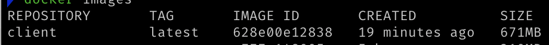
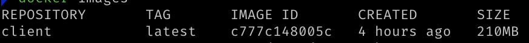

> **TL;DR** — Next.js standalone은 server.js를 자동 생성하기 때문에 커스텀 서버를 쓸 수 없다. HTTPS는 Nginx 리버스 프록시로, 환경변수·포트는 start.sh의 sed 치환으로 해결하면 이미지가 600MB → 250MB로 줄어든다.

난이도 : ★★★☆☆

1️⃣ `standalone` 2️⃣ `Nginx 리버스 프록시` 3️⃣ `runtime 환경변수 치환`

## ✅ 상황 (요구사항)

> 설계 부장님 : 프론트는 빌드했을 때 이미지 사이즈가 얼마나 나오지?
> 사수 : 도커 멀티스테이징 빌드 도입해서 600MB 정도 나옵니다. standalone 되어있는데, 지금 세팅된 커스텀 서버(server.js)에 설정들이 있어서 그것만 제거하면 될 것 같아요.
> ——— (자리로 돌아가서)
> 사수 : OO 씨 들으셨겠지만 standalone 설정하면 이미지가 절반 넘게 줄어들 거예요. 그런데 안에 설정들(SSL 인증서, CORS, 환경변수)을 다른 곳에서 세팅해야 되는데 그쪽 알아봐 줄 수 있나요?
> 예스맨 : YES!

일감을 받고 가장 먼저 든 생각은 이거였다. "standalone으로 바꾸면 server.mjs에 박아놨던 설정들은 어디로 가지?"

## ✅ standalone을 쓰면 뭐가 좋은가

Next.js의 `output: 'standalone'` 설정은 실행에 필요한 파일만 추출해 배포 크기를 최소화한다.

- 최소한의 코드만 포함해 빌드함
- `.next/standalone/server.js` 자동 생성 (런타임에 직접 수정 불가)
- `node_modules`에서 필요한 의존성만 추출해 포함됨
- 커스텀 서버 없이도 `node server.js`로 바로 실행 가능함

🔗 [Next.js 공식 문서 — output](https://nextjs.org/docs/pages/api-reference/config/next-config-js/output)

## ✅ 요구사항 분석 — 뭘 옮겨야 하나

기존 `server.mjs`에 들어있던 역할은 세 가지였다.

1. SSL 인증서 로딩 (HTTPS 처리)
2. CORS 설정
3. 포트·환경변수 주입

standalone으로 전환하면 `server.js`가 자동 생성되기 때문에 빌드 후 직접 코드를 수정할 수 없다. 게다가 여러 고객사에 설치되는 구조라 IP·포트가 배포마다 달라진다. 빌드 시점에 값을 고정할 수 없다는 뜻이다.

그리고 Next.js는 HTTPS를 `next.config.js`에서 설정하는 기능 자체를 제공하지 않는다. Nginx를 앞에 세우는 수밖에 없다.

### ❌ 기존 구조

- HTTPS·환경변수 처리를 위해 `server.mjs` 커스텀 서버 사용
- `node_modules` 전체 포함 → 이미지 증가
- 멀티스테이징 최적화 후에도 약 600MB

### ✅ 전환 목표

- `server.mjs` 제거
- HTTPS 유지 (Nginx로 이관)
- 런타임 환경변수 주입 가능하게
- Docker 이미지 최소화
- 패키지별 포트 동적 설정

## ✅ 구현 — 4가지 문제 해결

### 🔐 HTTPS — Nginx 리버스 프록시

Next.js가 HTTPS를 직접 처리하지 못하므로, Nginx가 TLS를 종료하고 내부 애플리케이션(HTTP)으로 전달하는 구조를 쓴다.

```nginx
server {
  listen 4000 ssl;
  ssl_certificate     /path/to/cert.pem;
  ssl_certificate_key /path/to/key.pem;

  location / {
    proxy_pass http://localhost:3000;
  }
}
```

인프라 담당자와 협업해 Nginx 설정을 잡았고, 앱 자체는 HTTP로 유지되므로 코드 변경이 없다.

### 🌡️ 환경변수 런타임 주입 — sed 치환

**문제**: Next.js는 빌드 시점에 `.env`를 읽고 `next.config.js`를 통해 값을 코드에 고정한다. standalone의 `server.js`는 자동 생성 후 변경 불가라 빌드 이후 환경에 맞게 값을 바꿀 방법이 없다.

**해결**: `publicRuntimeConfig`에 placeholder를 심어두고 `start.sh`에서 런타임에 `sed`로 값을 치환한다.

```javascript
// next.config.js
publicRuntimeConfig: {
  iamUrl: '%%NEXT_PUBLIC_XXX_URL%%'
}
```

```bash
# start.sh
sed -i "s#%%NEXT_PUBLIC_XXX_URL%%#$NEXT_PUBLIC_XXX_URL#g" server.js
exec node server.js
```

- `%%...%%` 형태로 placeholder를 지정함
- 런타임에 `start.sh`가 실행되면서 실제 값으로 치환됨
- 클라이언트에서는 `getConfig()`로 접근 가능함

### 🚪 PORT 동적 설정 — 같은 방식

**문제**: standalone `server.js`는 내부적으로 `process.env.PORT`라는 이름을 이미 사용한다. 패키지마다 포트를 다르게 지정하려면 환경변수 이름이 충돌한다.

```javascript
// standalone이 자동 생성하는 server.js 내부
const currentPort = parseInt(process.env.PORT, 10) || 3000;
```

**해결**: `.env.production`에서는 다른 이름(`NEXT_PUBLIC_XXX_PORT`)으로 포트를 관리하고, `start.sh`에서 `PORT`로 내보낸 뒤 sed로 치환한다.

```bash
# start.sh
export PORT=${NEXT_PUBLIC_XXX_PORT:-$PORT}
sed -i "s#%%PORT%%#$PORT#g" server.js
exec node server.js
```

### 📦 Dockerfile — standalone 결과물만 복사

```dockerfile
FROM base AS runner

RUN addgroup --system --gid 1001 nodejs
RUN adduser --system --uid 1001 nextjs

COPY --from=builder /app/.next/standalone/ ./
COPY --from=builder /app/.next/static ./apps/xxx/.next/static
COPY --from=builder /app/public ./apps/xxx/public

COPY ./apps/xxx/start.sh ./apps/xxx/
RUN chmod +x /app/apps/xxx/start.sh
```

`server.mjs`와 `node_modules` 전체를 걷어내고 standalone 결과물만 복사한다. `start.sh`가 환경변수와 포트 치환을 담당하므로 `server.js`를 직접 수정하지 않는다.

## ✅ 전체 동작 방식 요약

1. `next.config.js`에 `output: 'standalone'` 설정
2. `next build` → `.next/standalone` 생성
3. `server.js` 자동 생성 (환경변수 자리에 placeholder 삽입)
4. Nginx가 HTTPS 처리 → 내부는 HTTP로 전달
5. 컨테이너 기동 시 `start.sh`에서 sed로 값 치환
6. `exec node server.js`로 앱 실행
7. 런타임 환경에 맞는 URL·포트로 동작함

## ✅ 결과 & 배운 점

| | 변경 전 | 변경 후 |
|---|---|---|
| Docker 이미지 크기 | 600~650 MB | 200~250 MB |
| 커스텀 서버 | `server.mjs` 직접 관리 | standalone 자동 생성 |
| 환경변수 주입 | 빌드 시 고정 | 런타임 sed 치환 |



*멀티스테이징 적용*



*멀티스테이징 + standalone 적용*

커스텀 서버가 하던 일을 Nginx(HTTPS)와 start.sh(환경변수)로 역할 분리하면 standalone을 온전히 쓸 수 있다. 운영 환경이 다양하거나 패키지를 여러 곳에 배포하는 구조라면 이 패턴이 효과적이다!

## 참고한 링크

- [Next.js — output 'standalone'](https://nextjs.org/docs/pages/api-reference/config/next-config-js/output)
