## ***난위도 : ★***

**단순히 설치랑 초기세팅을 구글링해서 하지말고**

**어떤 방식으로 컴파일되고 왜 이 프로그램을 깔아야되는지**

**이 언어를 왜 사용하려고 하는지 정확히 알고 있어야 내것으로 만들 수 있다.**

**크~명언~!**


### **✔️ 자바 가 뭐임?? 특징 예시, 키워드**

**\*인터프리터 언어 vs 컴파일 언어 - 인터프리터 언어는 기계어로 변환하는 과정없이 한줄 한줄 해석하여 바로 명령어를 실행하는 언어를 말합니다.  컴파일 언어는 모두 기계어로 변환한 후에 기계(JVM 같은 가상 머신)에 넣고 기계어 코드를 실행**

- 탄생 배경 : 1991년 미국의 썬마이크로 시스템즈라는 회사에서 최초 가전제품에서 쓰일 프로그램 목적으로 개발했지만 인터넷 으로 초점이 옮겨지고 1995년 자바라는 이름으로 변경하게 되었다.
- 특징
  - 객체지향(OOP) - 먼저 하나의 클래스(설계도)를 만들어 작성하고 하나씩 객체끼리 조립 연결해가며 전체 프로그램 구성을 만드는 기법, 그중 가장 중요한 특징인 캡슐화, 상속성 다형성 등이 있다.(뒤에서 다룰 예정
  - 인터프리터 언어+ 컴파일 언어 - 컴파일 언어인 동시에 인터프리터 언어이기도 하고 시스템에 무관한 2진 클래스 파일을 만듬으로써 컴파일 언어에 가까운 속도와 시스템 독립성을 보여준다.
  - 자동메모리관리(가비지) - 개발자가 직접 메모리에 접근할 수 없으며 메모리는 자바가 직접 관리하는데 객체 생성시 자동으로 메모리 영역을 찾아서 할당하고 사용이 완료되면 가비지를 실행 시켜 자동으로 사용하지 않는 객체를 제거한다.
  - 멀티쓰레드 - 하나의 프로그램에서 다수의 일을 수핼할 수 있도록 해주고 프로그램 일부분이 중단되거나 긴작업을 수행하더라도 전반적인 프로그램의 수행이 계속되어 사용자에대한 응답성이 증가한다.
  - 동적 랜더링 - 실행시 모든 클래스가 로딩되는게 아니라 필요한 시점에 필요한 클래스를 로딩하여 사용할 수 있다.
  - 오픈소스 라이브러리 - 비교적 오랜 시간 동안 사용자에의에 쓰인 언어이고 다른 언어에 비해 검증된 오픈소스나 라이브러리가 풍부해서 유지보수가 쉽고 빠르게 작업을 진행 할 수 있다.

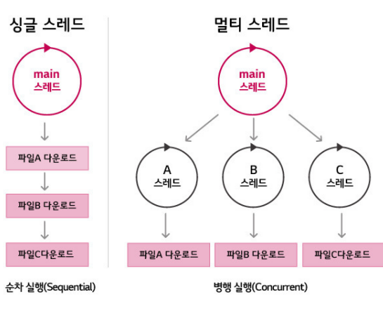

*싱글 스레드와 멀티 스레드*

### **✔️ 자바 실행 환경 동작 예시**

**\* 그림으로 보는 예시(사용자가 .java 파일에 코드입력 -> .class 로 컴파일 -> 컴퓨터 언어로 jvm이 컴파일)**

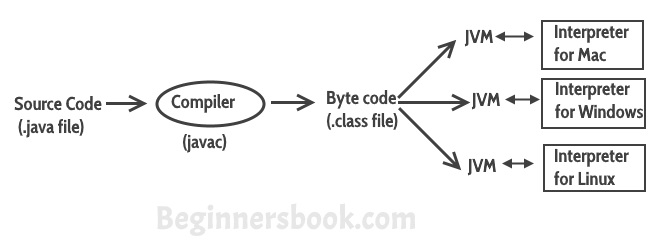

*자바 실행 예시*

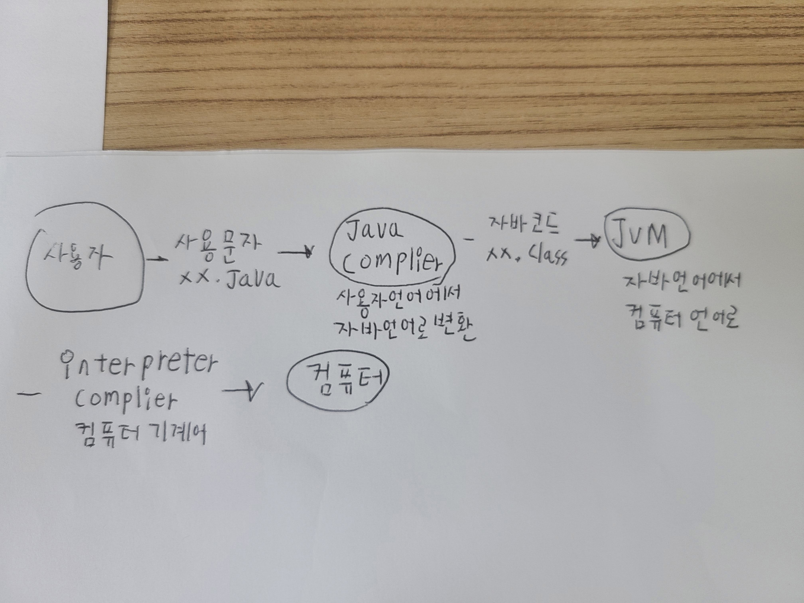

*자바 실행 예시*

### **✔️ JDK , JRE , JVM , eclips 의 개념과 역활**

**\* 참고로 메모리 구조를 공부하기위해 JDK , JRE , JVM 이 뭔지는 이해하고 있는게 좋다**

- **JDK** **(자바 개발도구, Java Development Kit)** - JRE + Development Tools(개발키트 ,컴파일러, 디버거등), 개발시 이것만 설치하면 JRE JVM 이 다 설치된다.
- **JRE** **(자바 실행환경, Java Runtime Environment)** - JVM + Libaray Classes
- **JVM (**자바 가상머신, Java Virtual Machine)** - 어느 기기, 어느 운영체제 상에서도 실행될 수 있게 만들어주고 메모리를 효율적으로 관리 최적화해주는 역활(가비지컬랙션도 여기에 포함)
- **Eclips (개발 툴, IDE)** - 자바 기반으로 한 통합 개발 환경으로 어느 운영체제든 자유롭게 이용 수정 배포가 가능하다 다만 전반적으로 다른 IDE에 비해 최적화가 제대로 안돼서 심각하게 느리다고 한다.

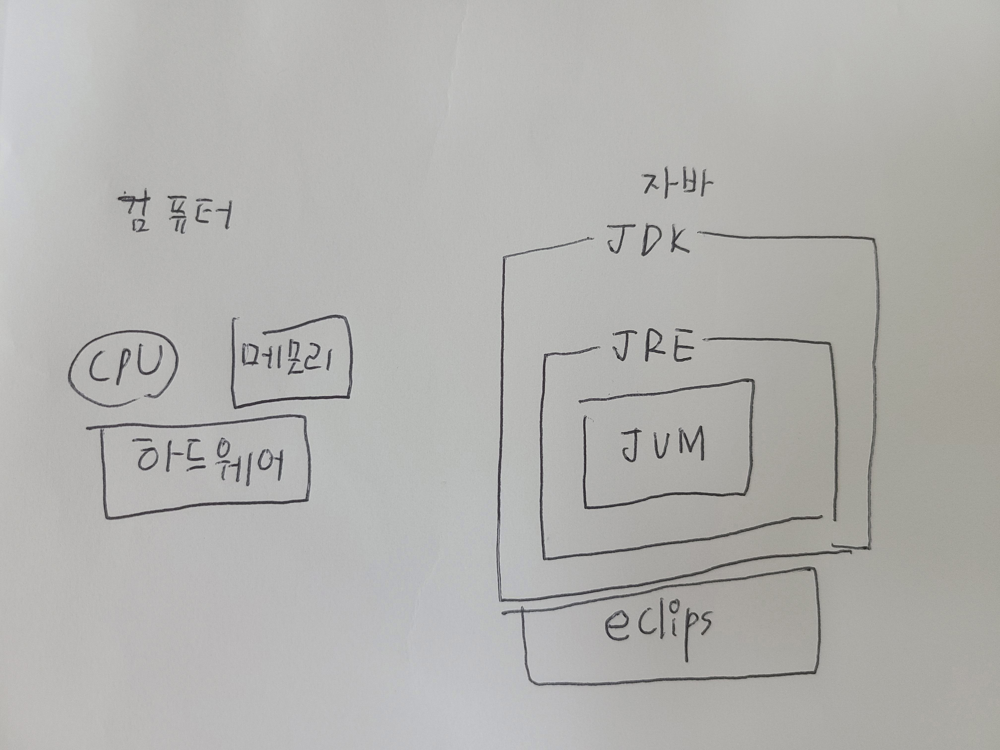

*JDK > JRE > JVM*

### **✔️ 개발환경 세팅 및 프로그램 설치(12/22 기준)**

**\* 꿀팁1! 이클립스 자동 정렬 세팅 방법**  
**링크 : <https://hianna.tistory.com/653>**

**\* 꿀팁2! 이클립스 자동완성 방법 (자동 ctrl+space)**  
**넣을 것 : .qwertyuioplkjhgfdsazxcvbnm\_QWERTYUIOPLKJHGFDSAZXCVBNM**

**링크 : <https://devlimk1.tistory.com/9>**

**1. JDK 설치 및 환경 변수 세팅 (JDK를 설치하는 이유는 위에 개념을 이해하면된다)**

**(참고 링크 : <https://gaeggu.tistory.com/2> )**

**\*보통 컴파일 된 파일들은 bin이라는 폴더 밑으로 들어가서 Path 세팅을 bin으로 하는거임**

- JDK 설치 - 밑에 링크로 들어가서 각 운영체제에 맞는걸로 설치하면 된다  
  링크 : <https://www.oracle.com/java/technologies/downloads/>
- 환경 변수 세팅 - 시스템 속성에서 환경변수로 들어간다   
  - JAVA\_HOME 세팅 - 시스템 변수에서 새로만들기 클릭후 설치한 jdk 경로를 입력하고 변수 이름은 아무거나 해도 된다
  - Path 세팅 - 시스템 변수에서 Path로 되있는 변수로 들어가 편집을 눌러 상위 경로와 같은 곳 밑에 %JAVA\_HOME%\bin 를 입력한다 (JAVA\_HOME으로 위에 세팅한 경로가 들어가 bin을 읽어오겠다는 말임

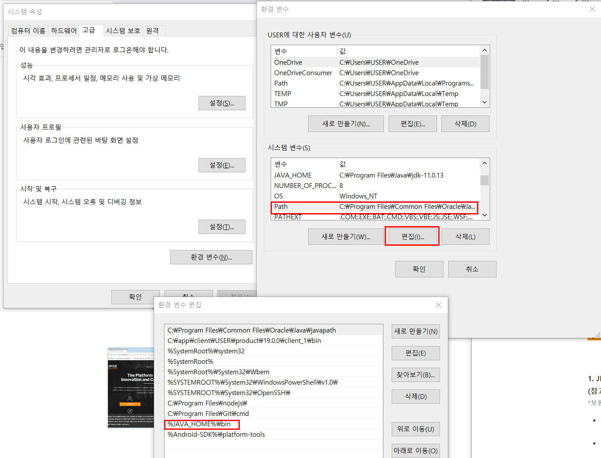

*Path 세팅*

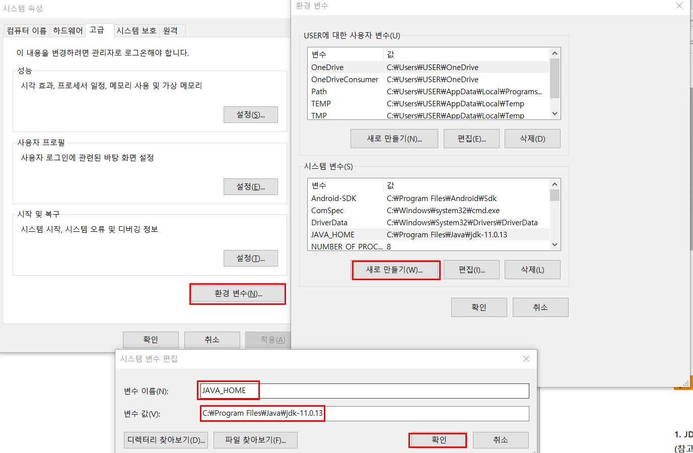

*환경변수(JAVA\_HOME) 세팅*

**2. 이클립스 설치(IDE)  
(참고 링크 : <https://parkjye.tistory.com/33>)**

- 아래 링크로 들어가 해당 운영체제에 맞게 Eclipse IDE for Enterprise Java and Web Developers 이걸로 다운 받으면 된다.   
  링크 : <https://www.eclipse.org/downloads/packages/>

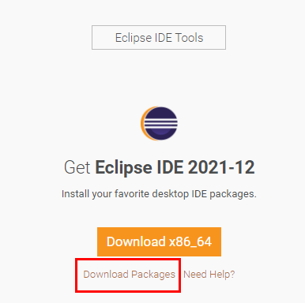

*이클립스 홈페이지 들어갔을때*

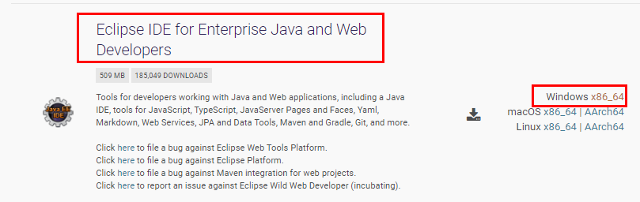

*위에 Download Packages를 클릭했을때*

**3. Hello World 출력 (사용자 입력부터 컴파일 되는 과정까지는 위에 실행환경 동작 예시 참고)**

- UTF-8 세팅 (한글 깨짐 방지)  
  링크 : <https://gangzzang.tistory.com/entry/%EC%9D%B4%ED%81%B4%EB%A6%BD%EC%8A%A4-%EA%B0%9C%EB%B0%9C%ED%99%98%EA%B2%BD-UTF8-%EC%9D%B8%EC%BD%94%EB%94%A9-%EC%84%A4%EC%A0%95>  
  - 상단 메뉴중 Window -> preferences 클릭
  - 필수로 Workspace, Css, HTML, JSP 등 UTF-8 로 설정을 변경해준다.
- 프로젝트 패키지 클래스 생성  
  링크 : <https://comclothing.tistory.com/26>  
  - 프로젝트 생성 : 상단메뉴중 File -> New -> Java Project
  - 패키지+ 클래스 생성 : 생성한 프로젝트 우클릭 -> New -> Class  
    패키지랑 클래스 를 동시에 생성할수있고 생성자나 psvm(public static void main) 자동 생성할 수 있다  

  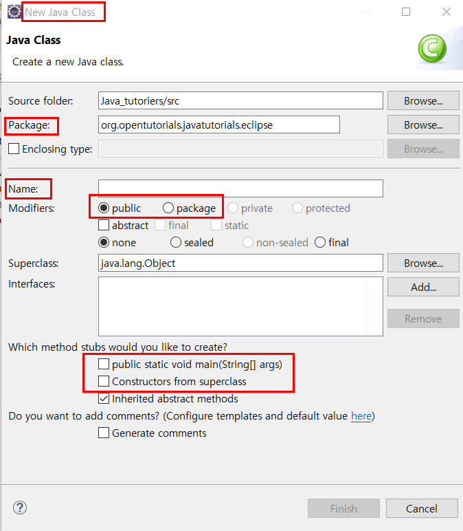

  *클래스 생성시 이미지*

  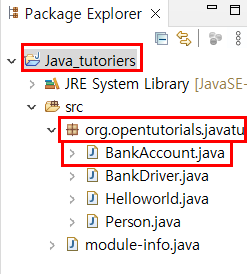

  *프로젝트, 패키지, 클래스 생성시 화면*
- 콘솔에 HelloWorld 출력
  - 생성한 클래스에 아래와 같은 코드 입력  

    ```javascript
    package org.opentutorials.javatutorials.eclipse;//패키지명

    public class Helloworld {//클래스명

    	public static void main(String[] args) {
    		// TODO Auto-generated method stub
    		System.out.println("HelloWorld");//System.out.println은 출력하기 위한 메소드 (차후에 설명)
    	}

    }​
    ```
  - Ctrl + f11 누르면 컴파일 되서 Console 창에 뜸

  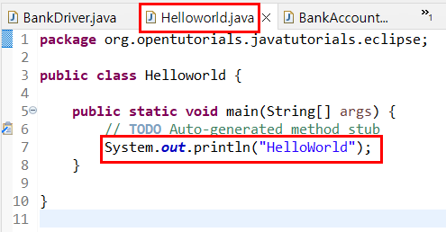

  *출력하는 코드입력*

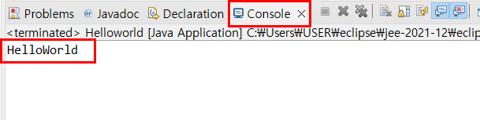

*콘솔 창&nbsp;*


