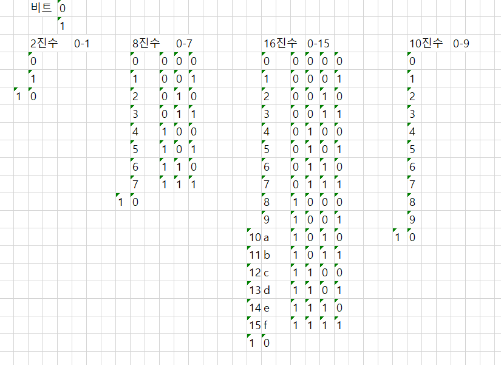
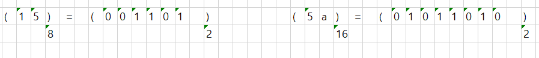
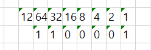
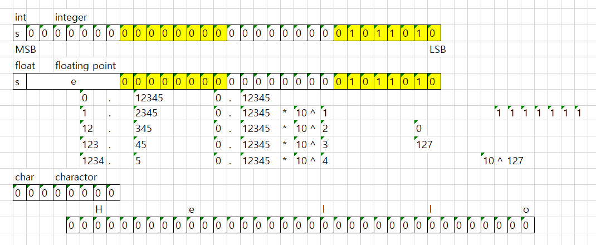
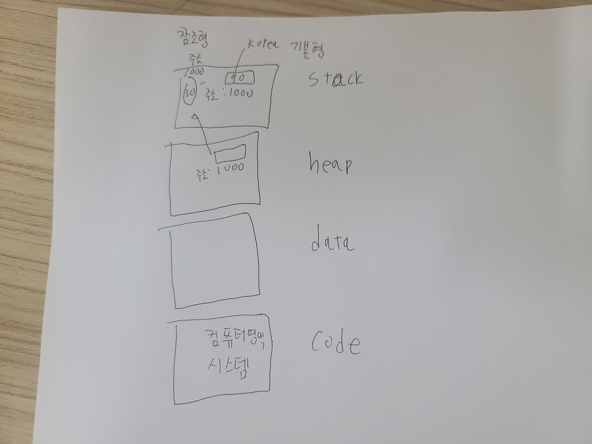
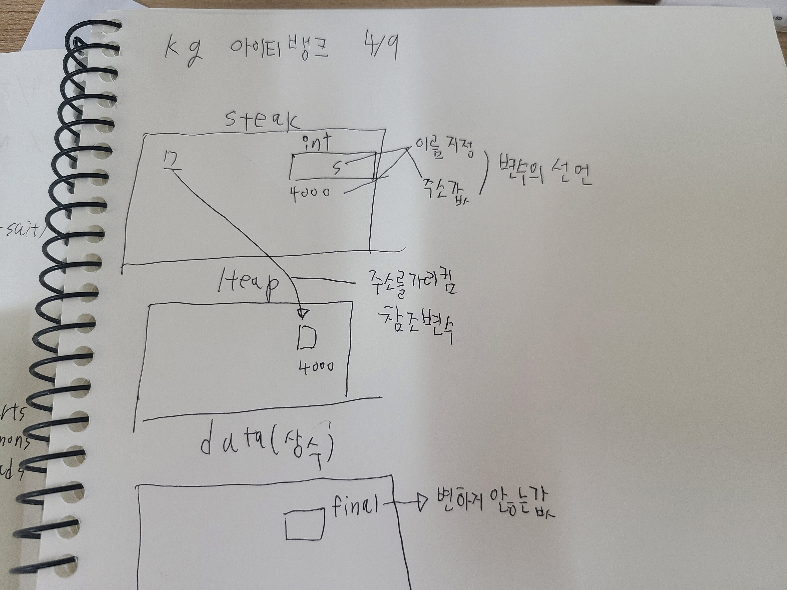
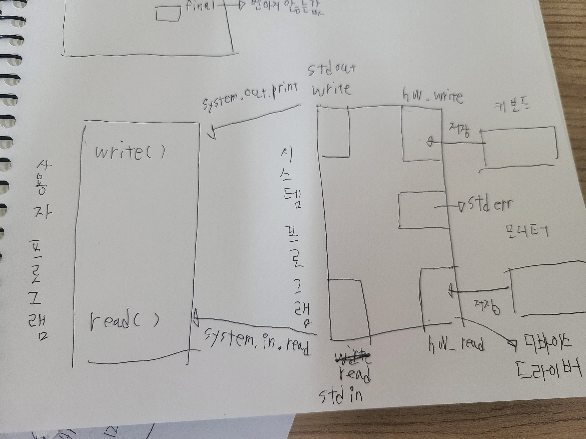

## ***난위도 : ★★***

**전반적인 개념을 다루기전에 기본적으로 알아야될**

**자료구조나 데이터 타입, 입출력에 대한 개념을 적어봤고**

**이부분을 몰라도 코드치는데는 문제 없지만 단순히 코드만 치는 코더보다는**

**원리를 이해해 한줄 한줄 마다 이유를 아는 프로그래머가 되고 싶은 마음에 정리해봤다**

**어찌보면 다른 이론보다 중요하다고 생각한다.**


### **✔️ 들어가기전에각 진수별 이해 (2진수 8진수 16진수 10진수)**

**\* 나중에 정보통신기사? 자격증 시험보면 나온다고함 기본적인 개념임**

**1. 비트 VS 바이트 - 1 바이트 = 8비트**

**2. 프로그램 메모리 구조를 이해하기전 먼저 각 진수의 이해를 먼저해야된다.**

**3. 컴퓨터가 받아들이는 모든 정보는 0과 1로 변환되어서 메모리(stack, heap)에 저장된다**

**\* 아스키코드(아래에 써놓은거는 알고있어야됨) -** 컴퓨터가 이해할수있는 코드  
같이 알면 좋은개념 : 유니코드

32(아스키코드) --> space    
48(아스키코드) --> 0  
65(아스키코드) --> A  
97(아스키코드) --> a

|  |  |  |
| --- | --- | --- |
| 진수 | 비트 | 표기법 |
| 2진수 | 1비트 | 0b(표기법) |
| 8진수 | 3비트 | 0o(표기법) |
| 16진수 | 4비트 | 0x(표기법) |
| 10진수 | 32비트 | (표기법 없음) |



*각 진수별 표기법*



*8진법과 16진법을 2진법으로*



*10진법과 2진법 관계*

### **✔️ 각 타입별 메모리 크기**

**1. 예외상황**

float나 long 은 기본적으로 데이터 뒤에 f , l 을 붙여줘야된다  
이유 : 기본타입이 double 과 int 이기때문에 형변환(메모 사용 크기를 줄이거나 늘리기)을 해줘야된다

예시 : long A = 20L;

**2. 왜 String 은 안적음?**RE : String 은 참고로 문자열이라고하고 char를 여러개 묶은 객체라고 생각하면 좋음(객체 개념은 차후에 배울예정)

**3. 타입별 비트 표기방법**

- int (자료 상태) +좌측 1개(부호) +나머지 31개(2진수)

- float (자료 상태) +좌측 1개(부호) +7개(제곱승 숫자) +24개(소숫점 밑 숫자)

- char (자료 상태) +좌측 1개(구분) +7개(비트)

|  |  |  |  |
| --- | --- | --- | --- |
| 구분 | 기본타입 | 메모리 사용 크기 | 저장가능한 값 범위 |
| 정수 | byte | 1byte (8bit) | -128~127 |
| 정수 | short | 2byte (16bit) | -2의15승 ~2의15승-1 |
| 정수 | int | 4byte (32bit) | -2의31승 ~2의31승-1 |
| 정수 | long | 8byte (64bit) | -2의63승 ~2의63승-1 |
| 실수 | float | 4byte (32bit) | ±(1.40129846432481707e-45 ~ 3.40282346638528860e+38) |
| 실수 | double | 8byte (64bit) | ±(4.94065645841246544e-324d ~ 1.79769313486231570e+308d) |
| 문자 | char | 2byte (16bit) | 0~2의16승 -1 |
| 논리 | boolean | 1byte (8bit) | true,false |



*타입별 비트 예시*

### **✔️ 자바 메모리 구조 Stack?**

**\* data랑 code 부분은 보통 객체랑 함수가 들어가는데 이부분은 차후에 더 배우고 다듬어 보겠다.**  
**틀린 부분이나 보안해야될 부분 있으면 아래 댓글로 남겨주길 바란다.**

**참고 링크 : <https://beomseok95.tistory.com/221>**

|  |  |  |  |
| --- | --- | --- | --- |
| 메모리 구조 | 언제?? | 실행 범위 | 정의 |
| stack(변수) | 함수실행때 생성 | 함수내부 | 이름을 갖는 상자라고 생각하면 이해하기 편함 보통 이름으로 값을 담을수 있다. |
| heap(변수) | 사용자 요청때 생성 | 프로그램전역 | 주소를 갖고 있고 stack이 이름으로 생성할때 참조해서 stack에 주소값을 넣을 수 있다. |
| data(상수) | 프로그램 시작때 생성 | 프로그램전역 |  |
| code(명령어데이터) | 자바는 접근 못하는 영역 | 시스템영역 |  |

### **✔️ 위에 메모리 구조 참고하여 코드 이해**

**\* 변수명 네이밍 컨벤션**

**(참고링크 : <https://tecoble.techcourse.co.kr/post/2020-04-24-variable_naming/> )**

**- 대소문자는 구분되며 길이의 제한은 없다.**

**- 예약어를 사용해서는 안 된다.**

**- 숫자로 시작하면 안 된다.**

**- 특수문자는 \_ 와 $ 만 허용한다.**

**- 변수는 첫 글자의 소문자로 시작하는 명사로 짓는다.**

**- 여러 단어로 이루어진 이름인 경우 각 단어의 첫 글자를 대문자로 한다. (카멜 표기법 사용)**

**1.  변수 할당 :  int korean = 90;**

- int : stack 영역에 32비트 생성
- korean--> stack에 컴퓨터 주소를 korean이라는 이름을
- 90; --> 그 주소영역에 90이라고 저장하기



*데이터 구조로 표현1*



*데이터 구조로 표현2*

### **✔️ 자바 표준 입출력 방법**

**\* 필자는 아래 부분을 왜우는것보다 원리를 이해하는것이 중요하다고 생각한다**

**참고링크 : <https://travislife.tistory.com/48>**

**1. 입출력이란?**

CPU로 데이터를 보내거나 받는것!

**2. 스트림(stream)??**

데이터가 가는길은 하드웨어적으로 버스라고 하며 프로그래밍 레벨에서는 스트림이라고한다.

**3. print , println , printf 차이점**

- print : 괄호안 내용을 단순히 출력. 개행문자(=줄바꿈문자=\n) 포함안됨.

- printf : C에서의 printf와 동일. %d, %s 등을 쓰기위해 사용. 개행문자 포함X

- println : 괄호안 내용을 출력한 후 마지막에 개행문자가 포함되어 있어 출력후 한 줄 띄워짐.

**4. Scanner 객체란?**

- 기본적인 데이터 타입들을 Scanner 의 메소드를 사용하여 입력받을 수 있다.

- Scanner 을 사용할 시 util 패키지를 경로의 Scanner 클래스를 호출해야 한다.

- 공백(띄어쓰기) 또는 개행(줄 바꿈)을 기준으로 읽는다.

- 객체 사용 방법

```javascript
Scanner in = new Scanner(System.in); // Scanner 객체 생성
```

|  |  |
| --- | --- |
| System 클래스 메소드 | 정의 |
| in | - 표준 입력 스트림 - 키보드로 데이터 입력을 받음 - input Stream ex) system. out .print |
| out | - 표준 출력 스트림 - 모니터로 데이터를 출력시킴 - Print Stram - 메소드 종류 (print , println , printf) ex) system. int. read |
| err | - 표준 에러 출력 스트림 |

|  |  |
| --- | --- |
| 사용자 입력을 받는 Scanner 메소드 종류 | 정의 |
| next | 다음 토큰을 문자열로 리턴 |
| nextByte | 다음 토큰을 byte 타입으로 리턴 |
| nextShort | 다음 토큰을 short 타입으로 리턴 |
| nextInt | 다음 토큰을 int 타입으로 리턴 |
| nextLong | 다음 토큰을 long 타입으로 리턴 |
| nextFloat | 다음 토큰을 float 타입으로 리턴 |
| nextDouble | 다음 토큰을 double 타입으로 리턴 |
| nextLine | ' \n '을 포함하는 한 라인을 읽고 ' \n '을 버린 나머지만 리턴 |
| close | Scanner의 사용 종료 |
| hasNext | 현재 입력된 토큰이 있으면 true, 아니면 새로운 입력이 들어올 때까지 무한정 기다려서, 새로운 입력이 들어오면 그 때 true 리턴. ctrl + z 키가 입력되면 입력 끝이므로 false 리턴 |

|  |  |
| --- | --- |
| 출력시 제어하기 위한 명령문자 | 뭥미? |
| %d | 정수 |
| %f | 실수 |
| %c | 문자 |
| %s | 문자열 |
| \t | 띄어쓰기 8번 |
| \n | 줄바꿈 |



*입출시 상환*


