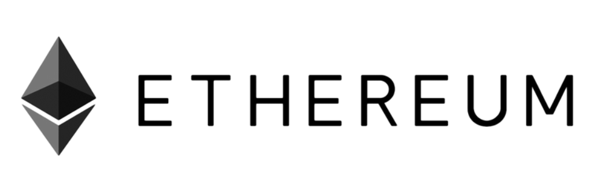
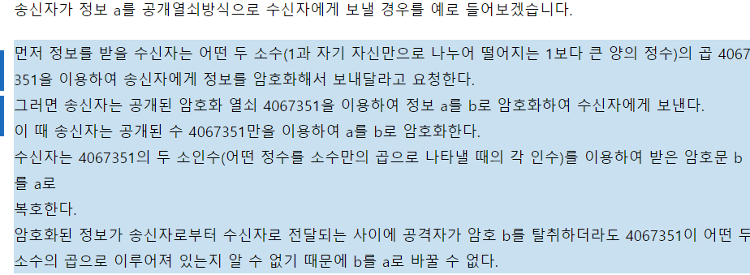

요즘 유행하고 많은 사람 기업들이 관심있는 주제

블록체인 가상화페의 개념과 의미를 내가 아는선 조사한부분에

대해 정리 및 얘기하려고한다.

이 부분에대해 관심은 있도 장난 삼아 투기로 뛰어드는

사람들을에게 알려주고자 적었다. 뭐 더 중요한거는 나중에

모든 기업에서 필요한 부분이라고 생각하고 내가 코딩을

배우는데 큰 도움이 될것같아 기록하려고 하려고 한다.

현제는 아직 메타버스 출시한 곳에서 가상화페 NFT를 사용하고 있지는

않지만 곧 출시하는 더 센드박스에서 최초가 될것같다.

### ***블록체인이란?***

쉽게 얘기하자면 은행이 문제되는 부분은 해결하려고

만들었다 생각하면된다.

예를들어 사람들이 돈을 이체하던가 거래하는부분을

각 은행마다 관리하는데 만약 은행이 망하거나

다른 은행한테 먹힐경우 해당 계좌의 돈은 하늘로 증발해버린다.

(대출은 인수한 은행으로 넘어간다. 없어지지는 않음...?!?)

이런 문제가 발생하기때문에 나가모토 사토시가 비트코인이라는 암호화페를

2009년에 만들었다. 그당시에는 사람들이 사기다 도박이다라고 얘기하고 외면했는데

그당시 시대를 앞서 나가서 그런것같고 지금은 코로나때문이나

경제 위기가 오면서 더 부각된거 같다.

블록체인 기술은 모든 데이터를 중앙기관(은행)에서 관리하는게아니라

사람과 사람 사이에 모든 데이터를 기록하여 저장하도록한다.

만약 A라는 사람의 거래내역을 수정하고 싶으면 은행은 직접하면되는데

블록체인 기술을 가지고 있는 코인은 이용하는 모든 사람의 기록을 수정해야된다.

(모든 기록은 모든 사람에게 남기때문에 보안이 강하다, 코인이 없어져도 이력은 없어지지 않는다.)

그리고 혹시나 해커가 수정하려고 하면 그만한 서버를 갖춰야지만 가능한데 현실적으로 불가능....

이 투명하게 들어나있는 거래내역(장부)같은경우 탈중앙화(여러사람이 체인으로 연결되있다 라는의미)

로 연결되있기에 가능한거고 비트코인때와 다르게 지금은 속도까지 업그레이드 된 이더리움 2세대를 사용하고있다.

**이더리움 장부 (메인넷)**

[etherscan.io/](https://etherscan.io/)

[🔗 Ethereum (ETH) Blockchain Explorer](https://etherscan.io/) — Etherscan allows you to explore and search the Ethereum blockchain for transactions, addresses, tokens, prices and other activities taking place on Ethereum (ETH)

->여기서 이더리움으로 들어오거나 다른곳으로 보내는 코드값이 다 관리됨

### ***이더리움***

앞서 얘기했던 비트코인(가상화페 1세대)은 개인간의 돈거래 만 가능했지만

이더리움같은경우 물품을 사거나 팔때도 사용하고 수수료도 매길수 있도록

시스템이 구현되있다. 즉 가상의 물품 NFT (게임 캐릭터의 옷, 게임상의 땅등)을 거래할때

무조건 필수라고 생각하면된다.

이더리움과 같이 거래할때 반드시 필요한 코인이 또 있는데 그게 바로 가스(가상화페)이다.

즉 가상 컴퓨터에서 수많은 코드로 돌아가는데 그부분의 휘발유 역활을 하는게

가스라고 생각하면된다.

2013년도에 에어비엔비의 창시자가

이더리움을 만들어졌고 이후 해커에게 공격당하는 일도 있었지만

하드 포크(위험에 대비하는 제 2의 코인) 이더리움 클레식을 만들어놨기에

위기를 모면할수 있었다.

전기 소비도 줄어들고 속도도 빠르기때문에 많은 사람들에게 충분이 대표 코인이

될수있다고 생각하여 투자를 하고있고 지금은 많은 기업들이 눈여겨서 보고있다.

이더리움 대표는 현제 17세로 전제산 1조원이 넘은 상태이고

일부의 이더리움을 보유하고있는 상태이다.

### ***채굴***

우리가 생각하는 광산에서 금을 채굴한다 이런 의미랑은 다르고

블록체인 개념을 이해해야되는데 모든사람들의 거래는

체인처럼 암호로 기록되있어서 서로 공유하고있는데

그 암호를 풀어서 장부에 남겨야 기록이 된다.

이런 암호들을 푸는 역활이라고 생각하면되고

채굴하기위해서는 cpu과부화를 대비해 성능좋은

컴퓨터를 구비해야되고 24시간동안 구동을 시켜야된다.

그러면 일정의 수수료(코인)을 지급 받을수 있다.

좀더 정확히 말하자면 정해진 조건(난이도)을 만족하는 해시값이 나올때까지

nonce라는 임의의 숫자를 계속 바꿔가면서 해시함수를 무한 반복 돌리는거임.

정답을 미리 계산할 방법이 없고 무작위로 대입해야만 찾을수 있어서 컴퓨터

성능과 시간이 그만큼 많이 필요한거고, 제일 먼저 찾는 사람이 장부에

기록할 권한이랑 보상을 동시에 가져가는 구조라고 보면 된다.

---> 위에는 하나의 예시를 든것뿐이고 푸는데 5년걸린다고 한다....

### ***NFT***

대체불가능토큰 이라고하는데 쉽게 설명하자면

피카소의 그림으로 주장하는 한 미술품이 있는데

그게 진품으로 감정되고 어디에서든 볼수 없다면

대체불가능 토큰으로 분류된다.

(내가 만들었는데 그게 1개뿐이면 NFT)

NFT마켓에서 직접 판매할수있다.

또는 음악 저작권이나 내가만든 게임 케릭터옷 등등

NFT로 분류되고 판매도 가능하다.

현실에서 많은 돈을 들여 전시를 열지않아도

마켓에서 직접 판매할수도 있고 소장하려고 구매하는

사람도 많다.

### ***메타마스크***

크롬 확장판 가상화페 지갑이고

보안이 강화되어 원화로 교환후 보내는게아니라

해당지갑에서 다른사람의 지갑으로 코인을

보낼수있다. 단, 보낼때 수수료 이더리움이나 가스로 내야되며

비용은 대략 15000원 정도 되는걸로 알고있다.

나도 만든지 얼마 않됬음! 현제 정부가 9월달에 가상화페 거래소 거의 없앤다며

법안 만들고있는데 이런부분때문에 걱정된다면 하나 만들어서 개인적으로 보관하는게

적절할것같다.

[metamask.io/](https://metamask.io/download)

[🔗 MetaMask Download](https://metamask.io/download) — A crypto wallet & gateway to blockchain apps

### ***유니스웹 인터페이스***

위에 메타버스는 지갑, 개인통장의 형태를 띄우고있으면

유니스웹은 A라는 코인에서 B라는 코인으로 바꿔주는것을 의미한다.

상장된 코인 기준으로 하는것같고 이것도 이더리움 or 가스 의 수수료가 부가된다.

[app.uniswap.org/#/swap](https://app.uniswap.org/#/swap)

[🔗 Uniswap Interface](https://app.uniswap.org/#/swap)

### ***오픈씨아***

세계 최초이자 최대 규모 NFT 마켓이라고 생각하면된다.

구매하거나 소장 판매할수도 있고

가격도 직접 측정할수도 있다 다만 지갑이 따로 등록되어야 하는것같다.

[opensea.io/](https://opensea.io/)

[🔗 OpenSea: Buy NFTs, Crypto Collectibles, CryptoKitties, Decentraland, and more on Ethereum](https://opensea.io/) — A peer-to-peer marketplace for rare digital items and crypto collectibles. Buy, sell, auction, and discover CryptoKitties, Decentraland, Gods Unchained cards, blockchain game items, and more. Over 100,000 collectibles on sale now!
