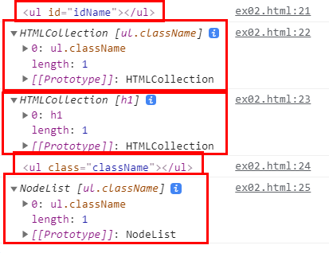
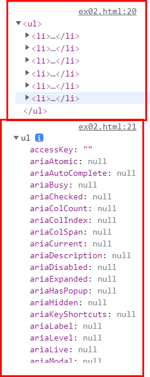
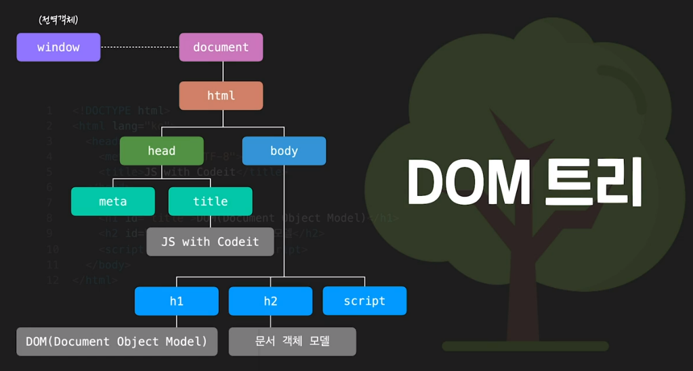
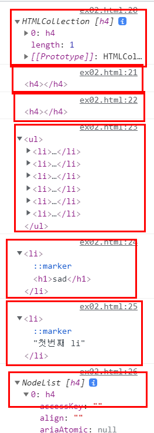
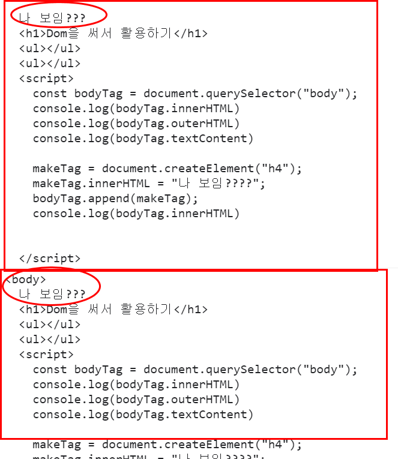
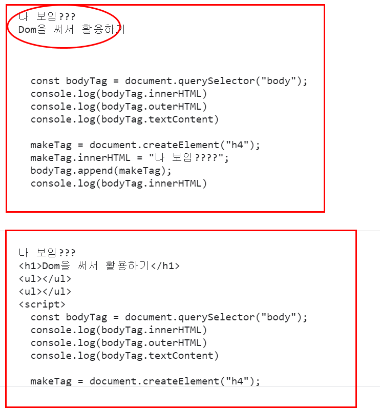

## ***난위도 : ★★★☆☆***

**Reat 들어가지전에 무조건 알아야되고 동적인 HTML을 HTML이나 CSS가아닌**

**JS로 동작키는 것이라고 생각하면된다~!**

**죽을맛이다 엉아는~ㅠ**


### ***# Dom 도대체 왜 쓰는 거임??????🙄***

**\*참고한것! ( [여기 클릭! : 출처 MDN](https://developer.mozilla.org/ko/docs/Web/API/Window) )**

- 웹 페이지 내의 모든 HTML 태그를 계층화시켜 객체로 나타내는것
- 자바스크립트로 HTML과 CSS를 조작할수있다!
- 여기서 가장 중요한점은 DOM이 객체라는것!!!
- Window는 모든 브라우저 객체이고 모든 객체의 최상단 객체!
- console 객체도 알고보면 window.console이었다는점!

**\*밑에 예시로 2개(Dom ㄴㄴ, Domㅇㅋ) 구현했는데 지금은 둘다 비슷해 보일지 모르지만**  
**데이터가 100만개가 있다라고 하면 반복문 돌려서 Dom으로 HTML 코드를 찍어내는게 가독성이 좋아 보일것이다**

```html
<!DOCTYPE html>
<html lang="en">
<head>
  <meta charset="UTF-8">
  <meta http-equiv="X-UA-Compatible" content="IE=edge">
  <meta name="viewport" content="width=device-width, initial-scale=1.0">
  <title>Document</title>
</head>
<body>
  <h1>Dom을 안쓰고 html만으로 표현하기</h1>
  <ul>
    <h4>하루 일과</h4>
    <li>일어나기</li>
    <li>잠자기</li>
    <li>씻기</li>
    <li>먹기</li>
  </ul>
  <ul>
    <h4>위코드란</h4>
    <li>힘들다</li>
    <li>새롭다</li>
    <li>눈물난다</li>
    <li>시간이부족하다</li>
  </ul>
</body>
</html>
```

```html
<!DOCTYPE html>
<html lang="en">
<head>
  <meta charset="UTF-8">
  <meta http-equiv="X-UA-Compatible" content="IE=edge">
  <meta name="viewport" content="width=device-width, initial-scale=1.0">
  <title>Document</title>
</head>
<body>
  <h1>Dom을 써서 활용하기</h1>
  <ul></ul>
  <ul></ul>
  <script>
    let firstDB = ["하루 일과", "일어나기", "잠자기", "씻기", "먹기"];
    let secondDB = ["위코드란", "힘들다", "새롭다", "눈물난다", "시간이 부족하다"];

    const bodyTag = document.querySelector("body");
    const firstUlTag = bodyTag.children[1];
    const secondUlTag = bodyTag.children[2];

    let makeTag;

    const makeTagFuntion = (el, index) => {
      if(!index){
        makeTag = document.createElement("h4");
        makeTag.innerHTML = el;
        firstUlTag.append(makeTag);
      }else {
        makeTag = document.createElement("li");
        makeTag.innerHTML = el;
        firstUlTag.append(makeTag);
      }
    }

    firstDB.forEach(makeTagFuntion);
    secondDB.forEach(makeTagFuntion);
  </script>
</body>
</html>
```

### ***#HTML 가져오는 방법 ! 어떻게 하는거임???(수정하기)😮***

**\* 유사배열이란? : 배열과 다름 인덱스로 접근 가능하지만 배열 배소드 사용불가**

|  |  |
| --- | --- |
| document 메소드 | 뭥미? |
| getElementById(); | - argument로 값으로 Id 식별자를 전달해주면 HTML에 있는 형식 그대로 나옴 - 존제하지 않는 값을 넣어주면 null이나옴 |
| getElementsByClassName(); | -  argument로 class 식벽자를 전달해주면 사용하는 태그들이 싹다 다 유사배열에 담겨서 옴 - 메소드(push등)는 사용할수 없음 (=유사배열 특징)  - 존재하지 않는 class 속성값을 넣어주면 HTMLCollection[]이 출력됨 (비어있는 배열, null과 다름) |
| getElementsByTagName(); | - HTML에서 쓰이는태그를 넣어주면 쓰이는 태그들의 목록을 유사배열의 형태로 가져옴! - 존제하지 않는 태그를 넣어줄 경우나 유사배열에 저장된다는점 getElementsByClassName와 동일 - \* 를 넣어주면 모든 태그내용 가져옴 (개꿀티~) |
| querySelector() | - HTML에 있는 형식 그대로 나옴 - 식별자 태그 전부 argument로 전달가능😮 - class 식별자를 넣으면 유사배열이 아니라 첫번째 요소만 출력됨! |
| querySelectorAll() | - class처럼 여러값을 가져오거나 유사배열로 출력할때 주로씀 - argument에 모든 식별자가 들어갈 수 있음 -기본적으로 NodeList에 저장됨 - 존재하지 않는 class 속성값을 넣어주면 NodeList[] 로 출력됨 |

> **보통은 querySelector를 많이쓰고 Dom의 첫단계이자 꽃이기 때문에 이것은 무조건 필수 구현해보기~!**

```html
<!DOCTYPE html>
<html lang="en">
<head>
  <meta charset="UTF-8">
  <meta http-equiv="X-UA-Compatible" content="IE=edge">
  <meta name="viewport" content="width=device-width, initial-scale=1.0">
  <title>Document</title>
</head>
<body>
  <h1>HTML 태그값 가져오는 메소드</h1>
  <ul></ul>
  <ul class="className"></ul>
  <ul id="idName"></ul>
  <script>
    const getElementByIdF = document.getElementById("idName");
    const getElementsByClassNameF = document.getElementsByClassName("className");
    const getElementsByTagNameF = document.getElementsByTagName("h1");
    const querySelectorF = document.querySelector(".className");
    const querySelectorAll = document.querySelectorAll(".className");

    console.log(getElementByIdF);
    console.log(getElementsByClassNameF);
    console.log(getElementsByTagNameF);
    console.log(querySelectorF);
    console.log(querySelectorAll);

  </script>
</body>
</html>
```



### ***#  이벤트 속성부여(클릭시?, 글자 입력시? 등등)***

**\*이벤트 종류 모음 : <https://zibu-story.tistory.com/110>**

|  |  |
| --- | --- |
| 이벤트 접근 | 뭥미? |
| 요소.addEventListener() | - 첫번째 argument는 이벤트 종류가 들어가고, 두번째 argument에는 콜백함수가 들어간다 - 만약 콜백함수를 두번째 인자로 안주고 밖에서 따로 함수를 선언 했다면 argument 로 함수() 이렇게 정의하지말고 함수명만 가져오자 - 두번째 인자로 받아온 argument에 들어갈 콜백함수 파라미터에는 event 변수명이 들어가고 각 이벤트의 메소드 프로퍼티를 자유롭게 쓸 수 있게한다.(안써도 무관 |

**보통은 가독성때문에 두번째 argument로 주는 익명함수를 밖에 먼저 정의한다고 함!**

```html
<!DOCTYPE html>
<html lang="en">
<head>
  <meta charset="UTF-8">
  <meta http-equiv="X-UA-Compatible" content="IE=edge">
  <meta name="viewport" content="width=device-width, initial-scale=1.0">
  <title>Document</title>
</head>
<body>
  <button type="button">버튼</button>
  <input type="text" placeholder="여기 입력해보세요">
  <script>
    const buttonEvent = document.getElementsByTagName("body")[0];
    buttonEvent.addEventListener("click" , e => {
      alert("클릭 이벤트");
      console.log("클릭이벤트")
    })

    const inputEvent = document.getElementsByTagName("input")[0];
    console.log(inputEvent)
    inputEvent.addEventListener("keydown" , e => {
      alert("적을때 이벤트");
    })
  </script>
</body>
</html>
```

### ***# 꿀~팁??? onsole.dir vs console.log👶***

**보통 값을 확인하고 싶을때는 log를 주로 쓰는 편이고 나중에 JSON에서는 dir많이 사용할것같음(내 예상~ ㅋ)**

|  |  |
| --- | --- |
| 출력하는 console의 메소드 | 뭥미??? |
| console.dir() | - 문자열 표시 형식으로 콘솔에 출력 - 객체의 속성을 좀 더 자세하게 출력  - 여러 값을 전달하더라도 첫 번째 값만 출력 - DOM객체에서는 대상을 객체 형태로 출력 |
| console.log() | - 파라미터로 전달받은 값을 위주로 출력  - 여러 값을 쉼표로 구분해서 전달하면 전달받은 모든 값을 출력 - DOM객체에서는 대상을 HTML 형태로 출력 |

```html
<!DOCTYPE html>
<html lang="en">
<head>
  <meta charset="UTF-8">
  <meta http-equiv="X-UA-Compatible" content="IE=edge">
  <meta name="viewport" content="width=device-width, initial-scale=1.0">
  <title>log 랑 dir 비교</title>
</head>
<body>
  <ul>
    <li></li>
    <li></li>
    <li></li>
    <li></li>
    <li></li>
    <li></li>
  </ul>
  <script>
    const ulTag = document.getElementsByTagName("ul")[0];
    console.log(ulTag);
    console.dir(ulTag)

  </script>
</body>
</html>
```



### ***#DOM트리?? 노드??? 시작하기전 용어부터 정리하고 들어가자~!!🎈***

**HTML에서 계층구조로 부모태그 자식태그가 있듯이**   
**Dom으로 가져온 객체에서도 동일하게 부모노드 자식노드로 이뤄져잇음**   
**- 요소노드 : 태그를 표현하는 노드**   
**- 택스트 노드 : 문자를 표현하는 노드, 자식노드를 가질수 없음**  
**- 형제노드 : HTML에서 같은 선상에 위치하고 있는 노드들간의 관계**  
**- 자식노드 : HTML에서 나의 기준 하위태그를 말함**  
**- 부모노드 : HTML에서 나의 기준 상위태그를 말함**



*코드잇 - 자바스크립트 중급*

### ***#HTML에서 가져온 노드에서 다른 노드들간의 이동🛺***

**꿀팁 ? Node간의 이동 즉 태그랑 텍스트랑 이동하고 싶을때는 밑에 메소드에서 Element만 빼주면 됨**  
**단, children()메소드 같은경우는 childrenNodes로 표기하고 리턴은 NodeList가 된다.**

|  |  |
| --- | --- |
| 노드들간에 이동하기위함 메소드 | 뭥미? |
| children() | - 지정 요소의 자식 요소 모음 - 리턴 HTMLCollection |
| firstElementChild() | - 지정 요소의 첫번째 자식 요소 |
| lastElementChild() | - 지정 요소의 마지막 자식 요소 |
| parentElement() | - 지정 요소의 부모 요소 하나 |
| priviousElementSibling() | - 지정 요소의 이전 혹은 좌측에 있는 요소 하나 |
| nextElementSibling() | - 지정 요소의 다음 혹은 우측에 있는 요소 하나 |

```html
<!DOCTYPE html>
<html lang="en">
<head>
  <meta charset="UTF-8">
  <meta http-equiv="X-UA-Compatible" content="IE=edge">
  <meta name="viewport" content="width=device-width, initial-scale=1.0">
  <title>log 랑 dir 비교</title>
</head>
<body>
  <ul>
    <li>첫번째 li</li>
    <li><h4></h4></li>
    <li><h1>sad</h1></li>
    <li></li>
    <li></li>
    <li></li>
  </ul>
  <script>
    const ulTag = document.getElementsByTagName("li")[1];
    console.log(ulTag.children);
    console.log(ulTag.firstElementChild);
    console.log(ulTag.lastElementChild);
    console.log(ulTag.parentElement);
    console.log(ulTag.nextElementSibling);
    console.log(ulTag.previousElementSibling);
    console.log(ulTag.childNodes)

  </script>
</body>
</html>
```



### ***# 노드 전체를 가지고오고 싶을때는 어떻게함?(HTML 코드 전체 DOM으로 가져옴)***

|  |  |
| --- | --- |
| 노드 전체 가져오기 | 뭥미? |
| innerHTML | - 요소 노드 내부의 HTML코드 문자열로 리턴 - 요소 안의 정보를 확인할 수도 있지만, - 내부의 HTML 자체를 수정할 때 좀 더 자주 활용 |
| outerHTML | - 요소 노드 자체의 전체적인 HTML 코드를 문자열로 리턴 - outerHTML은 새로운 값을 할당하면 요소 자체가 교체되어 버리기 때문에 주의 |
| textContent | - 요소 노드 내부의 내용들 중에서 HTML을 제외하고 텍스트만 리턴 - 텍스트만 다루기 때문에 HTML태그를 쓰더라도 모두 텍스트로 처리됨 |

**문제 발생!**  
**이렇게하면 HTML에서 만든 태그와 속성들이  보존이 않된다. (자체 요소의 값을 건들이거나 수정하니까)기본적으로 들여쓰기 엔터 포함해서 출력됨**  
**그럼 어떻게 해결??**  

**문제 해결방안 : 새로운 노드를 만들어 CSS속성을 부여하고 기존노드에 추가한다**  
**- 요소 만들기 : document .createElement()**  
**- 요소 노드 꾸미기: element .textContent, element .innerHTML 등등**  
**- 요소 노드 추가 혹은 이동하기: element .prepend, element .append, element .after, element .before**  
**- 요소 노드 삭제하기: element .remove()**

```html
<!DOCTYPE html>
<html lang="en">
<head>
  <meta charset="UTF-8">
  <meta http-equiv="X-UA-Compatible" content="IE=edge">
  <meta name="viewport" content="width=device-width, initial-scale=1.0">
  <title>Document</title>
</head>
<body>
  나 보임???
  <h1>Dom을 써서 활용하기</h1>
  <ul></ul>
  <ul></ul>
  <script>
    const bodyTag = document.querySelector("body");
    console.log(bodyTag.innerHTML)
    console.log(bodyTag.outerHTML)
    console.log(bodyTag.textContent)

    makeTag = document.createElement("h4");
    makeTag.innerHTML = "나 보임????";
    bodyTag.append(makeTag);
    console.log(bodyTag.innerHTML)

  </script>
</body>
</html>
```





### ***# CSS 속성을 DOM에서 만들고 HTML 속성으로 추가한당?***

**\*비표준과 비표준 차이** : <https://kyoung-jnn.tistory.com/entry/HTML-CSS-DOCTYPE-%EA%B3%BC-%ED%91%9C%EC%A4%80-%EB%B9%84%ED%91%9C%EC%A4%80-%EB%AA%A8%EB%93%9C-Standard-Quirks-mode>

**위에 읽어보면 알겠지만 표준과 비표준을 안다는 가정하에 비표준 속성같은 경우 Dom 프로퍼티로 변환이 않되서**  
**style보다는 추천 , style은 고정적으로 부여하고 싶을때 주로 사용함**

|  |  |
| --- | --- |
| DOM에서 CSS 만드는 메소드 | 뭥미? |
| getAttribute() | - CSS 속성에 접근하여 값을 꺼내올때 사용하는 메소드 - argument로 속성만 주면 됨 |
| setAttribute() | - CSS 속성에 접근하여 값을 집어넣을때 사용하는 메소드 - 첫번째 argument로 속성, 첫번째 argument로 값 이렇게 주면 됨 |
| removeAttribute() | - CSS 속성에 접근하여 값을 제거할때 사용하는 메소드 - argument로 속성만 주면 됨 |

```html
<!DOCTYPE html>
<html lang="en">
<head>
  <meta charset="UTF-8">
  <meta http-equiv="X-UA-Compatible" content="IE=edge">
  <meta name="viewport" content="width=device-width, initial-scale=1.0">
  <title>Document</title>
</head>
<body>
  <p><a id="abc" href="#">CODING FACTORY</a></p>
  <script>
    document.getElementById('abc').setAttribute('href', 'https://zibu-story.tistory.com/' );
  </script>
</body>
</html>
```

### ***#  CSS에 속성을 미리 만들고 식별자를 Dom 으로 HTML에 부여 or 삭제하기(class태그)👧***

**이렇게 메소드를 사용해서 쓰는 이유는 style 프로퍼티나 setsetAttribute 메소드가 여러개의 값을 전달하지 못할뿐더**  
**css 속성을 JS에서 부여하는것 자체가 일관성에 안맞는다.**

|  |  |
| --- | --- |
| DOM으로 class식별자 부여 메소드 | 뭥미??? |
| classList.add() | - argument로 여러개의 식별자를 전달해서 추가 가능 |
| classList.remove() | - argument로 여러개의 식별자를 전달해서 삭제 가능 |
| classList.toggle() | - 하나의 값을 전달 가능하고 두번째 argument로는 추가 혹은 삭제를 강제할수있음 - 두번때 argument를 안쓸경우 첫번째 argument로 준 class식별자가 있을경우 삭제 없다면 추가 하는거 - 이거는 상황 잘 파악한후 쓰라고하심 |

```html
<!DOCTYPE html>
<html lang="en">
<head>
  <meta charset="UTF-8">
  <meta http-equiv="X-UA-Compatible" content="IE=edge">
  <meta name="viewport" content="width=device-width, initial-scale=1.0">
  <title>Document</title>
</head>
<body>
  <p><a href="#">CODING FACTORY</a></p>

  <style>.abc{color: red;}</style>
  <script>
    document.querySelector('a').classList.add('abc');
  </script>
</body>
</html>
```
