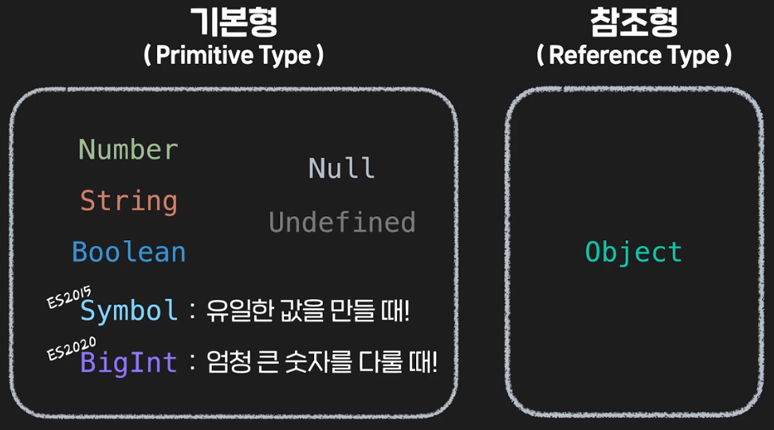
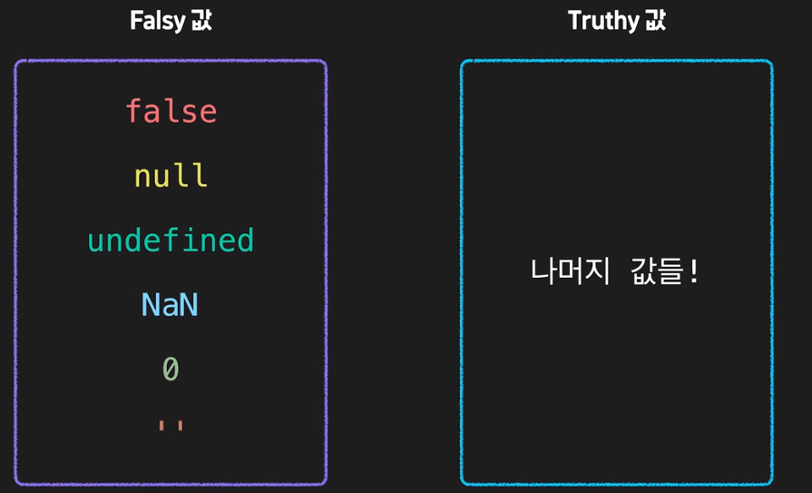
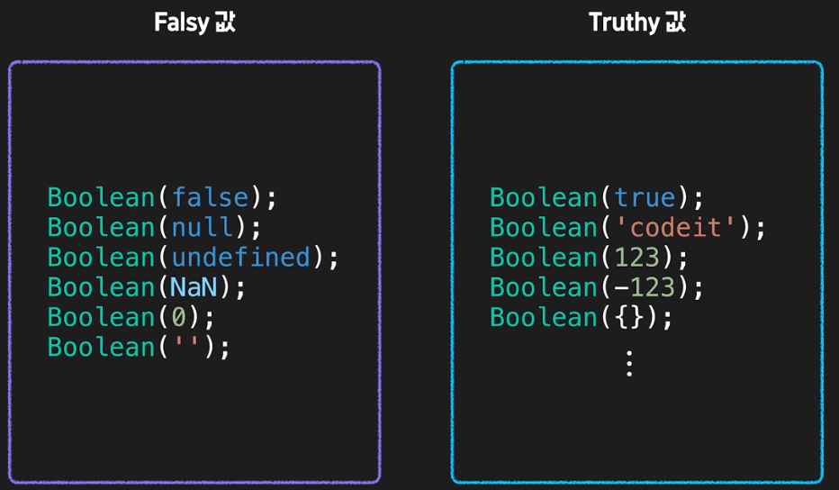

***\*참고한곳! (잘 정리했음!)***

<https://curryyou.tistory.com/192>

[🔗 [자바스크립트] 변수 선언 방식 차이: var / let / const](https://curryyou.tistory.com/192) — 자바스크립트의 변수 선언은 var로만 가능했으나, ES6(ES2015)부터 let과 const가 추가 되었다. 옛날의 var가 최신의 let(변수), const(상수)로 분리되었다고 생각할 수 있으나, 내부 사정은 상당히 다르

--> 밑에 직접 코딩한거

#### ***# ECMAScript(ES, 자바스크립트 표준 명세서)***

ecma (국제표준화기구)에서 자바스크립트 규정을    
ECMA-262로 문서화 했는데 그내용이 ES임

#### ***# 모던 자바스크립트***

현 시점에 사용하기 적합한 범위 내에서 최신버전의 표준을 준수하는 자바스크립트

#### ***#자바스크립트 vs ES***

-JavaScript는 프로그래밍 언어이고, ECMAScript는 프로그래밍 언어의 표준   
-ECMAScript는 JavaScript가 갖추어야 할 내용을 정리해둔 '설명서'이고, JavaScript는 ECMAScript를 준수해서 만들어낸 '결과물'   
-ECMAScript는 JavaScript 뿐만아니라 모든 스크립트 언어(scripting languages)가 지켜야 하는 표준   
-JavaScript는 ECMAScript를 기반으로 하지만 ECMAScript에 정의된 내용뿐만 아니라, WebIDL의 표준화된 기술도 사용함(DOM : HTML을 JS에서 다루는 객체,문법)

#### ***# 자바스크립트 데이터 타입 종류***



#### ***# typeof 연산자의 실체***

-키워드 다음에 공백(띄어쓰기)을 두고 값을 작성해도 되고, 함수를 사용하듯 괄호로 감싸서 사용할 수도 있음   
-연산자의 결과가 모든 타입과 1:1로 매칭되지 않는다는 점??   
-typeof null을 하면 문자열 null이 리턴되는 게 아니라 문자열 object가 리턴??   
-자바스크립트에서 함수는 객체 취급하지만 typeof 함수하면 Object가 아닌 function이 리턴

```javascript
//typeof 연산자
console.log(typeof 'codeit');//String
console.log(typeof Symbol());//symbole
console.log(typeof []);//object
console.log(typeof {});//object
console.log(typeof true);//boolean
console.log(typeof (false));//boolean
console.log(typeof 123);//number
console.log(typeof NaN);//number
console.log(typeof 456n);//begint
console.log(typeof undefined);//undefined
```

#### ***# boolean이 아닌 boolean 같은 너***

자바스크립트에서는 boolean형이 아니라도 다른 데이터 타입이 boolean형으로 자동 형변환 됨   
사진





```javascript
//boolean의 실체
console.log(Boolean(false));//false
console.log(Boolean(123));//true
console.log(Boolean(0));//false
console.log(Boolean('Sdas'));//true
console.log(Boolean(NaN));//false
console.log(Boolean(undefined));//false
console.log(Boolean(''));//false
console.log(Boolean(null));//false
console.log(Boolean(true));//true
console.log(Boolean(-123));//true
console.log(Boolean({}));//true
console.log(Boolean([]));//true
```

#### ***# AND(&&)와 OR(||) 연산의 진실***

불린형을 조합해서 출력하는게아닌 선택하는거였음   
1. AND(&&) 연산의 진실   
-좌측값이 true면 우측갑 출력   
-촤측값이 false면 좌측값 출력   
2. OR(||) 연산의 진실   
-좌측값이 true면 좌측갑 출력   
-촤측값이 false면 우측값 출력   
3. 연산시 AND(&&)가 OR(||) 보다 우선순위에 있다   
4. null병합 연산자(??) OR(||)이랑 비슷할수 있으니 주의!   
- 연산자(??)좌측에 null, undefined 있으면 우측출력   
- 연산자(??)좌측에 null, undefined 없으면 좌측 출력

```javascript
// &&, ||, ?? 연산의 진실
console.log('codeit' && 'javs'); //true && true --> 우측 출력(javs)
console.log(0 && 'javas'); //false && true --> 좌측 출력(0)
console.log('codeit' || 'javs'); //true || true --> 좌측 출력(codeit)
console.log(0 || 'javas'); //false || true --> 우측 출력(javas)
console.log(0 ?? 'javas'); //좌측에 null,undefined 없음 좌측출력(0)
console.log(null ?? 'javas'); //좌측에 null,undefined 있음 우측출력(javas)

//Quiz~!
function print(value) {
  const message = value || 'Codeit';
  console.log(message);
}
print();//Codeit 출력
print('javaScript')//javaScript출력
```

#### ***# var, let, const 차이점 5가지***

1. 중복선언 가능 여부   
-var : 중복 선언이 가능하다.   
-const, let : 중복 선언 불가능

```javascript
//-중복선언가능여부 : var 중복 선언이 가능, const, let 중복 선언 불가능
console.log('----중복선언가능여부--');
console.log('----var차례---');
var vtest3 = '안녕';
var vtest3 = '잘가';
console.log(vtest3); //잘가
console.log('----let차례---');
let vtest2 = '안녕';
//let vtest2 = '잘가'; //Error
console.log(vtest2);
console.log('----const차례---');
const vtest1 = '안녕';
//const vtest1 = '잘가'; //Error
console.log(vtest1);
```

2. 재할당 가능 여부   
var, let : 값의 재할당이 '가능'한 변수다.   
const : 값의 재할당이 '불가능'한 상수다.

```javascript
//재할당 가능 여부 : var, let 가능 ,const 불가능
console.log('----재할당 가능 여부--');
console.log('----var차례---');
var vtest3 = '안녕';
vtest3 = '잘가';
console.log(vtest3); //잘가
console.log('----let차례---');
let vtest2 = '안녕';
vtest2 = '잘가'; 
console.log(vtest2);//잘가
console.log('----const차례---');
const vtest1 = '안녕';
//vtest1 = '잘가'; //Error
console.log(vtest1);
```

3. 변수 스코프 유효범위   
var : 함수 레벨 스코프(function-level scope), 함수블록 기준에서 유효범위 발동(for,if,while은 ㄴㄴ)  
let, cost : 블록 레벨 스코프(block-level scope), 블록 기준으로 유효범위 발동  
스코프 : 유호한 참조범위, 변수가 어디까지 사용가능한지 범위

```javascript
//-유효범위(스코프) : var 함수레벨 , let const 블록레벨
console.log('----스코프--');
console.log('----var차례---');
for (var i = 0; i < 5; i++) {
    console.log(i);//0~4
  }
console.log(i);//5
console.log('----let차례---');
for (let i = 0; i < 5; i++) {
    console.log(i);//0~4
  }
//console.log(i); //Error
console.log('----const차례---');
for (const i = 0; i < 5; i++) {
    console.log(i);//0~4
  }
//console.log(i); //Error
```

4. 변수 호이스팅 방식   
var: 변수 호이스팅이 발생한다.   
let, const: 변수 호이스팅이 발생한다. 하지만 다른 방식으로 작동한다.   
호이스팅 : 선언을 나중에하고 먼저 사용 가능한지 체크하는거?

```javascript
//-호이스팅가능여부 : var가능 ,const let 불가능
console.log('----호이스팅가능여부--');
console.log('----var차례---');
console.log(vtest1);
var vtest1 = 'var입니다'
console.log(vtest1);
console.log('----let차례---');
//console.log(ltest2); //Error
let ltest2 = 'let입니다'
console.log(ltest2);
console.log('----const차례---');
//console.log(ctest3); //Error
const ctest3 = 'const입니다'
console.log(ctest3);
```

5. 전역객체 프로퍼티 여부   
var : var로 선언된 변수는 전역객체(브라우저 환경의 경우 window)의 프로퍼티다.   
let, const : let/const 로 선언된 변수는 전역객체 프로퍼티가 아니다.

***\*결론 (구글의 자바스크립트 스타일 가이드 참고)***

1. const와 let을 이용해서 변수를 선언라.   
2. 값을 재할당하는 경우가 아니라면, const를 디폴트로 사용하라.   
3. var는 절대로 사용하지 말라
