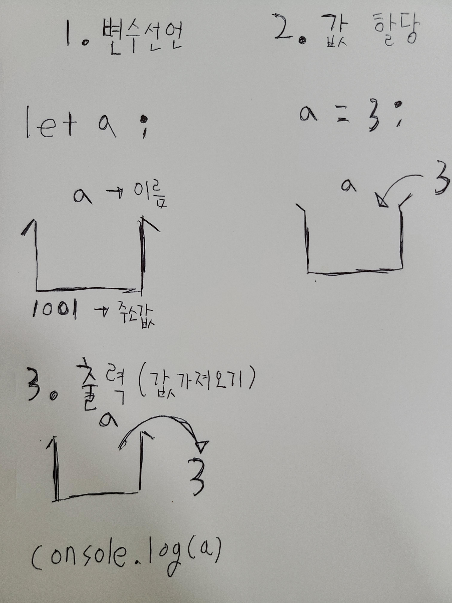
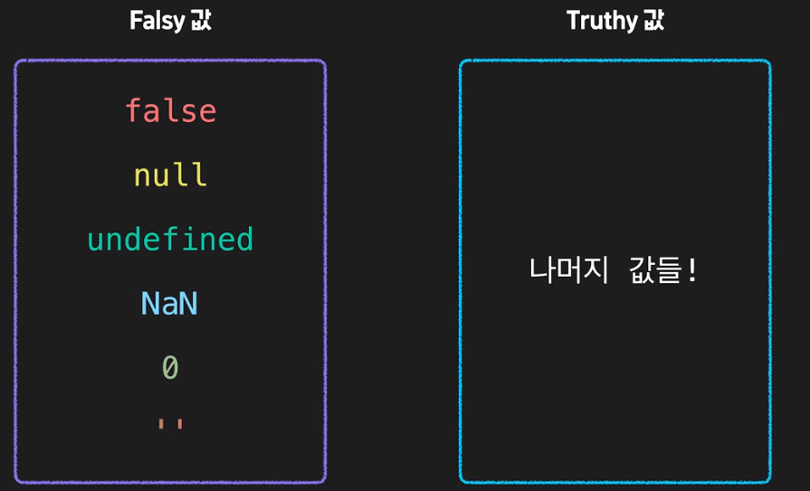
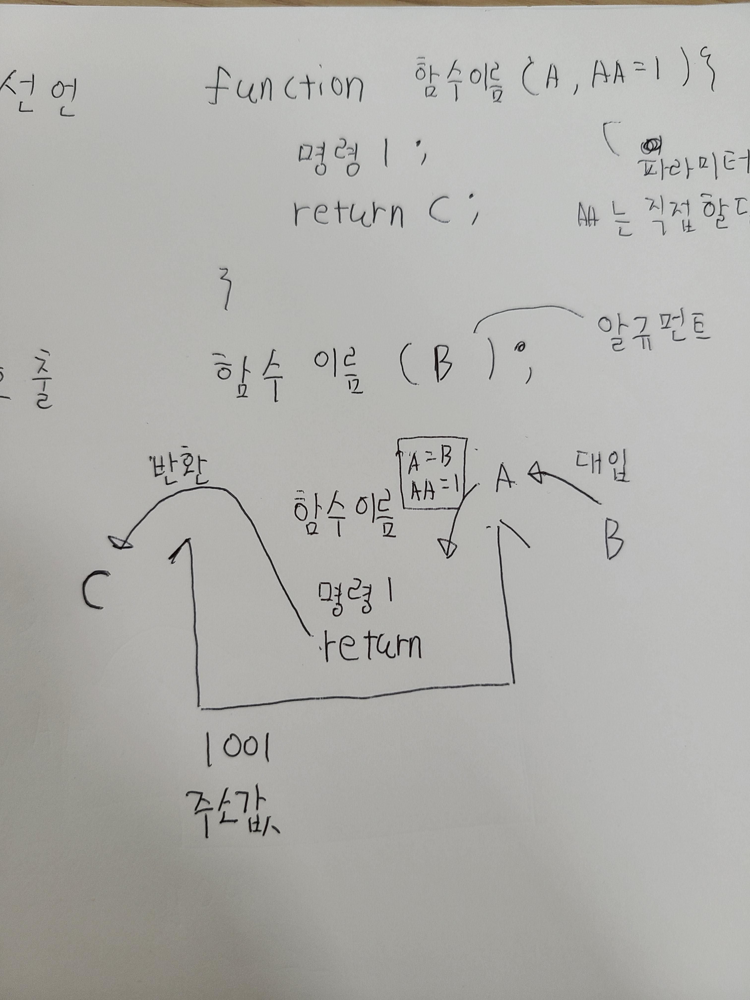

## ***난위도 : ★☆☆☆☆***

### ***# 들어가기전에 ~ 자바스크립트에서 출력할때 쓰는것***

|  |  |  |
| --- | --- | --- |
| 출력함수 | 정의 | 예시 |
| decument | 웹 페이지 그 자체를 의미합니다. 웹 페이지에 존재하는 HTML 요소에 접근하고자 할 때는 반드시 Document 객체부터 시작해야 합니다. | ex) document.write(글자) : 웹페이지에 글자를 출력함 |
| console | IDE에서나 웹페이지 개발자도구 콘솔에 출력하는 객체 | ex) console.log(글자) : 콘솔에 글자를 출력함 |
| alert | 자바스크립트에서 가장 많이 사용되는 웹브라우저상 메세지창, 사용자로부터 입력을 받을 필요가 없고 단순히 메시지창을 나타내고자 할때 사용 | ex) alert('글자') |
| prompt | 사용자의 입력을 받아 브라우저 창에 메세지 창을 띄울수 있다 | ex) prompt('설명', '입력') |

### ***#변수가 필요한 이유와 선언하는 방법***

1. 변수의 정의    
- 여러 종류(숫자, 문자, 주소값, 객체, 함수 등)의 데이터들을 집어넣고 뺄수있는 바구니 같은 존재   
- 선언하면 공간이 생겨나고 여러 종류의 값들을 할당할수있다.(집어 넣을 수 있다)   
- 자바스크립트는 동일한 바구니(변수)에 여러 데이터 타입을 넣을수있다    

2. 변수의 선언, 할당방법:   
- 주소값으로 바구니 안에있는 값에 접근하는것보다    
이름으로 접근하는게 편해서 이름을 붙임 그게 변수이름   
- 변수이름으로 바구니에 있는 값을 넣고 뺄수있음   
- 표기법 :  변수이름 = 값;

```javascript
//변수 선언 할당
let numerad;//선언
numerad = 3;//할당
let numerad2 = 3; // 선언 +할당
console.log(numerad2); //3 출력됨
```



3. 전역변수와 지역변수의 차이   
전역변수 :  함수 외부에서 선언된 변수로, 프로그램 전체에서 접근할 수 있는 변수   
지역변수 : 함수 내부에서 선언된 변수로, 함수가 실행되면 만들어지고 함수가 종료되면 소멸하는 변수   
블록 밖에서 지역변수 사용 불가능(var는 예외)

```javascript
//전역변수, 지역변수
function arr (){
    let numA = 40; //numA는 지역변수
    console.log(numA)
}
let numB = 30;//numB는 전역변수
console.log(numB);
```

4. const, let, var 의 차이점(변수)

-재할당 : 선언된 변수에 다른값을 넣는것  
-중복선언 : 동인한 이름의 변수를 선언하는것  
-함수 스코프 : 선언한 함수(if, while, for 제외)의 블록(대괄호) 안에서 선언한 변수는 밖에서 사용불가  
-블록 스코프 : 무조건 블록 안에서 선언한 변수 밖에서 사용 불가  
-호이스팅 : 선언은 나중에하고 할당이나 호출부터 하는것

|  |  |  |  |
| --- | --- | --- | --- |
| 데이터(바구니) 종류 | var | let | const |
| 중복선언 | O | X | X |
| 재할당 | O | O | X |
| 스코프 | 함수 | 블록 | 블록 |
| 호이스팅 | O | X | X |

```javascript
//-중복선언가능여부 : var 중복 선언이 가능, const, let 중복 선언 불가능
var vtest3 = '안녕';
var vtest3 = '잘가';
console.log(vtest3); //잘가
let vtest2 = '안녕';
//let vtest2 = '잘가'; //Error
console.log(vtest2);
const vtest1 = '안녕';
//const vtest1 = '잘가'; //Error
console.log(vtest1);

//재할당 가능 여부 : var, let 가능 ,const 불가능
var vtest3 = '안녕';
vtest3 = '잘가';
console.log(vtest3); //잘가
let vtest2 = '안녕';
vtest2 = '잘가'; 
console.log(vtest2);//잘가
const vtest1 = '안녕';
//vtest1 = '잘가'; //Error
console.log(vtest1);

//-유효범위(스코프) : var 함수레벨 , let const 블록레벨
for (var i = 0; i < 5; i++) {
    console.log(i);//0~4
  }
console.log(i);//5
for (let i = 0; i < 5; i++) {
    console.log(i);//0~4
  }
//console.log(i); //Error
for (const i = 0; i < 5; i++) {
    console.log(i);//0~4
  }
//console.log(i); //Error

//-호이스팅가능여부 : var가능 ,const let 불가능
console.log(vtest1);
var vtest1 = 'var입니다'
console.log(vtest1);
//console.log(ltest2); //Error
let ltest2 = 'let입니다'
console.log(ltest2);
//console.log(ctest3); //Error
const ctest3 = 'const입니다'
console.log(ctest3);
```

5. 변수가 필요한 이유   
- 값을 바구니(변수)에 담아 언제든지 쓸수있으니까   
- 주소값으로 접근하면 오류가 날수도있고 값으로 접근시 재할당이 불가능하다(똑같은 값이라도 갖고있는 주소값이 다르기때문!   
- 더 많은 이유가 있겠지만 이걸로도 충분한것같다.

**\*자바스크립트의 변수의 데이터 크기 및 공간 생기는 법칙**

- var, let const 를 데이터 타입이라고 부름? 아님 다른 지칭이 있음?  
re : 데이터 타입은 Number, Boolean, String 을 부르는 말이고 var, let, const는 키워드라고 부르는것같음  
- var,let const에따라 크기가 달라짐? 아님 Number Boolean에따라 크기가 달라짐?  
re : 자바와 다르게 자바스크립트는 하이언어(사람의 언어)에 가까워서 데이터공간을 가비지 컬렉터에서 자동으로  
만들고 해제 해주며 선언할때 바구니(데이터크기)가 만들어지는게 아니라 할당할때 데이터 타입별로 만들어짐  
즉 var, let, const(키워드)로 데이터 공간이 할당되는게 아니라 Number, Boolean, String(데이터 타입)별로 공간이 할당됨  
Boolean(1bit), Number(64bit), String(16bit)  
단, 이렇게 가비지 컬렉터에서 자동적으로 해제하고 할당하는데 문제가 있고 이부분을 Memory Overflow(할당된 메모리가 더 이상 필요 없을 때"를 알아내기가 어렵다는 것)라고 한다.

### ***#자바스크립트 데이터 타입의 종류***

1. 변수의 데이터 타입 종류

**기본타입 (해당 값으로 바구니(변수)에 넣음)**

|  |  |  |
| --- | --- | --- |
| 종류 | 정의 | 예시 |
| Number | 숫자 그 자체 | ex) let a = 1; |
| Boolean | 참과 거짓(true, false) 2가지로 값을 표현 | ex) let a = true; |
| String | 문자, 문자열(작은따음표, 큰따음표로 표시) | ex) let a = 'my'; |
| undefined | 값을 바구니(변수)에 넣지 않는 상태, 선언만하고 값을 할당하지 않는 상태 | ex) let a; |
| Null | 사용자가 바구니(변수)에 값이 없다는 것을 임의로 표기하기 위해 null이라는 값을 넣은것 | ex) let a = null; |

**참조타입 (해당 주소값으로 바구니(변수)에 넣음)**

|  |  |  |
| --- | --- | --- |
| 종류 | 정의 | 예시 |
| 배열 | 기본 타입에 있는 값(value)들로 이뤄져있는 묶음(대괄호로 표시함) | ex) let a = [1, "str", true]; |
| 객체 | 기본 타입에 있는 값(value)들을 key로 구분하여 묶은것(중괄호로 표시함,객체 함수 배열 등이 올수있음) | ex) let a = {1 : "str", 'A' : [30,2], function(){ } } |
| 함수 | 명령어들의 집합체(선언하는 방식 3가지 있음) | ex) function(a){ return a+2; } |

```javascript
//undefined null
let undefines;//undefined 출력됨
console.log(undefines);
let nulls = null;//null은 사용자가 임의로 값이 없다는것을 지정
console.log(nulls);
```

#### ***\* undefined 와 NaN 의 개념***

-undefined 는 선언은 하고 값을 할당하지 않는 상황

-NaN은 Number에 하위 계층 객체, 그래서 typeOf 메소드로 확인하면 Number가 출력됨

#### ***\* NaN이라고 출력되는 경우(전역 스코프)***

Not-A-Number(숫자가 아님)를 나타냄

1. 숫자로서 읽을 수 없음 (parseInt("어쩌구"), Number(undefined))

2. 결과가 허수인 수학 계산식 (Math.sqrt(-1))

3. 피연산자가 NaN (7 \*\* NaN)

4. 정의할 수 없는 계산식 (0 \* Infinity)

5. 문자열을 포함하면서 덧셈이 아닌 계산식 ("가" / 3)

2. 각각 변수끼리 연산할때 결과값

```javascript
//타입별 연산 결과
//case1 : Number+String 
console.log(20 + 'str'); //20(Number)가 문자열(String)으로 바뀜, 20str출력
//case2 : Number + Boolean
console.log(20 + true); //true가 숫자 1로 바뀜(false는 0으로), 21출력
//case3 : Number + undefined
console.log(20 + undefined); //undefined는 숫자와 연산불가,NaN출력
//case4 : Number + null
console.log(20 + null); //null을 숫자로 바꾸면 0, 20출력
//case5 : String + Boolean
console.log('str' + true); //true가 문자열로 바뀜, strtrue출력
//case6 : String + undefined
console.log('str'+ undefined); //undefine가 문자로 바뀜, strundefined 출력
//case7 : String + null
console.log('str' + null); //null가 문자로 바뀜, strnull 출력
//case8 : Boolean + undefined
console.log(true + undefined); //undefined는 불린과 연산 불가, NaN출력
//case9 : Boolean + null
console.log(true + null); //true를 숫자로 바꾸면 1 null을 숫자로 바꾸면 0, 1 출력
//case10 : null + undefined
console.log(null + undefined); //null은 숫자로 바꾸면 0인데 undefined는 숫자연산 불가능
```

3. 기본타입을 Boolean형으로 바꿀시



```javascript
//기본타입 --> 불린형
//case1 : 0을 제외한 숫자
console.log(Boolean(100)); // true 출력
//case2 : 0(숫자) 
console.log(Boolean(0));// false 출력
//case3 : 문자
console.log(Boolean('str'));// true 출력
//case4 : 공백
console.log(Boolean(''));// false 출력
//case5 : 대괄호(객체)
console.log(Boolean({}));// true 출력
//case6 : 소괄호(배열)
console.log(Boolean([]));// true 출력
//case7 : null
console.log(Boolean(null));// false 출력
//case8 : undefined
console.log(Boolean(undefined));// false 출력
//case9 : NaN
console.log(Boolean(NaN));// false 출력
```

4. 연산자 종류

|  |  |  |  |
| --- | --- | --- | --- |
| 우선순위 | 종류 | 정의 | 부호 |
| 첫번째 | 단항연산자 | 피연산자가 하나인 연산자, 계산시 우선순위 가장 높음 | ex) !(논리부정), ~(비트부정), ++ --(증감연산자) |
| 두번째 | 산순연산자 | 사칙연산에서 주로 사용됨 | ex) + - \* /(더하기 빼기 곱하기 나누기), %(나눈 후 나머지값), \*\*(거듭제곱) |
| 세번째 | 시프트연산자 | 비트 연산시 사용함, 잘 사용안하는것같음 | ex) <<(주어진 비트만큼 왼쪽이동, 2배증가), >>(주어진 비트만큼 오른쪽이동, 1/2씩감소) |
| 네번째 | 관계연산자 | 두 수 사이에 조건을 참과 거짓으로 판단해주고 리턴값은 불린임 | ex) <(크다), <=(크거나 같다), >(작다), >=(작거나 같다), ==(동등연산자, 같다), !=(같지않다) |
| 다섯번째 | 논리연산자 | 논리를 계산하여 참과 거짓을 판단해줌 리턴값은 불린 | ex) &&(왼쪽이 true면 오른쪽 반환, 왼쪽이 false면 왼쪽반환), \|\|(왼쪽이 true면 왼쪽 반환, 왼쪽이 false면 오른쪽반환), ??(좌측에 null, undefined 있으면 우측출력, 좌측에 null, undefined 없으면 좌측 출력) |
| 여섯번째 | 조건연산자 | 조건식의 결과에 따라 수행되는 값을 결정 | ex) ? : (3항 연산자) |
| 일곱번째 | 대입연산자 | 오른쪽의 값을 왼쪽으로 대입하는 연산자 | ex) = (그냥 대입), += (오른쪽하고 왼쪽을 더한후 왼쪽에 대입), -= (오른쪽하고 왼쪽을 뺀 후 왼쪽에 대입), \*= (오른쪽하고 왼쪽을 곱한후 왼쪽에 대입), /= (오른쪽하고 왼쪽을 나눈후 왼쪽에 대입), |

```javascript
//연산자 종류(몰랐던것만 코드로 구현함)

//동등연산자 : 타입 ㄴㄴ 값일치만
console.log(3 == '3'); //숫자 3이랑 문자 3이랑 같다고봄 출력 true
console.log(true == 'true'); //불린 true와 문자열 true는 다른거 출력 false
console.log(true == 1); //불린 true(1) 이란 숫자 1은 같은거 출력 true
console.log(undefined == 'undefined');//undefined랑 문자열 undefined는 다른거 출력 false

//일치연산자 : 타입 ㅇㅋ 값일치 ㅇㅋ , 전부 false
console.log(3 === '3');
console.log(true === 'true');
console.log(true === 1);
console.log(undefined === 'undefined');

//3항 연산자 : (조건) ? 참 : 거짓
console.log(3<4 ? 12 : 2); // 3은 4보다 작다는 true 이기에 12 출력

//산순 연산자(거듭제곱)
console.log(2**3); // 2의 3제곱 8 출력
```

***\*동등연산자 VS 일치연산자***

동등연산자(==) : 피연산자가 서로 같으면 true를 반환합니다.

일치연산자(===) : 두 피연산자의 값과 타입이 모두 같은 경우 true를 반환합니다.

***\* in 과 instanceof***

- in : 왼쪽에 있는 속성이나 값이 오른쪽에 객체나 배열에 포함되있는지 확인함

- instanceof : 왼쪽의 객체가 오른쪽의 객체의 자식인지 확인해줌

### ***#Number와 String의 메서드 각각 3개와 사용 방법***

1. Number 메서드 종류

|  |  |
| --- | --- |
| 종류 | 정의 |
| toFixed(소숫점 자리수) | 자리수로 지정한 값을 버리고 문자열로 반환 |
| toString(진법) | 해당값을 문자열로 반환함, 진법으로 바꾸고 문자열로 반환가능 |
| .parseInt(문자열) | 문자열에 포함된 숫자 부분을 정수 형태로 반환합니다. 문자열에 여러 개의 숫자가 존재하면, 그중에서 첫 번째 숫자만을 정수 형태로 반환합니다. |

```javascript
//toFixed(소숫점 자리수)
var num = 3.14159265;  // Number 인스턴스를 생성함.
num.toFixed();         // 3
num.toFixed(2);       // 3.14
num.toFixed(4);       // 3.1416
3.14159265.toFixed(6); // 3.141593
//toString(진법) 
var num = 255;       // Number 인스턴스를 생성함.
num.toString();      // 255
(255).toString();    // 255
(3.14).toString();   // 3.14
num.toString(2);     // 11111111
(100).toString(16);  // 64
(-0xff).toString(2); // -11111111
//.parseInt()
Number.parseInt("12");         // 12
Number.parseInt("12.34");      // 12
Number.parseInt("12문자열");   // 12
Number.parseInt("12 34 56");   // 12
Number.parseInt("문자열 56"); // NaN
```

2. String 메서드 종류

|  |  |
| --- | --- |
| 종류 | 정의 |
| concat(문자열, 문자열) | 해당 문자열을 합쳐서 새로운 문자열로 반환함 |
| toUpperCase(), toLowerCase() | 문자열에 있는 영어를 대문자 or 소문자로 전부 바꿔줌 |
| trim() | 문자열의 모든 공백과 줄바꿈을 제외함 |
| indexOf(문자열, 인덱스) | 해당 문자열이 있는지 확인하고 없으면 -1 있으면 해당 인덱스 반환, 해당 인덱스 위치부터 체크할수도 있음 |
| charAt(인덱스) | 해당 인덱스에 있는 문자를 반환함 |
| slice(시작, 종료) | 해당 문자열의 시작인덱스부터 종료 인덱스의 문자열을 출력함 |
| split(기준) | 해당 문자열을 나누는 기준을 설정하고 그 설정에 맞게 ,(쉼표)로 나눠서 출력됨 |

```javascript
//String 메소드

//trim()
var str = "      JavaScript    ";
str.trim();

//toUpperCase(), toLowerCase()
var str = "JavaScript";
str.toUpperCase(); // JAVASCRIPT
str.toLowerCase(); // javascript

//concat()
var str = "자바스크립트";
str;                                                // 자바스크립트
str.concat("는 너무 멋져요!");                      // 자바스크립트는 너무 멋져요!
str.concat("는 너무 멋져요!", " 그리고 유용해요."); // 자바스크립트는 너무 멋져요! 그리고 유용해요!

//split()
var str = "자바스크립트는 너무 멋져요! 그리고 유용해요.";
str.split();    // 구분자를 명시하지 않으면 아무런 동작도 하지 않음.
str.split("");  // 한 문자("")씩 나눔.
str.split(" "); // 띄어쓰기(" ")를 기준으로 나눔.
str.split("!"); // 느낌표("!")를 기준으로 나눔.

//slice()
var str = "abcDEFabc";
str.slice(2, 6);     // cDEF     인덱스 2부터 인덱스 5까지의 문자열을 추출함.
str.slice(-4, -2);   // Fa       음수로 전달된 인덱스는 문자열의 뒤에서부터 시작함.
str.slice(2);        // abcDEFab 인수로 종료 인덱스가 전달되지 않으면 문자열의 마지막까지 추출함.

//charAt()
var str = "abcDEFabc";
str.charAt(0);      // a
str.charAt(10);     // 빈 문자열 -> 전달받은 인덱스가 문자열의 길이보다 클 경우에는 빈 문자열을 반환함.

//indexOf()
var str = "abcDEFabc";
str.indexOf('abc');     // 0  -> 자바스크립트에서 인덱스는 0부터 시작함.
str.indexOf('abcd');    // -1 -> 문자열을 비교할 때 문자의 대소문자를 구분함.
str.indexOf('abc', 3);  // 6  -> 인덱스 3부터 'abc'를 찾기 시작함.
```

### ***# 함수의 정의와 호출의 차이점***

1. 함수의 정의와 호출



2. 함수의 형태

|  |  |
| --- | --- |
| 함수종류 | 정의 |
| 일반적인 함수 | - 선언하기전에 호출가능 - 함수 스코프 가짐 |
| 표현식으로 쓰이는 함수 | - 함수를 값처럼 사용하는거 - 호이스팅 불가 - 할당된 변수에따라 스코프 결정 - 함수=객체(console.dir로 확인) |
| 익명,즉시실행 함수 | - 함수 선언과 동시에 즉시 실행되는 함수 - 외부에서 재사용불가 - 함수의 리턴값을 바로 변수에 할당하고싶을때 사용 - 프로그램 초기화시 많이 사용한다함 |
| ArrowFunction | - 익명함수의 축약버전 - 함수 선언을 보다 간결하게 만들어줌 - 파라미터가 한개일경우 소괄호 생략 가능한데 없거나 2개이상일경우 필히 적어줘야됨 - 리턴값이 하나이면 대괄호 생략가능한데 객체이거나 조건이 여러개일경우 생략 불가능 - 리턴문이 객체일때 생략못하는 이유가 객체의 대괄호가 해당 함수의 대괄호로 해석하기때문임 혹시나 쓰고싶으면 소괄호 붙여주면됨 - arguments랑 호환 불가능 |

```javascript
//함수의 선언과 호출 여러가지 방법
//case1, case2, case3, case4 다 똑같이 출력됨

//case1 : 함수 선언식
function AZ(numz){
    console.log(`나는 바보다 `+numz);//
}
AZ('23');

// case2 : 함수 표현식
let AZ = function AZZ(numz){
    console.log(`나는 바보다 `+numz);
}
AZ('23'); //23출력
AZZ('23'); //error

//case3 : 익명함수 즉시선언
(function(numz){
    console.log(`나는 바보다 `+numz);
})('23')

//case4 : Arrow Function(2015버전이후부터 가능, () => {})
(numz => console.log(`나는 바보다 `+numz))('23');
```

3. 파라미터 VS 알규먼트  
-파라미터 : 함수 선언에서 소괄호 안에 작성하는것! 직접할당 할수도 있다. 함수 블록 안에서만 사용 가능하다  
-알규먼트 : 호출시 소괄호 안에 작성하는것! 변수가 아닌 직접 값이나 객체 배열등 넣을수있다  
-파라미터>알규먼트 : 남는 파라미터들은 값을 전달받은게 없기 때문에 undefined로 됨  
-파라미터<알규먼트 : 남는 알규먼트들을 전달받은 값이 없기에 함수내에서 사용 불가능하다. 만약 사용하고싶으면

arguments객체나 RestParameter로 받으면된다(심화과정)  
-파라미터=알규먼트 : 앞에서 부터 차례대로 파라미터로 받아 연산하면됨, 일반적인 경우

### ***# 함수의 의미 와 필요한 이유***

- 명령어들의 집합체

- 함수라는 바구니에 명령어들을 집어 넣은 형태라고 보면되고 선언과 호출로 어느때나 사용가능하다.

- 자바스크립트에서 가장 중요한 부분은 함수가 값으로서 쓰일수 있다는 부분이다.

- 함수는 주소값으로 접근 가능하다.

### ***# 조건문이 필요한 이유***

1. 조건문의 개념

- 명령들을 해당 조건에 맞겠음 실행할수 있게 만드는 함수

- var 같은 경우 여기서 스코프가 허용됨

- 반복적으로 조건을 검사하는 함수도 만들수 있음

- 필수적인 개념이라 확실히 짚고 넘어가야됨

2. 조건문과 반복문 종류

```javascript
//조건식
//밑에 case1이랑 case2랑 같은말

//case1 : if~else if~ else 문
let ifNum = 1;
if(ifNum) {// 1은 Boolean값으로 true임
    console.log('ifNum은 true입니다');//이거 출력
}else if(ifNum === null){
    console.log('ifNum은 null입니다');
}else { //위에 조건외 나머지
    console.log('아이구 모르겠다');
}

//case2 : switch~case~default
switch(ifNum) { //switch는 equals(일치연산자 ===)이 기본으로 깔려있다
    case true :
        console.log('ifNum은 true입니다');
        break;
    case null :
        console.log('ifNum은 null입니다');
    default ://위에 조건외 나머지
        console.log('아이구 모르겠다');//이거 출력
}
```

```javascript
//반복문
//밑에 case1이랑 case2랑 같은말

//case1 : for(변수값할당 ; 조건식 ; 증감식) {명령}
for(var i=1 ; i<5 ; i++){
    console.log(i); //1~4까지 출력
}
console.log(i); //var는 스코프 허용되기에 5출력

//case 2 : while(조건){명령}
var i = 1;
while(i < 5){
    console.log(i); //1~4까지 출력
    i++;
}
console.log(i); //5출력
```

### ***# 참고한 사이트(내꺼 제외)***

<https://developer.mozilla.org/ko/docs/Web/JavaScript/Reference/Operators/Operator_Precedence>

[🔗 연산자 우선순위 - JavaScript | MDN](https://developer.mozilla.org/ko/docs/Web/JavaScript/Reference/Operators/Operator_Precedence) — 연산자 우선순위는 연산자를 실행하는 순서를 결정합니다. 우선순위가 높은 연산자가 먼저 실행됩니다.

<https://tcpschool.com/javascript/js_standard_numberMethod>

[🔗 코딩교육 티씨피스쿨](https://tcpschool.com/javascript/js_standard_numberMethod) — 4차산업혁명, 코딩교육, 소프트웨어교육, 코딩기초, SW코딩, 기초코딩부터 자바 파이썬 등

<https://helloinyong.tistory.com/292>

[🔗 [2020.09.04] 자바스크립트 메모리 관리(Garbage Collection)에 대해 알아보자](https://helloinyong.tistory.com/292) — 자바스크립트는 언어 특성상 메모리를 자동으로 관리하도록 동작하기 때문에 개발자가 '메모리 관리'에 대해 많이 소홀해질 수 있다는 특징을 가지고 있다. 서비스의 성능 관리를 신경 쓰려면
