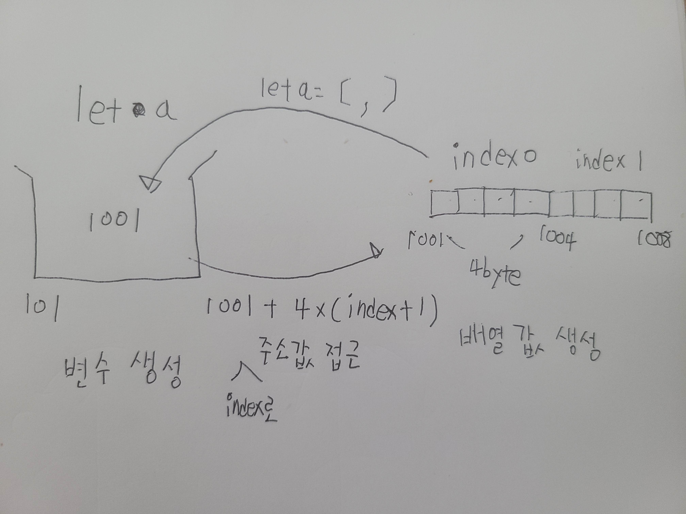

## ***난위도 : ★★☆☆☆***

### ***# 배열이란***

1. 인덱스와 값으로 이뤄진 하나의 묶음   
2. 여러개의 데이터를 어떤 공간에 저장해서 필요할때마다 꺼낼수있기 때문에 사용   
3.. 자바스크립트는 어떠한 값이라도 배열의 요소가 될수 있음   
4. 자바스크립트는 크기가 고정되있지 않는 동적 배열의 형태이다   
5. 배열은 기본적으로 참조타입(레퍼런스 타입)이라서 데이터당 4byte의 공간을 만들어 주소로 접근함   
(데이터는 값이 들어가고 배열은 주소값이 들어간다는점 꼭 명심!)   
6. 인덱스로 배열에 값에 접근 가능함, 첫번째 값(요소)의 인덱스는 0번부터 시작한다

7. 자바스크립트는 index가 음수일때 맨 마지막에서 역순으로 간다

### ***# 배열의 선언 방법***



```javascript
//배열의 선언 및 출력
let myArrays = [1, '1', true, [null], undefined, function(){}, [], {}]//배열선언
console.log(myArrays);//배열 형태로 출력
console.log([1,2,3]); //[1,2,3]출력
console.log(myArrays[1], typeof(myArrays[1]));//배열의 요소에 접근하는방법(대괄호 안에 index) 문자열 1 출력
let myArrayCopy = myArrays;//myArray에 있는 배열의 주소값 myArrayCopy에넣기
myArrayCopy[1] = 200; //myArrayCopy 값 수정하기
console.log(myArrays[1]); //같은 배열을 참조하기 때문에 myArrays 배열의 값이 바뀐거 200 출력
console.log(myArrays.length)//배열의 길이를 구하기 8 출력
```

### ***# 배열에 메소드(값추가, 확인, 합치기, 제거, 추출, 정렬, 뒤바꾸기)***

|  |  |  |
| --- | --- | --- |
| 메소드 | 정의 | 쓰는방법 |
| push | 맨뒤에 값추가, 리턴값 배열의 총 길이 | ex) 배열이름.push(값); |
| unshift | 맨앞에 값추가, 리턴값 배열의 총 길이 | ex) 배열이름.unshift(값); |
| isArray | 배열인지 아닌지 체크 리턴 boolean | ex) Array.isArray(배열이름) |
| indexOf | 해당값이 어느 인덱스에 있는지 확인 리턴 index | ex) 배열이름.indexOf(값) |
| concat | 두 배열을 합칠때 사용함 리턴 배열 | ex) 앞에올 배열이름.concat(뒤에올 배열이름) |
| shift | 맨앞에 값 제거, 리턴 삭제한 value | ex) 배열이름.shift(); |
| pop | 맨뒤에 값 제거, 리턴 삭제한 value | ex) 배열이름.pop(); |
| splice | 지정하여 값을 제거할때 사용함 추가도 할수있음, 리턴 삭제할 값들만 묶은 새로운 배열 (배열이 바뀜) | ex) 배열이름.splice(시작인덱스, 삭제할 요소갯수, 추가할요소,...) |
| slice | 범위를 지정하여 값들을 복사할때 사용 ,리턴 복사한 값들만 묶어서 새로운 배열 리턴 (배열에는 변동 없음) | ex) 배열이름.slice(시작인덱스,끝인덱스-1) |
| sort | 파라미터로 함수를 집어넣는데 그 조건에따라 정렬됨만약 파라미터로 값을 넣지 않으면 유니코드 순서에따라 오름차순 정렬, 리턴 새로운배열 | ex) 배열이름.sort() --> 유니코드 오름차순, 배열이름.sort((a, b) => a-b)) --> 숫자 크기 오름차순 |
| reverse | 해당 배열의 인덱스 순서를 뒤집음 , 리턴 새로운 배열 | ex) 배열이름.reverse() |
| join | 해당 배열 요소들을 합쳐 문자열로 리턴 |  |

```javascript
//값 추가
let myArray2 = [0, null]
myArray2[2] = '400'; // 인덱스로 추가 
console.log(myArray2.push('300'))//맨뒤에 값추가, 리턴값 배열의 총 길이
console.log(myArray2.unshift('10'));//

//확인하기
console.log(Array.isArray(myArray2)); //배열인지 아닌지 체크 true 출력
console.log(myArrays instanceof Array); //배열인지 아닌지 체크 보통 객체에서 많이씀 true출력
console.log(myArray2[1]);// index -> value null출력
console.log(myArray2.indexOf(null));//value -> index 1출력 값이 없을때는 -1출력

//합치기
let myArray3 = [100, [], 20, 0, 90];
console.log(myArray2.concat(myArray3));// myArray2+myArray3 해서 새로운 배열 리턴

//값 제거
console.log(myArray3.shift());//맨앞에있는 값 제거 리턴은 삭제한값 100출력
console.log(myArray3.pop());//맨뒤에 있는 값 제거 90출력
console.log(myArray3.splice(0, 2, 20, 30)); //(시작인덱스, 삭제할 요소갯수, 추가할요소,...) , [ [], 20 ] 출력

//값 추출
console.log(myArray3.slice(0, 2));//(시작인덱스,끝인덱스-1) 잘라서 새로운 배열로 리턴 [ 20, 30 ]출력

//정렬 + 뒤바꾸기
let myArray4 = [1, 20, 10, 5, 29];
console.log(myArray4.sort()); //[ 1, 10, 20, 29, 5 ] 출력, 유니코드 순서에 따라서 오름차순
console.log(myArray4.sort((a, b) => a-b));//오름차순 정렬, [ 1, 5, 10, 20, 29 ] 출력
console.log(myArray4.reverse()); //[ 29, 20, 10, 5, 1 ] 출력
```

### ***# 반복문 , 배열과 활용***

1.동일한 동작을 원하는 횟수만큼 반복적으로 수행하고 싶을때 사용   
2. 주로 for문 하고 while문을 주로 씀   
- for(초기값 ; 조건문 ; 증감식){반복수행문}   
- while(조건문) {반복수행문}   
3. 초기값이나 증감식을 반복문 안에 쓰고싶으면 for 그게아니라 밖에 쓰고싶으면 while (상황에따라 좀 다름)   
4. continue를 만나면 밑에 실행안하고 다음으로 건너뛸수있다 , break를 만나면 바로 반복문을 나갈수있다

5. 배열과 같이 쓰면 여러가지의 데이터를 갯수 상관없이 원하는 만큼 담고 뺄수 있다 (week 4 내꺼 주제)

```javascript
//배열 값 집어넣기
let evenArray = [];
evenArray.push(1);
evenArray.push(2);
evenArray.push(3);
evenArray.push(4);
evenArray.push(5);
evenArray.push(6);
console.log(evenArray); //[ 1, 2, 3, 4, 5, 6 ] 출력

//배열 값 빼기
let num = evenArray[0];
console.log(num);
num = evenArray[1];
console.log(num);
num = evenArray[2];
console.log(num);
num = evenArray[3];
console.log(num);
num = evenArray[4];
console.log(num);
num = evenArray[5];
console.log(num); //1~6 출력

//반복문으로 값 넣기
evenArray = []
for(let i=1 ; i<7 ; i++){
    evenArray.push(i);
}
console.log(evenArray); //[ 1, 2, 3, 4, 5, 6 ] 출력

//반복문으로 값빼기
evenArray.forEach((value) => {
    console.log(value); // //1~6 출력
})

//while문 으로 값넣기
evenArray = []
let i = 1 
while(i < 7){
    evenArray.push(i);
    i++;
}
console.log(evenArray);//[ 1, 2, 3, 4, 5, 6 ] 출력

//break활용
evenArray = []
i = 1 
while(true){
    if(i > 6) break; //6때 반복문 나감
    evenArray.push(i);
    i++;
}
console.log(evenArray);//[ 1, 2, 3, 4, 5, 6 ] 출력

//continue활용
evenArray = []
i = 0
while(i < 6){
    i++;
    if(i === 2) continue; //2 제외
    evenArray.push(i);
}
console.log(evenArray);//[ 1, 3, 4, 5, 6 ] 출력
```

### ***# for~of랑 for~in의 차이점***

- for~in : 객체에서 주로 쓰는데 배열에서는 index, 객체에서는 key값을 순서대로 좌측 변수에 담음   
- for~of : 배열에서 주로 쓰는데 value의 값을 차래대로 좌측 변수에 담음

```javascript
//for~in
for(let index in evenArray){ //index출력함
    console.log(index, evenArray[index]);//index value 형태로 출력
}
//for~of
for(let index of evenArray){ //value출력함
    console.log(index);//value만 출력
}
```

**\*주의! : for~in은 배열에서 순서(인덱스 오름차순)를 100% 보장 안해주고 프로토타입에 추가된**  
**속성까지 다 돌수도 있어서 배열은 왠만하면 for~of나 forEach를 쓰는게 안전함.**  
**for~in은 객체 전용으로 생각하는게 맞는듯**

### ***#배열의 반복문 메소드 종류 (forEach,map등등, 소괄호 안에는 익명함수로 써야됨)***

|  |  |  |
| --- | --- | --- |
| 반복문 메소드 | 정의 | 쓰는법 |
| forEach | 배열의 값을 순차적으로 꺼낼때 사용 리턴 없음 | ex) 배열이름.forEach((요소, 인덱스, 배열) => 출력); |
| map | 배열의 값을 순차적으로 꺼낼때 사용 리턴 배열 | ex) 배열이름.map((요소, 인덱스, 배열) => 명령); |
| find | 해당 조건에 맞는 요소 만나면 바로 break! 리턴 값 | ex) 배열이름.find((요소) => 조건); |
| filter | 해당 조건에 맞는 요소만 고름 리턴 배열 | ex) 배열이름.filter((요소) => 조건); |
| every | 모든 요소가 조건을 만족하는지 체크 리턴 Boolean | ex) 배열이름.every((요소, 인덱스) => 조건); |
| some | 만족하는 요소가 1개이상 있는지 체크 리턴 Boolean | ex) 배열이름.some((요소, 인덱스) => 조건); |
| reduce | 누산기를 파라미터로 지정하여 반복적인 계산을 할때 사용함, sum+= value 랑 유사함, 리턴값 마지막 누산기 | ex) 배열이름.reduece((누산기, 요소, 인덱스, 배열) =>{return 연산식},첫번째 누산기값); |

```javascript
//배열의 반복문 메소드 종류!!!
let arrayMy = [1, 20, 30, 10, 20];

//일반적으로 쓸때
for (let index in arrayMy){
    console.log(`${index}번째 값 ${arrayMy[index]}`);
}

//forEach로 쓸때(리턴값 ㄴㄴ)
arrayMy.forEach((value,index) => console.log(`${index}번째 값 ${value}`));//하나씩 출력

//map으로 쓸때(리턴값 배열)
let copy= arrayMy.map((value,index) =>  `${index}번째 값 ${value}`);
console.log(copy);//[ '0번째 값 1', '1번째 값 20', '2번째 값 30', '3번째 값 10', '4번째 값 20' ] 출력

//filter로 쓸때(리턴 배열)
let resultSayer1 = arrayMy.filter((value) => value == 20);//value == 20에 true인게 있는지 찾고 배열리턴
console.log(resultSayer1);//[20,20]출력

//find로 쓸때 (리턴 값)
let resultSayer2 = arrayMy.find((value) => value == 20);//value == 20에 true인걸찾으면 뒤도 안돌아보고 리턴
console.log(resultSayer2);//20출력(타입 number)

//some로 쓸때 (리턴 불린)
let someReturn = arrayMy.some((value, index) => value+index > 5);
console.log(someReturn);//true출력

//every로 쓸때 (리턴 불린)
let everyReturn = arrayMy.every((value, index) => value+index >5);
console.log(everyReturn);//false출력

//reduce로 쓸때 (리턴 누산기 마지막값) 
let sumAll = arrayMy.reduce((acc, value, index ,arr) => {//파라미터(누산기, 요소, 인덱스, 배열)
    console.log(`${index} 번째의 요소로 콜백함수 동작!`);
    console.log('acc : ', acc); // 누산기랑 요소랑 더한값이 다음 누산기로 전달되는 형식
    console.log('value : ', value);//요소
    console.log('arr : ', arr);
    console.log('---------');
    return value + index;// 어찌보면 sum += el 이랑 비슷한 논리가 되는듯

}, 2); //첫번째로 될 누산기의 값 필수는 아니고 안써도 되는데 쓰는거를 추천!
```

### ***#참고한것!***

<https://zibu-story.tistory.com/115>

[🔗 7.25 코드잇(자바스크립트-중급) -배열 메소드( forEach, map, filter, find, some, every, reduce, sort, reserve),](https://zibu-story.tistory.com/115) — #깨닭은것! 1. js파일들간에 변수와 함수들을 각각 공유하여 쓸수 있다 2. 배열의 메소드들을 자유롭게 쓸수 있다. 3. forEach랑 map으로 배열의 요소를 반복하여 꺼낼수 있다. 4. reduce의 알규먼트 값

### ***# 3개의 랜덤한 수를 배열에 담아 맞추는 게임 ( 야구게임)***

<https://zibu-story.tistory.com/125>

[🔗 8.05 알고리즘 문제 (JS, ★★★) - 숫자야구 게임 만들기(반복문, 배열, 함수로만~!)](https://zibu-story.tistory.com/125) — 난위도 ★★☆☆☆ # 설명서~! 1. 1~9까지 난수 3개 배열에 담기(중복 ㄴㄴ), 함수로 구현 -comSu(배열이름), ComSuFunction(함수이름) 2. 1~9까지 난수 3개 배열에 담기(중복 ㄴㄴ), 함수로 구현 -personSu(배열
