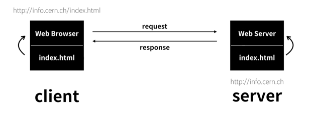
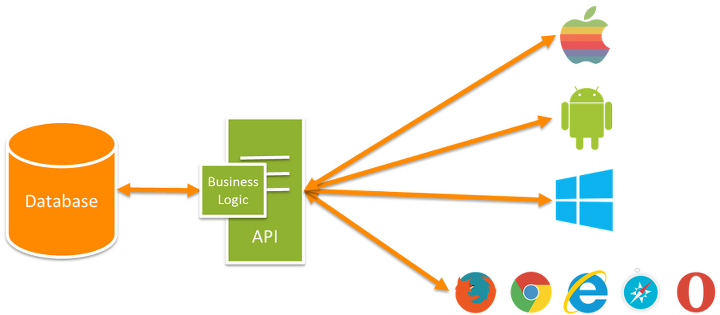
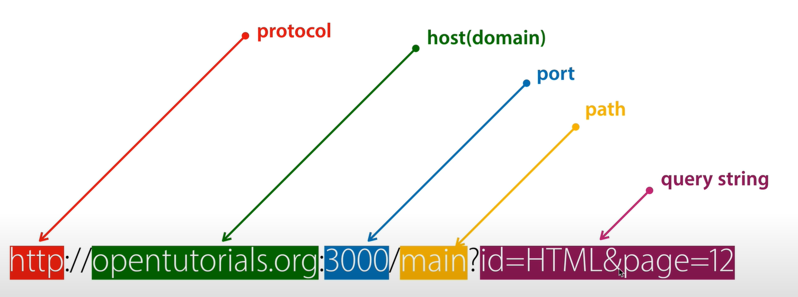
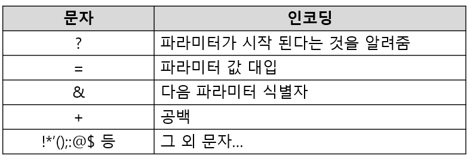
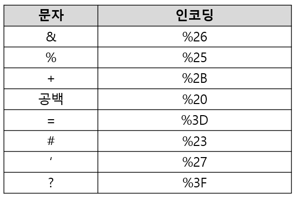
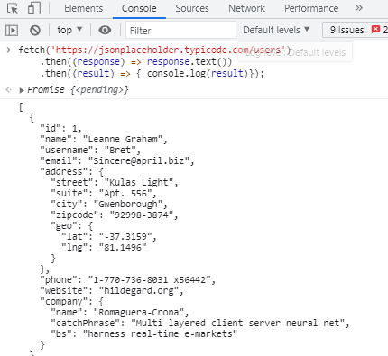
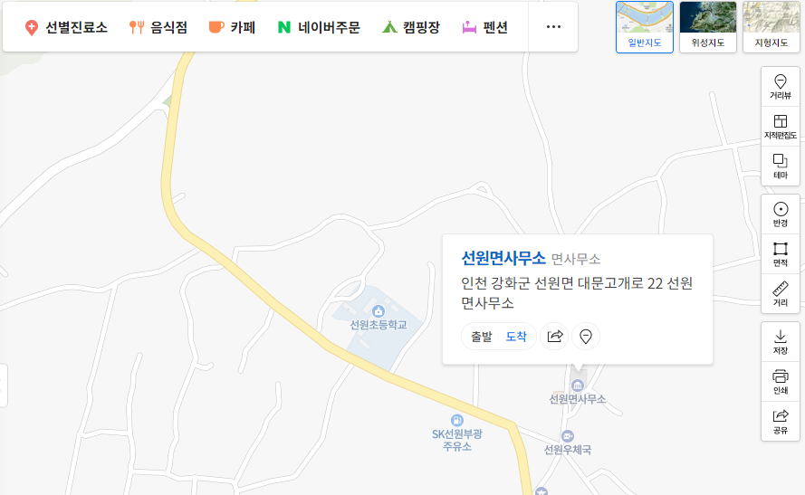
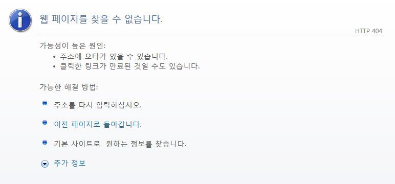
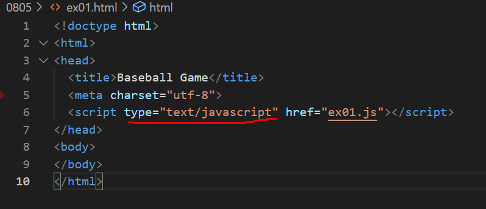

### ***난위도 : ★★★☆***

**1. 서버랑 브라우저간의 상호작용(request,response)**   
**2. 서버로부터 응답받을때 데이터 타입**   
**3. URL의 구조**   
**4. AJAX란?**  
**5. JSON은 뭥미?**

**6. 응답에 대한 결과 --> 상태코드~!**

### ***# 웹이란? (Word Wide Web)***

1. 인터넷에 연결된 사용자들이 서로의 정보를 공유할 수 있는 공간   
2. 인터넷 상에서 텍스트나 그림, 소리, 영상 등과 같은 멀티미디어 정보를 하이퍼텍스트 방식이나 Ajax 방식 등으로 연결하여 제공   
3. 하이퍼텍스트 : 문서 내부에 또 다른 문서로 연결되는 참조를 집어 넣음으로써 웹 상에 존재하는 여러 문서끼리 서로 참조할 수 있는 기술   
4. 브라우저와 서버를 통신할때는 request(요청), response(응답) 을 무조건 1번 이상은 함   
5. 기본적으로 웹의 형태는 개발자 도구를 통해 확인 가능



*출처 : 생활코딩*

### ***# API(Application Programming Interface)는 멍미?***

1. 내가 만들 응용프로그램에서 사용 할 수 있도록 기타 다른 응용프로그램들을 제어 할 수 있게 하는 것   
2. UI가 사용자와 시스템의 인터페이스 였다면 API는 시스템과 시스템간의 인터페이스라고 할 수 있음   
ex) 시스템? : 프로그램, 웹브라우저, 운영체제, 하드웨어 등



*출처 : 구글*

### ***# 웹 프로그래밍 주요 용어***

1. URL(Uniform Resource Locator) : 웹에 존재하는 특정 데이터를 나타내는 문자열   
ex) https://호스트/경로/쿼리   
2. 쿼리 : 데이터에 관한 세부적인 요구사항(있을수도있고 없을수도 있음), =(등호)와 &(연산자)로 구분함   
3. 경로 : 서버에 있는 데이터중 원하는 데이터를 특정, 경로와 쿼리 사이에는 ?로 구분함   
4. 호스트 : 전세계 서버중 하나의 서버를 특정(도메인 이름이 들어감)   
5. http(HyperText Transfer Protocol) : 다른 텍스트에 대한 참조를 갖고있는 텍스트를 전송하는 프로토콜, s(scure : 안전)가 붙은거는 보안성이 뛰어남   
6. 프로토콜(스킴) : 통신을 하는 두 주체가 지켜야 하는 통신 규약   
ex) port번호, http, https, FTP, SMTP등   
7. IP주소: 네트워크상에서 특정 컴퓨터를 식별할 수 있는 주소   
8. Port 번호: IP주소가 컴퓨터를 식별할 수 있게 해준다면, 포트번호는 해당 컴퓨터의 구동되고 있는 프로그램을 구분할 수 있는 번호.   
9. DNS(도메인): IP주소를 인간이 쉽게 외우도록 맵핑한 문자열.



*출처 : 구글서칭*





### ***# JSON이란?(JavaScript Object Notation) 캐캐캐캨 중요함***

1. 데이터를 저장하거나 전송할 때 많이 사용되는 경량의 DATA 교환 형식   
2. 사람과 기계 모두 이해하기 쉬우며 용량이 작아음   
3. XML보다 상대적으로 다뤄야 할 일이 많음   
4. 자바스크립트 객체 형식이랑 유사함   
5. 객체안에 key값은 무조건 ""(큰따음표)를 붙여줘야된다   
6. 객체안에 value값중 문자열은 ""(큰따음표)로 표기해야된다   
7. null이나 undefined를 value로 표기할수없다   
8. 데이터 포멧이기에 주석을 추가할수없다   
9. String 타입의 JSon 객체라 직접적으로 접근하기 힘듬   
10. JSON.parse(변수) : String 타입의 JSON 객체를 자바스크립트의 타입으로 바꿔라(stringify 반대)   
ex) parse(Serialization,직렬화) , stringify(Deserialization,역직렬화)



```javascript
fetch('https://jsonplaceholder.typicode.com/users') //fetch문법은 다음 게시물에
    .then((response) => response.text()) 
    .then((result) => { console.log(result)}); //JSON데이터 출력

 fetch('https://www.naver.com/')
    .then((response) => response.text()) 
    .then((result) => { console.log(result)}); // 화면을 그리는 HTML코드 출력
```

### ***# Ajax(Asynchronous Javascript And Xml)***

1. 브라우저가 가지고있는 XMLHttpRequest 객체를 이용해서 전체 페이지를 새로 고치지 않고도 페이지의 일부만을 위한 데이터를 로드하는 기법   
ex)구글맵   
2. JavaScript를 사용한 비동기 통신, 클라이언트와 서버간에 XML 데이터를 주고받는 기술이라고 할 수 있겠습니다.   
3. 초창기에는 매번 세페이지가 로드 되는 하이퍼링크를 많이 썼는데 그다지 효율적이지 않았음

4. 클라이언트에서 서버로 데이터를 요청하고 부분적으로 수정하고싶은 데이터만 돌려받을 수 있다.

5. 구현 방법

-fetch 함수 .then메소드 활용(fetch 게시물 참고!)

-XMLHttpRequest 객체 이용



*출처 : 네이버지도*

```javascript
//XMLHttpRequest 를 통해 Ajax통신(해석불가)
const xhr = new XMLHttpRequest();
xhr.open('GET', 'https://learn.codeit.kr/api/members');
xhr.onload = function () {
  console.log(xhr.response);
};
xhr.onerror = function () {
  alert('Error!');
};
xhr.send();
```

### ***# HTTP 주요 응답 상태 코드(Status Code) 봤을꺼다~!***



1. 100번대 : 서버가 클라이언트에게 정보성 응답을 줄 때 사용되는 상태 코드들입니다.

|  |  |
| --- | --- |
| 상태코드 | 의미 |
| 100(Continue) | 클라이언트가 서버에게 계속 리퀘스트를 보내도 괜찮은지 물어봤을 때, 계속 리퀘스트를 보내도 괜찮다고 알려주는 상태 코드 |
| 101(Switching Protocols) | 클라이언트가 프로토콜을 바꾸자는 리퀘스트를 보냈을 때, 서버가 알겠다라는 뜻임 |

2. 200번대 : 클라이언트의 리퀘스트가 성공 처리되었음을 의미하는 상태 코드들입니다.

|  |  |
| --- | --- |
| 상태코드 | 의미 |
| 200(OK) | - GET : 경우 리소스가 잘 조회되었다는 뜻 - POST : 새 리소스가 잘 생성 - PUT : 기존 리소스가 잘 수정 - DELETE : 기존 리소스가 잘 삭제되었다는 뜻. |
| 201(Created) | 리퀘스트의 내용대로 리소스가 잘 생성되었다는 뜻 . POST 리퀘스트가 성공한 경우에 200번 대신 201번이 올 수도 있습니다. |
| 202(Accepted) | 리퀘스트의 내용이 일단은 잘 접수되었다는 뜻입니다. 즉, 당장 리퀘스트의 내용이 처리된 것은 아니지만 언젠가 처리할 것이라는 뜻 |

3. 300번대 : 클라이언트의 리퀘스트가 아직 처리되지 않았고, 리퀘스트 처리를 원하면 클라이언트 측의 추가적인 작업이 필요함을 의미하는 상태 코드들입니다.

|  |  |
| --- | --- |
| 상태코드 | 의미 |
| 301 (Moved Permanently) | 이 응답 코드는 요청한 리소스의 URI가 변경되었음을 의미합니다. 새로운 URI가 응답에서 아마도 주어질 수 있습니다. |
| 302 (Found) | 이 응답 코드는 요청한 리소스의 URI가 일시적으로 변경되었음을 의미합니다. 새롭게 변경된 URI는 나중에 만들어질 수 있습니다. 그러므로, 클라이언트는 향후의 요청도 반드시 동일한 URI로 해야합니다. |
| 304 (Not Modified) | 이것은 캐시를 목적으로 사용됩니다. 이것은 클라이언트에게 응답이 수정되지 않았음을 알려주며, 그러므로 클라이언트는 계속해서 응답의 캐시된 버전을 사용할 수 있습니다. |

4. 400번대 : 리퀘스트를 보내는 클라이언트 쪽에 문제가 있음을 의미하는 상태 코드들입니다.

|  |  |
| --- | --- |
| 상태코드 | 의미 |
| 400 (Bad Request) | 말그대로 리퀘스트에 문제가 있음을 나타냅니다. 리퀘스트 내부 내용의 문법에 오류가 존재하는 등의 이유로 인해 발생합니다. |
| 401 (Unauthorized) | 아직 신원이 확인되지않은 사용자로부터 온 리퀘스트를 처리할 수 없다는 뜻입니다. |
| 403 (Forbidden) | 사용자의 신원은 확인되었지만 해당 리소스에 대한 접근 권한이 없는 사용자라서 리퀘스트를 처리할 수 없다는 뜻입니다. |
| 404 (Not Found) | 해당 URL이 나타내는 리소스를 찾을 수 없다는 뜻입니다. 보통 이런 상태 코드가 담긴 리스폰스는 그 바디에 관련 웹 페이지를 이루는 코드를 포함하고 있는 경우가 많습니다. 예를들어 https://www.google.com/abc와 같이 존재하지 않는 URL에 접속하려고 하면 이런 페이지가 보이는 것을 알 수 있습니다. |
| 405 (Method Not Allowed) | 요청한 메소드는 서버에서 알고 있지만, 제거되었고 사용할 수 없습니다. 예를 들어, 어떤 API에서 리소스를 삭제하는 것을 금지할 수 있습니다. 필수적인 메소드인 GET과 HEAD는 제거될 수 없으며, 이 에러 코드를 리턴할 수 없습니다. |
| 413 (Payload Too Large) | 현재 리퀘스트의 바디에 들어있는 데이터의 용량이 지나치게 커서 서버가 거부한다는 뜻입니다. |
| 429 (Too Many Requests) | 일정 시간 동안 클라이언트가 지나치게 많은 리퀘스트를 보냈다는 뜻입니다. |

5. 500번대 : 서버 쪽의 문제로 인해 리퀘스트를 정상적으로 처리할 수 없음을 의미하는 상태 코드들입니다.

|  |  |
| --- | --- |
| 상태코드 | 의미 |
| 500 (Internal Server Error) | 현재 알 수 없는 서버 내의 에러로 인해 리퀘스트를 처리할 수 없다는 뜻입니다. |
| 503 (Service Unavailable) | 현재 서버 점검 중이거나, 트래픽 폭주 등으로 인해 서비스를 제공할 수 없다는 뜻입니다. |

### ***# Content-Type  알고있었음?***

1. 현재 request 또는 response의 바디에 들어 있는 데이터가 어떤 타입인지를 나타냄

2. 바이너리 파일 이란?

- 텍스트 파일 이외의 파일들을 보통 바이너리 파일  
- Content-Type 헤더가 존재하면, 바디의 데이터를 직접 확인해서 그 타입을 추론하지 않아도 되기 때문

|  |  |
| --- | --- |
| 타입 | 표기 |
| 텍스트타입 | - text/plain(일반텍스트) - text/css(CSS코드) - text/html(HTML코드) - text/javascript(자바스크립트 코드) |
| 이미지 타입 | - image/bmp - image/gif  - image/png |
| 오디오 타입 | - audio/mp4 - audio/ogg |
| 비디오 타입 | - video/mp4 - video/H264 |
| application타입 | - application/json (JSON 데이터) - application/octet-stream(확인되지 않은 바이너리 파일) - application/xml(XML타입) - application/x-www-form-urlencoded (form태그로 날릴때 주로사용, form태그에 enctype 속성 활용) |
| 기타 타입 | - multipart/form-data(여러 종류의 데이터를 하나로 합친 데이터를 의미하는 타입) |



### ***#비동기적 실행 관련 문법 종류***

1. 파라미터로 바로 콜백을 전달하는 형태의 전통적인 비동기 실행 함수   
- setTimeout(콜백, 시간) :특정 함수의 실행을 원하는 시간만큼 뒤로 미루기 위해 사용하는 함수   
- setInterval(콜백, 시간):특정 콜백을 일정한 시간 간격으로 실행하도록 등록하는 함수   
- addEventListener :이벤트를 추가하는 DOM함수   
2. Promise : 작업에 관한 상태 정보를 나타낼때 쓰임 (다음 게시물에 다룰예정)  
3. async/await : 비동기 처리방식중 최근에 나온 방식, 일반 함수 쓰는거랑 유사함 (다음 게시물에 다룰예정)  

<https://zibu-story.tistory.com/110>

[🔗 7.19 코드잇(자바스크립트-중급) - 이벤트(종류, 다루는법 등), 브러우저 기본 이벤트 제거방법](https://zibu-story.tistory.com/110) — #이벤트 핸들러 등록 하는 몇가지 방법 1. 돔 요소에 접근하여 등록 ex)let 변수이름 = document.querySelector(css); 변수이름.onclick= function(){이벤트 } --> 이벤트 추가 --> 이렇게하면..

```javascript
//비동기적 실행함수(setTimeout, setInterval)
console.log('a');
setTimeout(() => { console.log('b'); }, 2000);
console.log('c');//출력 a , c , b(2초뒤)

console.log('a');
setInterval(() => { console.log('b'); }, 2000);
console.log('c');//출력 a , c , b(2초뒤)
```

### ***# 모르는 것~!***

1. enctype : 폼 데이터(form data)가 서버로 제출될 때 해당 데이터가 인코딩되는 방법을 명시(Content-Type 적어주면됨)    
2. formData : ajax로 폼 전송을 가능하게 해주도록 자바스크립트에서 제공하는 API 객체(new 로 생성해주면됨), 주로 여러개의 데이터들을 저장할때 사용함   
3. axios :  브라우저, Node.js를 위한 Promise API를 활용하는 HTTP 비동기 통신 라이브러리이다.(fetch랑 같은 비동기식 라이브러리)   
4. 비동기식처리 : 순서에 상관없이 기다리지않고 먼저 실행   
5. 콜백함수 : 파라미터자리에 함수가 오는것   
6. 직렬화(Serialize) : 객체 -> 문자열   
7. 역직렬화(Deserialize) : 문자열 -> 객체

### ***#참고한 웹사이트***

비동기식   
<https://joshua1988.github.io/web-development/javascript/javascript-asynchronous-operation/>

[🔗 자바스크립트 비동기 처리와 콜백 함수](https://joshua1988.github.io/web-development/javascript/javascript-asynchronous-operation/) — (중급) 중급 자바스크립트 개발자가 되기 위한 자바스크립트 비동기 처리와 콜백 함수 이해하기. 콜백 지옥과 해결 방법 등

AJAX, Axios 정리   
<https://velog.io/@shin6403/React-axios%EB%9E%80-feat.-Fetch-API>

[🔗 React | axios란? (feat. Fetch API)](https://velog.io/@shin6403/React-axios%EB%9E%80-feat.-Fetch-API) — # Intro 리액트는 효율적인 UI 구현을 위한 라이브러리이다. HTTP Client(HTTP 상에서 커뮤니케이션을 하는 자바 기반 컴포넌트)를 내장하고 있는 Angular와는 다르게, 리액트는 따로 내장 클래스가 존재
