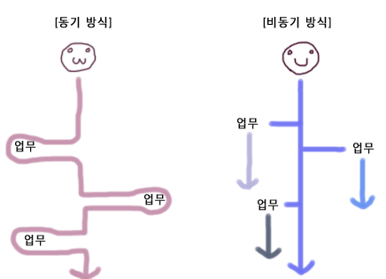
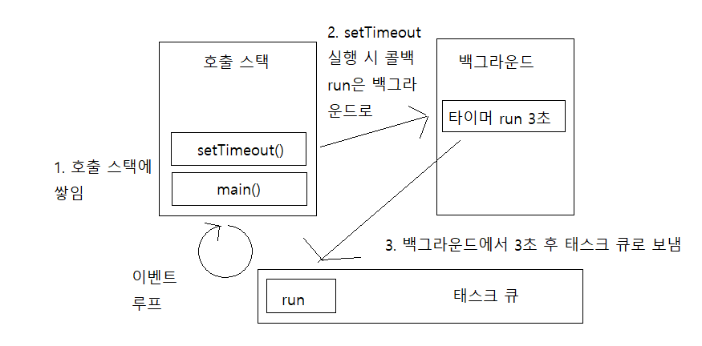
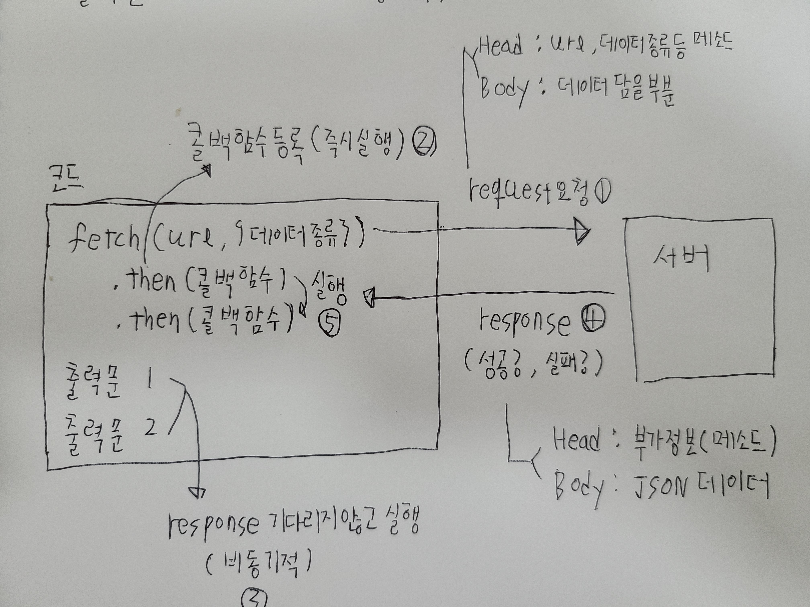
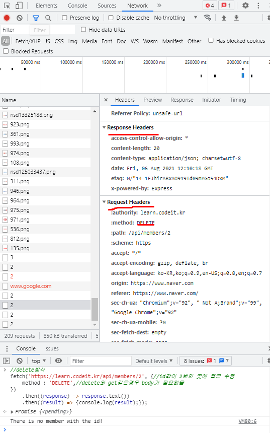

## ***난위도 : ★★★★☆***

**웹브라우저의 이해 필요~!**

**웹브라우저 구동 방식 ( request,response)**

**자바스크립트 모든 부분 이해 필요**

**웹브라우저 개발자 도구 활용방법 알아야됨**

**여기부터 공부하기**

<https://zibu-story.tistory.com/126>

### ***🎈# 비동기란 이벤트 루프랑 연결지어서 설명하기~! 간단 명료!***

**이벤트 루프 실제 동작 예시본: <https://www.youtube.com/watch?v=8aGhZQkoFbQ>**

**이벤트 루프 상세 정리 : <https://zibu-story.tistory.com/160>**

**\* 용어정리**

**런타임: 프로그램이 실행되고 있는 때 존재하는 곳.**

**메모리 힙: 메모리 할당을 담당하는 곳.**

**콜스택: 코드가 호출되면서, 스택으로 쌓이는 곳.**

1. 웹페이지를 리로드하지 않고 데이터를 불러오는 방식

2. 서버에 요청을 한 후 기다리는게 아니라 먼저 실행함

3. 가장 흔한 사례는 setTime이나 async , fetch 등이 있음

4. 실행순서가 확실하지 않음 , 오래걸릴것 같은거를 따로 빼두고 다음줄 먼저 실행

5. 이벤트 발생 시 호출되는 콜백 함수들을 관리하여 태스크 큐에 전달하고, 태스트 큐에 담겨있는 콜백 함수들을 콜스택에 넘겨준다. 단, 콜스택에 쌓여있는 함수가 없을 때만 수행된다.

(이거는 이벤트 루프를 완벽히 이해해야됨 위에 링크 참고하기)

6. 노드가 비동기를 선호하는 이유는 작업시간을 줄일수 있기 때문이다.

```javascript
//비동기식 처리방법 사례 - 생각한 순서(1번 -> 2번 -> 3번), 출력결과(1번 -> 3번 -> 2번)
console.log('Hello');//1번 실행
setTimeout(function() {//2번 백그라운드로 뺌  (이벤트루프 참고)
	console.log('Bye');
}, 3000);
console.log('Hello Again');//3번 실행

//주의! setTimeout의 설정한 시간대로 동작하지 않을수 있다(이유 : 이벤트 루프 참고)
```



*동기실행 비동기실행*



*이벤트 루프 예시본*

### ***🎈# fetch함수란? 이거 모르면 간첩~~!😃😄***

**\* 프론트가 서버단에 원하는 데이터를 요청 할 수 있도록 돕는 함수,**

**빽엔드에서 데이터를 보내줘도 이게 없으면 프론트단에서 받을수 없음**

1. fetch의 첫번째 인자값으로 url을 넣어주고 두번째 인자로는  post와 delete때 요청할 데이터를 head와 body에 담아서 같이 보내준다.

2. 서버로부터 받은 응답을 promise객체(밑에있음)에 담고 성공 or 실패값의 status를 담는 primise객체를 then의 첫번째 파라미터로 전달합니다

3. 일반 함수의 파라미터로 콜백을 주고 또 콜백을 주고 이러면 콜백 지옥에 빠진다 ,이를 방지하기 위해 사용함

2. 실행순서(기다리지않고 다음줄 실행)

- fetch 함수로 request보냄 (pending상태)

- promise가 pending에서 fulfilled될때를 대비해 바로 실행할 콜백함수를 (then 소괄호 안에있는거)

이벤트 리스너에 등록

- 서버로부터 응답올때까지 기다리지않고 동기적인거 먼저 실행

- 서버로부터 응답이 와서 promise가 fulfilled상태가 되면 리스너에 등록한 primise객체를 then메소드의 콜백 함수의 파라미터로 전달됨

- 순차적으로 then 메소드 실행 (단, 모든 then들은 promise객체를 리턴해야된다. )

**\* 꿀팁~! : 직렬화란 역직렬화란 무엇인가?**

직렬화 -> 자바스크립트 객체에서 JSON객체로 변환

역직렬화 ->JSON 객체에서 자바스크립트로 변환  
1. parse -> 두변째 then에서 역직렬화  
2. json메소드 -> 첫번째 then에서 파라미터로 받은 response를 바로 역직렬화를 해줌  
3. stringify -> 두번째 then에서 직렬화

```javascript
//fetch 사용법

console.log('출력1);
fetch('https://www.google.com/')//url적기, 두번째는 옵션객체 안쓰면 get방식
.then((response) => response.text())//서버로부터 전달받은 객체 result로 전달
.then((result) => {console.log(result, 출력3);});//화변에 보여질 HTML JS로 이뤄진 코드
console.log('출력2);

//실행순서 출력1 -> 출력2 -> 출력3
//1. fetch 에 있는 url로 요청을 보냄 (Promise상태 pending) 
//2. (response) => response.text() 를 이벤트 리스너에 등록
//3. 서버로 부터 응답이 Promise객체 형태로 옴( fullfilled or rejected)
//4. then 메소드 순차적으로 실행
```



### ***🎈# 서버로 부터 데이터를 Request 요청할때 fetch 사용법 😁😊***

1. 서버로 부터 데이터를 요청할때 Request를 사용한다  
2. Head 부분 : request에 대한 부가정보 (메소드), get이나 delete같은경우 body가 필요없음  
3. Body 부분 : 실제 데이터를 담는 부분 , 보통 post나 put이 해당됨

**\* 꿀팁!@ : 데이터 종류**  
- get : 조회 , url창 뒤에 고유 id번호 입력하면됨  
- post : 추가, fetch의 두번째 파라미터로 JSON 객체를 body, method는 post를 적어서 보내야됨  
- put : 수정 url에 고유 id값을 주고 두번째 파라미터로 두번째 파라미터로 JSON 객체를 body, method는 post를 적어서 보내야됨  
- delete : 삭제 , delete는 body가 필요없음

```javascript
//get방식
fetch('https://learn.codeit.kr/api/members/3')//Id값이 3인 정보만 출력
    .then((response) => response.text())
    .then((result) => {console.log(result);});

//post방식
let newMember = {//새로운 객체
    name : 'Jery',
    email : 'jery@naver.com',
    departmemt : 'engineering'
};
fetch('https://learn.codeit.kr/api/members', {//옵션객체 안쓰면 get방식
    method : 'POST',//형식
    body : JSON.stringify(newMember) //자바스크립트 객체 -> JSON객체
})
    .then((response) => response.text())
    .then((result) => {console.log(result);});

//put방식
let memberA = {//새로운 객체
    name : 'Alice',
    email : 'alice@codeitmall.kr',
    departmemt : 'marketing'
};
fetch('https://learn.codeit.kr/api/members/2', {//id값이 2번인 곳에 접근 수정
    method : 'PUT',//형식
    body : JSON.stringify(memberA) //자바스크립트 객체 -> JSON객체
})
    .then((response) => response.text())
    .then((result) => {console.log(result);});

//delete방식
fetch('https://learn.codeit.kr/api/members/2', {//id값이 2번인 곳에 접근 수정
    method : 'DELETE',//delete와 get같은경우 body가 필요없음
})
    .then((response) => response.text())
    .then((result) => {console.log(result);});
```

### ***🎈#  요청한부분에대해 서버로부터 Response 응답올때 😁😊***

1. 각각 Head부분하고 Body부분으로 나눠서 데이터를 전달받음  
2. Head 부분 : response에 대한 부가정보 (메소드)  
상태코드가 들어감  
3. Body 부분 : 실제 데이터를 담는 부분 ,JSON데이터가 들어감  
4. 서버가 보내주는 response의 데이터 종류  
(개발자 도구 network메뉴에서 확인가능)  
- .text할때 나오는거는 화면을 그리기 위한 JS나 HTML코드   
- 순수한 정보를 담는 JSON(JavaScript Object Notation) 이라는 데이터 포멧을 사용



*개발자 도구 확인하면됨&amp;amp;nbsp;*

### ***🎈#  비동기 함수에서는 꼭 알아야되는 promise 객체 🎃🎊***

1. request에 대한 서버로부터의 response 작업에 관한 상태 정보 (status)를 나타낼때 쓰임

( status : fullfilled, pending rejected 의 요청에대한 성공 실패 정보)

2. 서버로부터의 응답은 promise 객체에 담겨져서 옴  
2. 작업상태 종류(자세하게)   
- pending : 작업진행중  
- rejected : 작업실패, 리턴된 promise객체에 작업 실패정보가 담김  
- fulfilled : 작업성공, 리턴된 promise 객체에 작업 성공정보가 담김  
4. text 메소드(promise 메소드) : fulfilled 상태이면 response의 바디에 있는 내용을 string 타입으로 변환한 값을 '작업 성공 결과'로 가진 Promise 객체를 리턴  
5. json 메소드(promise 메소드)  
- response의 바디에 있는 JSON 데이터를 자바스크립트 객체로 역직렬화해서 생겨난 객체를 '작업 성공 결과'로 가진 Promise 객체를 리턴   
- response의 바디에 있는 내용이 JSON 타입이 아니라면 에러가 발생하고 Promise 객체는 rejected 상태가 되면서 그 '작업 실패 정보'를 갖게 됨

6. 알규먼트로 콜백함수를 넣어서 직성 promise객체를 직접 생성할수있다.  
7. 콜백함수의 파라미터는 executor 함수인 resolve, reject를 넣어줌  
- excutor : 프로미스 객체가 생성될때 자동으로 실행시킴  
- resolve 함수 : 프로미스객체를 fulfilled 상태로 만듬  
- reject 함수 : 프로미스객체를 rejected 상태로 만듬  
8. 이미 결정된 상태로 객체 만들수도 있음, 단 작업정보는 ㅁ시점과 상관 없음  
(resolve , reject 메소드 활용)

```javascript
new Promise(function(resolve, reject){
  setTimeout(function() {
    resolve(1);
  }, 2000);
})
.then(function(result) {
  console.log(result); // 1
  return result + 10;
})
.then(function(result) {
  console.log(result); // 11
  return result + 20;
})
.then(function(result) {
  console.log(result); // 31
});
```

### ***🎈# fetch랑 짝꿍 then메소드란???🎉✨***

1. '리스폰스가 왔을 때 실행할 콜백'을 미리 등록할 수 있습니다.  
2. 첫번째 then메소드의 리턴값을 넘겨 두번째 then메소드의 파라미터로 받는다(pomise chaining)  
3. promise객체의 메소드이며 첫번째 파라미터는 fulfilled상태일때 실행할 콜백함수이고 두번째 파라미터는 rejected일때 실행할 콜백함수이다

4. catch 메소드 대신 .then(undefind, 콜백) 이렇게 써도 된다.  
4. 리턴값의 따른 작업 상태 결과   
- 리턴값이 promise : 동일한 상태값을 갖는 promise를 리턴함  
- 리턴값이 기본,참조 타입 : 무조건 fulfilled상태로 리턴됨  
- 리턴값이 없음 :  fulfilled상태로 undefined가 리턴됨  
- 콜백 내부에서 에러발생시 :   rejected 상태가 되고, 그 작업 실패 정보로 해당 Error 객체를 갖게 됨  
- 콜백함수가 없음 : 이전 Promise 객체와 동일한 상태와 결과를 갖게 됨

### ***🎈# rejected 를 then의 두번째 인자로 받기 싫어~~! catch~ finally!!🎨🧵***

1. catch  
- rejected 일때 실행하는 콜백함수를 적어줌   
- then(undefined, 콜백함수) 랑 축약버전   
- 보통 실무에서는 맨마지막 줄에 쓴다고함

- 오류시 실행될 메소드  
2. finally  
- rejected이든 fulfilled 이든 무조건 실행함   
- 보통 catch메소드보다 더 밑에 씀   
- 어떠한 정보도 필요하지 않기때문에 파라미터가 없음

```javascript
//catch~ finally
fetch('https://www.error.www')
    .then((response) => response.text())
    .then((result) => { console.log(result); }) //fullfilled일때
    .catch((error) => { console.log('Hello'); throw new Error('test'); }) //reject일때
    .then((result) => { console.log(result); })
    .then(undefined, (error) => { })
    .catch((error) => { console.log('JS'); })
    .then((result) => { console.log(result); })
    .finally(() => { console.log('final'); });
```

### ***🎈# fetch를 좀 편한 버전으로 쓰고싶다~!!! async , await🎠🎡***

1. await는 promise객체가 fulfilled상태가 될때까지 기다리고 작업성공결과를 추출해서 리턴   
2. async는 비동기 함수라는거를 표시하기 위해 함수 앞에 붙임  
3. await은 async가 붙은 함수 안에서만 사용가능   
4. 이 문법은 Promise 객체를 우리에게 이미 익숙한 실행 코드 방식으로 다룰 수 있게 해주는 문법   
5. rejected 상태가 될때를 대비해 기존에 쓰던 try~ catch~finally 를 활용하면됨  
6. async객체는 항상 promise객체를 리턴함

```javascript
//async , await 쓰는법 (구글 개발자 도구에서 찍어보면 됨)
async function fetchAndPrint() {// 실행순서 1,2,3,4,5,6,7
    console.log(2);
    const response = await fetch('https://jsonplaceholder.typicode.com/users');
    console.log(7);
    const result = await response.text();
    console.log(result);
}

// fetch('https://jsonplaceholder.typicode.com/users') //같은말
    //     .then((response) => {
    //         console.log(7);
    //         return response.text();
    //     })
    //     .then((result) => {console.log(result);});
//}

console.log(1);
fetchAndPrint();
console.log(3);
console.log(4);
console.log(5);
console.log(6);
```

### ***🎈# axios랑 fetch의 차이점~!! axios의 정의***

**\* axios : Axios는 브라우저, Node.js를 위한 Promise API를 활용하는 HTTP 비동기 통신 라이브러리입니다**

**(공식 문서 참고한것~!)**

|  |  |
| --- | --- |
| axios ???? | fetch???? |
| 요청 객체에 url이 있다. | 요청 객체에 url이 없다. |
| 써드파티 라이브러리로 설치가 필요 | 따로 설치 필요 없음 |
| XSRF 보호를 해준다. | 별도 보호 없음 |
| data 속성을 사용 | body 속성을 사용 |
| data는 object를 포함한다 | body는 문자열화 되어있다 |
| status가 200이고 statusText가 ‘OK’이면 성공이다 | 응답객체가 ok 속성을 포함하면 성공이다 |
| 자동으로 JSON데이터 형식으로 변환된다 | .json()메서드를 사용해야 한다. |
| 요청을 취소할 수 있고 타임아웃을 걸 수 있다. | 해당 기능 존재 하지않음 |
| HTTP 요청을 가로챌수 있음 | 기본적으로 제공하지 않음 |
| download진행에 대해 기본적인 지원을 함 | 지원하지 않음 |
| 좀더 많은 브라우저에 지원됨 | Chrome 42+, Firefox 39+, Edge 14+, and Safari 10.1+이상에 지원 |

```javascript
const axios = require('axios')

// ID로 사용자 요청
axios
  .get('/user?ID=12345')
  // 응답(성공)
  .then(function(response) {
    console.log(response)
  })
  // 응답(실패)
  .catch(function(error) {
    console.log(error)
  })
  // 응답(항상 실행)
  .then(function() {
    // ...
  })
```

### ***#모르는것~!(8/8 차후에 개념 추가할 예정)***

1. axios : ajax랑 동일한 비동기식 라이브러리, 쓰는 방법 개념 파악하기

2. all 메소드, race 메소드, allSettled 메소드 , any 메소드 개념정리 원리 이해하기

3. 전체적인 개념은 웹브라우저 원리 파악후 다시 복습해야될듯

### ***# 참고한 URL***

**fetch 예시본 종합**

<https://ko.javascript.info/fetch>

[🔗 fetch](https://ko.javascript.info/fetch)

**Promise 요점 정리**  
<https://joshua1988.github.io/web-development/javascript/promise-for-beginners/>

[🔗 자바스크립트 Promise 쉽게 이해하기](https://joshua1988.github.io/web-development/javascript/promise-for-beginners/) — (중급) 자바스크립트 입문자를 위한 Promise 설명. 쉽게 알아보는 자바스크립트 Promise 개념, 사용법, 예제 코드. 예제로 알아보는 then(), catch() 활용법


