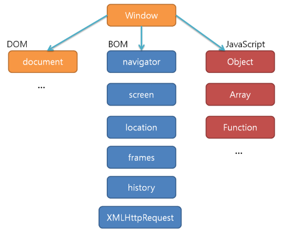

## ***난위도 : ★★☆☆☆***

### ***# 객체란? 왜쓰는거임?***

1. 일반 데이터(변수), 함수(메소드)의 집합체이다   
2. 배열은 index로 value의 값을 구분한다면 객체는 key로 value를 구분하는데 순서는 없다. 그래서 여러객체를 배열안에 담아 활용하는경우가 많다   
3. 자바스크립트 객체는 값으로 쓰일수있다.   
4. 하나의 객체(설계도)를 만들어 다양한 인스턴스(설계도로 만든 제품)를 만들수있다.   
5. key와 value로 올수있는 타입 종류   
-key : 변수, 문자열, 표현식, 불린, 숫자(String형, 자동형변)   
-value : 모든 타입   
6. 자바스크립트의 각 객체는 클레스가 아닌 프로퍼티로 연결되있다.

```javascript
//객체 생성 (Object literal 방식), key(속성) value(값)
let h = 10
let ketca = {
    a : 1, // case1 : key 변수, value 숫자 -> 프로퍼티
    true : true, //case2 : key 불린, value 불린
    [1+2] : 'axo', //case3 :  key 표현식(문자 3,숫자아님), value 문자
    'f' : (a,b=1) => a+b,//case4 : key 문자, value 함수 ->메소드
    ['za'+1] : [1,2,3],//case5 : key 표현식(문자 za1), value 배열
    h,// case6 : 프로퍼티 생략 -> h : h 
    i () {console.log('안녕')}//case7 : 메소드 생략 -> i : () => {console.log('안녕')}
}
console.log(ketca);
```

### ***# 객체의 접근 방법***

1. 대괄호 표기법(bracket)    
- key가 어떠한 경우에라도 접근 가능하다   
- key랑 동일한 값을 다른변수에 대입후 객체에 접근해도 표현식으로 인식해 접근가능하다   
2. 점표기법(Dot)    
- key가 숫자형 String타입인 경우 점표기법이 불가능하다    
- 애초에 연산 접근이 불가능하기 때문에 다른변수에 대입후 객체에 접근이 불가능하다   
3. 추가 삭제 수정 방법   
-삭제할때 delete로 해야지 완전히 없어진다

```javascript
//값 할당방식 : 대괄호표기법, 점 표기법
console.log(ketca.a);// case1 : key가 일반 변수일때 둘다가능
console.log(ketca['a']); 
console.log(ketca.true);//case2 : key가 boolean일경우 둘다가능
console.log(ketca[true]);
console.log(ketca[3]);//case3 : key가 숫자(String형)일때 대괄호 표기법만가능
console.log(ketca.f(1));//case4 : value 가 함수일때 점표기법 대괄호 표기법 다 접근가능
console.log(ketca['f'](1));
console.log(ketca.za1[0]);//case5 : value가 배열일때 점표기법 대괄호 표기법 다 접근가능
console.log(ketca['z'+'a'+1][0]);//['za'+1]이랑 동일한말
let anyway = 'a';//추가 case : key를 다른 변수에 대입해서 접근할경우
console.log(ketca[anyway]); //1출력
console.log(ketca.anyway);//undefined

//객체 수정 삭제 추가 방법
ketca['za1'] = 20;//수정
delete ketca.i;//삭제
ketca[20+1] = '바보';//추가
console.log(ketca);
```

### ***# 배열(순서있음) + 객체(다양한 타입의 key) 활용 예시***

```javascript
//배열안 객체 활용 점수 구하기
let array = [//Object literal 객체리터럴
    {name : '지수', score : 20},//객체
    {name : '지영', score : 20},
    {name : '수지', score : 40},
];
array.push({name : '진수', score : 70})//배열 요소 추가

let total = 0//총점구하는 변수
array.forEach(element => {//배열의 요소 하나씩 빼기
    total += element.score;
    console.log(`이름 : ${element.name} , 성적 : ${element.score}`);
});
console.log(`총점 : ${total}, 평균 : ${Math.floor(total/array.length)}`);
```

### ***# 내장객체란? 꼭알아야하는 종류~!(DOM,BOM)***

1. 자바스크립트 자체에서 제공하는 객체, 직접 객체를 만드는거는 사용자 정의 객체   
ex) Number, Error, Math, Date   
2. DOM 객체    
- 문서 에대한 모든 정보를 담는 객체   
- 객체 모델을 이용하여 HTML CSS를 제어할수있고 태그 추가 삭제도 가능하다   
- document 객체를 이용하면 직접 접근 가능하다   
3. BOM 객체   
- 브라우저에 대한 모든 정보를 담는 객체   
ex)뒤로가기, 북마크 즐겨찾기 등   
- window history location 객체 등으로 브라우저에 직접 접근 가능하다




### ***# 라이브러리 VS 프레임워크***

1. 프레임워크 : 기존 개발자들이 프로그램 틀이나 뼈대를 미리 만들어 놓은것, 단 완성된 상태는 아니라고함

ex) Node.js , Reat 등

2. 라이브러리 : 기존 개발자들이 프로그램을 구현하기위해 특정 기능에 대한 API(도구 / 함수)를 모은 집합,

그 기능을 사용하기위해 불러와서 호출하는 방식을 생각하시면 쉬울듯

ex) JQuery 등

**\*좀더 와닿게 설명하면 : 라이브러리는 내가 코드 흐름의 주도권을 갖고 필요할때 라이브러리 함수를**  
**호출하는거고(내가 부름), 프레임워크는 반대로 프레임워크가 정해놓은 흐름 안에서 내 코드가 필요한**  
**시점에 호출당하는거임(제어의 역전, IoC). 그래서 프레임워크는 규칙을 따라야하고 자유도가 낮은대신**  
**구조가 이미 잡혀있고, 라이브러리는 자유롭게 갖다쓰는대신 구조는 내가 다 짜야됨.**

### ***# 객체 중급 Time~! (기초 숙지된사람들 여기로)***

1. 우리가 몰랐던 객체 표기방법 4가지(Object literal, factory Function, Constructor function, class 객체)   
2. 객체지향 프로그램 핵심개념 4가지   
3. prototype 은 뭥미? \_proto는 뭥미?  
<https://zibu-story.tistory.com/120>

[🔗 7.29 코드잇(자바스크립트-중급) - 객체의 모든것~! (쓰는법 4가지, 추상화, 상속, 캡슐화, 다형성),](https://zibu-story.tistory.com/120) — 난위도 : ★★★★☆ #참고한것 https://meetup.toast.com/posts/90 클로저, 그리고 캡슐화와 은닉화 : NHN Cloud Meetup 클로저, 그리고 캡슐화와 은닉화 meetup.toast.com https://medium.com/@bluesh55/javascr..

### ***#참고한것!***

-객체 모델 정리 블로그   
<https://doitnow-man.tistory.com/134>

[🔗 [javascript] 8. 객체 모델 정리](https://doitnow-man.tistory.com/134) — [javascript] 8. 객체 모델 정리 1. 객체 모델의 종류 2. 기본 내장 객체 모델 1) 정의 - JavaScript관련 객체 - 자바스크립트 엔진에 내장되어있다. 2) 객체 종류 - developer.mozilla.org 에서 제공하는 내장..

-MDN 내장객체 종류   
<https://developer.mozilla.org/ko/docs/Web/JavaScript/Reference/Global_Objects>

[🔗 표준 내장 객체 - JavaScript | MDN](https://developer.mozilla.org/ko/docs/Web/JavaScript/Reference/Global_Objects) — 이 장은 JavaScript의 모든 표준 내장 객체와 그 메서드 및 속성을 나열합니다.

-라이브러리 프레임워크 차이

<https://web-front-end.tistory.com/63>

[🔗 프레임워크와 라이브러리의 차이](https://web-front-end.tistory.com/63) — 최근 자바스크립트는 수많은 라이브러리와 수많은 프레임워크들이 자고일어날때마다 출시되고있습니다. 그러면 어떠한것은 라이브러리이고 어떠한것은 왜 프레임워크일까요? 오늘은 라이브
