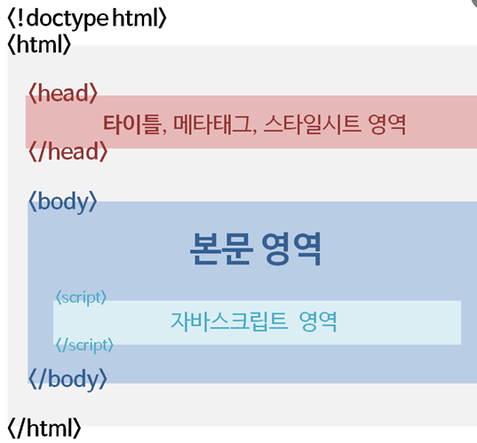
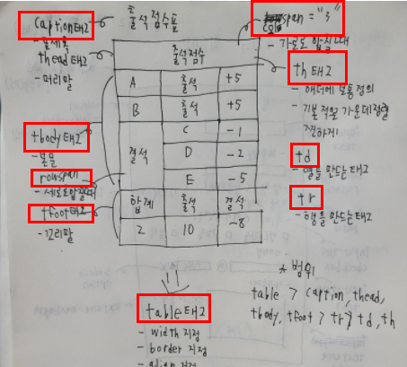
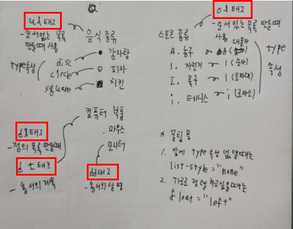

## ***난위도 : ★☆☆☆☆***

**HTML의 다양의 태그 속성들을 만나실수 있음!**

**CSS파트는 다음 쳅터에 다룰 예정~!**

**자기소계페이지 구현, 알고리즘 응용 예제 풀기 그 이후에 올릴 예정~!**

## ***# HTML이란? (Hypertext Markup Language)***

1. 정적인 웹페이지를 만드는 언어   
2. 메모장,한글,워드...문서작업이 가능한 프로그램에서는 모두 작성 가능하다.   
3. HTML 문서는 태그라는 명령어로 구성되어있다.  
4. .html 확장자 사용   
5. 태그는 기본적으로 시작태그<>와 종료 태그</>의 한쌍으로 구성

6. HTML 태그로는 곗산이 않되고 텍스트 인식 인식한다

7. HyperText(웹 페이지에서 다른 페이지로 이동할 수 있도록 하는 것) 기능을 가진 문서를 만드는 언어



### ***# HTML 태그 종류 (필수로 암기해야됨!!!!)***

\* 참고한곳 :  [태그의 모든것](http://tcpschool.com/html-tags/input)

1. 기본 태그 종류

|  |  |
| --- | --- |
| 태그 | 뜻 |
| <!DOCTYPE html> | html 문서 타입을 알려주는 태그 , 맨 위에 써줌 , 그 밑에는 html태그 |
| <meta charset="UTF-8"> | 현제 페이지에 대한 속성과 정보를 표시함, 한글표시 |
| <title> | 문서 제목 |
| <html> , <head> , <body> | HTML의 최상의 태그 1. head - 보통 meta태그, link태그, style태그, script태그가옴 - 화면에 안보여지는 부분을 구현할때 사용함 2. body - 화면에 보여지는 부분을 구분함 - 각종 태그들이 다옴 |
| <hr> , <b>, <i> , <small> , <u> <strong> , <em> , <br> , <del> | 처음부터 구분선, 굵게, 기울기, 작게, 밑줄, 굵게, 기울기, 줄바꿈, 밑줄 |
| <h1> ~ <h6> | h1 ~ h6 태그들은 머리말을 담당하며 클수록 글씨 크기가 작아짐 |
| <p> | 문단을 표현할때 쓰는 태그, 보통 안에는 단문이나 장문이 많이옴 |
| <div> | - 블럭요소로, 요소들을 그룹화 할 때 사용한다.  - 레이아웃을 구현할 때 사용 가능하다. |
| <span> | - 인라인요소로, 인라인요소들을 그룹화 할 때 사용한다..  - 인라인요소는 기본적으로 자신이 포함하고 있는 컨텐츠 만큼만 사용한다. |
| <a> | 링크 접속을 할때 필요한 태그 1. href 속성 :  이동 url 지정, #+id값 을 주면 해당 id로 포커싱 2. target 속성 : 링크 클릭했을때 웹사이트가 열리는곳 지정  - \_self 는 지금있는 브라우져에서 실행  - \_blank는 새로운 브라우저를 열어서 실행 |
|  | 이미지를 삽입할때 필요한 태그 1. src 속성 : 이미지 파일이 저장된 경로 지정  2. title 속성 : 마우스를 올렸을때 사진에대한 설명이 나옴  3. alt 속성 : 웹 접근성을 위해 시각 장애인 등 화면낭독기를 사용하는 사람을 위한 대체 텍스트  4. width/height 속성 : 이미지 가로 세로 사이지 지정 |
| <form> | 데이터들을 서버로 넘겨줘서 다룰때 사용함 1. action 속성 : form을 전송할 서버쪽 파일 지정  2. name 속성 : form 식별하기 위한 이름  3. target 속성 : form에 입력된 데이터가 서버를 거쳐 처리된 결과를 표시할 프레임  4. method 속성 : form을 서버에 전송할 http 메서드 지정  get은 submit으로 보낼때 url창에 나옴  post는 안나옴 |
| <input> | 사용자 입력을 받거나 변수 값을 지정할수있습니다. 1. type 속성 : 입력 태그의 형태 지정 - text : 텍스트박스에 글자 적기 - password : 텍스트박스에 암호적기 - button : 버튼 생성 2. name 속성 : 서버로 전달되는 이름, 변수의 타입  3. value 속성 : 입력 변수(태그)의 초기값을 지정, 변수의 값  4. maxlength 속성: 입력한 글자의 최대길이 지정  5. checked 속성 : 홈페이지를 열때 즉시 선택되어지도록 하는거  6. onclick : 마우스 클릭스 이벤트 발생시키는거, 안에 자바스크립트 함수 적어야됨 |

2. 표 관련태그

|  |  |
| --- | --- |
| 태그 | 뜻 |
| <table> | 테이블 만들때 최상의 태그 |
| <rowspan> | 셀을 세로로 합칠 때 사용합니다 |
| <colspan> | 셀을 가로로 합칠 때 사용합니다 |
| <tr> , <td> | row(행,가로라인), col(열) 만드는 태그 |
| <td> | 테이블 해더를 정의합니다. 가운데정렬 진하게 속성이 자동으로 부여됩니다. |
| <caption> | 표에 제목을 달아줄때 작성합니다. |
| <thead> , <tbody> , <tfoot> | 표의 머리말, 표의 본문, 표의 꼬리말 을 담당하는 그룹화태그 |



3. 리스트 관련태그

|  |  |
| --- | --- |
| 태그 | 뜻 |
| <ul> | 1. 순서가 없는 목록을 만들때 사용하는 태그입니다  2. 글머리 기호를 붙여서 목록을 만드는 태그입니다  3. type속성을 사용해서 시호를 설정 할 수 있습니다 (속성 없애고 싶으면 list-style='none') -disc : 검은 동그라미  -circle : 투명한 동그라미  -square : 검은 사각형 |
| <ol> | 1. 순서가 있는 목록을 만들 때 사용하는 태그  2. type속성을 사용해서 사용하는 항목 형태를 지정 할 수 있습니다 (속성 없애고 싶으면 list-style='none')  - 1 : 숫자  - A : 알파벡 대문자  - a : 알파벳 소문자  - I : 로마숫자 대문자  - i : 로마숫자 소문자 |
| <li> | 1. ul, ol 태그 내부에서 사용되는 태그입니다  2. 목록의 내용을 작성하는 태그입니다 |
| <dt> , <dd> , <dl> | 정의 목록, 용어의 제목, 용어에 대한 설명 |



4. 선택 그룹 관련태그들

|  |  |
| --- | --- |
| 태그 | 뜻 |
| <select> | - 드롭다운을 사용해서 여러개의 목록을 정의합니다 - 선택할수있는 박스형태가 나오고 스크롤해서  원하는 목록을 지정할수있음 |
| <optgroup> | select에서 선택할수 있는 목록들을 그룹으로 묶어 큰 카테고리를 만듬 |
| <option> | select 태그 안의 선택할수 있는 목록 |
| <fieldset> | form태그 안에있는 목록들을 그룹화할때 사용 border속성이 기본적으로 입혀지면서 테두리가 생김 |
| <legend> | fieldset 은 폼테그 안에 테두리를 입히는거라면 테두리 중간에 설명을 적을수 있음 |
| <label> | 보통 input태그 앞에 써주고 이름 나이 성별 을 써줌 |

### ***# HTML + CSS + JavaScript 관계 및 연결방법***

1. HTML 에서 CSS 접근

```html
<!DOCTYPE html>
<html>
    <head>
        <mata charset="utf-8">
        <link href="ex01.css" rel="stylesheet" type="text/css"/> <!-- case1 : css파일연결-->
        <style src="ex01.css" type="text/css"></style>
        <style>
            p {
                color: #000;
            }
        </style> <!--case2 : 여러개의 css속성을 써서 다수의 HTML태그에 속성을 입힐때 -->
    </head>

    <body>
        <p style="color: blue;"></p><!--case2 : 하나의 태그에만 쓸때-->
    </body>
</html>
```

2. HTML에서 자바스크립트 다루기

```html
<!DOCTYPE html>
<html>
    <head>
        <mata charset="utf-8">
        <link href="ex01.js" rel="text/javascript"/> <!-- case1 : js파일연결-->
        <script src="ex01.js" type="text/javascript"></script>
        <script>
            function a (){
                return 10;
            }
        </script> <!--case2 : 여러개의 자바스크립트를 쓸때 -->
    </head>

    <body>
        <input type="button" onclick="a()"><!--case2 : 하나의 태그에 자바스크립트를 쓸때는 이벤트 활용-->
    </body>
</html>
```

### ***# HTML 알고리즘 구현~!(회원가입창 만들기~!)***

<https://zibu-story.tistory.com/135>

[🔗 8.12 알고리즘 문제 (HTML, ★) -회원가입창 구현하기~! input 속성 이용~!(아직 미완성)](https://zibu-story.tistory.com/135) — 난위도 : ★☆☆☆☆ HTML의 기본 문법~! 웹을 만드려면 무조건 알고가야될 상식! 누구나 꼭 한번쯤 귀찮아도 만들어야됨!@ # 설명서~! 1. 아이디, 중복검사, 비밀번호, 비밀번호 확인, 이름, 이메일
