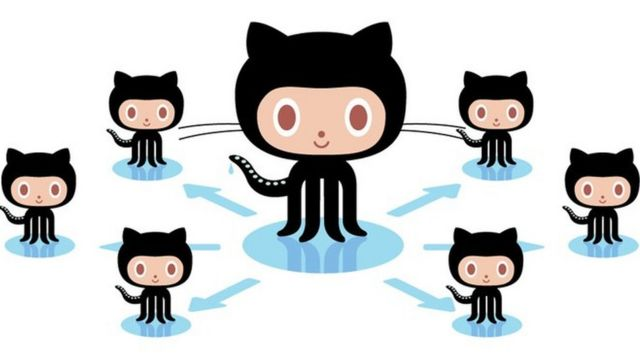
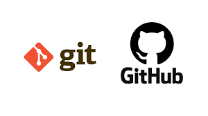
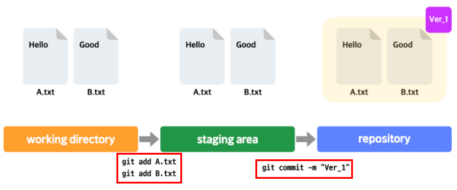
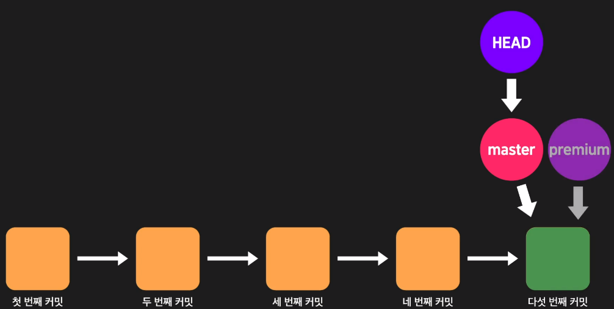
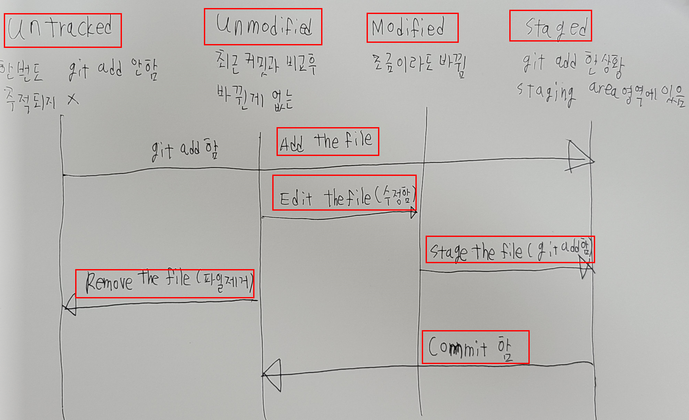
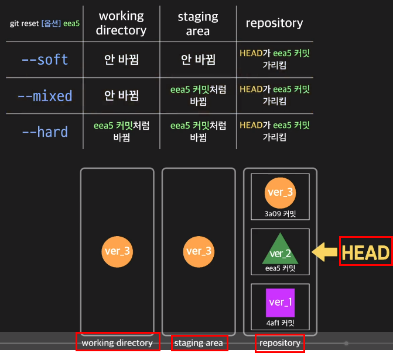

## ***난위도 : ★☆☆☆☆***

**1. Git의 프로그램 개념을 이해했고 왜 쓰는지 알게되었다.**

**2. GitHub 랑 Git 이랑의 차이점 언제 써야되는지 알게됨**

**3. 직접 버전을 등록, 수정 하는 방법을 알게되었다**

**4. 각각의 용어와 파일의 상태 등 개념을 알게되었다~!**



*중앙서버에서 분산 관리한다는 뜻*

### ***#  Git 들어가기전 알아야될것!💨 서버모델 ???? 분산모델 ????***

|  |  |
| --- | --- |
| 모델 종류 | 뭥미? |
| 서버 모델(클라이언트) | - 하나의 중앙 서버가 존재하며, 여러 클라이언트들은 중앙 서버에서 각자 맡은 파트만 가져와서 작업하고, 다시 중앙으로 통합하는것 - 대표적 시스템으로 CVS,Subversion(SVN) 등이 있다. |
| 분산 모델 | - 하나의 중앙 서버가 존재하지만, 여러 클라이언트들은 각자의 컴퓨터 저장소에 중앙 서버의 전체 사본을 가지고 작업하는 것을 의미한다. - 대표적으로 git이 있다. |

### ***#  와~ 캠짱이네~! 💘 Git VS Git hub (웹 호스팅 시스템)***

|  |  |
| --- | --- |
| 종류 (깃??? 깃허브???) | 뭥미? |
| Git (로컬영역) | - 버전별로 관리할수있다. (형성관리도구) - 소스 코드를 USB나 메일로 주고받는 건 엄청난 낭비 임과 동시에 보안성 위험이 있기에 이를 해결할수 있는 수단으로 쓰인다  - 리눅스 만든 리누스토발즈 라는사람이 깃을 만듬(이건 나도 몰랐음 ㅋㅋ) - 버전별로 어느 부분이 수정됬고 삭제됬는지 확인가능하다. - 버전별로 저장하는데 이전 버전으로 다시 되돌아갈 수 있다 - Git 자체에서 지원하는 커널(git bash)에서 명령어를 작성한다. - 분산 버전 관리이기 때문에 인터넷이 연결되지 않은 곳에서도 개발을 진행할 수 있고, 중앙 저장소가 날라가 버려도 원상복구할 수 있다. |
| Git Hub (리모트 영역) | - 로컬 영역에서만 버전을 관리하게되면 해당 컴퓨터가 다운되면 복구과 불가하기에 중앙서버에서 관리해야된다, 이를 호스팅이라고 하며 깃허브에서 무상으로 제공해준다 - push, pull  기능을 통해 해당 중앙 서버에서 여러사람들과 코드를 공유하며 협업이 가능하다. ex) GitHub, GitLab, BitBucket |



### ***# Git 관련 필수 용어들~!!!💥💦***

|  |  |
| --- | --- |
| 용어 | 내용 |
| Repository | - 실제 작업 폴더를 깃에서 관리하게 되면 그 폴더를 레파지토리라고 한다. - 레파지토리를 만드는 명령어는 git init 이 있는데 입력시 레파지토리가 있다면 초기화된다. - 커밋을 하게된다고 하면 실질적인 파일 데이터 폴더 등이 레파지토리로 이동하게되며 push할 준비를 마치게 된다. |
| Commit | - 현재 변경된 작업 상태를 점검을 마치면 확정하고 저장소에 저장하는 작업. |
| Working Directory | - 현제 내가 바라보고 있는 폴더 즉 깃에서 관리하기전 작업공간이라고 생각하면 된다 |
| Staging Area | - 깃이 관리하기전 준비단계 즉 작업폴더에서 바로 commit을 하게 되는게 아니라 add로 준비단계 있다가 차후에 레파지토리로 이동하게됨 |
| Head | - branch가 직접 해당 commit을 가리키는데 head는 브런치를 가리키며 간접적으로 commit에 접근함 - 그렇다고 무조건 head는 branch를 가리키는건 아니고 경우에따라 직접적으로 commit을 가리킬수도 있음(밑에 참고) |
| Branch | - 하나의 가지 또는 분기점을 의미하며, 여러가지 버전을 나눌때 유용하게 사용된다.  - master 브랜치는 처음 커밋할때 자동으로 생성해준다 - 직접적으로 commit을 가리킬수 있고 경우에따라 head가 branch를 가리키게됨 |
| Merge | - 현재 가리키는 branch내용과 입력한 브랜치 내용을 합쳐서 새로운 커밋을 만들겠다는 의미 - conflict(파일간의 충돌) 일어날수 있으니 주의할것! |
| README(파일이름) | - 깃허브에서 프로젝트의 간략한 설명을 보여주는 파일, .md(마크다운) 확장자로 표기한다. - 해당 문법이 있으나 아직은 필요 없을것같다. |



*코드잇 수업중 관련자료*



*코드잇 수업중 관련자료*

### ***# Git의 파일상태란??? 언제 바뀜????🤨***

**\*흙끗하고 넘어가도 될 사항들임!**

|  |  |
| --- | --- |
| 깃의 파일 상태 | 뭥미? |
| Untracked | - 깃이 추적하지 않는 상태 - 한번도 git add를 하지 않은 상태라고 생각하면됨 |
| Staged | - Tracked 깃의 추적하는 상태 - git add를 해서 staging area 영역에 들어가있는 상태 |
| Unmodified | - Tracked 깃의 추적하는 상태라고 생각하면됨 - 커밋후 수정하지 않는 상태 |
| Modified | - Tracked 깃의 추적하는 상태 - 최근과 비교해서 조금이라도 바뀐 상태라고 생각하면됨 |

|  |  |
| --- | --- |
| 깃의 파일 상태가 변화하는 상황 | 뭥미??? |
| Add the file | - untracked 상태에서 git add 한 상황 즉 staged상태로 변한다는말 |
| Edit the file | - 파일이나 폴더 코드를 수정하게 될때 상황, 즉 unmodified에서 modified상태로 변한다는 말 |
| Stage the file | - git add한 상황은 같지만 이거는 modified에서 staged로 바뀌는 것 |
| Remove the file | - git remove 했을때 상황 즉 unmodified에서 untracked상태로 바뀌었다는 말임 |
| Commit | - git commit을 한 상환 즉 staged에서 unmodified상태로 바뀌었다는 말임 |



*전체적인 노트 정리*

### ***# Git Bash 커널에서 쓰는 명령어 😎***

**(이거는 무조건 알고 코드로 구현하는 연습해야됨!)**

#### **\* 기본적으로 알고있어야되는 명령어들~!**

|  |  |
| --- | --- |
| 명령어 | 뜻 |
| $ mkdir 이름 | - 워킹 디렉토리(폴더) 생성하기 |
| $ cd 프로젝트이름/ | - 폴더 안으로 들어가기 |
| $ cd .. | - 상위폴더로이동 |
| $ git init | - 레파지토리 생성 있으면 초기화함 |
| $ cd .git | - 생성한 레파지토리 안으로 들어가기 모든 명령들을 git으로 처리 |
| $ git config user.name "이름" | - commit하기전 해줘야됨 사용자 이름 입력 |
| $ git config user.email "이메일주소" | - commit하기전 해줘야됨  사용자 이메일 입력 |
| $ git add 파일이름 | - commit 하기전 해야됨 안하면 untracked상태 - working 디렉토리에서 Staging Area 디렉토리로 이동 |
| $ git add . | - 전부 add 하기 |
| $ git reset 파일이름 | - add한것 취소 |
| $ git reset --속성 | - 각 3개의 속성에따라 파일의 내용이달라짐 - 속성 종류는 hard mixed soft가 있음  -자세한 부분은 밑에 설명 |
| $ git commit -m "남길 메모" | - 커밋 메세지 남기기 |
| $ git commit | - 커널상 텍스트 에디터에서 commit 메모를 남길수 잇음 - i를 입력시 insert 상태가 되고 글을 입력가능하다 - 완료하면 Esc를 눌르고 :wq를 입력하면 커밋이 저장된다 |
| $ git commit --amend | - 새롭게 커밋하는게아닌 기존 커밋 덮어씌우기 - 메모도 수정가능 -입력시 텍스트 에디터로 이동됨 |
| $ touch 파일이름 | - 새로운 파일 만들기 |
| $ git branch 브랜치이름 | - 브랜치 만들기 , 안쓰면 브랜치 전체조회 |
| $ git branch -d 브런치이름 | - 브랜치 삭제하기 |

**\* reset할때 속성에 따라 변화하는 부분 ~!**



#### **\* git bash로 호스팅 하기 위한 명령어들~!**

|  |  |
| --- | --- |
| 명령어 | 뭥미??? |
| $ git remote add origin 깃허브url | 깃허브 url을 origin이름으로 레포지토리 만들겠다는뜻 |
| $ git push -u origin master | 로컬에 master branch가 origin 리모트를 계속 가리키고 내용을 레포지토리를 보낸다는말 |
| $ git push | 로컬레포지토리 -> 리모트 레포지토리, 프로젝트 주인만가능 다같이하려면 설정해줘야됨 |
| $ git revert 커밋아이디 | push하기전 되돌리고 싶은 커밋 선택하면 새로운 커밋이 생성되며 이전상태로 되돌아감 |
| $ git fetch | 로컬레포지토리 <- 리모트 레포지토리 단, merge는 따로 해줘야됨 파일 점검 할때 주로 사용 |
| $ git pull | 로컬레포지토리 <- 리모트 레포지토리 merge 자동적으로 해줌 점검할 필요 없을때 사용 |
| $ git clone 깃허브url | 깃허브에서 다른사람 프로젝트 쓰기 |

#### **\* 그외적인 명령어들!(태그달기 , merge하기등등)**

|  |  |
| --- | --- |
| 명령어 | 뜻 |
| $ git config alias.별명 '내용' | 위에 명령어 별병으로 축약가능 |
| $ git diff 커밋아이디 동일 | 두 커밋,브랜치 내용의 차이점을 보여줌 |
| $ git tag 태그이름 커밋아이디 | 커밋에 태그달아주기 |
| $ git tag -d 지울태그명 | 태그 단거 회수 |
| $ git show 태그이름 | 태그이름 |
| $ git checkout 브랜치이름 or 커밋아이디 | 브런치 이름을쓰면 head가 지정 브랜치를 가리키고 커밋아이디를 쓰면 head가 직접 커밋을 가리킴 |
| $ git checkout -b 브런치이름 | 브랜치 생성후 바로 이동 |
| $ git merge 브런치이름 | 현재 가리키는 branch내용과 입력한 브랜치 내용을 합쳐 새로운 커밋(머지커밋)을 만들겠다는 말 |
| $ git merge --abort | merge취소 |
| $ git rebase 브런치이름 | 터미널에 쓴 브런치 내용을 가져와 다음커밋으로 현재 브런치 내용과 합쳐 마치 병합하지 않는 상황처럼 만듬(merge랑 다름) |
| $ git rebase --continue | rebase하고 커밋할때는 이렇게 써줌 |
| $ git stash | 작업한 내용을 stack에 저장하고 이전 commit으로 돌아감, 커밋을 안하면 다른 branch로 못돌아가니까 |
| $ git stash apply | 스택에 저장한 커밋 branch로 다시 가져오기 기존 브랜치가 아닌 다른 브랜치에서 병합 가능 |
| $ git stash drop,pop 아이디 | stash list에 있는 목록중 하나 선택해서 삭제 |

#### **\* 목록 조회하는 명령어~!!**

|  |  |
| --- | --- |
| 명령어 | 뜻 |
| $ ls , $ ls -a | - 목록조회 |
| $ git branch | - 브런치 목록 조회 |
| $ git log --pretty=oneline | - 커밋한 히스토리 (repository한파일) 목록 한줄로 불러오기 (log부터는 history로 축약함) |
| $ git log --pretty=oneline --all | - histoy로 축약했다는 가정 모든 브랜츠의 커밋한 목록을 보는것 - alias로 별명을 줘서 축약할수있다 |
| $ git log --pretty=oneline --all --graph | - history로 축약했다는 가정 모든 브랜츠의 커밋한 목록을 그래프 형식으로 보는것 |
| $ git log | - 지금까지 커밋한거보기 아래로갈수록 오래된거  - 커밋 아이디도 확인가능(커밋해시) |
| $ cat 파일명 | - 해당 파일의 working directory 를 읽어옴 |
| $ git tag 태그이름 | - 태그 목록 확인 |
| $ git stash list | - 스택에 저장한 커밋을 볼수있음 |
| $ git help 명령어 | - 명령어에대해 자세히 알고싶을때 |
| $ git reflog | - Head가 이제까지 가리켰던 커밋들을 보여줌 |
| $ git blame 파일 | - 파일에서 어떤부분을 언제 누가 커밋아이디 까지 전부 나옴 |
| $ git status | - 어디 브랜치 위에있는지 확인 |
| $ git show 커밋아이디 | 커밋아이디로 저장한 부분 더 자세히 보기 |

### ***# 중요한 부분 코드 구현~! 다른거는 몰라도 이거는 알자~!😋***

#### **1. 프로젝트 디렉토리 생성 및 레퍼지토리 생성하기**

```bash
USER@DESKTOP-JARARK6 MINGW64 ~/Desktop/코드잇/gitHub <--현재경로
$ mkdir MathTool <-- 프로젝트 디렉토리 생성

USER@DESKTOP-JARARK6 MINGW64 ~/Desktop/코드잇/gitHub
$ ls <--목록조회
Git-2.32.0.2-64-bit.exe*  License  MathTool/  calculator.js

USER@DESKTOP-JARARK6 MINGW64 ~/Desktop/코드잇/gitHub
$ cd MathTool/ <--MathTool폴더 안으로 들어가기

USER@DESKTOP-JARARK6 MINGW64 ~/Desktop/코드잇/gitHub/MathTool
$ git init  <--git는 이제부터 자주쓰게될용어, 비어있는 레퍼지토리(프로젝트 디렉토리의 각 버전을 담는 저장소)생성
Initialized empty Git repository in C:/Users/USER/Desktop/코드잇/gitHub/MathTool/.git/

USER@DESKTOP-JARARK6 MINGW64 ~/Desktop/코드잇/gitHub/MathTool (master)
$ cd .git <--레퍼지토리 안으로 들어가기

USER@DESKTOP-JARARK6 MINGW64 ~/Desktop/코드잇/gitHub/MathTool/.git (GIT_DIR!)
$ ls -al <--목록 조회
total 11
drwxr-xr-x 1 USER 197121   0 Aug 10 17:11 ./ <--각종 작업을 하기 위해 사용하는것들
drwxr-xr-x 1 USER 197121   0 Aug 10 17:11 ../
-rw-r--r-- 1 USER 197121  23 Aug 10 17:11 HEAD
-rw-r--r-- 1 USER 197121 130 Aug 10 17:11 config
-rw-r--r-- 1 USER 197121  73 Aug 10 17:11 description
drwxr-xr-x 1 USER 197121   0 Aug 10 17:11 hooks/
drwxr-xr-x 1 USER 197121   0 Aug 10 17:11 info/
drwxr-xr-x 1 USER 197121   0 Aug 10 17:11 objects/
drwxr-xr-x 1 USER 197121   0 Aug 10 17:11 refs/
```

#### **2. 새파일 or 수정파일 commit 등록하기**

```bash
USER@DESKTOP-JARARK6 MINGW64 ~/Desktop/코드잇/gitHub/MathTool/.git (GIT_DIR!) <--현재파일위치
$ cd .. <--상위폴더로이동

USER@DESKTOP-JARARK6 MINGW64 ~/Desktop/코드잇/gitHub/MathTool (master)
$ git config user.name "jisue" <-- 필수사항1 : 사용자 이름 입력

USER@DESKTOP-JARARK6 MINGW64 ~/Desktop/코드잇/gitHub/MathTool (master)
$ git config user.email "tjdwltn121@naver.com" <-- 필수사항2 : 사용자 이름 입력

USER@DESKTOP-JARARK6 MINGW64 ~/Desktop/코드잇/gitHub/MathTool (master)
$ git add calculator.js <--commit 하기전 해야됨 안하면 untracked상태

USER@DESKTOP-JARARK6 MINGW64 ~/Desktop/코드잇/gitHub/MathTool (master)
$ git add License

USER@DESKTOP-JARARK6 MINGW64 ~/Desktop/코드잇/gitHub/MathTool (master)
$ git commit -m "Create calculator.js and License" <-- 필수사항3 : 커밋 메세지 남기기
[master (root-commit) 6744671] Create calculator.js and License <--root는 처음이라는 뜻
 2 files changed, 7 insertions(+) <--commit한 파일수 , 파일에 있는 총 줄수
 create mode 100644 License
 create mode 100644 calculator.js

USER@DESKTOP-JARARK6 MINGW64 ~/Desktop/코드잇/gitHub/MathTool (master)
$ git status <--현재 상태 확인하기
On branch master
Changes to be committed:
  (use "git restore --staged <file>..." to unstage)
        modified:   calculator.js
```

#### **3. 새로운 폴더안에 파일 만들기 , 한번에 등록하기 , 등록한거 취소하기**

```bash
USER@DESKTOP-JARARK6 MINGW64 ~/Desktop/코드잇/gitHub/MathTool (master)
$ mkdir meeting-log

USER@DESKTOP-JARARK6 MINGW64 ~/Desktop/코드잇/gitHub/MathTool (master)
$ cd meeting-log/

USER@DESKTOP-JARARK6 MINGW64 ~/Desktop/코드잇/gitHub/MathTool/meeting-log (master)
$ touch day1 <--새로운 파일 만들기

USER@DESKTOP-JARARK6 MINGW64 ~/Desktop/코드잇/gitHub/MathTool/meeting-log (master)
$ touch day2

USER@DESKTOP-JARARK6 MINGW64 ~/Desktop/코드잇/gitHub/MathTool/meeting-log (master)
$ cd ..

USER@DESKTOP-JARARK6 MINGW64 ~/Desktop/코드잇/gitHub/MathTool (master)
$ git add meeting-log/ <--한번에 추가

USER@DESKTOP-JARARK6 MINGW64 ~/Desktop/코드잇/gitHub/MathTool (master)
$ git add . <--모든항목 추가

USER@DESKTOP-JARARK6 MINGW64 ~/Desktop/코드잇/gitHub/MathTool (master)
$ git reset calculator.js <--등록 취소
Unstaged changes after reset:
M       calculator.js
```

#### **4. 깃허브 깃에 연결하기**

```bash
USER@DESKTOP-JARARK6 MINGW64 ~/Desktop/코드잇/gitHub
$ cd MathTool/ <--MathTool 폴더안으로 들어가기

USER@DESKTOP-JARARK6 MINGW64 ~/Desktop/코드잇/gitHub/MathTool (master)
$ git remote add origin https://github.com/seong-ji-sue/Box.git <--깃허브 연결하기

USER@DESKTOP-JARARK6 MINGW64 ~/Desktop/코드잇/gitHub/MathTool (master)
$ git push -u origin master <--깃허브로 파일 업로드
Enumerating objects: 10, done.
Counting objects: 100% (10/10), done.
Delta compression using up to 8 threads
Compressing objects: 100% (7/7), done.
Writing objects: 100% (10/10), 738 bytes | 738.00 KiB/s, done.
Total 10 (delta 1), reused 0 (delta 0), pack-reused 0
remote: Resolving deltas: 100% (1/1), done.
To https://github.com/seong-ji-sue/Box.git
 * [new branch]      master -> master
Branch 'master' set up to track remote branch 'master' from 'origin'.
```

#### **5. 브랜치 만들기**

```bash
USER@DESKTOP-JARARK6 MINGW64 ~/Desktop/코드잇/gitHub/MathTool (master)
$ git branch premium <--premium 브랜치 생성

USER@DESKTOP-JARARK6 MINGW64 ~/Desktop/코드잇/gitHub/MathTool (master)
$ git checkout premium <--Head가 premium 으로 가리키기
Switched to branch 'premium'

USER@DESKTOP-JARARK6 MINGW64 ~/Desktop/코드잇/gitHub/MathTool (premium)
$ git status <-- 상태 확인
On branch premium
nothing to commit, working tree clean

USER@DESKTOP-JARARK6 MINGW64 ~/Desktop/코드잇/gitHub/MathTool (premium)
$ git push <--master 브랜치는 -u한상태
fatal: The current branch premium has no upstream branch.
To push the current branch and set the remote as upstream, use

    git push --set-upstream origin premium <--premium은 -u 안해줬기때문에 해줘야된다는말
```

### ***#궁금한것! 😮(위에 전반적으로 공부했다는 가정하에 쓰는거기때문에 밑에 작성함)***

**(이것은 wecode 부캠에서 pre-course 2주차에 weducks과제 할때 맨토님께 여쭤본 사항임)**

#### **\* 궁금증 ?**

현제 프로젝트한 Repository에 제 과제를 push한 상황입니다. 혹시나 제 컴퓨터가 초기화 되도 다시 clone해서 저의 brach로 들어가보면 파일이 복구됩니다. 그럼 당연히 현제 remote는 자동적으로 프로젝트한 Repository 로 가리키고 있을텐데 저는 제 github Repository 에도 과제 파일을 업로드하고 push하고 싶습니다. 이런 상황에서 따로 대중적으로 문제 없이 쓰는 방법이 있나요?

#### **\* 시도한 부분들**

1. 현제 제 로컬 레파지토리에서 remote를 origin을 줘서 제 리모트 레파지토리로 push하게되면 프로젝트한  Repository 때문에 오류가 난다
2. 현제 제 로컬 레파지토리에서 remote를 origin말고 따른값을 주고 push를 주면 문제 없이 작동하지만 하나의 로컬 레파지토리만 push하다가 나머지 하나를 push할 경우 commit한 시점이 달라서 충돌이 발생한다
3. 제 로컬 레파지토리에 있는 코드 파일을 다른 working directory 로 복사해서 따로 commit하고 제 github 레파지토리에 push 해줘도 문제 없는데 이중적으로 파일을 관리해야되고 깃이 추구하는 형상관리의 목적이 벗어난다.

#### **\*답변 ( re : 소O 맨토님)**

현재 로컬에 있는 코드를 위코드 레포지토리와 동시에, 같은 코드를, 독립적인 레포지토리에서도 관리하시고 싶으시다는 뜻으로 이해하면 될까요?

(추천 검색어: github repository fork , 또는 한글로 깃허브 레포지토리 fork)

1. 시도해보신 것처럼, local 에 있는 코드를 서로 다른 두 remote repository에게 push 해서 관리하는 경우는 거의 없습니다
2. repository fork 기능을 사용하면 지수님의 의도를 적용할 수 있을 것 같아요.fork에 대해 공부를 조금 해보셔야겠지만 (별로 어렵지는 않습니다.)특정한 레포를 바라보고 있는 제2의 레포지토리를 만들어서 연동해가면서 사용하실 수 있습니다

**\* 추천검색어로 찾아서 개념을 이해하기 좋은 블로그 : [Git fork와 clone 의 차이점](https://velog.io/@imacoolgirlyo/Git-fork%EC%99%80-clone-%EC%9D%98-%EC%B0%A8%EC%9D%B4%EC%A0%90-5sjuhwfzgp)**
