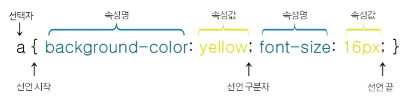

## ***난위도 : ★★☆☆☆***

**화면에 그려준거 꾸미는 방법~!**

**모든 태그에는 block, inline 둘중에 하나임~!**

**float랑 세로정렬은 개인적으로 캐캐캐어려움~!**

### ***# CSS란? (Cascading Style Sheets)***

-HTML에서 브라우저에 글이나 이미지 링크를 썼다면 CSS는 이쁘게 꾸미는것

-모든 속성들은 CSS에서 해준다고 보면됨~!

-속성과 값으로 선언함~!

### ***#CSS 속성종류***

**\*참고하면 좋은곳 : [CSS속성 총정리](http://tcpschool.com/css/intro)**

0. 중요한것들~!

|  |  |
| --- | --- |
| 속성 | 뜻 |
| min,max-weight | 화면을 줄이거나 늘릴때 최소길이 최대길이를 정하는거 |
| display | 속성지정 1. inline - 다른 요소들과 같은 줄에 머무르려고 하는 성향 - 가로 길이는 필요한 만큼 차지하는 성향 - 가로 세로 길이 개념이 없음 - 텍스트처럼 다둘수있음 2. block  - 새로운 줄에 가려고 하는 성향  - 가로길이를 최대한 많이 차지, - 가로길이랑 세로길이 설정해줄수도있음 3. inline-block - 같은줄에 머물고 크기조절함 - 요소는 인라인임 대체요소라고 생각하면됨 |
| list-style | ul이나 ol 태그 할때 앞에 나오는 부분 없애주는거 (none) |

1. 폰트에 관한 속성

|  |  |
| --- | --- |
| 속성 | 뜻 |
| color | 폰트의 컬러를 설정해줌 |
| font-size | 폰트의 사이즈 설정 -px : 다른 요소의 값에 영향 ㄴㄴ 절대값,자식이 정의해놓 은것만 보면됨 -rem,em: 다른요소 영향 ㅇㅋ 상대값, 부모가 정의한 font-size에 배로 된다생각 em은 자신이 정의할시 부모꺼 무시 -% : 부모꺼 font-size나 width 기준 |
| text-decoration | 글자에 밑줄을 긎는거, - underline : 밑에 - overline : 글 위에 - line-through : 글자 가운데 - none : 밑줄 없애기 |

2. 가로 정렬, 세로정렬

|  |  |
| --- | --- |
| 속성 | 뜻 |
| text-align, | 가로 가운데정렬(inline일경우) |
| margin-left,right | auto : 가로 가운대 정렬 (block일 경우) |
| vertical-align | baseline에 맞춰서 세로 정렬 --> [baseline하고 세로정렬은 여기참고~!](https://zibu-story.tistory.com/66) |

3. Boxing에 관한 태그

|  |  |
| --- | --- |
| 속성 | 뜻 |
| margin | 테두리(border) 바깥쪽 여백 |
| border, border-radius, border-위치 | 테두리 만들기(굵기, 종류, 색깔), radius는 둥글게 - dotted : 점선 - dashed : 파선 - border-bottom 밑에만 테두리 생김, 0이나 none 주면 테두리 없어짐 |
| padding | 테두리(border) 안쪽 여백 |

4. 전체적인 배경 관련 속성

|  |  |
| --- | --- |
| 속성 | 뜻 |
| background-color,image | 배경에 무엇을 넣을껀지 지정해주기 |
| background-size | - cover : 화면을 꽉 채우면서, 사진 비율을 유지 - contain : 가로, 세로 중 먼저 채워지는 쪽에 맞추어서 출력 |
| background-position | 짤릴때 보여지는 부분 설정 |
| background-repeat | 남는공간 반복적으로 사진을 채울거임? - repeat-x,y : 가로or 세로 방향으로만 반복 - repeat : 가로와 세로 모두 반복 - space : 반복할 수 있는 만큼 반복한 뒤, 남는 공간은 이미지 간의 여백으로 배분 - round : 반복할 수 있는 만큼 반복한 뒤, 남는 공간은 이미지 확대를 통해 배분 |
| background-position | 테두리 안에서 배경 이미지 위치 정해줌 - 가로: left, center, right - 세로: top, center, bottom |

5. 큰 영역적인 관련 속성들~!(여기가 난위도 좀 빡셈)

|  |  |
| --- | --- |
| 속성 | 뜻 |
| overflow | - hidden : 테두리 밖으로 넘치는 부분 숨김처리 - scroll : 숨겨진부분 스크롤로 내릴수있음,내용이 넘지않아도 스크롤 생김 - auto : 내용이 넘을때만 스크롤생김 |
| box-shadow: | 그림자 지정 가로(px), 세로(px), 흐린정도(px), 그림자크기(px), 그림자색 |
| box-sizing | 지정한 가로 세로길이에 pading을 붙이면 더 커지는데 이를 방지 하기위해 pading 길이 포함 가로길이 지정으로 됨 - border-box |
| position | -relative 상대적으로 바뀜 이동시 다른 요소에 영향을 주지않고 겹치더라도 그 요소만 전에 있던 위치 기준움직임 -기본값 position을 안씀(static 기본값 자동 설정) margin으로 움직일시 겹치지 않는 선에서 다른요소도 영향받음 -fixed 브라우져 기준으로 움직임 즉 스크롤을 내려도  계속 고정된 자리에 있음 있던 공간에서 제외되고 독립적으로 움직임 -absolute  가장 가까운 position된 부모 요소 기준으로 움직임 |
| float, clear | 그리드 만드는 법 [여기 참고할것!@](https://zibu-story.tistory.com/67) (캐캐캐어려움) |

### ***# 폰트 설정방법***

1. 사용자가 가지고있는 폰트 사용할시  
- font-famaily: 폰트이름1,폰트이름2, 폰트종류; -->폰트1을 쓰고 없을때 폰트2를 씀 폰트2도 없으면 폰트종류중 있는거 아무거나 가져옴  
2. 구글폰트 사용하기  
fonts.google.com 에서 폰트 고르고   
HTML코드 복사해서 head태그 안에 넣기  
그리고 CSS코드 복사 붙어넣기  
3. 다운받은 폰트파일 사용  
@font-face{   
src: url(파일경로);  
font-family: 이름설정;  
} -->이렇게쓰고 위에 형식대로 쓰는데  
폰트이름대신 이름설정을 넣으면됨  
4. 폰트 종류  
Serif(궁서체,Times: 끝에가 구부러져있음)  
Sans-Serif(굴림체,Arial: 끝에 구부러진게 없음)  
Monospace(courier: 글자사이 폭이 같음)  
Cursive(필기체,Comic San MS) -->긴글 ㄴㄴ 머리말에 사용  
Fantasy(나머지폰트, Impact)

### ***# CSS에서 선택자 쓰는법***

0. A {} : 기본적인 방법  
1. A > B {} : A의 바로 직속자식인 B를 가지고 있는 모든 태그   
2. A, B {} : A와 B 둘중에 하나라도 가지고 있는 태그   
3. A B:nth-child(?) {} : A의 자식인 B를 가지고 있는 태그중 ?번째   
4. A B: first-child {} : A 자식인 B를 가지고 있는 태그중 첫번째(마지막은 last)   
5. A B:not (:first-child) {} : A자식중 B를 가지고 있는 태그중 첫번째만 빼고 모두(마지막은 last)   
6. A : hover {} : 마우스가 A에 올라갔을때

### ***# 이벤트란? + 종류(자바스크립트로 이벤트 다루기~!)***

<https://zibu-story.tistory.com/110>

[🔗 7.19 코드잇(자바스크립트-중급) - 이벤트(종류, 다루는법 등), 브러우저 기본 이벤트 제거방법](https://zibu-story.tistory.com/110) — #이벤트 핸들러 등록 하는 몇가지 방법 1. 돔 요소에 접근하여 등록 ex)let 변수이름 = document.querySelector(css); 변수이름.onclick= function(){이벤트 } --> 이벤트 추가 --> 이렇게하면..

### ***# 꿀팁~!!! 그냥 지나치기 아까울껄~!***

1. 반응형 웹 만드는법

@media (min-width: 750px) {} -> 가로가 750px 밑으로 가면 적용할 속성 설정 하면됨

2. 자바스크립트로 CSS 다루는방법

- JQery를 이용한다 (아직 안배운것)

- document.getElementsByClassName 를 써서 속성을 추가한다

3. 자바스크립트로 HTML 다루는 방법

- DOM 객체 이용하여 태그추가, 자식태그 접근 할수있다 ([자세한 내용 여기로](https://zibu-story.tistory.com/105))
