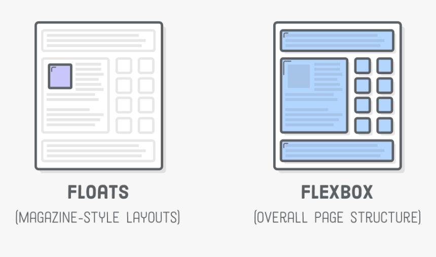

## ***난위도 : ★★☆★☆***

**요즘 Flex 모르면 사람도 아님! 염따도 맨날 Flex 하는것도 이것때문 ㅋㅋㅋ**

**정렬의 최신 끝판왕~!!**


*이뻐서 퍼옴 (출처 : 1분코딩)*

### ***# Flex 왜 쓰는거임? float 놔🤔***

전반적으로 실무에서 요즘 flex 속성을 자주 쓴다고 하고 float 속성은 점점 잊혀져가고 있다고

한다. 그럼 여기서 의문점! 왜 float의 문제점은 뭘까?! 내 생각에는 float는 display 속성에 따라 다르고

앞 쳅터를 본것같이 내가 원하는 위치(아래 위 옆 간격줘서 등) 이동할수 없다는 한계가 있다.(left right 밖에 없음)

그리고 clear 속성까지 병행해서 써야하는 불편.... (특히 세로정렬할때 ㅈㅈ)

그래서 여러가지를 보안해 flex 속성이 나온거고 속성별로 간격 위치가 지정되있기 때문에 자유 자제로 이동할수 있다.



*float 와 flex의 차이점 (출처 : 구글링)*

### ***#Flex 개념! - 처음이지? 일로와~!😁***

\*실습하기 : <https://flexboxfroggy.com/#ko> (개구리 잡기)

참고한곳 : <https://studiomeal.com/archives/197> (캐릭터가 귀여움 ㅎㅎ)

**1. 부모태그 속성 설정**

- justify-content 속성

|  |  |
| --- | --- |
| 속성값 | 뭥미? |
| flex-start | 요소들을 컨테이너의 왼쪽으로 정렬합니다. |
| flex-end | 요소들을 컨테이너의 오른쪽으로 정렬합니다. |
| center | 요소들을 컨테이너의 가운데로 정렬합니다. |
| space-between | 요소들 사이에 동일한 간격을 둡니다. |
| space-around | 요소들 주위에 동일한 간격을 둡니다. |

- align-items 속성

|  |  |
| --- | --- |
| 속성값 | 뭥미? |
| flex-start | 요소들을 컨테이너의 꼭대기로 정렬합니다. |
| flex-end | 요소들을 컨테이너의 바닥으로 정렬합니다. |
| center | 요소들을 컨테이너의 세로선 상의 가운데로 정렬합니다. |
| baseline | 요소들을 컨테이너의 시작 위치에 정렬합니다. |
| stretch | 요소들을 컨테이너에 맞도록 늘립니다. |

- flex-direction 속성

|  |  |
| --- | --- |
| 속성값 | 뭥미? |
| row | 요소들을 텍스트의 방향과 동일하게 정렬합니다. |
| row-reverse | 요소들을 텍스트의 반대 방향으로 정렬합니다. |
| column | 요소들을 위에서 아래로 정렬합니다. |
| column-reverse | 요소들을 아래에서 위로 정렬합니다. |

- flex-wrap 속성

|  |  |
| --- | --- |
| 속성값 | 뭥미? |
| nowrap | 모든 요소들을 한 줄에 정렬합니다. |
| wrap | 요소들을 여러 줄에 걸쳐 정렬합니다. |
| wrap-reverse | 요소들을 여러 줄에 걸쳐 반대로 정렬합니다. |

- flex-flow 속성

```css
/*flex-direction ,flex-wrap 속성 둘다 쓸수있음 여러개 속성 지정가능 */
flex-flow: <‘flex-direction’> || <‘flex-wrap>;
```

- align-content 속성

|  |  |
| --- | --- |
| 속성값 | 뭥미? |
| flex-start | 여러 줄들을 컨테이너의 꼭대기에 정렬합니다. |
| flex-end | 여러 줄들을 컨테이너의 바닥에 정렬합니다. |
| center | 여러 줄들을 세로선 상의 가운데에 정렬합니다. |
| space-between | 여러 줄들 사이에 동일한 간격을 둡니다. |
| space-around | 여러 줄들 주위에 동일한 간격을 둡니다. |
| stretch | 여러 줄들을 컨테이너에 맞도록 늘립니다. |

**2. 자식태그 속성 설정**

- order속성 :자식태그의 순서를 바꿀때 사용

```css
/*지정해주면 그 태그만 이동*/
order : 음수(왼) or 양수(오)
```

- align-self 속성

|  |  |
| --- | --- |
| 속성값 | 뭥미? |
| flex-start | 여러 줄들을 컨테이너의 꼭대기에 정렬합니다. |
| flex-end | 여러 줄들을 컨테이너의 바닥에 정렬합니다. |
| center | 여러 줄들을 세로선 상의 가운데에 정렬합니다. |
| space-between | 여러 줄들 사이에 동일한 간격을 둡니다. |
| space-around | 여러 줄들 주위에 동일한 간격을 둡니다. |
| stretch | 여러 줄들을 컨테이너에 맞도록 늘립니다. |
