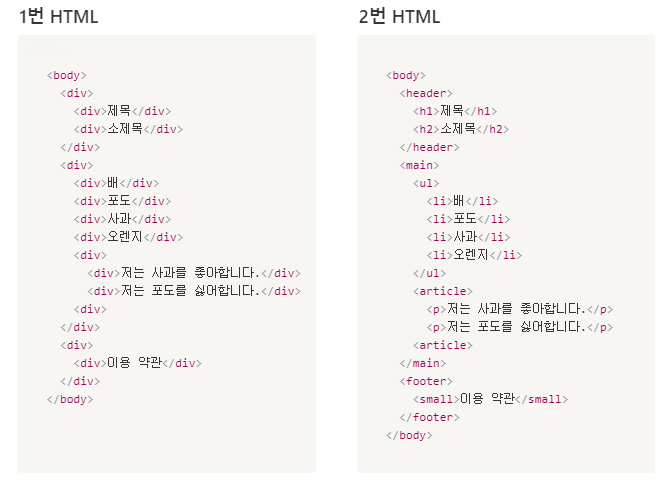
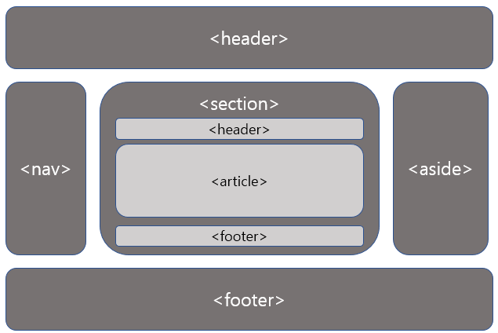

## ***난위도 : ★☆☆☆☆***

**서칭만 하면 개념들이 다 나오기때문에**

**만약 개념을 모르고 그냥 사용하게 된다면 생길 문제점을**

**먼저 적어보고 거기에 맞춰 왜 써야되는지에 포커싱을**

**둬서 글을 적어봤음**

### ***#  문제 인식 1번째 (Semantic Tag Part)***

1. 우리가 기본적으로 알고있는 기능이 있는(a태그, img태그 등) 태그들은 저마다 다 의미가 있는데 그룹화 하는 태그는 기능이 없어서 그런지 정말 다 의미가 같을까?   
2. 만약 있다면 어느 상황에 쓰고 태그들의 의미는 무엇일까?   
3. 그리고 단순히 div 태그만 썼을때랑 차이점은 무엇이 있을까?

### ***#Semantic Web은 뭐야?***

시맨틱 웹(Semantic Web)은 "의미론적인 웹"이라는 뜻으로, 기계가 이해할 수 있는 형태로 제작된 웹을 의미합니다. (물론 사람도 이해할 수 있습니다.)

### ***#Semantic Tag(의미론적 태그) 굳이 왜씀?***

1. div 태그로만 정의해도 코드는 돌아가는데 다른 개발자들이 볼때 구조를 좀더 쉽게 파학하기 위해서 의미론적으로 사용   
2. 검색엔진에게도 중요한 부분 덜 중요한 부분을 파악할 수 있게 해줘서 효율적인 검색을 하도록 도와줌   
3. 쉽게 검색엔진에 노출됨    
4. 건물 지을때도 특정 부분에 이름을 짓듯이 쉽게 이해하기 편하려고 쓰는것같음



*div도배 VS Semantic Tag 사용 예시 (Wecode 제공)*

### ***# Semantic Tag 종류***

|  |  |
| --- | --- |
| 태그 | 뭥미? |
| section 태그 | 하나의 주제를 그룹화할 때 사용합니다.  ex) 뉴스 기사의 제목 |
| article 태그 | 하나의 주제에 대해서 그 내용에 대해 설명할 떄 사용합니다. ex) 뉴스 기사, 블로그 글, 광고글 |
| details 태그 | 사용자가 보거나 숨길수 있는 추가적인 세부 정보를 정의할때 쓴다 |
| footer 태그 | 화면 하단에 위치하는 정보를 정의할때 씀 ex)이메일 저작권 표시 |
| header 태그 | 화면 상단에 위치하는 정보를 정의할때 씀 |
| main 태그 | 화면 중간부분에 위치하는 정보를 정의할때 쓰고 주가되는 컨텐츠가 주로 옴 |
| nav 태그 | 보통 header 태그 영역의 아래쪽에 위치하며 메뉴를 표현할 수 있습니다. |
| section 태그 | 하나의 주제를 그룹화할때 사용  ex)뉴스기사 제목 |
| time 태그 | 날짜나 시간을 정의할때 씀 |



*태그 사용했을때 구조*

### ***# 개인적인 뇌피셜~!***

원래 div태그로만 감싸고 display 속성으로 상태를 바꿀수 있기에 그룹화 태그는 아무거나 쓰는줄 알았고 구분 하기위해서 식별자(id, class)를 특정하던가 주석으로 표시하는등 이해할수있게 적는줄 알았는데 새로운 깨닭음을 얻은것같음!   
다만 좀 번거로울수 있고 코드량이 많아지면 태그만으로 구분하기 힘들것같아 다른 방법이 있는지 더 알아봐야될것같음!

### ***#문제 인식 2번째 (img 태그 VS background-image)***

1. 이미지는 통상 img태그나 background-image속성으로    
넣는걸로 알고있는데 방식이 같으면 하나만 써도 되는거 아님?   
2. 나는 img 태그를 주로 쓰고 size는 css에서 수정하는 방향으로 하는데 극단적인 상황에서 넣을 image가 많을 경우 코드가 길어짐   
3. 단어 뜻대로 image(이미지), background-image(배경이미지) 라면 배경이미지는 무엇인가?

### ***# 상황1 - img 태그에서 사용되는 이미지 로드가 실패하면?***

1. img태그 : broken image 와 지정한 alt 텍스트가 브라우저 화면에 뜬다, 의도적으로 오류를 나타내고 싶을때 쓰면 좋음(즉! 사용자 중심)

```css

```


*img태그 - 로드 실패시 브라우저 화면*

2. background-image 속성 : 텍스트나 대신 나오는 이미지가 없기때문에 아무것도 브라우저에 출력이 되지않는다(배경화면), 의도적으로 오류를 나타내고 싶지않을때 쓰면 좋음(즉! 디자인 중심)

### ***# 상황2 - 만약 사진을 브라우저에 반복적으로 출력하거나 디자인적으로 꾸미고 싶다면?***

1. img태그 : 콘텐츠나 사용자 중심이기때문에 사이즈 수정만 가능하고 디자인적 수정을 불가능   
ex) 단순히 사진만 보여주고 싶을때

2. background-image : 디자인적으로 수정가능하고 반복적으로나 세밀한 사이즈 수정 가능   
ex) 홈페이지를 배경이미지로 이쁘게 꾸미고 싶을때


*이미지를 반복해서 화면에 채우는 경우(코드잇 참고)*

```css
/* 가로와 세로 모두 반복 */
background-repeat: repeat;
```

### ***# 상황3 - 만약 프린트로 출력하는 경우가 생긴다면?***

1. img태그 : 이미지가 포함되서 출력이된다  
2. background-image 속성 : 이미지가 제외되서 출력이 된다

### ***# 나의 뇌피셜~!***

즉 img 태그랑 background-image 속성은 용도나 목적에 따라 다른거고 상황을 체크하고 생각해가며 써야될것같음.   
img 태그로 background-reat같은 속성이 지정될지 모르겠지만 이거는 내가 따로 실습해볼 예정임~!
