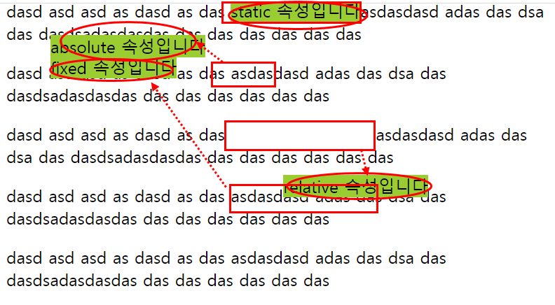
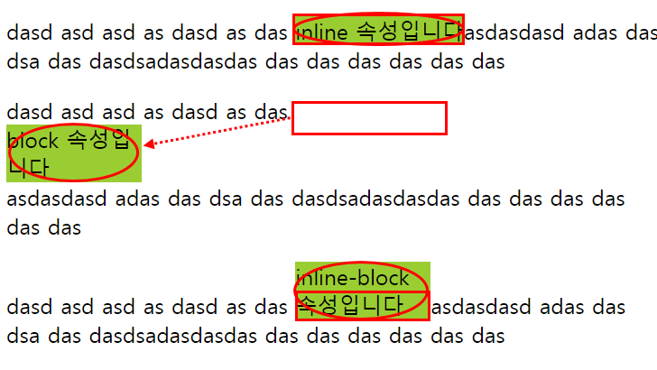
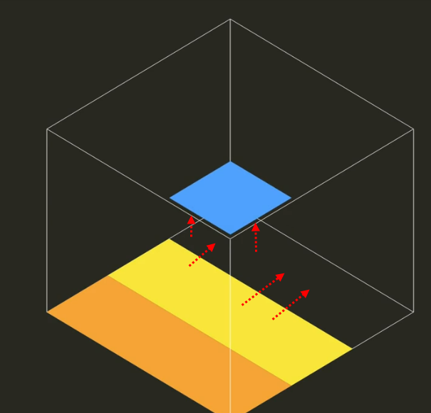
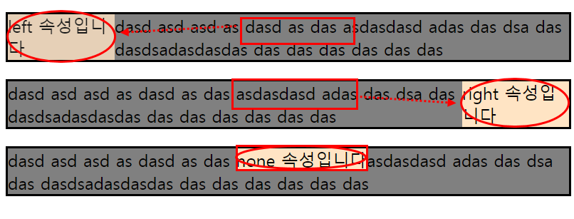

## ***난위도 : ★★☆☆☆***

**이 내용 숨쉬는것같이 많이 다뤘었고 꼭 알아야 하는 사항이라**

**이제 능숙해질때도 됬다~!**

**float 보다 flex를 많이 사용 한다지만 알고는 있자~!**

### ***# Position 파트~!!🌭***

#### ***\* 문제인식 1 : position 왜 쓰는거임?***

우리가 position속성을 지정 안했을 경우 기본값 static을 갖게된다. 그럴경우

고정된 위치에서 벗어나 요소를 움직일수 없게된다.

(top, left 속성 지정해도 무반응)

#### **그럼 position 에 속성값에 뭐가 있는뎅?**

|  |  |
| --- | --- |
| 속성값 | 뭥미? |
| static | 위치속성(top, left 등)이 요소에 아무런 영향을 안줌 기본값 |
| relative | 이동하기전 위치 기준으로 움직임 |
| fixed | 브라우져 기준으로 움직임 즉 스크롤을 내려도 계속 고정된 자리에 있음 |
| absolute | 가장 가까운 position된 부모 요소 기준으로 움직임 |

**\*추가로 알아두면 좋은거 : z-index**

position값이 static이 아닌 요소들끼리 위치가 겹칠때 어떤게 위로 올라올지 쌓는

순서를 정해주는 속성. 숫자가 클수록 위로 올라옴(안주면 HTML 작성 순서대로 쌓임).

단, position 속성을 따로 안주면(static 상태) z-index 줘도 씹힘 조심.

```css
.box{
    position: relative;
    z-index: 10; /*숫자 클수록 위로*/
}
```

#### **나도 position 써볼랭~! 실습!**

\*참고 : 화살표(이동) , 네모박스(현재위치) , 원(속성값 지정후 위치)



*스크롤로 약간 내렸을때 브라우저 출력화면*

```css
/*position 속성 실습*/
.static{
    background-color: yellowgreen;
    position: static;
    top :50px;
    left: 50px;
}
.absolute{
    background-color: yellowgreen;
    position: absolute;
    left: 50px;
    top :50px;
}
.relative{
    background-color: yellowgreen;
    position: relative;
    left: 50px;
    top :50px;
}
.fixed{
    background-color: yellowgreen;
    position: fixed;
    left: 50px;
    top :50px;
}
```

### ***# display 파트~!🍔***

#### ***\* 문제인식 1 :  display 속성 왜 주는거임?***

각 태그마다 display 속성이 이미 지정되있기 때문에 span태그 안에 텍스트를 가로 세로 조정하거나

여러개의 div태그를 같은 줄에 머무르게 할수 없다.

(즉 display속성 변경으로 span태그가 같은줄에 있게하는 속성을 div에도 적용할수 있다는 뜻)

#### ***\* 그럼 display 에 속성값에 뭐가 있는뎅?***

#### **(flex도 있는데 다음 게시글 업로드함)**

|  |  |
| --- | --- |
| 속성값 | 뭥미? |
| inline | 각 태그마다 브라우저에서 각자의 영역을 차지함(가로, 세로 Boxing의 개념이 없음), 줄 바꿈 같은 라인에 있음 |
| block | 각 태그마다 가로 영역을 브라우저 만큼 차지함(크기 조정가능), 각자 다른 라인에 있음 |
| inline-block | 줄 바꿈 없이 같은 라인에 있음(inline속성), 크기 조정가능(block속성) |

#### ***\* 나도 display 써볼랭~! 실습!***

\*참고 : 화살표(이동) , 네모박스(현재위치) , 원(속성값 지정후 위치)



*브라우저 출력화면*

```css
/*display 속성 코드 실습*/
.inline{
    background-color: yellowgreen;
    display: inline;
    width: 100px;
}
.block{
    background-color: yellowgreen;
    display: block;
    width: 100px;
}
.inline-block{
    background-color: yellowgreen;
    display: inline-block;
    width: 100px;
}
```

#### ***\* 문제인식 1 :  왜 float 속성을 쓰는거야?***

보통 block 상태일때는 한 영역을 혼자 다 차지하는 경향이 있는데 inline 속성값을 주고 position 속성으로 이동하려고 하면 생각보다 복잡하게 될것이고 여러요소일 경우는 불가능 할수도 있다.

그래서 여러요소를 정렬하고자 할때 주로 쓰인다.

### ***# Float 파트~!🍖***

#### ***\* 그럼 float 에 속성값에 뭐가 있는뎅?***

\*참고 : 파란색 박스(float 지정 요소) , 노란색 주황색 박스(기본값) , 화살표(이동)

|  |  |
| --- | --- |
| 속성값 | 뭥미? |
| left | 지정한 요소를왼쪽(우측) 끝으로 이동후 위로 띄워 밑에 남은 공백을 다음요소가 차지하게한다.(정렬) 3차원 영역으로 생각하면 이해하기 쉬움 |
| right | 지정한 요소를 오른쪽(우측) 끝으로 이동후 위로 띄워 밑에 남은 공백을 다음요소가 차지하게한다.(정렬) |
| none | 지정한 요소를 띄우지 않는다. 기본값! |



*브라우저를 3차원으로 생각하여 float 이해하기*

#### ***\* 나도 float 써볼랭~! 실습!***

\*참고 : 검정색박스(상위 태그) , 네모박스(현재위치) , 원(이동 후 위치) , 화살표(이동)



*브라우저 출력 화면*

```css
/*float 코드 실습*/
p{
    background-color: gray;
    border: 2px solid black;
}
.left{
    background-color: bisque;
    float: left;
    width: 100px;
    opacity: 0.8;
}
.right{
    background-color: bisque;
    float: right;
    width: 100px;
}
.none{
    background-color: bisque;
    float: none;
    width: 100px;
}
```

### ***# flex 개념 잡으러 가자~!!!🚕***

***<https://zibu-story.tistory.com/138>***

[🔗 8.21 위코드 Pre-Course(진심 1주차,HTML/CSS) - Flex 개념 정리 , Flex 속성 총정리~!! (실습하는 페이지 따](https://zibu-story.tistory.com/138) — 난위도 : ★★☆★☆ 요즘 Flex 모르면 사람도 아님! 염따도 맨날 Flex 하는것도 이것때문 ㅋㅋㅋ 정렬의 최신 끝판왕~!! # Flex 왜 쓰는거임? float 놔🤔 전반적으로 실무에서 요즘 flex 속성을 자주 쓴
