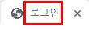
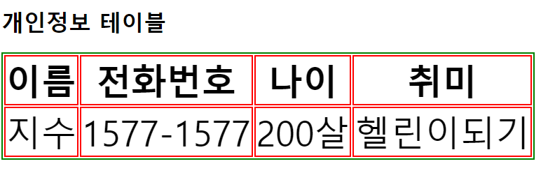
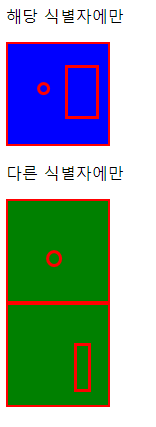

## ***난위도 : ??????***

**헬 replit 문제 풀다가 따로 모르는 것들 메모장에 정리후**

**다풀면 그때 정리해서 블로그 올림! 기본 개념을 떠나서**

**이렇게하니까 더 자세히 알게된것같은 느낌임**

### ***# replit 풀다가 모르는 개념~! 😎***

#### **\* title태그는 왜 쓰는가??**

1. 검색 엔진 알고리즘에서 검색 결과에 페이지를 나열하는 순서를 결정하는 데 사용되는 구성 요소 중 하나입니다. 또한 제목은 검색 결과 페이지를 바라보는 독자의 관심을 끄는 첫 번째 "후크"입니다.([MDN링크](https://developer.mozilla.org/en-US/docs/Web/HTML/Element/title))

2. 보통 페이지 상단 아이콘 에 글씨로 남옴 (자세한 내용 밑 이미지 참고)

3. 보통 head 영역에 쓰고 몉가지 규칙이 있음

- 한 단어 또는 두 단어로 된 제목을 피하십시오. 설명 문구를 사용하거나 용어집 또는 참조 스타일 페이지에 대한 용어 정의 쌍을 사용하십시오.
- 검색 엔진은 일반적으로 페이지 제목의 처음 55-60자 정도를 표시합니다. 그 이상의 텍스트는 손실될 수 있으므로 그보다 긴 제목은 사용하지 마십시오. 더 긴 제목을 사용해야 하는 경우 중요한 부분이 더 빨리 나오고 제목에서 누락될 가능성이 있는 부분에 중요한 부분이 없는지 확인하십시오.
- "키워드 얼룩"을 사용하지 마십시오. 제목이 단어 목록일 경우 알고리즘이 검색 결과에서 페이지의 위치를 ​​줄이는 경우가 많습니다.
- 귀하의 제목이 귀하의 사이트 내에서 가능한 한 고유한지 확인하십시오. 중복 또는 거의 중복된 제목은 부정확한 검색 결과에 기여할 수 있습니다.

```css
<title>로그인</title>
```



#### **\* 테이블 관련 테그 코드로 명확히 정리~!**



*브라우저 출력화면~!*

```html
<!DOCTYPE html>
<html lang="en">
  <head>
    <meta charset="UTF-8" />
    <meta name="viewport" content="width=device-width, initial-scale=1.0" />
    <title>테이블 테그 정리</title>
    <link rel="stylesheet" href="asd.css" />
  </head>
  <body>
      <table>
        <thead><!--여기는 상단부분 ex)테이블 설명-->
            <h1>개인정보 테이블</h1>
        </thead>
        <tbody><!--여기는 메인자리 ex)본문, 테이블-->
            <tr><!--행-->
                <th>이름</th><!--테이블내 머릿말-->
                <th>전화번호</th>
                <th>나이</th>
                <th>취미</th>
            </tr>
            <tr>
                <td>지수</td><!--열-->
                <td>1577-1577</td>
                <td>200살</td>
                <td>헬린이되기</td>
            </tr>
        </tbody>
        <tfoot></tfoot>
      </table>
    </body>
</html>
```

```css
tr td {
    border: 2px solid red;
    font-size: 50px;
}
th{
    border: 2px solid red;
    font-size: 50px;
}
table{
    border: 2px solid green;
}
```

#### **\* hover 다른클래스 적용 예시!(코드로 구현)**

-참고한곳~! : <https://joooohee.tistory.com/52>

동그라미는 마우스, 네모는 변화되는 요소



*브라우저 구현*

```html
<!DOCTYPE html>
<html lang="en">
  <head>
    <meta charset="UTF-8" />
    <meta name="viewport" content="width=device-width, initial-scale=1.0" />
    <title>테이블 테그 정리</title>
    <link rel="stylesheet" href="asd.css" />
  </head>
  <body>
      <div>
        <p>해당 식별자에만</p>
        <div class ="first-box"></div>
      </div>
      <div>
        <p id="text-box">다른 식별자에만</p>
        <div class = "second-box"></div>
        <div class = "third-box"></div>
      </div>
    </body>
</html>
```

```css
.first-box, .second-box, .third-box{
    background-color: green;
    border: 2px solid red;
    height: 100px;
    width: 100px;
}

.first-box:hover{ /*마우스를 본인 본인바뀜*/
    background-color: blue;
    cursor: pointer;
    opacity: 0.8;
}

.second-box:hover + .third-box{/*마우스를 본인 딴게바뀜*/
    background-color: blue;
    cursor: pointer;
    opacity: 0.8;
}
```

### ***#replit 풀다가 몰랐던 코드들~!🤣***

1. mata태그의 속성 중 하나~! 필수 설정!!!(mata 속성중 utf-8)

```html
<meta name="viewport" content="width=device-width">
```

: 디바이스의 가로 크기가 곧 웹 페이지의 가로와 같다는 의미입니다. 모바일에서 웹사이트가 예쁘게 잘 보이려면 추가해야 하는 정보입니다. 해당 정보를 추가하지 않으면 데스크탑 버전의 웹페이지가 축소되어 보이는 현상이 나타납니다.

2. 식별자를 쓸때 조건문으로 해당 속성이 있는지 확인후 부여

```css
input[type="text"]::placeholder {
  color: red;
}
```

: type이 text인 요소중에 placeholder를 빨강으로 바꿈

3. media 쿼리 사용시 다수의 조건을 걸거나 특성을 부여하는것

```css
@media only screen and (min-width: 320px) and (max-width: 480px){}
```

- only : 오래 된 브라우저가 스타일을 잘못 적용하지 못하도록 방지할 때 유용 ,  구형 브라우저는 쿼리를 단순히 screen으로만 읽고 뒷부분은 무시한 채 스타일을 적용해버립니다

- screen : 화면에 달린 기기에만 스타일을 적용하는 것으로 한정시키기 위해, 사용자는 screen 미디어유형에 미디어기능을 연결

- and :  다수의 미디어 특성을 조합하여 하나의 미디어 쿼리를 만들 때 사용
