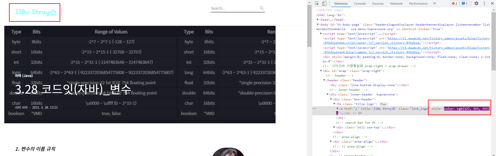

## ***난위도 : ???????????????????????????***

**객체는 HTML/CSS 파트보다 어려운게 없었다.**

**뭐 지금은 손톱에 떼 만큼도 안했을것이다. 리엑트가 초특급 헬이지만**

**내 머리는 비상 상태 ...ㄷㄷ**

**블로그 빤짝이 아이콘 기능은 정말 궁급하고 갖고싶지만**

**아직은 내가 이해할수 없는 상태라 좀만있다가 맨토님께 물어볼 예정~!**

### ***#헬 replit 풀다가 모르는 개념~! 지저스~😂***

#### **\*DATE객체 메소드**

- 참고 : <https://goddaehee.tistory.com/234>

- Date 객체 소괄호에 날짜를 argument로 넣어주면 파라미터로 날짜가 세팅되서 나옴
- Date 객체 소괄호에 아무것도 안넣으면 현제 날짜 시간에 맞춰 세팅되 나옴
- Date 객체 메소드는 dot 표기법으로 접근하며 메소드를 사용할수있다.

```javascript
//Date 객체 생성
let date1 = new Date('December 17, 2019 03:24:00'); 
let date3 = new Date(2019, 5, 1);
let rightNow = new Date();//
//Date 객체 메소드 활용
let year = rightNow.getFullYear();
let month = rightNow.getMonth()+1;
let date = rightNow.getDate();
let day = rightNow.getDay();
let currentHour = rightNow.getHours();
let currentMin = rightNow.getMinutes();
let currentTime = rightNow.getTime();
//출력시 콘솔
console.log(date1)//print :2019-12-16T18:24:00.000Z
console.log(date3)//print :2019-05-31T15:00:00.000Z
console.log(rightNow)//print :2021-08-21T07:55:47.424Z
console.log(year)//print :2021
console.log(month)//print :8
console.log(date)//print :21
console.log(day)//print :6
console.log(currentHour)//print :16
console.log(currentMin)//print :55
console.log(currentTime)//print :1629532547424
```

|  |  |
| --- | --- |
| Date 메소드~! | 뭥미? |
| getFullYear() | 해당 년도 |
| getMonth() | 해당 월 (+1을 해줘야됨) |
| getDate() | 해당 일 |
| getDay() | 해당 요일(정수로 반환) |
| getHours() | 해당 시간 |
| getMinutes() | 해당 분 |
| getSeconds() | 해당 초 |
| getTime() | 1970년 1월 1일 0시 0분 0초부터 현재까지의 시간을 밀리초 단위로 환산한 값을 숫자로 리턴 한다. |
| now() | 1970년 1월 1일 00:00:00(UTC)부터 현재까지의 시간을 millisecond 단위 정수로 리턴 |
| parse() | 1970년 1월 1일 00:00:00(UTC)부터 인수로 전달된 시간 까지를 millisecond 단위 정수로 리턴 |

#### **\* String 관련 메소드들~!(추가~!)**

-나머지~! : <https://zibu-story.tistory.com/118>

```javascript
//실험 대상 문자열 생성
let str = "I am business man how are you"
//실험시작~!
console.log(str.startsWith('I'))//print :true
console.log(str.startsWith('am'))//print :false
console.log(str.endsWith('am'))//print :false
console.log(str.endsWith('you'))//print :true
console.log(str.includes('you'))//print :true
console.log(str.includes('a'))//print :true
console.log('abc'.repeat(3.5))//print :abcabcabc
console.log(str.split(" "));//print :[ 'I', 'am', 'business', 'man', 'how', 'are', 'you' ]
```

|  |  |
| --- | --- |
| String 관련 메소드들~! | 뭥미? |
| startsWith | argument로 넣어준 값이 첫번째 문자나 문자열 에 포함되있는지 확인 return Boolean |
| endsWith | argument로 넣어준 값이 마지막 문자나 문자열 에 포함되있는지 확인 return Boolean |
| includes | argument로 넣어준 값이 전체 문자나 문자열 중에 포함되있는지 확인 return Boolean |
| repeat | 문자나 문자열 반복, argument로 정수를 받고 return 결과 String |
| split | 특정 기준으로 문자열을 나눠서 배열 요소로 각각 만들어버림, argument로 문자나 문자열 받고 return 배열 |

#### **\* 객체 key , value 접근 하는 메소드 종류**

-객체에 대해 자세히 알고싶음? : <https://zibu-story.tistory.com/128>

- 객체는 length메소드를 사용할수없고 길이를 구할수 없다?

```javascript
//실험할 객체 생성
let myPeople = {
    name : 'jisue',
    age : 21,
    live : '인천 방구석'
}
//실험시작
console.log(myPeople.length());//error
console.log(Object.keys(myPeople));//print :[ 'name', 'age', 'live' ]
console.log(Object.values(myPeople));//print :[ 'jisue', 21, '인천 방구석' ]
console.log(Object.entries(myPeople));//print :[ [ 'name', 'jisue' ], [ 'age', 21 ], [ 'live', '인천 방구석' ] ]
```

|  |  |
| --- | --- |
| key, value 접근할수있는 객체  메소드 | 뭥미? |
| Object.values() | 객체의 키가 아닌 값으로 이루어진 배열을 리턴 |
| Object.entries() | 객체의 키와 값의 쌍으로 이루어진 길이 2짜리 배열로 이루어진, 배열을 리턴 |
| Object.keys() | 객체의 값들로 이뤄진 배열을 리턴 |

### **#그냥 일상에서 궁금했던거나 알고싶은것~!(나중에 따로 정리할거😀😁**

- 왜 JS 파일 맨위에 'use strict js' 이거를 씀? : 다른 언어에서는 안되는거를 Js에서는 유하게 했는데 이런부분  
  엄격하게 관리하겠다는말?  
  참고한곳 : <https://m.blog.naver.com/on21life/221654555798>
- ${ } 안에 배열을 집어넣으면 어떻게됨? :  문자열로 반환됨  
  참고한곳 : <https://developer.mozilla.org/ko/docs/Web/JavaScript/Reference/Template_literals>
- 블로깅 이란 ? : 블로거가 웹에 자신의 흔적을 남기는거나 게시글을 작성하는것, 블로그를 통해 자신의  
  의견을 남기고 이거를 통해 사람들이 유입되는 현상  
  참고한곳 :<https://ko.unitinal.com/%EB%B8%94%EB%A1%9C%EA%B9%85-%EB%AC%B4%EC%97%87%EC%9D%B4%EB%A9%B0-%EC%9D%B8%EA%B8%B0%EA%B0%80%EC%9E%88%EB%8A%94-%EC%9D%B4%EC%9C%A0%EB%8A%94-%EB%AC%B4%EC%97%87%EC%9E%85%EB%8B%88%EA%B9%8C/>
- 도커란? : 애플리케이션을 신속하게 구축, 테스트 및 배포할 수 있는 소프트웨어 플랫폼 (부캠 과정 끝나면 공부할것!)  
  참고한곳 : <https://aws.amazon.com/ko/docker/>

### ***# 개인 홈피 만드는중 궁금한 기능 ~! 캐캐캐캐 궁금해~!🤐***

- 사건 개요 : 개강전에 블로그 스타일링좀 하려고 구글 폰트 가져다가 썼는데 블로그 상단 'ZiBu' 아이콘에 마우스를 올리면 원하지 않게 그라데이션처럼 색이 바뀐다.
- 찾은 사항 : 검사를 통해 확인해보니 rgb 3개의 값중 랜덤으로 하나씩 번갈아가면서 값이 올라갔다 내려갔다 하는것 같다. 구글링으로 통해 알아보니 rgb 중 3개값을 동시에 변화를 주는부분이 있지만 앞서 얘기한 랜덤으로 하나씩 번갈아가면서 변화를 주는 부분은 아직 찾지 못했다
- 사이트 정보  
  개인 블로그 홈피 : <https://zibu-story.tistory.com/>  
  블로그 색상 관련 사이트 : <https://m.blog.naver.com/PostView.naver?isHttpsRedirect=true&blogId=reword12&logNo=221216533619>


