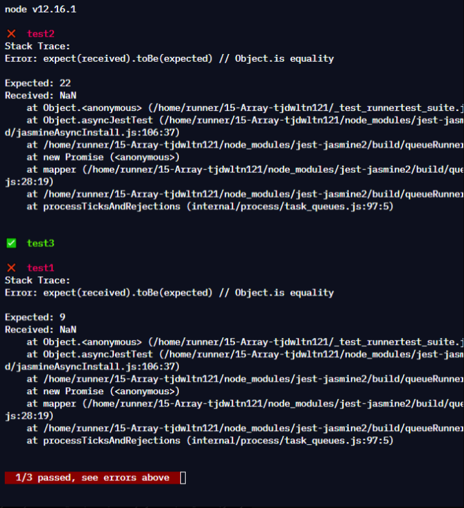

## ***🚓Pre-Course week1 😴***

## ***난위도 : ★★★★☆***

**1주 빡 헬 리얼 코딩했는데 현실은 지금 1주차 ㅋㅋㅋㅋㅋㅋㅋㅋㅋㅋㅋㅋㅋㅋㅋㅋㅋㅋㅋㅋㅋㅋㅋㅋㅋ**

**진심 16주뒤면 1년차 실무자 될것같음~!**

**맨토님들이나 여기 대표님 동기분들 진심 존경합니다. 아자아자~! 😎**

### ***# 해야될거~! 해야되는거~! (초반부터 빡코딩이냐~)😫***

**\* 평일에 한것들~!**

- [x] replit HTML/CSS파트 다 풀기
- [x] replit 다풀고 몰랐던 문제 VS코드에서 여러가지 경우의 수로 구현해보기
- [x] replit 과제 풀면서 모르는 개념 서칭후 정리하기~!
- [x] TIL에 개강 후기 태그남겨서 작성하기+ 일기
- [x] Semantic Web과 Semantic Tag에 대한 주제로 블로그를 작성
- [x] 컴퓨터 사고 알고리즘 팀별과제 오후에 같이 풀기
- [x] 개인 노션페이지에 요번주차 할꺼 일정 정리(형식에맞게)
- [x] 개인과제 개구리 문제 풀기
- [x] 팀 과제 개구리 문제 풀기
- [x] HTML/CSS 12번 14번 16번 17번 19번 22번 26번 다시 풀어보기
- [x] position 속성, display속성, float 속성 에대해 TIL정리
- [x] 자바스크립트 시험 준비하기
- [x] 웹서비스 역사와 발전 구글링해서 조사하기
- [x] 26번 hover부분 다시 해결해서 올리기
- [x] productList class과제하기
- [x] 그룹면접 내 범위 조사하고 31개 질문 마스터하기

**\* 주말에 한것들~! 아직 미션 클리어 ㄴㄴ**

- [ ] HTML/CSS replit에서 배운대로 개인 홈페이지 수정하기
- [x] 나머지 모르는것도 TIL에 정리하기
- [x] 자바스크립트 replit문제 풀기
- [ ] 1주차 후기 TIL 쓰기
- [ ] Dom 객체 복습 Notion 블로그 참고 코드연습
- [ ] sql 이론 암기

### ***# 😅 replit 개고생한 문제~! 헬코딩~***

**\* HTML/CSS 25번 문제**

1. position속성을 줬을때 키보드 돋보기 마이크가 검색창기준으로 세로 가운데 정렬이 않됨
   - 나 : vertical-align으로 세로기준 가운데 정렬 했는데 position이랑 호환 안되는것같음
   - 해결방안 : flex랑 position을 연동해서 해야됨, flex 개념 정리하기
2. 브라우저를 키우고 줄일때 전체적인 이미지 텍스트박스가 엉크러짐
   - 나 : px가 아닌 %로 부모 크기 기준으로 작아졌다 커졌다한다
   - 해결방법 : 크기는 항상 일정하게 하고 크기보다 더 줄일때는 다음줄로 내려가는게아닌 hidden처리하기
3. font Awesome에서 아이콘 가져왔는데 브라우저상에서 깨져보임
   - 나 : 아이콘 마다 HTML 낮은버전으로 업로드 됬기때문에 깨짐
   - 해결방안 : class 속성값으로 fa가 아닌 fas로 바꿔준다



*멘붕오는 Replit 오류 화면*

### ***# 🤷‍♂️모르는것들~ (해답 아래 T스토리 링크 클릭)***

- [x] Semantic Tag 종류, 쓰는 이유
- [x] <meta name="viewport" content="width=device-width"> 의미
- [x] title 태그는 화면에 출력도 않되는데 왜 써야됨?
- [x] font-family VS font-style
- [x] img 태그로 넣는것과 background-image로 넣는것과 차이점
- [x] position 속성 - relative, absolute, fixed
- [x] inline, inline-block, block, none 의 차이점 언제쓰는지?
- [x] 투명도 조절하는 방법
- [x] flex의 는 뭐임? 어떻게 쓰는거임?

### ***# 💨헬 replit 중 몰랐던 코드~!***

```css
<meta name="viewport" content="width=device-width">
```

```css
input[type="text"]::placeholder {
  color: red;
}
```

```css
input[type="text"]::placeholder {
  color: red;
}
```

### ***# 리얼 부캠 1주차 하고난후 깨닭은것들~! 거짓 ㄴㄴ 🥰😂***

- 사전스터디때는 애기들 장난 ㅋㅋ 노란불 안키고 오니까 개강때 긴장할것!
- HTML/CSS JavaScript 개념, 코드쓰는 법, 면접 기초지만 마스터함
- Fullstack 온라인이라 1주중 하루는 위워크로 가서 Zoom으로 함!(즉 다 온라인)
- 온라인이라고 잘 않될줄 알았는데 그런 생각할 시간조차 부족함
- 다 끝났을때 충분히 실무가도 싸워서 이길수 있는 실력이 될것같은 믿음
- 하기싫어도 할수밖에 없는 커리큘럼~!
- 그래도 왠만하면 팀으로 움직일것!
- 하는거는 팀과제+ Replit(빽준같은 문제푸는곳) 대략 70문제+개별과제+TIL정리  
  주말 복습 및 예습
- 다양한 연령때가 오니 기죽지 말것!

### ***#진실 농도 100% 위코드 Pre-course 1주차 후기~!😲***

개강으로 팀 배정 후 해야될게 정해지는데 보통 다들 서먹서먹 하는거에

비해 우리는 남자들만있는 맨 오브 스틸팀 이라서 열정이 불끈 불끈 했다~!

먼저 일정이 아침 10시에 Daily Kickoff 를 진행하는데 쉽게 말하자면 출석 체크라고

생각하면되고 Zoom으로 해당시간에 맞춰서 들어오면 맨토님이 다정하게 노래를 틀어주면서

반겨준다. Daily Kickoff 가 끝나면 10시 15분쯤 각 팀원들이랑 화상으로 일정 정리를 하는데 우리는 Zoom이 시간제한 있어서 디스코드로 진행했다.10시 30분이 되서 맨토님이 진행하는 Session이 진행되는데 학원 강의보다는 이 개념을 어떤식으로공부해야되는지 전체전인 개념을 대략 30분~1시간동안 설명해주신다. 여기서 나는 가장 좋았던게다른 학원과 달리 현직 실무자인 맨토님들이 강의를 하는거여서 실무에 도움되는 꿀팀을 많이 알려주신다.(예를들어 img태그에서 alt는 맨 처음 쓰고 script 태그는 맨 마지막에 써야된다 등)Session이 다 끝나면 개인 공부시간이 주어지는데 그때 대부분 Replit을 푸는것같다(정말정말 정말~ 많습니다.)점심 먹고난후에는 각 날짜에 맞는 맨토님의 설명이 있고 끝나면 팀과제를 어떻게 해야될지 팀원들이랑 소통을 한다. 그 후에는 개인시간 이다. 그냥 이제부터는 개인시간은 문제풀거나 코딩하는 시간이라고 생각했으면좋겠다(그정도로 해야될양이 정말정말 많음...ㄷ) 6시 15분이되면 Daily Wrap-up을 하는데 이거는 맨토님이 오늘 하루 어땠는지 얘기하는 시간인데 그냥 노가리 까는 시간이라고 보면됨! 그후에는 Daily Team Wrap-up(팀 Zoom) 을 하는데 오늘 하루 뭘했는지 나머지 과제를 어떻게 할껀지 등 정리하는 시간이라고 보면된다.간략하게? 일정을 얘기했는데 결론적으로 보면 맨토님들이 개입하는시간보다 개인적으로 학습하고 알아봐야되고 팀끼리 과제하는 시간이 90%라고 보면된다. 그리고 여기서 가장 강조하는 학습법이 자기주도 학습인데 문제가 생겨서 질문해도 딱~! 알려주는게 아닌 관련된 정보나 검색어 등 준다고 보면된다.개인적으로 아직 1주동안 밖에 경험을 해보지는 못했지만 정말 충분하고 넘쳐 흐를만큼 하기때문에 실력은 비상식적으로 오를수 밖에 없을것같고 가장 중요한 체력관리 마인드 관리인것같다. ( 참고로 나는 Daily Kickoff 하기전 일찍 일어나서 헬스를 하고온다 정말 정말 운동해라!)

**\*대략적인 시간표**

|  |  |
| --- | --- |
| 시간 | 내용 |
| **AM** 7시 | 기상 |
| **AM** 7시30분 ~ 9시 | 헬스 몸짱되기~! |
| **AM** 9시 ~ 9시30분 | 아침식사(시리얼or 과일) |
| **AM** 10시 ~ 10시30분 | Daily Kickoff + 팀원들이랑 화상으로 일정 정리 + 맨토님이 진행하는 Session |
| **AM** 11시 ~ 1시30분 | 헬 Replit을 풀기 |
| **PM** 1시30분 ~ 2시 | 점심식사(맘대로) |
| **PM**2시 ~ 3시 | 각 날짜에 맞는 맨토님의 설명이 있고 끝나면 팀과제를 어떻게 해야될지 팀원들이랑 소통 |
| **PM**3시 ~ 5시00분 | 헬 Replit을 풀기 |
| **PM**5시 ~ 5시30분 | 저녁식사 |
| **PM**6시 ~ 6시30분 | Daily Wrap-up + 팀원들과 일과 마무리 +노가다 |
| **PM**6시30분 ~ 1시 | 헬 Replit을 풀기 |

### ***# 🎃1주동안 빡코딩한 블로그 목록 참고할것!***

<https://zibu-story.tistory.com/139>

[🔗 8.18 위코드 Pre-Course(과제, HTML/CSS) - Semantic Web란?, Semantic Tag 왜 써야되는지, 태그종류, img태그 VS bac](https://zibu-story.tistory.com/139) — 난위도 : ★☆☆☆☆ 서칭만 하면 개념들이 다 나오기때문에 만약 개념을 모르고 그냥 사용하게 된다면 생길 문제점을 먼저 적어보고 거기에 맞춰 왜 써야되는지에 포커싱을 둬서 글을 적어봤

<https://zibu-story.tistory.com/141>

[🔗 8.19 위코드 Pre-Course(과제, HTML/CSS) - position 속성값 정의, display 속성값 정의 , float 속성값 정의 , 코](https://zibu-story.tistory.com/141) — 난위도 : ★★☆☆☆ 이 내용 숨쉬는것같이 많이 다뤘었고 꼭 알아야 하는 사항이라 이제 능숙해질때도 됬다~! float 보다 flex를 많이 사용 한다지만 알고는 있자~! # Position 파트~!!🌭 \* 문제인식 1

<https://zibu-story.tistory.com/142>

[🔗 8.21 위코드 Pre-Course(과제, HTML/CSS) - Week1 모르는 개념, 모르는 코드 정리~! , title 왜 씀?, 테이블태](https://zibu-story.tistory.com/142) — 난위도 : ?????? 헬 replit 문제 풀다가 따로 모르는 것들 메모장에 정리후 다풀면 그때 정리해서 블로그 올림! 기본 개념을 떠나서 이렇게하니까 더 자세히 알게된것같은 느낌임 # replit 풀다가 모르

<https://zibu-story.tistory.com/138>

[🔗 8.21 위코드 Pre-Course(진심 1주차,HTML/CSS) - Flex 개념 정리 , Flex 속성 총정리~!! (실습하는 페이지 따](https://zibu-story.tistory.com/138) — 난위도 : ★★☆★☆ 요즘 Flex 모르면 사람도 아님! 염따도 맨날 Flex 하는것도 이것때문 ㅋㅋㅋ 정렬의 최신 끝판왕~!! # Flex 왜 쓰는거임? float 놔🤔 전반적으로 실무에서 요즘 flex 속성을 자주 쓴

<https://zibu-story.tistory.com/143>

[🔗 8.21 위코드 Pre-Course(진심 1주차,JavaScript) - Date 객체 메소드 정리 , String 메소드 정리, 사용자 정의](https://zibu-story.tistory.com/143) — 난위도 : ??????????????????????????? 객체는 HTML/CSS 파트보다 어려운게 없었다. 뭐 지금은 손톱에 떼 만큼도 안했을것이다. 리엑트가 초특급 헬이지만 내 머리는 비상 상태 ...ㄷㄷ 블로그 빤짝이 아이
