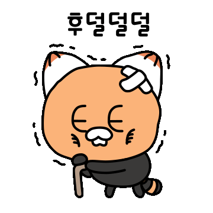
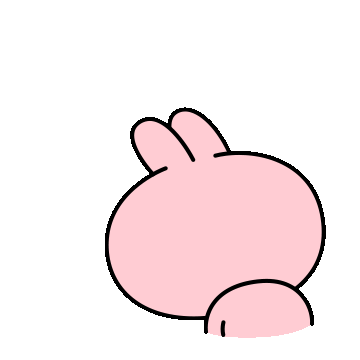
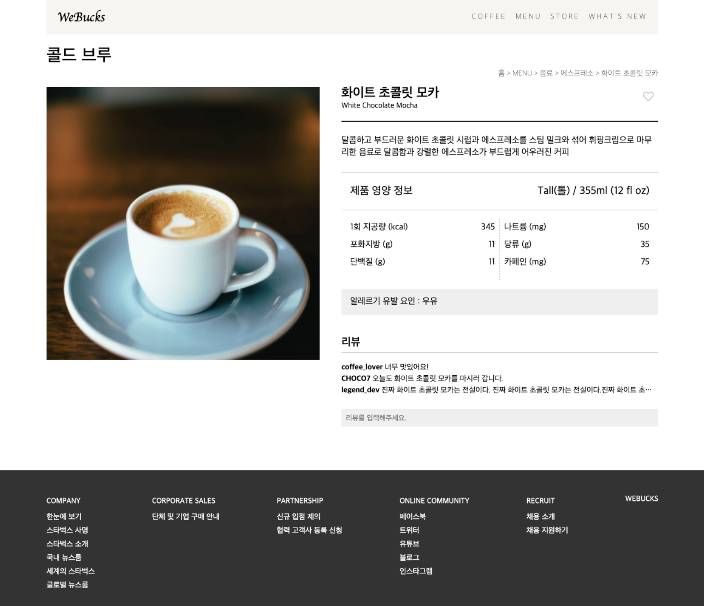

## ***난위도 : ★★★★★☆😂🤣😆***

**2주밖에 않됬는데 벌써 ㄷㄷ**

**시간 숙삭이고 첫 프로젝트를 끝낸것에 의욕이 활활타오르면서**

**다들 지쳐있음~! 근데 다음주는 리엑트임....ㅠㅠㅠㅠㅠㅠㅠㅠㅠㅠㅠㅠㅠㅠㅠㅠㅠㅠㅠㅠㅠ**

**이거 보고 동기부여하기~!!**

[**(소헌님 공유 : 개발자의 평생공부 방법)**](https://zdnet.co.kr/view/?no=20170616090644)

### ***# 해야될거~! 해야되는거~! (초반부터 빡코딩이냐~)😫***

**(진심 더 있는데 올릴 시간이 없었음.... ㅠ 빠르게 코딩하는게 답임)**

#### **\* 평일에 한일🧂**

- [x] 코드잇 노션 생활코딩 참고해서 DOM 개념 메모장에정리
- [x] DOM 개념 정리한거 기반 예시 코팅해보기
- [x] sqld 자격증 1회차 문제 다시풀고 모르는거 요점 정리하기
- [x] 자바스크립트 레플릿 시험문제 한번 풀어보기
- [x] JavaScript Troubleshooting 노션 보고 팀과제하기 (저녁 7시 맞춰본다고함
- [x] Dom 개별과제하기
- [x] Webucks 과제 1번까지 마무리하기
- [x] git github TIL에 업로드한거 다시 수정해서 올리기
- [x] webucks 미션 5까지 끝내기
- [x] webucks미션 3까지하고 refacktoring하기
- [x] DOM 개념 전에한거 수정기반으로 TIL 업로드하기
- [x] 개구리 3번 잡기~!!!!
- [x] git 질문올린거 찾아서 공부해보고 적용해보기
- [x] Flex TIL 개구리 참고한거 기반 재 정리하기

#### **\* 주말에 한일🥚**

- [ ] HTML/CSS/JS 기반으로 ZiBu페이지 수정하기
- [ ] 노션에 올린거 요번주차 정리해서 TIL업로드, 2주차 후기작성
- [x] 깃헙 TIL 작성하기
- [ ] transform transition 정리하기
- [x] 생활코딩 react 강좌 다듣고 메모장 정리하기
- [x] 생활코딩 react 실습및 예습하기
- [ ] react TIL(설치방법,)
- [ ] react 개념정리 메모장
- [x] 학점은행 강의 2개 듣기
- [ ] 취업지원제도 하기
- [ ] webucks 프로젝트 후기 TIL 남기기

### ***# 🤷‍♂️모르는것들~ (해답 아래 T스토리 링크 클릭)***

**(진심 더 있는데 올릴 시간이 없었음.... ㅠ 빠르게 코딩하는게 답임)**

- [ ] Flex개념 완벽 마스터 못함(개구리문제 100번하기)
- [ ] Id속성가 우선순위로 갖는 속성 종류
- [ ] CSS에서 우선순위로 써야되는 속성
- [ ] 이벤트 발생시 경로이동방법
- [ ] defer이란?
- [ ] transform transition
- [x] 깃헙에서 프로젝트 레파지토리를 내 레파지토리로 가져오는 효과적인 방법

### ***# 리얼 부캠 2주차 하고난후 깨닭은것들~! 거짓 ㄴㄴ 🥰😂***

1. 과제를 빨리하면 사람들이랑 맞춰볼 시간도 있기에 더 이득이다.

2. 할일이 태산이라 주말중으로 무조건 예습하는거는 필수이다.

3. 다들 2주차 과제할때 죽을맛인데 다음주에 리엑트이다.

4. 지하 식당 중국집은 너무너무 맛있다.

5. 맨토님들은 너무너무 착하신것같다.

6. 이론을 10배 공부하는것보다 코드 1번 쳐보는게 더 이득이다.

7. 위코드 다닐동안에는 자격증?? 학점은행??? 그냥 안하는게 좋다(시간 부족,...)

8. 다른사람들이랑 비교하지 말고 내가 성장하는거에 기점을 두자.

9. I 면 백엔드이고 E면 프론트라고한다 ( 2기 선배님들)

10. 누가 특강하면 참석하는게 좋다.

### ***# 진실 농도 100%  부트캠프 2주차 빡코딩 후기~! (Webucks -스타벅스 clone) 🥰😂***

휴 ..... 뭐 2주차가 끝났지만 기쁘??? 음 행복하다 ㅋㅋㅋ

너무너무 할게많고 마지막 금요일날에는 맨토님들이 클론한거 zoom에서 랜덤 선택에서

깃으로 피드백 해주는데 너무너무 고쳐야될게 태산이라 하루동안 계속 리펙토링을 한것같다 ㅠㅠ

그래도 어느정도 진도가 느리지는 않았고 빠른사람들은 코드를 비교하거나 리엑트를 공부하는 시간을 가지는것같아

뭔가 빠르게 하는게 유리한것같다.. pre-course (1주차~2주차) 팀원들이 너무너무 잘해서 오히려 많이 물어보고 도움 받았다. 1주차에는 레플릿을 주로 풀었다고하면 2주차에는 위벅스 클론을 주로하는데 혹시 다음 기수중 보는 사람이 있을수도 있으니 팁을 주자면 최대한 빨리 진도를 끝내고 모르는것을 팀원들이랑 최대한 의논하며 리펙토링에 힘쓰는게 좋을것같다. 어차피 누가 먼저 끝내든 중요하지 않지만 (다 안끝내도됨) 다음주 리엑트를 복습하던가 다른사람들이랑 의논하는 시간이 더 크게 성장하는 계기가 되는것같다.

그리고 1기 선배들이나 맨토님들 등등 다들 리엑트 리엑트 하는 이유를 알것같다 ...ㅋㅋㅋ 지금 예습하는데 하나도 모르겠음...ㅠㅠ 아무튼 잘끝냈고 좀더 더 더 잘하고 싶은 마음이다.

*프로젝트 작업한것!*

### ***# 🎃2주동안 빡코딩한 블로그 목록 참고할것!***

**(아직 게시물 다 못올려서 정리후 추가하겠음!)**

**1. 깃헙 맨토님께 질문한것! fock관련**

<https://community.wecode.co.kr/t/topic/4056/2>

[🔗 wecode - wecode](https://community.wecode.co.kr/t/topic/4056/2) — wecode

**2. Dom 객체 이론 정리 모음**

<https://zibu-story.tistory.com/105>

[🔗 8.28 코드잇+위코드(Pre-Course, 2주차) -DOM 완전히 잡아가기~!, 노드접근 ,CSS속성부여 및 삭제, 노드](https://zibu-story.tistory.com/105) — 난위도 : ★★★☆☆ Reat 들어가지전에 무조건 알아야되고 동적인 HTML을 HTML이나 CSS가아닌 JS로 동작키는 것이라고 생각하면된다~! 죽을맛이다 엉아는~ㅠ # Dom 도대체 왜 쓰는 거임??????🙄 \*참고

**3. 깃, 깃헙 이론 관련 정리 모음**

<https://zibu-story.tistory.com/132>

[🔗 8.29 코드잇(Git) - Git이랑 GitHub랑 차이가 뭐임? , Git 파일공간 +상태 +커널 명령어 , 코드 구현해보](https://zibu-story.tistory.com/132) — 난위도 : ★☆☆☆☆ 1. Git의 프로그램 개념을 이해했고 왜 쓰는지 알게되었다. 2. GitHub 랑 Git 이랑의 차이점 언제 써야되는지 알게됨 3. 직접 버전을 등록, 수정 하는 방법을 알게되었다 4. 각각의

**4. 위벅스 바닐라 순수 클론 코딩**

<https://github.com/wecode-bootcamp-korea/webucks-javascript/issues>

[🔗 GitHub - wecode-bootcamp-korea/webucks-javascript](https://github.com/wecode-bootcamp-korea/webucks-javascript/issues) — Contribute to wecode-bootcamp-korea/webucks-javascript development by creating an account on GitHub.

**5. 위벅스 클론한 TIL 찐후기**

<https://zibu-story.tistory.com/146>

[🔗 08.29 위코드 Week1(Pre-Course) - Webucks 클론~!! (드디어~!!) , 미션 구현하는법, 어려웠던것~! , 나의 구현](https://zibu-story.tistory.com/146) — 난위도 : ★★★★★★★☆ 1. DOM에 기본적인 원리 용어를 알아야됨 2. Flex 개구리 100마리 잡아야됨 3. HTML Sementic 태그 종류에 맞겠음 작성해야됨 4. refactoring을 어떻게해야되고 각 작업이 끝날때
