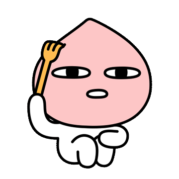
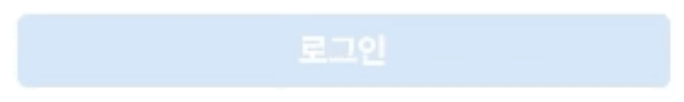
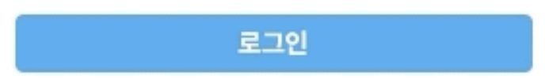
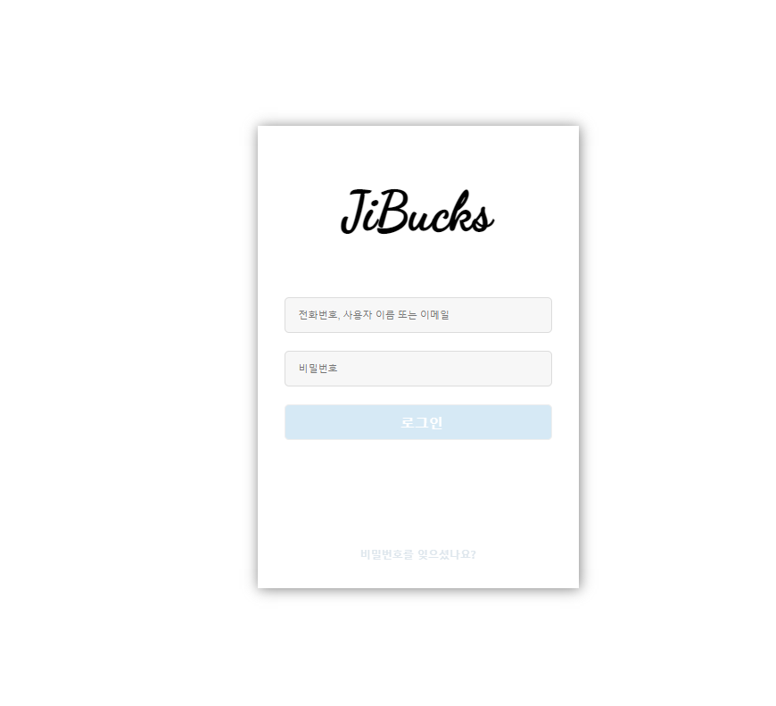
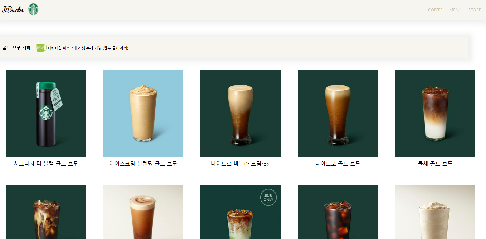
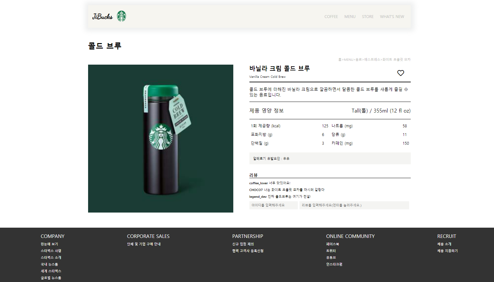

## ***난위도 : ★★★★★★★☆***

**1. DOM에 기본적인 원리 용어를 알아야됨**

**2. Flex 개구리 100마리 잡아야됨**

**3. HTML Sementic 태그 종류에 맞겠음 작성해야됨**

**4. refactoring을 어떻게해야되고 각 작업이 끝날때마다 해야됨**

**5. 내가 원하는 속성들을 CSS로 구현할줄 알아야됨**

**6. 아이콘 및 이미지를 적절히 넣고 찾을줄 알아야됨**

**7. script 태그를 맨밑에나 defer 속성을 주는 이유를 알야됨**

#### **할꺼 많다잉~~~~~~!!**

**(아래는 내가 구현한 파일들~!! 궁금하면 한번씩 눌러~)**

### ***# Webucks 클론하기 ,미션 종류~!!! (1주일도 부족 ㅠㅠ)🙄***

#### **\* 미션 1 - 로그인 페이지 레이아웃 구현**

1. 로고는 아래 둘 중 하나의 조건을 만족시켜주세요.
   - img 태그를 사용하여 로고를 이미지 파일로 제작
   - [이 폰트](https://fonts.google.com/specimen/Dancing+Script)를 사용하여 로고를 만들어야 합니다(기본 폰트가 아니라 구글 폰트에 있는 원하시는 다른 폰트를 사용해도 무관합니다).
2. 다음 요구사항에 맞게 HTML을 작성해주세요.
   - HTML을 작성할때는, 항상 디자인된 화면을 보면서 해야합니다.
   - 아래 이미지를 보고 레이아웃을 완성해주세요.
   - 로그인 박스 전체를 감싸고 있는 div 혹은 section 태그가 필요합니다.
   - form 태그를 활용해주세요.
   - input 태그를 사용하여 아이디, 비밀번호를 입력하는 창을 구현해주세요.
     - input의 타입은 각각 text 혹은 password입니다.
     - input의 속성으로 placeholder가 있습니다. 해당 속성을 사용하여 "전화번호, 사용자 이름 또는 이메일" 등의 값을 넣어주시면 됩니다.
   - 로그인 버튼은 button 태그를 사용해주세요.

#### **\* 미션2 - 로그인 페이지 기능 구현**

- id에 @가 포함되고, password가 8자 이상이 되면 버튼이 활성화 되도록 해주세요.
  - 원래 연한 파란색이었다가 → 활성화 되면 밝고 진한 파란색으

- id, password가 조건에 맞을 때 로그인 버튼을 누르면 list 페이지로 이동해야 합니다.

#### **\* 미션 3 - 커피 리스트 페이지 레이아웃 구현**

1. HTML, CSS로만 아래 스타벅스 리스트 페이지를 구현해 주세요.
2. 실제 페이지가 아니라 아래 이미지에 있는 부분만 구현해주세요.
3. 콜드 브루 커피, 브루드 커피 두 종류에 대해서 만들어주세요.
   - 커피 사진과 이름은 모두 다르게 해주세요.
   - 반응형을 고려하지 않으셔도 괜찮습니다.
   - 반응형을 고려하신다면 커피 리스트는 flex-wrap 혹은 grid를 활용해주세요.
4. 커피 이미지에 마우스를 호버했을 때 이미지를 확대해주세요.
   - 이 효과는 [실제 스타벅스 페이지](https://www.starbucks.co.kr/menu/drink_list.do)를 참고해주세요!
5. 모두 완료하였다면 1차 리팩토링을 진행해주세요.

#### **\* 미션 4 - 커피 상세 페이지 레이아웃 구현**

1. HTML, CSS로 스타벅스 상세 페이지를 구현해 주세요.
2. 실제 페이지가 아니라 아래 이미지에 있는 부분만 구현해주세요.
3. 원하시는 커피 하나를 골라 구현해주세요. 단, 알러지 정보 박스는 있어야 합니다. 알러지 정보가 없다면 알러지 정보가 없다라는 문구를 넣어주세요.

#### **\* 미션 5 - 커피 상세 페이지 기능 구현**

1. 커피에 좋아요 버튼을 누르는 기능을 구현해주세요
   - 하트 버튼을 눌렀을 때 하트의 색이 붉은색으로 변하게 구현하면 됩니다.
2. 리뷰로 댓글을 추가하는 기능을 구현해주세요.
   - input창에 리뷰를 작성하고 엔터를 누르면 댓글이 추가되도록 구현해주세요.
3. 모두 완료하였다면 2차 리팩토링을 진행해주세요.

#### **\* 미션 6 - 도전과제!**

**상세 페이지**

- 리뷰 댓글을 삭제하는 기능을 구현해주세요.
- 리뷰별로 좋아요 버튼을 누르는 기능을 구현해주세요.

**로그인 페이지**

- id가 이메일 형식에 맞으면 이메일 input의 border가 초록색으로 바뀌게 구현해주세요.
- password는 영어 소문자, 영어 대문자, 특수문자, 숫자를 포함한 8자 이상입니다. 이 조건을 만족하면 패스워드 input의 border가 초록색으로 바뀌게 구현해주세요.
- 로그인 버튼 활성화 조건도 위에서 언급한 id, password 조건으로 맞추어 주세요.
- 비밀번호 input 내부 오른쪽에 show, hide 버튼을 만들어. show 일 때는 비밀번호가 보이게, hide일 때는 type="password"가 되도록 해주세요.

**리스트 페이지**

- 커피 이름 옆 좋아요 버튼(하트)를 눌렀을 때 붉은색 하트로 변하게 구현해주세요.
- 리스트 페이지를 반응형으로 구현해주세요.

### ***# 미션 다 끝내고 난후 결과 화면~!!! (내꺼)🤗***

**\*클론하는 사이트 : <https://www.starbucks.co.kr/index.do>**

*Login.html*

*List.html*

*Detail.html*

### ***# 😅 WeBucks하면서 안풀렸던것들, 깨닭은것들~!(스타벅스 클론)***

#### **\* 미션1**

- 먼저 HTML태그 Sementic고려해서 코드해야됨
- CSS 정렬할때 Flex하면되는데 위에 상위 태그가 있어야됨
- id식별자를 주면 가장 우선순위로 CSS 속성이 먹힘
- 처음에 HTML만 입력해도 HTML5가 옵션으로 나와 자동완성으로 만들어준다

#### **미션2**

- Script태그 같은 경우 맨 마지막에 쓰던가 그 안에 속성으로 defer를 준다
- value속성같은 경우 kedown이벤트가 다 끝나고 사용자가 다른 입력키를 눌렀을때 총 입력한 값을 리턴한다
- addEventLisner를 쓰기위해 객체는 이벤트 발생시 끝나는 태그로 지정해준다
- 경로지정해서 이벤트 발생시 이동하려면 location.href 속성을 이용한다

#### **미션3**

- Flex 로 요소들 정렬하기(개구리 100마리 잡음
- 제품에 마우스를 올릴때 스벅같이 이미지가 확대되야됨

#### **미션5**

- input으로 2개의 text타입으로 생성하고 사용자 입력시 위에 내용에 띄우기
- 띄웠다면 input 에 사용자입력값(value) 초기화하기
- 레이아웃 구성하기

### ***# 참고한 사이트 목록들~!!! 꼭!!!😎😍😋***

**1. 과제 다운로드, 미션종류 (참고 : 위코드)**

<https://github.com/wecode-bootcamp-korea/webucks-javascript/issues>

[🔗 GitHub - wecode-bootcamp-korea/webucks-javascript](https://github.com/wecode-bootcamp-korea/webucks-javascript/issues) — Contribute to wecode-bootcamp-korea/webucks-javascript development by creating an account on GitHub.

**2. 하트나 화살표 기본 아이콘 무료로 쓰는곳**

<https://fontawesome.com/>

[🔗 Font Awesome](https://fontawesome.com/) — The world’s most popular and easiest to use icon set just got an upgrade. More icons. More styles. More Options.

**3. Flex가 헷깔리다면 여기서 개구리 100번잡기**

<https://flexboxfroggy.com/#ko>

[🔗 Flexbox Froggy](https://flexboxfroggy.com/#ko) — A game for learning CSS flexbox

**4. 커피나 배경화면등 일러스트 무료로 쓰는곳**

<https://www.pngwing.com/ko/free-png-bkday>

[🔗 컵 그림을 마시는 스타 벅스, 커피 라떼 차 스타 벅스, 수채화 스타 벅스, 수채화 그림, 수채화 잎](https://www.pngwing.com/ko/free-png-bkday)
