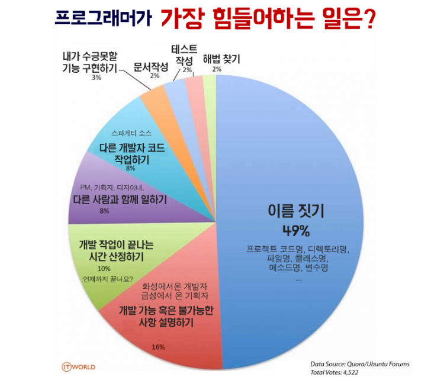

## ***난위도 : ★☆★★***

**Wecode 2주차 3주차 Notion 참고**

**컴퓨터가 이해하는 코드는 어떤 바보도 쓸 수 있다.**  
**하지만 훌륭한 프로그래머는 사람이 이해할 수 있는 코드를 쓴다.**  
**- 마틴 파울러, <리팩토링>의 저자**

**학습목표!!!!~!😁😊**

**1. `Refactoring`이 무엇인지 설명할 수 있다.**  
**2. `Refactoring`의 필요성에 대해 설명할 수 있다.**  
**3. 작성한 코드를 유지보수 관점에서 생각하며 `Refactoring`을 할 수 있다.**  
**4. 제공된 컨벤션에 맞춰 코드를 작성할 수 있다.**


### ***# console.log은 삭제하자!!@@ (내가 가장 많이 실수하는것!)😅***

**테스트 끝난 콘솔은 모두 지워 주세요!**   
**console.log는 테스트를 할 때는 필수적이지만 최종 결과물에는 포함되면 안됩니다.**

```javascript
function add(a, b) {
  console.log(a);//지워주세요~!
  console.log(b);
  console.log(a);
  console.log(b);
  console.log(a);
  console.log(b);
  console.log(a);
  console.log(b);
  console.log(a);
  console.log(b);
  console.log(a);
  console.log(b);

  return a + b;
}
```

### ***# id ・ class명, 변수명, 함수명 짓기!~! (코드치는것보다 어려웡~!) 😐😑***

**id ・ class, 변수, 함수의 이름에서 의미가 직관적으로 드러나게 작성해주세요. 또한 camelCase 컨벤션도 지켜주세요.**

**코드는 쓰는 경우보다 읽히는 경우가 훨씬 많습니다!**

```javascript
// bad
let value = "Tom";
let value2 = "Cruise"

// good
let firstName = "Tom"
let lastName = "Cruise"
```



*wecode notion 참고*

### ***# 들여쓰기는 무조건!~! 자동들여쓰기 하는법 구글링 참고!! (이거는 기초인데 적어야되나?? 음...)🤨***

**프로그래밍 언어에서 규칙성 있는 들여 쓰기는 가독성 측면에서 매우 중요합니다.**

**회사마다 들여씌기를 스페이즈\*2를하나 스페이스\*4를 하나 다르니 꼭 확인할것!**

```javascript
const thisIsButton = document.getElementsByClassName('login-btn')[0];

thisIsButton.addEventListener('click', function() {
const password = document.getElementById('password').value;
const rePassword = document.getElementById('re-password').value;

if (!password) {
alert('비밀번호를 입력해주세요!');//들여씌기를 해주세요~!
return;
}

if (!rePassword) {
alert('비밀번호 확인을 입력해주세요!');
return;
}

if (password !== rePassword) {
alert('비밀번호가 맞지 않습니다!');
return;
}

alert('회원가입 성공!!');
});
```

### ***# Semantic Tag의 사용할것!! (Sementic Tag가 뭔지 모르면 아래 참고)😏***

**\*참고 사이트 : <https://zibu-story.tistory.com/139?category=862574>**

**HTML에는 다양한 태그가 존재하며 그 중에서도 Semantic Tag를 적절하게 사용하는 것은 가독성 ・ SEO측면에서 너무나 중요합니다. <div> <span> 태그를 남발하기 보다는 상황에 맞게 적절한 태그를 사용해주세요**

```javascript
<!-- non-semantic  -->
<div class="mentorList">
  <div>Joonsik</div>
  <div>Jongtaek</div>
  <div>Seonghoon</div>
  <div>Dohyun</div>
  <div>Yeonuk</div>
</div>

<!-- semantic  -->
<ul class="mentorList">
  <li>Joonsik</li>
  <li>Jongtaek</li>
  <li>Seonghoon</li>
  <li>Dohyun</li>
  <li>Yeonuk</li>
</ul>
```

### ***# img 태그에 alt속성 필히 부여해주기!!!~!!! 무조건!!🙄🎈***

**- img 태그를 사용하실 때는 아래와 같은 이유로 반드시 alt 속성을 부여해주셔야 합니다.**   
**- 이미지가 로딩되지 않을 경우 alt 속성에 적힌 값이 보여짐.**   
**- 시각장애인의 경우 alt 속성을 통해 어떤 이미지가 보여지는지 알 수 있음.**   
**- SEO 검색엔진 최적화에서 어떤 img인지 인식하는 코드는 alt 속성임.**   
**( 위와 같은 이유로 `alt` 속성은 중요하기 때문에 `src` 속성보다 먼저 작성하는게 좋습니다. )**

```html
<!-- Bad  -->


<!-- Good  -->

```

### **# Self Closing 사용하기~!!! (안에 Text가 없을 경우에만!)🧨🎃🧧**

**- HTML tag는 일반적으로 여는태그(`<div>`) 와 닫는태그 (`</div>` )로 이루어져 있습니다.**   
**- 하지만, 열고닫는 태그 없이 스스로 닫을 수 있는(Self Closing) tag들이 있습니다.**   
**- 이런 태그들을  쓸데없이 열고 닫으면 가독성을 해칠 수 있습니다.**  
**- Self Closing을 적용할 수 있는 단일 tag 목록**   
**ex) <br> <hr>  <meta> <link> <input>**

```html
<!-- Bad  -->
<input type="password"></input>

<!-- Good  -->
<input type="password" />
```

### ***# CSS 에서 속성을 적는 순서~!! (처음 적을때부터 생각하면서 하기!)🎨🧶***

**우리의 옷장을 생각해봅시다. 우리는 자연스럽게 상의, 하의, 겨울옷, 여름옷 등의 기준으로**   
**보관하는 공간을 분리합니다. 기준없이 뒤섞여 있어도 옷에는 어떠한 영향도 미치지 않지만**   
**우리는 자연스럽게 옷을 찾기 편하게 하기 위함입니다. (Wecode Notion)**

**- CSS 속성은 작성 순서는 성능향상이나 적용 순서에 유의미한 영향을 주지는 않습니다.**   
**- 하지만 우리가 작성한 수많은 css 속성들이 규칙없이 뒤섞여 있다면, 원하는 속성이 어디에 있는지, 이 선택자에 어떤 속성이 적용되고 있는지 한눈에 파악하기 힘들어집니다.**   
**- CSS는 서로 영향을 미치는 구조로 이루어져 있고, 이 연관관계가 코드가 길어질수록 복잡해집니다. 이러한 이유로, CSS 유지보수가 `Javascript` 유지보수보다 힘듭니다.**   
**- 따라서, 연관관계를 조금이라도 쉽게 파악하기 위해서 반드시 컨벤션을 지켜서 작성하는 습관을 들이셔야 합니다.**   
**- CSS 속성은 레이아웃에 영향을 많이 주는 순서대로 , 인접 속성끼리 묶어서 작성해주는게 좋습니다.**   

**\* 권장되는 속성 순서는 아래와 같습니다.**   
    1. Layout Properties (position, float, clear, display)   
    2. Box Model Properties (width, height, margin, padding)   
    3. Visual Properties (color, background, border, box-shadow)   
    4. Typography Properties (font-size, font-family, text-align, text-transform)   
    5. Misc Properties (cursor, overflow, z-index)

### ***# 다른 CSS 선택자들 사이 한줄 띄우기(???? 기준을 잘 모르겠음!)🤨***

**- 우리는 CSS 파일에서 수많은 선택자를 사용해서 HTML 요소를 특정하고 스타일을 입힙니다.**   
**- 이렇게 수많은 선택자들이 공백 없이 붙어있다면 요소들이 구분되어 있는지 확인하기 쉽지 않습니다.**   
**- 가독성을 위해 다른 css 선택자들 사이는 한 줄 공백을 추가해주세요**

```css
.login-btn {
    height: 2.5rem;
    margin: 0.625rem 0px;
    border: 0;
    border-radius: 0.3125rem;
    background-color: var(--disabled);
    color: var(--white);
    font-weight: 700;
    font-size: 0.9375rem;
}
   //이렇게 한줄 띄우기
.find-password {
    margin: 3.75rem 0 1.25rem 0;
    color: #00376b;
    text-align: center;
    font-size: 12px;
}

.enabled-btn {
    background-color: var(--enabled);
    cursor: pointer;
}

.disabled-btn {
    background-color: var(--disabled);
    cursor: default;
}
```

### ***# 불필요한 style 속성 작성 지양할것!!!😗***

**\*참고 링크 : <https://www.w3schools.com/cssref/css_default_values.asp>**

**1. block 요소에 불필요하게 `display:block;` 을 부여하는 것**   
**2. block 요소에 불필요하게 `width:100%` 를 부여하는 것**  
**- `<div>, <article>` 등 수많은 요소는 이미 display:block을 default style로 적용이 되고 있습니다.**   
**- 이러한 tag들에 `display:block` 을 선언해줘서 불필요한 코드를 작성할 필요는 없습니다.**   
**- 또한, `display:block` 요소들은 기본적으로 부모요소의 너비를 모두 차지하고 있습니다.**   
**- 따라서, `display:block` 요소들에 불필요하게 `width:100%` 를 선언해줄 필요도 없습니다.**   
**- CSS의 기본 동작 원리를 잘 이해하고, 각 HTML tag들이 어떤 default css value를 가지고 있는지 확인해서 불필요한 style 속성 작성을 지양해주세요**

### ***# 레이아웃은 bottom-up 방식으로 구성(이거는 살짝 이해안감, 더 읽어봐야겠음)😋***

**레이아웃을 구성할 때 부모요소의 높이를 미리 정해두고 자식요소의 크기를 정하는 top-down 방식이 아닌, 자식요소의 높이에 따라 부모요소의 높이가 유동적으로 결정되는 bottom-up 방식으로 구성해주세요.**

**- 레이아웃을 구성할 때 부모요소의 크기를 고정적으로 정해둔다면, 자식요소의 크기가 변함에 따라서 부모요소의 크기가 유동적으로 변하지 않습니다.**   
**- 이런 상황에서 만약 자식요소의 크기가 변해야 한다면, 부모요소의 CSS도 같이 수정해줘야 하는 불편함이 있습니다.**   
**- 이런 구성이 겹겹이 쌓인다면 추후에 CSS 유지보수가 매우 힘들어집니다.**   
**- 다시 한번 기억합시다, `CSS` 유지보수가 `Javascript` 유지보수보다 힘듭니다.**

```css
// bad
.feedList {
	height:100vh;
}

.feed{
	height:300px;
}

// good
.feedList {
	padding-top:20px;
}

.feed{
	height:300px;
}
```

**- feedList안에 여러개의 feed가 들어있는 상황을 가정해봅시다. `(feedList > feed \* n)`**   
**- bad의 경우 여러 feed들을 감싸고 있는 feedList에 고정 height를 부여했습니다.**   
**- feedList가 안에 feed가 몇개나 생성될 지 모르기에 feedList의 크기는 feed의 개수에 따라서 유동적으로 조정되어야 합니다.**   
**- 하지만 bad의 예시에서는 feedList는 고정 height를 가지고 있으므로 feed가 1개일 때도, 그리고 20개일 때도 똑같이 100vh의 height를 가지고 있습니다.**   
**- 즉 자식요소의 크기에 따라서 부모의 크기가 유동적으로 조정이 안되고 있습니다.**   
**- 하지만 good의 예시를 보면 feedList에는 고정 height를 부여하지 않았습니다. 이 경우에는 feedList의 크기가 자식요소의 크기만큼 자동으로 조정됩니다.**   
**- 즉, feedList의 높이가 내부의 `자식요소의 높이 + 20px(padding-top 값)` 로 유동적으로 변할 수 있게 됩니다.**   
**- 레이아웃을 구성할 때는 자식요소에 따라 부모요소가 조정되도록 bottom-up 방식으로 구성해주세요**
