## ***난위도 : ★★☆☆☆※?***

**리엑트 설치했다~~!!!! ㅋㅋㅋㅋㅋㅋㅋㅋㅋㅋㅋㅋㅋㅋㅋㅋㅋㅋㅋㅋㅋ**

**첫 고비 넘김!!!**

**처음이라면 당황스러울수도 있는 사람을 위해 TIL 작성해봄**

**이거를 보면서 좀더 쉽게 설치할수있었으면 좋겠음!!**

**(나중에 내가 모를때 참고하려는게 더큼..ㅋㅋㅋ)**


### ***# 리엑트 설치하는 방법 !! 어렵지 않는데 처음하는 사람한테는 약간 당황할수도...?🤨***

**(99퍼센트 정확함!@ 인내의 끝에 적음! )**

#### **\*  node.js+ npm 다운로드 (이미 설치 되있는 사람들은 제외)**

[노드 홈페이지](https://nodejs.org/ko/) 접속후 해당 사진에 있는 파일 클릭후 설치하기

설치하면 자동적으로 VScode에 적용됨~!

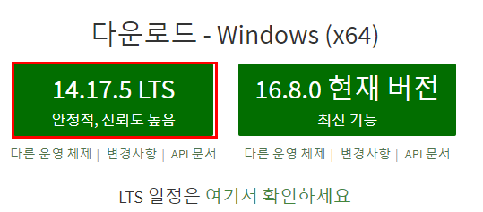

#### **\* npm, npx 를 이용해서 Create React App(리엑트 설치 도우미??) 설치**

1. 바탕화면에서 터미널(바탕화면 하단 검색창에 cmd 입력하면됨!) 에서 밑에있는 코드 입력하기

```bash
npm install -g create-react-app
//어디에서나 프로그램을 사용할수있겠음 하기
```

2. 밑에있는 화면이 터미널상에 출력되야지 정상! , 실패하면 sudo 맨 앞에 붙이고 다시 실행

```bash
Please specify the project directory:
create-react-app

For example:
create-react-app my-react-app

Run create-react-app --help to see all options.
```

#### **\* Create React App을 이용해서 개발환경 구축 및 react 설치~!**

1. 바탕화면에 폴더 생성 (기존에있는 폴더에다가 해도됨)후 터미널상 경로에 드레그하기

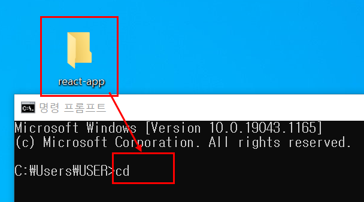

*파일을 드레그 하는 장면 꼭 cd를 적고 띄어씌기 한 후 해야됨*

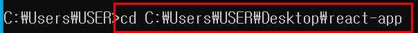

*드레그 후 결과*

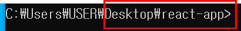

*엔터하면 경로 자동입력*

2. 만든 해당 폴더로 들어갔다면 그 다음에 터미널상에서 리엑트 관련 파일들 다운로드하기~!

```bash
create-react-app .
//리엑트 전체 파일을 다운받겠다는 뜻임
create-react-app 
//create-react-app이 설치되있는지 확인사항 위에 설치하기 전에 꼭 확인
```

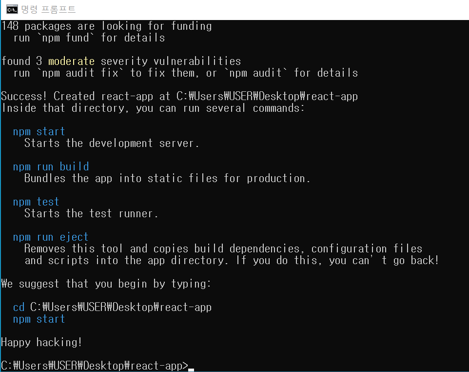

*설치 완료후 터미널 상황*

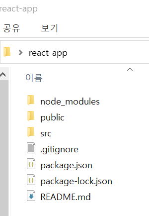

*설치후 폴더 상황*

#### **\* 샘플 웹앱 실행 하기 (리엑트에서 무료로 제공해주는 웹) npx로 접근하거나 npm으로 접근하면됨**

1. 해당 폴더안으로 들어가서 VScode(다른 편집기는 모르겠음 구글링 ㄱㄱ) 실행하기

2. VScode상 상단메뉴에 보기-> 터미널 클릭후 세팅 준비하기

3. vscode 터미널상 npm run start 입력 (npx로 해도 되는데 그러면 한번만 서버해줌)

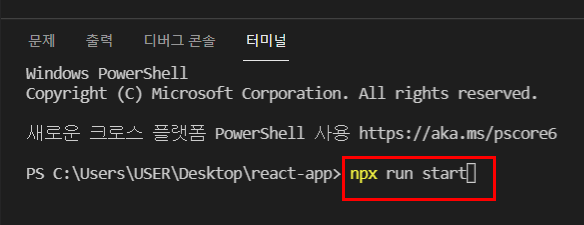

*터미널상 코드구현*

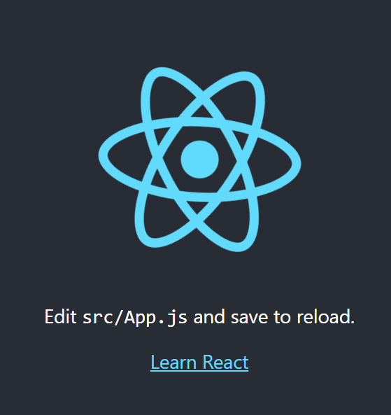

*실행 완료시 보이는 화면~!*

4. 리엑트에서 제공해주는 셈플 웹이기때문에 당황하기말것! 나갈때는 ctrl+c 입력하면 됨

#### **\* 디플로이(배포하는 방법)??? 용량 줄이기~! ->build**

1. 문제발견~! : 셈플로 제공해주는 웹에 개발자도구를 보면 리엑트에서 기본적으로 제공해주는 파일

때문에 용량을 많이 차지함 이는 비효율적임(1.7mb)

2. 해결방법 : 불필요한 파일을 제거 및 코드 간소화 하기위해 빌드업해야됨(472kb)

즉 public폴더의 index.html이 간소화되서 따로

```bash
npm run build 
//npm으로 빌드업하기
```

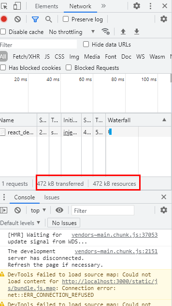

*해당 부분은 이미 빌드업 해놓은 상황임*

3. 빌드업이 완료되면 아래같은 화면이 출력되고 build라는 폴더가 자동 생성된다

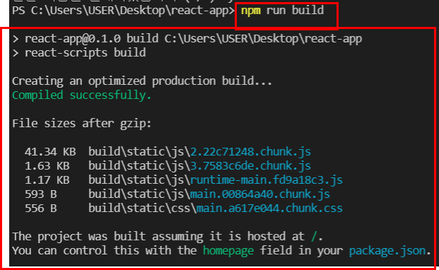

*터미널 출력결과*

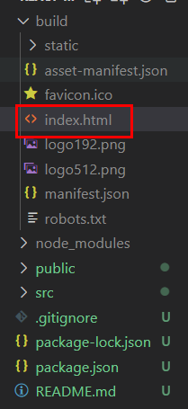

*폴더 생성화면*

4. 연결시킬 서버를 설치한다. 선택사항임 (서버주소가 3000에서 5000으로 바뀜, npx로 할시 ctrl+c 해서 나가면 서버 종료됨)

```bash
npm install -g serve //npm으로 서버 설치
npx serve -s build //npx로 서버 설치
```

5. 서버 설치 완료되면 아래같은 자동으로 생성된 url로 들어가면 리엑트에서 무료로 제공해주는 웹앱이 만들어진다.

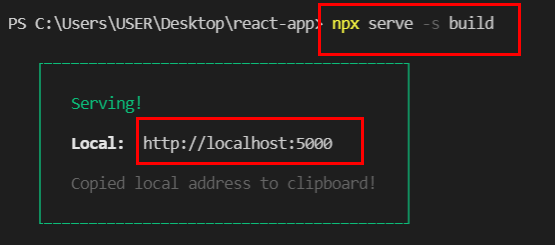

*결과 터미널*

#### **\* 크롬에서 기본적으로 지원하는 react developer tools 확장프로그램에 추가하기**

**(브라우저상 개발자도구에서 JSX를 볼수있는 유용한 도구임!)**

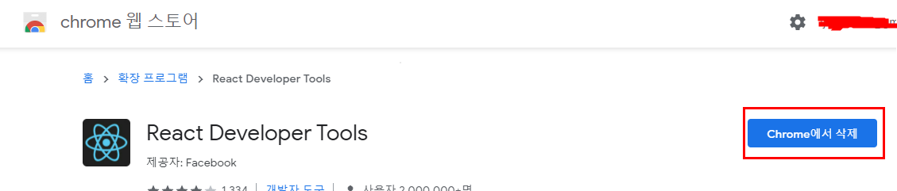

*리엑트 확장 프로그램 추가 화면*

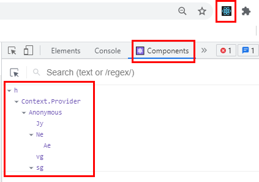

### ***# 기본적인 폴더 구성 파일들의 의미~! 처럼에는 난해할수도... ㅠ😅***

1. public폴더 에서 index.html은 실질적으로 화면을 그리는 역활을 하는 메인임!  
   아래와 같은 root속성값을 갖는 태그는 무조건 있어야됨~!  

   ```html
   <noscript>You need to enable JavaScript to run this app.</noscript>
       <div id="root"></div>​
   ```
2. src폴더에서 index.js 파일은 App.js 파일에서 리턴한 JSX를 index.html의 root태그 안에 생성되게 함  
   아래 코드 부분은 무조건 있어야되고 import로 App은 무조건 연결되있어야됨!  

   ```javascript
   import App from './App';

   ReactDOM.render(
     <React.StrictMode>
       <App />
     </React.StrictMode>,
     document.getElementById('root')
   );​
   ```
3. App.js 파일의 App객체는 태그를 JSX문법으로 생성여 리턴한부분을 index.js에 전달하는 역활을 한다  
   기본적으로 class 객체 문법을 사용하며 아래와같이 되있다면 수정해야된다.   
   그리고 div태그같이 감싸는 태그 하나는 무조건 있어야되고 안에 있는 부분은 리엑트에서 지원해주는 코드인데 지워도 되고 보통 여기에는 사용자 정의태그(component???)가 들어감  

   ```javascript
   //함수객체로 되있는 상황
   import './App.css';

   function App() {
     return (
       <div className="App">
         //여기안에 들어있던거 리엑트에서 지원해주는 웹인데 필요없음 여기에 사용자 정의태그가 들어감
       </div>
     );
   }

   export default App;

   //클래스 객체로 변경후 코드 상황
   import './App.css';
   import { Component } from 'react';

   class App extends Component {
     render(props) {
       return (
         <div className="App">

         </div>
       );

     }

   }

   export default App;
   ```
4. 기본적으로 사용자가 만드는 폴더나 파일은 src 폴더에서 보관한다
5. src 폴더에서 App.css , index.css 내용괴 public 폴더안에 사진들은 지워도 상관없다  
   (리엑트에서 제공해준 웹 기반 코드 사진들임)

### ***# 참고하면 좋은 목록들~!!!!😚😙🙄***

**1. 생활코딩~! 하루동안 얕게 들으면 좋음**

<https://opentutorials.org/module/4058>

[🔗 React](https://opentutorials.org/module/4058) — 수업소개 리액트 입문 수업입니다. 이 수업에서는 아래와 같은 내용을 다루고 있습니다.  리액트를 사용하는 이유 리액트의 컴포넌트를 만드는 법 리액트와 불변(immutable)의 관계 아래 내용은

**2. 설치의 대부분 여기서 참고했음~!!!**

<https://velog.io/@chez_bono/%EC%83%9D%ED%99%9C%EC%BD%94%EB%94%A9-React-%EA%B0%9C%EB%B0%9C-%ED%99%98%EA%B2%BD>

[🔗 ② 개발 환경](https://velog.io/@chez_bono/%EC%83%9D%ED%99%9C%EC%BD%94%EB%94%A9-React-%EA%B0%9C%EB%B0%9C-%ED%99%98%EA%B2%BD) — 🔗 생활코딩 React 1. 공부 전략 Coding : 개발 환경 설정 및 코드 작성 Run : 작성된 코드를 실행하여 결과 확인 Deploy : 소비자에게 전달 2. 개발환경의 종류 🔗 React 공식 홈페이지 1) 온라인 플레이그

3. 리엑트 공식 문서 (홈페이지 참고!!!)

<https://ko.reactjs.org/docs/getting-started.html>

[🔗 시작하기 – React](https://ko.reactjs.org/docs/getting-started.html) — A JavaScript library for building user interfaces
