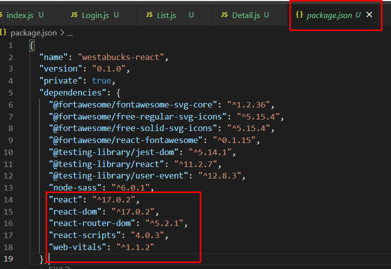
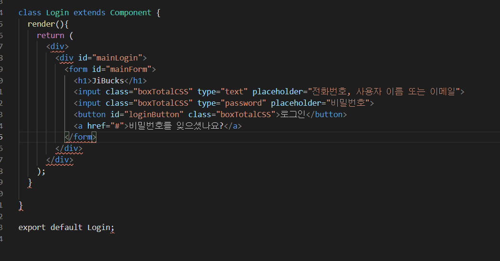
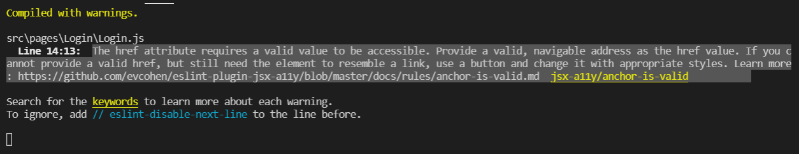
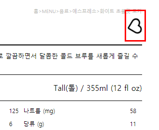
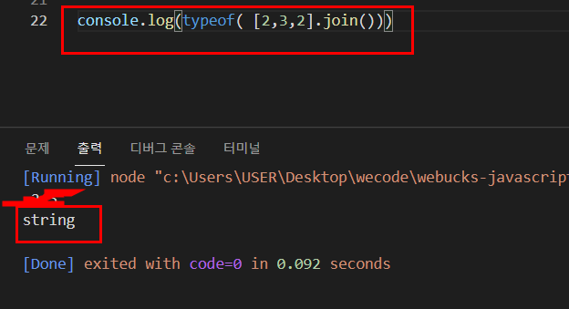
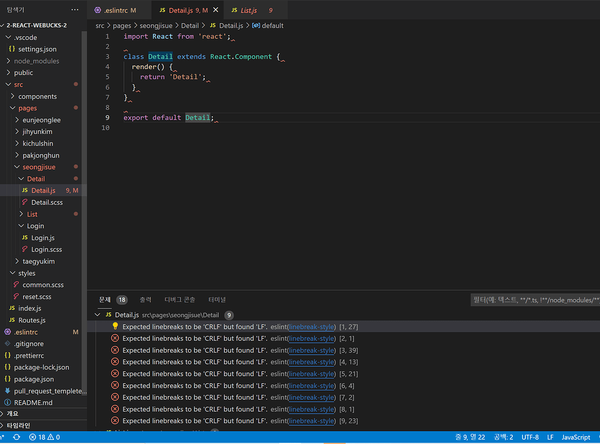
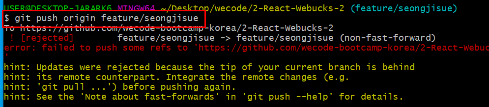
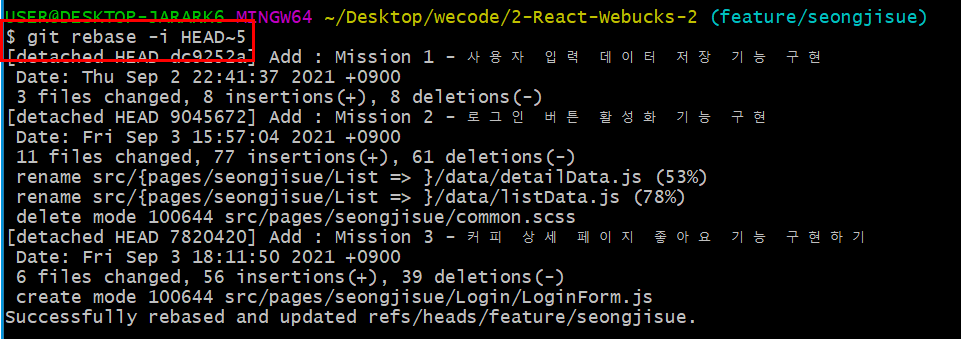
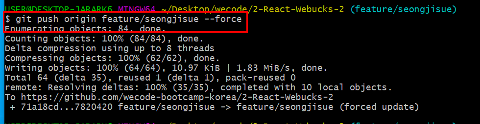

## ***난위도 : ★머★리★아☆퍼😣***

**이제부터 질문한거나 오류하는거 따로 기록남김**

**이는 차후에 동일한 에러가 나오면 손쉽게 대처하기 위함임**

**밑에는 생코 (생활코딩) 명언임**

**질문하기**  
**설명서보기**  
**나의상태를 분석하기**  
**검색하기**

**-실력자가 되기위해서 필수**

### ***# 첫번째 질문들~!!! 오류난것!ㅜㅜ😂 - npm으로 설치할때***

**문제** : reset.scss, commom.scss 이 파일 설치하려고 노션보고 'npm install react-router-dom --save' 명령어 입력했는데 터미널상 오류창이 뜨네요..ㅠ 구글링해서 찾아보니까 패키지를 업데이트하라고 하는데 같은 오류가 반복서요 ㅠㅠㅠ 오류내용이 맞나요?   
**오류내용** : found 3 moderate severity vulnerabilities  
**해결 내용** : 업데이트 하라는 내용인데 package.json에 보면 "react-router-dom": "^5.2.1", 있으면 실행하는데 문제없음 저거는 그냥 파일을 만들라는거임

*npm install할때 모든부분 여기서 기록이 남겨짐*

### ***# 두번째 질문들~!! 궁금한것!~!~! 😃 - git clone할때(리엑트버전)***

**문제** : git push할때 package.json 만 넘겨주면 된다고 하셨는데 만약 팀원들이 git clone하게된다면 node\_modules내용이 자동으로 다운받는 개념인가요? 아니면 npm install로 각각 node\_modules 파일을 다운받아야되는 개념인가요?   
**답변** : 후자가 맞음 npm install하면 node\_modules 가 자동적으로 다운받아지는데 package.json - dependencies 까지 다운받아지는거는 아님 그래서 npm install slider —-save 이렇게해서 다운 받아야됨  
node_modules는 용량이 크고 사람마다 OS·환경이 다를 수 있어서 git에는 안올리고(.gitignore) package.json에 적힌 목록 그대로 각자 npm install로 새로 받는 방식임

### **# 세번째 질문들 ~!! 에러뜬것들~!!😁🤣😅 - self closing tag 오류**

**문제** : webucks 프로젝트 작성한 HTML 코드부분을 복붙해서 JSX에 넣었는데 오류 뜨네요 ㅠ 혹시 이 오류가

self closing tag 에 관한 내용인가요? 어느 태그가 문제인지 모르겠어요`!!  
**에러 내용** : (property) JSX.IntrinsicElements.form: React.DetailedHTMLProps<React.FormHTMLAttributes<HTMLFormElement>, HTMLFormElement>   
**해결** : HTML을 JSX로 가져올때 self closing tag 해야됨   
input태그같은경우 HTML에서는 닫는 태그 없이 썼지만 JSX는 <태그 />문법으로 써야됨

*뭐가 잘못됬는지 파악해보기 태그에 빨간색깔~!~~~*

### ***# 네번째 질문 ~!!에러뜬것!!@🙄😶😑 - self closing tag (href속성)***

**문제** : self closing tag 하는 부분에서  a태그에 href 속성도 바꿔야되는 부분이 있나요? 아직 오류가 뜨네요 ㅠㅠ 번역했더니 이렇게 나와요ㅠ

**번역한 결과**: href 속성에 액세스하려면 유효한 값이 필요합니다. href 값으로 유효하고 탐색 가능한 주소를 제공하십시오. 유효한 href를 제공할 수 없지만 여전히 링크와 유사한 요소가 필요한 경우 버튼을 사용하고 적절한 스타일로 변경하십시오.

**해결** : href에 #를 줘서 안에 링크값을 주라는 말이었음

**자세히 알아보기**: <https://github.com/evcohen/eslint-plugin-jsx-a11y/blob/master/docs/rules/anchor-is-valid.md>

*링크 읽어보면 에러내용 이해갈듯*

### ***# 다번째 질문 ~!!에러뜬것!!😒😓😔 - JSX에서 fontawsome***

**문제** : HTML에서 webucks 프로젝트 바닐라 코딩으로 구현했는데 리엑트에 복사했을때 다른거는 되는데

왜 fontawsome은 아이콘이 안나옴??

**해결방안** : HTML이랑 JSX랑 문법이 다르기에 이게 fontawsome에서도 구현방법이 다른것같음

일단 npm으로 다운받고 import한후 Component태그로 써줘야됨~!  
HTML은 CDN에서 불러온 아이콘 폰트 클래스를 전역으로 바로 쓰는 방식이고, 리엑트는 컴포넌트 단위로 번들링되기 때문에 CDN 방식이 안먹혀서 npm 패키지로 설치 후 import해서 써야됨

**링크** : <https://www.digitalocean.com/community/tutorials/how-to-use-font-awesome-5-with-react>

*링크 읽으면 이거 구현가능*

### ***# 여섯번째 질문~!! 안풀렸던것들~!!🌭🧂🥟(치킨먹고싶다~ ㅎㅎ) - String 반전ㄴ***

**문제** : 배열에는 reverse로 순서를 뒤집는 함수가 있는데 String에는 없어~! 그럴때는 어떻게?? . 그리고 배열안에 문자인데 숫자로 전부 바꾸고 join하면 어떻게됨? 숫자?? 문자??

**해결한부분** : String  순서을 뒤집고 싶다면 일단은 split으로 "" 띄어쓰기 없이 큰따음표 기준으로 한글자씩 배열화해야되고 그상태로 reverse해야됨, 배열안에 숫자를 join하라는 말인데 어쨋든 join의 리턴값은 String임

### ***# 여섯번째 질문~!! 질문한것~!!! Why!!!!도대체@@@🙄***

**문제** : 현재 깃헙에 있는 레파지토리를 clone해서 npm install . 까지 한 상황 파일은 복사하지 않은 상황이었는데 에러가 발생해서 팀원이랑 얘기하다가 노션에 정리된 글을 발견하였고 내용은 운영체제 특성때문에 발생한 문제라고 글이 적혀있었습니다.( git push한 팀원은 맥이었고 저는 윈도우입니다)

노션에 적힌대로 .eslintrc.json 내용 수정, VScode 우측 하단에 CRLF에서 LF로 수정을 했지만, 에러가 계속 발생했습니다.   
윈도우랑 맥에 호환 문제라고 이해했지만, 해결방안을 찾을수 없어서 커뮤니티에 글을 올려봅니다.

- 노션에 글 내용대로 적용하기전 에러 : Delete `␍`eslintprettier/prettier  
  노션에 글 내용대로 적용한 후 에러 : Expected linebreaks to be 'CRLF' but found 'LF'.eslintlinebreak-style
- 노션에 공유된 링크 : <https://saengmotmi.netlify.app/trouble%20shooting/2020-06-28%20delete%20cr%20prettier/>
- 해결한 방법 : .eslintrc 파일은 공용 파일이기 때문에 노션에 올린 글이랑 다르게 수정하지 않고  
  모든 js 파일들을 CRLF에서 LF로 수정했더니 오류가 해결되었습니다.
- **문제 원인** : 유닉스 기반 시스템(Linux/Mac OS)에서는 LF( \n )만으로도 줄바꿈이 되는 반면 윈도우에서는 CRLF( \r\n )가 모두 입력되어야 줄바꿈이 처리되는 문제였습니다.

**의문점(추가 궁금증)** : 해결은 됬지만 의문점이 하나 생각이 났습니다. 지금같이 js파일이 몇개 않됬을때는 상관없지만 일일히 CRLF에서 LF로 수정하는 방법 밖에 없나요?  
노션에 공유된 링크에서는 .eslintrc에 코드를 추가하라고 되있어서 했는데 동일한 오류가 떴습니다.  
만약 해결할수 있는 코드가 있다면 처음 프로젝트를 push했을때 .eslintrc에 해결할수있는 코드를 미리추가해서 상황을 방지해야되는 부분인가요?

- **관희 맨토님 답변** : 얘기하신 문제의 원인은 맞고 코드를 추가하지말고 파일생성시 LF로 자동으로 변경됨

*오류상황사진*

### ***# 일곱번째 질문~!! 질문한것들~!!! 깃의 새로운 사실!@😗 커밋메세지 수정***

**문제** : 깃에서 commit message를 남긴 상태로 git push했습니다. 그런데 다시 생각해보니 github에는 올라갔고 commit message를 수정해야되는 상황이 왔을때 git에서 수정하고 push를 하면 에러가뜸!

- **해결한부분**  
  1. git rebase -i HEAD~5 // 최근부터 커밋 5개 불러오기   
  2. pick을 r로 바꾸기 // 창뜨면 수정하고싶은 커밋만 r로 지정   
  3. :wq //나가기   
  4. r로 지정한 커밋들 순서대로 나오면 커밋 메세지 수정후 :wq   
  5. git push origin feature/브런치이름 --force //깃헙에 있는 커밋메세지 강제 덮어씌우기
- **참고 사이트** :<https://velog.io/@mayinjanuary/git-%EC%BB%A4%EB%B0%8B-%EB%A9%94%EC%84%B8%EC%A7%80-%EC%88%98%EC%A0%95%ED%95%98%EA%B8%B0-changing-commit-message>

*에러상황*

*git rebase했을때*

*--force로 push한 상황!*

### ***# 여덜번째 질문~!! 질문한것들~!!! 깃의 새로운 사실!@😗 import 위치***

**문제** : @mixin 으로 파라미터 받아서 if문으로 조건 체크하려고 하는데 스타일이 적용 않되네요 ㅠ  
밑에 오류내용대로 font-를 추가했는데 안풀려서 질문드렸어요 그리고 문법도 밑에 참고한 사이트 기반으로 했습니다.  

**오류내용** :스타일 시트의 같은 위치에 'font-style', 'font-variant', 'font-weight', 'font-size', 'line-height' 및 'font-family'를 설정하기 위한 약식 속성입니다. 이 속성의 구문은 글꼴과 관련된 여러 속성을 설정하기 위한 전통적인 활자체 속기 표기법을 기반으로 합니다.  

**참고한 사이트** : <https://sass-lang.com/documentation/at-rules/control/if>  
해결: 구글 폰드를 scss에 적용하려면 import를 해야되는데 홈페이지에 import를 누르면됨  

**질문** : common.scss파일에 box-sizing: border-box; 랑 font-family속성을 넣고 모든 scss 파일에 적용하려고 하는데 scss에 import해야되나요? 아니면 js에 해야되나요?  
제 생각 : 어쨌든 같은 scss 파일이니까 각각의 scss(Login,List,Detail)파일에 import해야되지 않을까요? ㅎㅎ  
**소헌님 답변**  
1. 처음부터 완전한 정답은 없어요   
2. 나름의 기준을 가지고 import 해서 사용하신 다음에 (생각이 없으시면 …안돼요 ㅜㅜ..ㅋㅋ 이유가 있어야 합니다)  
3. 그 뒤에 동작하면, 개발자 도구 열어서 .scss 파일을 이 코드가 총 몇 번이나 import 하고 있는지 확인해주셍요
