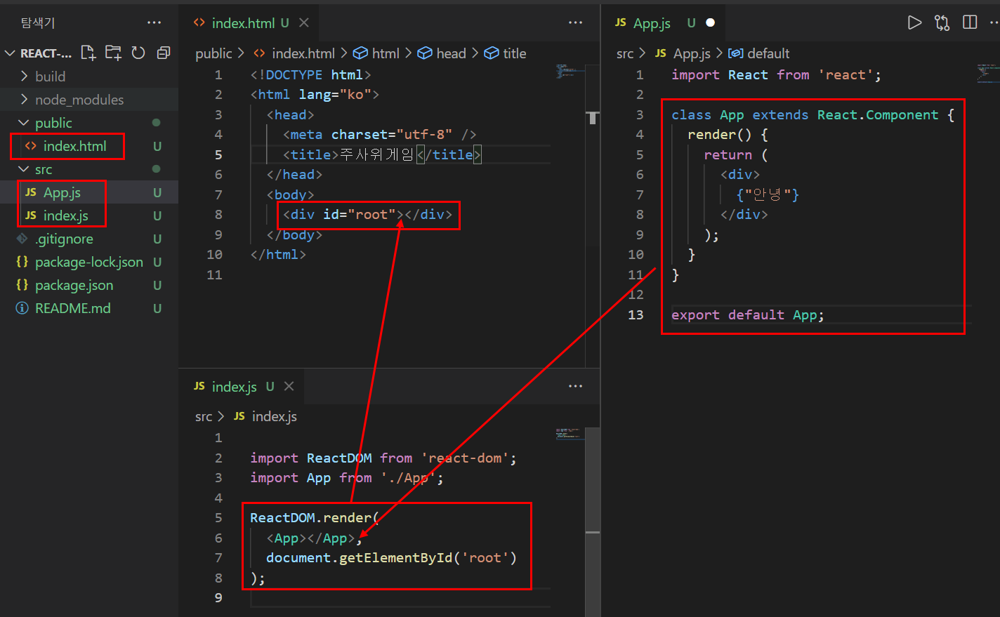
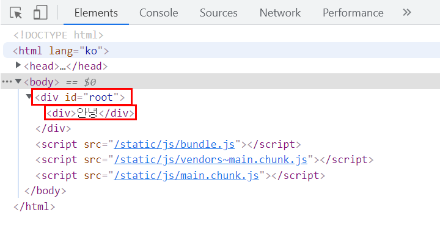

## ***난위도 : ★★★☆★※☆***

**리엑트 설치 부분 TIL을 참고해서 설치했다면 이제 코드를 칠 차례**

**props랑 state, Event종류 등 사용방법은 무조건 알아야됨!**

### ***# 시작하기전 주의사항~!!😎***

**\*기본적인 사항만 넣어놨음!**  
1. 컴포넌트 생성시 return값 안에는 하나의 태그로 감싸져있어야됨   
2. 태그의 속성을 지정시 예외의 경우가 있는데 바로 class이다. 자바스크립트에서 중복되기때문에

className이라고 지정해줘야된다  
3. JSX안에 자바스크립트 코드를 사용하려면 {}를 사용한다.    
4. 각 태그들의 속성은 카멜케이스로 써준다   
5. 컴포넌트나 태그에서 이벤트 속성을 주고싶을때는 콜백함수를 대입해야된다.

6. 이벤트 속성에 대입된 콜백함수 안에 this의 값은 무의미하다.

7. 처음 CRA를 생성시 index.html, index.js, 하나의 공통 컴포넌트는 무조건있어야된다.(나머지는 삭제해도 무관)

8. 하나의 컴포넌트를 생성후 index.js에 전달하고 ReactDom에 render라는 메소드로 인해 index.html에 있는

root속성값 안에 태그들이 만들어진다

9. 이미 만들어져있는 컴포넌트들이 있다 예를들면 Link, Router, Switch, Route 등등

### ***# 리엑트 코드 동작방법 ~!😋***

**\*화살표랑 네모 박스 참고할것!**



*코드상 이미지*



*브라우저 개발자도구*

### ***# 컴포넌트란??? 뭥미????😉😊😋***

**- 동적인 HTML코드에서 자바스크립트로 JSX문법으로 HTML 코드를 쪼개 하나의 컴포넌트(자바스크립트 화 HTML코드)로 만든것!**

**- 컴포넌트의 합성을 통해 UI를 재사용할 수 있고, 독립적인 단위로 쪼개어 생각할 수 있게 한다.**

**- React API 공식문서에 따르면 상속을 따르는 대신 컴포넌트를 쪼개 각각의 모듈을 하나의 모듈안에서 합성을 사용하길 권장한다.**  
**- HTML 코드는 index.html코드에서만 사용하고 나머지는 자바스크립트 코드로 이뤄진다.**  
**- 코드를 쓰기위한 방법은 2가지로 나뉘고있는데 바로 함수형과 클래스형이다. 이 2가지를 숙지하길 바란다.**

1.함수형 컴포넌트

```javascript
import React from 'react';

function ReactFunc(props) {
  //...statements
}
```

2. 클래스형 컴포넌트

```javascript
import React from 'react';

class ReactFunc extends React.Component {
  constructor(props){
   super(props)
   this.state = {}
  }

  render() {
    return (
      //...statements
    );
  }
}
```

### ***# 라우터에 내장된 컴포넌트 종류🤗🙄***

**- path속성으로 자신이 원하는 URL 주소를 만들고 그 해당 URL에 들어갈 컴포넌트들을 지정할 수 있습니다.**

**- 브라우저 이동 없이 컴포넌트만 싹 갈아 치워서 리프레시 없이 빠르게 페이지 전환이 마치 모바일앱처럼 이루어지게끔 해줍니다.( a요소 같은 역할을 하지만, 리프레시 없이 페이지 전환이 되는 것처럼 보이는 것이라 보면 되겠습니다)**

**- 꿀팀!  a태그와 Link 컴포넌트의 차이점 :** **a태그는 외부로 페이지를 넘어갈때 사용하는 반면 Link태그는 한 컴포넌트 안에서 경로를 주고받을때 사용함**

|  |  |
| --- | --- |
| 리엑트에서 제공해주는 라우터 컴포넌트들~! | 뭥미? |
| BrowserRouter | - URL과 UI를 동기화해주는 라우터이며, 웹 어플리케이션이 History API를 사용하여 페이지를 새로고침 없이 주소 변경이 가능하게 하고, 관련된 정보를 props로 쉽게 조회하거나 이용할 수 있게 해줍니다. |
| Switch | - Route로 생성된 자식 컴포넌트 중 매칭되는 첫번째 Route를 렌더링해줍니다.  - 보통 메인 Route의 url경로를 "/"로 지정하고 다른 Route에는 "/detail", "/login" 이런식으로 지정하게 되는데, 만약 Switch를 사용하지 않으면 그냥 메인페이지에 가기 위하여 "/" 경로를 접속했는데 "/"가 포함된 "/detail", "/login" 컴포넌트들이 다 렌더링 되는 경우를 보게 됩니다. - 위에서 부터 차레대로 path검사후 조건에 맞는 컴포넌트를 화면에 띄워줌 |
| Route | - 컴포넌트에 path 속성을 이용하여 원하는 url를 지정합니다.  - 그 url에 접속하면 해당 컴포넌트만 렌더링이 됩니다.  - 사용자의 경로에 따라 다른 컴포넌트를 보여줄 수 있습니다. - exact는 경로가 완벽히 일치해야됨 |
| Link | - 'a'요소와 비슷한 개념이지만 다른 개념입니다 - 지정한 url로 이동이 되게끔 해줍니다.  - 페이지를 새로 불러오기 때문에, 기존 컴포넌트에서 들고 있던 상태값들도 같이 날라갈수 있겠음 할수있습니다. |

```javascript
//index.js
import { BrowserRouter } from "react-router-dom";
.
.
.

//App.js
import { Route, Link, Switch } from "react-router-dom";
import Detail from "./Detail";
import Main from "./Main";

function App() {
  return (
    <div className="App">
      <Switch>
        <Route exact path="/" component={Main} />
        <Route path="/detail" component={Detail} />
      </Switch>
      <Link to="/"> //일반적으로 경로 이동
        <button>홈으로</button>
      </Link>
      <Link to=
      {{
      	pathname: '/detail', //경로입력
        state: {            //state로 데이터 실어담을수있음
        	imgURL: data.img, 
            coffeeName: data.name,
        },
      }}>
        <button>디테일페이지로</button>
      </Link>
    </div>
  );
}

//detail.js
let listLocation = this.props.location.state; //App.js에서 Link컴포넌트로 전달한 값 사용
```

### ***# Props랑 State 이부분 가장 중요함!!!~~!!!😎🤗🤩🤔***

|  |  |
| --- | --- |
| 제일로~중요한 것!!! | 뭥미?? |
| props | - 상위(부모) 컴포넌트에서 하위(자식) 컴포넌트로 데이터를 넘겨줄 수 있다 - 태그의 속성값으로 하나의 객체를 전달하면 하위 컴포넌트에서 this,props로 값을 받을수있다. - 읽기 전용, 받아오기만하고 직접 수정을 불가함(수정하려면 상위 컴포넌트 state 객체에서 값을 저장후 수정해야된다 - 생성자의 파라미터 super의 알규먼트로 props를 전달가능하다 - 기본값은 defaultProps 이다. |
| state | - 컴포넌트 내부에 값을 저장하고 그 안에서  값을 변경함 - 생성자 안에 this.state로 선언해주는데 프로퍼티로 초기값을 지정해줄수있다. - 만약 state의 값을 수정하고싶다면 무조건 setState 메소드를 선언해 그 알규먼트로 수정하고 싶은 객체 즉 프로퍼티를 넣어야된다. - 자식 컴포넌트에서 값을 수정하고싶다면 setState메소드를 전달하면되고 state의 값을 전달하고싶다면 this.state로 전달해주면된다. - state의 값이 바뀌면 render 함수가 다시 실행되어 화면을 그려준다. |

**\*해당 컴포넌트 태그에 속성을 줘서 자식태그로 전달할 수 있지만 state로부터 왔는지, props에서 왔는지, 수동으로 입력한 것인지 알지 못합니다. (데이터의 출처 파악불가)**

```javascript
//App.js
import React from 'react';
import Detail from './detail';
class App extends React.Component {
  constructor()
    super()
    this.state={//state 생성
      num :1
    }
  }
  render() {
    return (
      <div>
        <button onClick={()=>{
          this.setState({//state 수정
            num: this.state.num+1
          })
        }}>
          <Detail value={//detail에 state 넘겨주기
            this.state}>
          </Detail>
        </button>
      </div>
    );
  }
}

export default App;

//detail.js
import React from 'react';

class detail extends React.Component {

  render() {
    return (
      <div>
        <p>{this.props.value.num}</p>//props로 state 객체 받기
      </div>
    );
  }
}

export default detail;
```

### ***# setState에 콜백함수가???? 🙄(일반 객체를 넣을시 State 업데이트는 비동기적일 수도 있습니다.)***

**\* 참고 사이트 : <https://ko.reactjs.org/docs/state-and-lifecycle.html>**

**React는 성능을 위해 여러 setState() 호출을 단일 업데이트로 한꺼번에 처리할 수 있습니다.**

**this.props와 this.state가 비동기적으로 업데이트될 수 있기 때문에 다음 state를 계산할 때 해당 값에 의존해서는 안 됩니다.**

```javascript
// Wrong
this.setState({
  counter: this.state.counter + this.props.increment,
});

// Correct
this.setState((state, props) => ({
  counter: state.counter + props.increment
}));
```

**이를 수정하기 위해 객체보다는 함수를 인자로 사용하는 다른 형태의 setState()를 사용합니다. 그 함수는 이전 state를 첫 번째 인자로 받아들일 것이고, 업데이트가 적용된 시점의 props를 두 번째 인자로 받아들일 것입니다.**

### ***# 이벤트 종류와 발생시키는법! 주의해야될 사항~!!!😎***

**\*참고하기 : <https://zibu-story.tistory.com/110?category=854554>**

- **기본적으로 form태그에서 이벤트를 발생 시키게되면 그안에 태그들이 이벤트를 동작하여도 무시된다.(form은 안쓰는게 좋음)**
- **해당 이벤트의 기본 속성값을 무시시키려면 e.preventDefault 를 활용한다**
- **이벤트안에 this 지시자를 쓸경우 아무것도 가리키지 않는데 그럴때 이벤트 콜백함수 맨뒤에 .bind(this)를 붙여준다**
- **bind의 두번째 인자를 넣어주면 콜백함수의 첫번째 파라미터로 전달된다**

|  |  |
| --- | --- |
| 이벤트 종류 | 뭥미?? |
| onChange | 태그안에 value값이 변경될때 이벤트 실행 |
| onClick | 마우스 왼쪽 버튼을 누르면 이벤트 발생 |
| onKeypress | 키보드의 버튼을 누르는 순간 이벤트 발생 |
| onSubmit | 데이터 폼을 전송하려는 순간 이벤트 발생 |

```javascript
//App.js
import React from 'react';
import Detail from './detail';
class App extends React.Component {
  constructor()
    super()
    this.state={//state 생성
      num :1
    }
  }
  render() {
    return (
      <div>
        <button onClick={()=>{
          e.preventDefault(); //onClick이벤트의 기본 속성값 무시
          this.setState({//state 수정
            num: this.state.num+1
          })
        }.bind(this)}>// 이벤트 안에서는 bind로 this가 가리키는 위치를 지정해줘야됨
          <Detail value={//detail에 state 넘겨주기
            this.state}>
          </Detail>
        </button>
      </div>
    );
  }
}

export default App;
```

### ***# 참고한 링크 목록들~!  모르면 링크 들어가보랑😋***

**1. 컴포넌트란?**   
<https://pstudio411.tistory.com/entry/%EC%BB%B4%ED%8F%AC%EB%84%8C%ED%8A%B8Component%EB%9E%80?category=920340>

[🔗 컴포넌트(Component)란?(좀더 이해하기 쉽게 수정해야함)](https://pstudio411.tistory.com/entry/%EC%BB%B4%ED%8F%AC%EB%84%8C%ED%8A%B8Component%EB%9E%80?category=920340) — 컴포넌트(Component)  컴포넌트는 개념적으로 props라는 input값을 받고나서, UI, 즉 View(state) 상태에 따른 화면에 어떻게 출력이 되는지 Output을 React Element로 보여주는 함수를 뜻한다. 그래서 합성을

**2. 컴포넌트 활용**   
<https://velog.io/@younho9/%EB%A6%AC%EC%95%A1%ED%8A%B8%EB%A5%BC-%EB%8B%A4%EB%A3%A8%EB%8A%94-%EA%B8%B0%EC%88%A0-4%EC%9E%A5-%EC%9D%B4%EB%B2%A4%ED%8A%B8-%ED%95%B8%EB%93%A4%EB%A7%81>

[🔗 [리액트를 다루는 기술] 4장 - 이벤트 핸들링](https://velog.io/@younho9/%EB%A6%AC%EC%95%A1%ED%8A%B8%EB%A5%BC-%EB%8B%A4%EB%A3%A8%EB%8A%94-%EA%B8%B0%EC%88%A0-4%EC%9E%A5-%EC%9D%B4%EB%B2%A4%ED%8A%B8-%ED%95%B8%EB%93%A4%EB%A7%81) — 이 글은 김민준(velopert)님의 리액트를 다루는 기술을 참조하여 작성한 글입니다. 사용자가 웹 브라우저에서 DOM 요소들과 상호 작용하는 것을 이벤트(event)라고 한다.

**3. Router 컴포넌트**   
<https://baeharam.netlify.app/posts/react/why-switch-is-needed>

[🔗 [React] 는 언제 써야 할까? - 배하람의 블로그](https://baeharam.netlify.app/posts/react/why-switch-is-needed) — 기본적인 라우터의 동작 방식 라우터에는 가 보통 많이 사용되며 와 를 통해서 라우팅을 구현하는 방식이다. 예를 들어, 홈페이지, 영화페이지, 리뷰페이지가 있다고 하자. 각각의 URL을 / , /movies

**4. 이미 만들어져있는 컴포넌트 종류**   
<https://reactrouter.com/web/api/Link>

[🔗 React Router: Declarative Routing for React](https://reactrouter.com/web/api/Link) — Learn once, Route Anywhere

**5. 리엑트 이벤트 종류**   
<https://reactjs.org/docs/events.html>

[🔗 SyntheticEvent – React](https://reactjs.org/docs/events.html) — A JavaScript library for building user interfaces
