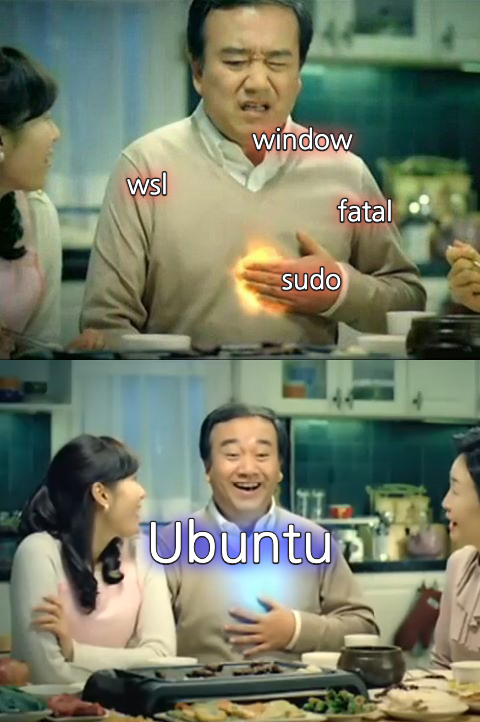

## ***난위도~! : ★★★★\*2***

**3주차, 4주차는 바로 리엑트에 계절인듯... ㅋㅋㅋㅋ**

**무시하고 넘어갈수 없고 조금씩 뒤쳐진다 느끼면 복습 예습 필히 할것!**

**소헌님이 우분투 짤 만들어주셨는데 우분투..... ㅠㅠ😂🤣**

**(공감 해보겠습니다.)**

### ***# ❤해야될거~!!! 무조건 해야되~!😂***

**\* 3주차**

- 평일
  - [x] 노션에 있는 react글 1~5(이벤트까지) 읽기
  - [x] 리엑트 파일 폴더 의 의미 노션참고해서 계시글 다시 올리기
  - [x] 미션 0B 0C 완성하기 모르는거 구글링
  - [x] 밑에있는 데이터 처리하는 방법 정훈님한테 여쭤보기
  - [x] 새로운 component만든거 sass도 밖으로 빼기
  - [x] 리엑트 코드부분 관련 TIL작성하기
  - [x] 미션 3까지 끝내기
  - [x] detail 페이지 관련 목데이터 만들기
- 주말
  - [x] 자격증 시험보러가기~! SQLD
  - [x] 취업지원제도 하기
  - [ ] props, state 복습 및 TIL 작성하기
  - [ ] 리엑트 생활코딩 들은거 기반 똑같이 구현해보기 (모르는거는 생코 참고)
  - [ ] 3주차 노션내용 참고해서 TIL작성하기
  - [ ] 모르는거 정리해서 TIL 작성하기

**\* 4주차**

- 평일
  - [x] props, state 복습 및 TIL 작성하기
  - [x] 재난지원금 신청하기
  - [x] 좋아요 버튼 JSON데이터로 분류해서 써보기
  - [x] state에 직접 접근해서 dataDetail을 꺼내지말고 setState로 수정하기
  - [x] 리뷰 id 줄때 index 말고 따른방법 생각해보기
  - [x] 새로 리팩토링 노션글 써주신거 참고서 코드 다시 수정해보기
  - [x] 내일 리엑트 시험 잘치루기
  - [x] 종로점가서 사람들이랑 코드 같이 공유하기
  - [x] 3주차 노션내용 참고해서 TIL작성하기
  - [x] 모르는거 정리해서 TIL 작성하기
  - [x] 관희님이 리뷰 남겨주신거 참고해서 고치기(reset,common은 개인적으로 수정)
  - [x] 팀별 JSON 데이터 만들기
  - [x] 미션 모두 완료하기
  - [x] 팀원 코드보고 리뷰 남기기
- 주말
  - [x] 코드잇에서 자바스크립트 중급중 비동기함수편 다시 듣기
  - [x] Node.js가 뭔지 노션참고해서 개념잡기
  - [x] 코드잇 Node.js 강의 듣기
  - [x] 다음주 일정 개인 노션에 정리하기
  - [x] 어제 남은 비동기 파트 듣기

### **😅 3주차, 4주차에 했던것들~!!! 배웠던것~!**

- 리엑트 초기세팅하는 방법 CRA 파일 폴더 구성 하기
- HTML CSS 파일 리엑트로 옮겨오고 HTML은 render의 리턴값에 CSS는 SASS 문법으로 교체하기
- 리엑트로 팀프로젝트 하는 간략한 방법(폴더 구성, 어떻게 clone push하는지
- HTML을 컴포넌트로 분류해서 사용하는방법
- Router(리엑트에서 경로 이동하는 방법
- a태그랑 Link 태그의 차이점 , class식별자를 쓰면 않되는 이유
- button태그나 form태그에서 이벤트 전달하는법
- 맨토님들, 동기들 코맨트 서로 달아주고 코드 고치기
- 리엑트에서 상위 컴포넌트만 state 주기
- 리엑트 면접(장현님 ㅠ)
- 인증 인가 Login.js에서 구현해보기

### ***# 면접 질문 (장현님) 목록 정리해봤음~!😲😤😬***

- JSX란 무엇인가요?
- React란 무엇인가요?
- CRA란 무엇인가요?
- 컴포넌트란 무엇인가요?
- React Sass란 무엇인가요? 사용하는 이유는 무엇인가요?
- React Router란 무엇인가요? 사용하는 이유는 무엇인가요?
- 라이브러리와 프레임워크의 차이점은 무엇인가요?
- mock data를 사용하는 이유는 무엇인가요?
- SPA란 무엇인가요?
- 생명주기(lifecycle) 메소드는 무엇인가요?
- state와 props의 차이는 무엇인가요?
- React의 특징(으로 시작해서 연계 질문 계속 가능)
- map 함수가 무엇인지 설명해주세요.
- 버튼을 클릭했을 때 alert 창을 띄우고 싶습니다. 리액트에서 어떻게 구현할까요?
- Virtual DOM이란 무엇인가요?
- 리액트에서 단방향 데이터 흐름이란 무엇인가요?
- fetch 함수는 무엇인가요?.
- 경 방법

### ***# 🤷‍♂️모르는것들~ (해답 아래 T스토리 링크 클릭)***

- [ ] defer이란?
- [ ] transform transition??
- [ ] onClick onChange onKeyPress등 차이점
- [ ] Link태그로 state객체 날리고 받는방법
- [ ] 리뷰창같이 input태그에 적은 값을 화면에 그리고 input초기화
- state에 프로퍼티를 초기값 즉 값을 지정하지말고 setState로 넣어주자
- constructor실행후 render될때 state에 아무값도 없어도 순간 깜빡임은 사용자가 인식하지 못한다
- 데이터를 따로 관리하여 값을 가져오는 방향으로 코드를 짜야된다.
- 모든 데이터에는 id라는 고유의 값이 있어야된다.

### ***# 리엑트 미션 종류~!!!!😚☺***

1. React 초기세팅 및 코드 옮겨오기
2. React 컴포넌트 분리 및 css를 scss로 변경하기
3. 팀원들과 같이쓸 목데이터 만들고 코드에 적용하기
4. Login | 사용자 입력 데이터 저장
5. Login | 로그인 버튼 활성화 (validation)
6. 커피 상세 페이지 좋아요 기능 구현하기
7. 커피 상세 페이지 리뷰별 좋아요 기능 구현하기
8. 커피 리스트 페이지 커피별 좋아요 기능 구현하기
9. 커피 상세 페이지 리뷰 삭제 기능 구현하기

### ***# 진실 농도 100% 위코드 Foundation 3주차, 4주차 후기~!😲***

벌써 리엑트의 감옥 Foundation 과정이 시작되었다~!!! 2주차 주말에 복습하라고 모든 사람들이

신신당부해서 생활코딩을 완주했다. 음 처음 생코를 접하신분들이라면 좀 힘들수도 있다

처음부터 개념을 잡고 시작하는게아니라 코드를 쳐가면서 하기때문에 애초에 기초가 않되는 사람들은

자바스크립트나 HTML CSS 과정을 먼저듣는것을 추천한다!@

Week3 주차에는 리엑트 초기세팅 바닐라 코딩을 한 부분을 리엑트 화 하기( CSS -> SCSS, HTML-> JSX)

로 변환하는데 시간이 오래걸린다.

미션은 바닐라 코딩하는거랑 비슷하지만 앞에 초기세팅하고 목데이터를 만드는 미션이 추가 되었고

처음부터 하나하나 컴포넌트를 나눠서 시작하는게 유리할듯 싶다.

그리고 4주차에는 멘토 리뷰랑 팀원 리뷰가 있기때문에 여유있게 하려면 3주차에 미션을 클리어하고

어느정도 리엑트의 개념을 잡고가는것이 좋다.

추가로 코드타가를 진행하는데 레플릿에서 빽준같은 문제를 매일마다 팀원끼리 풀고 맞춰보는 시간을 갖는다.

오히려 초반에는 개인적인 시간을 많이 갖었다면 지금은 팀원끼리 맞춰보고 조율하는 시간을 많이 갖는다.

4주차에는 위에 얘기했듯이 멘토님하고 팀원들과 코맨트를 진행하는데 고치는데 시간이 오래걸리지만

3주차보다는 한결 여유있고 꼭 초반 구현했을때 상위 컴포넌트에만 state를 주길 바란다~!(이거 하는데 오래걸림)

### ***# 🎃참고한 링크 목록~!!!@***

<https://zibu-story.tistory.com/149>

[🔗 8.29 개인TIL (React~!) - create-react-app 설치방법 , 폴더에 react 관련 파일 폴더 설치하기 , VScode상 터미](https://zibu-story.tistory.com/149) — 난위도 : ★★☆☆☆※? 리엑트 설치했다~~!!!! ㅋㅋㅋㅋㅋㅋㅋㅋㅋㅋㅋㅋㅋㅋㅋㅋㅋㅋㅋㅋㅋ 첫 고비 넘김!!! 처음이라면 당황스러울수도 있는 사람을 위해 TIL 작성해봄 이거를 보면서 좀더 쉽

<https://zibu-story.tistory.com/150>

<https://zibu-story.tistory.com/151>

[🔗 8.30 위코드 Week3(Question) - 질문한것들~! , 모르는것들~! , 에러난부분~! npm install할때 , 리엑트파일 g](https://zibu-story.tistory.com/151) — 난위도 : ★머★리★아☆퍼😣 이제부터 질문한거나 오류하는거 따로 기록남김 이는 차후에 동일한 에러가 나오면 손쉽게 대처하기 위함임 밑에는 생코 (생활코딩) 명언임 질문하기 설명서보기

<https://zibu-story.tistory.com/152>

[🔗 09.07 위코드 Week3(Foundation, React) - 리엑트 필수 구현 TIL, State란??? Props란??? , 이벤트 어떻게 써용???](https://zibu-story.tistory.com/152) — 난위도 : ★★★☆★※☆ 리엑트 설치 부분 TIL을 참고해서 설치했다면 이제 코드를 칠 차례 props랑 state, Event종류 등 사용방법은 무조건 알아야됨! # 시작하기전 주의사항~!!😎 \*기본적인 사항만
