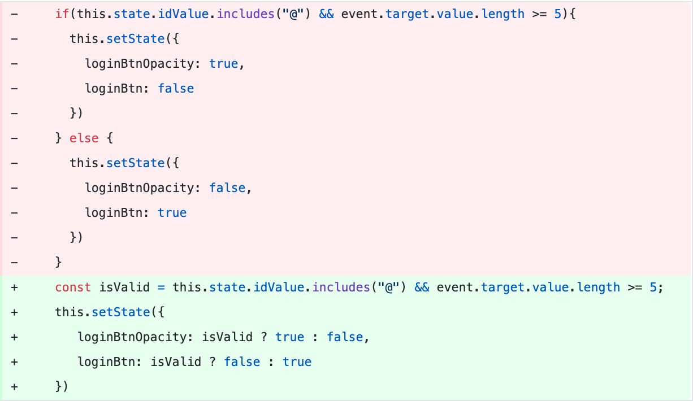
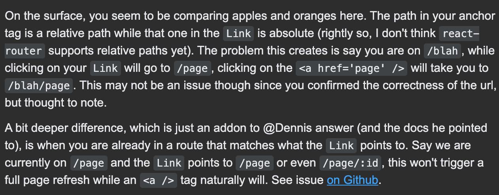

## ***난위도 : ★★★★★***

**내가 모르는 오류를 찾고 코드의 안정성을 위해**

**코맨트는 필수입니다. 그것을 하기전에 필요한 부분이 Refactoring입니다.**

**해도해도 끝이 없습니다~! ㅎㅎ**


### ***1. reset.scss & common.scss ~!😂😁😊***

**\* reset.scss, common.scss의 위치는 index.js에서 한번만!**

- reset.scss, common.scss는 기본적으로 index.js에서 import 해줍니다.
- index.html - index.js - <Routes /> 세 가지의 관계를 생각해보면 왜 index.js에서 한 번만 import 하면 되는지 쉽게 이해하실 수 있습니다 :)
- 변수, mixin등의 경우에는 variables.scss, mixin.scss 별도 파일로 분리해서 필요한 .scss 파일에서 import 해서 사용하시면 됩니다.
- 초기화 하는 세팅은 reset.scss에!
- 모두가 같이 쓸 수 있는 css는 common.scss에!

```scss
* {
	box-sizing: border-box;
	margin: 0;
	padding: 0;
}
```

### ***2. Sass nesting 활용~!! (sass 문법화 하기)😍😃🤣***

**\* css 그대로 두신 분들! nesting 꼭 적용해주세요. 결국엔 하나로 합쳐지는 파일들이기 때문에 내가 작성한 코드가 의도치 않게 다른 파일에 있는 요소에 영향을 줄 수 있습니다.**

- 참고) SPA, React, React Router 개념에 대해 정리해보시기 바랍니다.

```scss
* {
	font {
    	&size{}
        &weight{}

    }
}
```

### ***3. className의 동적 사용~! (HTML에서 CSS 사용 금지!, 3항연산자 사용)😎🙂🤗***

**\* style에 변화를 줄 때 inline으로 바로 줄 수도 있지만 우리는 css 파일을 사용하고 있기 때문에 적극 활용합시다!**

```html
<button
  onClick={this.handleCommentInputBtn}
  className={this.state.commentBtn ? "activated" : "deactivated"}
>
  로그인
</button>
```

```css
.activated {
  color: #0095f6;
}

.deactivated {
  color: #b5e1ff;
}
```

### ***4. 비구조화 할당, 구조분해 할당 (destructuring)😂🙄***

**\* 비구조화 할당(구조분해 할당)은 객체, 배열에 적용할 수 있는 ES6 문법입니다. 이 기능을 통해 긴 코드를 간결하게 쓸 수 있습니다.**

```javascript
handleInput = e => {
   this.setState({
      value: e.target.value,
   })
   ...
}

// 비구조화 할당 적용
handleInput = e => {
   const { value } = e.target;
   this.setState({
      value: value,
   })
   ...
}

// key-value 이름이 같은 경우 (cf. ES6 객체 단축 속성명)
handleInput = e => {
   const { value } = e.target;
   this.setState({
      value,
   })
   ...
}
const {idValue} = this.state;
```

- 함수에서 뿐만 아니라 render 함수 안에서도 state, props 객체에 비구조화 할당을 적용해 코드를 간결하게 할 수 있습니다.

```javascript
render() {
  const { email } = this.state;
  const { handleInput } = this;
  return (
    <input
      onChange={handleInput}
      value={email}
    />
  )
}
```

### ***5. Boolean 데이터 타입의 활용(3항연산자도 활용)😚***

**\* Boolean의 데이터 타입 특성을 이용하면 코드를 간결하고 쉽게 바꿀 수 있습니다.**



*wecode notion*

```javascript
render() {
  const { email } = this.state;
  const { handleInput } = this;
  return (
    <input
      onChange={handleInput}
      value={email}
    />
  )
}
```

### ***6. 반복되는 코드는 Array.map() 활용(HTML 간결화)🤩🤗***

- map을 사용할 때는 return 되는 JSX 요소마다 유니크한 key 값이 존재해야 합니다.
- key 속성은 제일 바깥에 있는 태그에 부여합니다
- 위 상황에서 INFO 변수를 render 와 return 사이에서 선언할 경우 컴포넌트가 render 될 때마다 새로운 변수가 계속 선언되기 때문에 컴포넌트 밖에서 선언합니다. (보통 .js 혹은 .json 파일로 분리해서 데이터를 관리합니다)
- 참고 ) [MDN | Array.prototype.map()](https://developer.mozilla.org/ko/docs/Web/JavaScript/Reference/Global_Objects/Array/map)

```javascript
// footerData.js
// named export (vs. default export)
export const INFO = [
  {id: 1, content: "도움말"},
  {id: 2, content: "홍보 센터"},
  {id: 3, content: "API"},
  {id: 4, content: "채용정보"},
  {id: 5, content: "개인정보처리방침"},
  {id: 6, content: "약관"},
  {id: 7, content: "위치"},
  {id: 8, content: "인기 계정"},
]

// Footer.js (Footer 컴포넌트)
import { INFO } from './footerData.js'

render() {
  return (
    ...
    {INFO.map(el => {
       return (
         <li key={el.id}>
				   <a href="">{el.content}</a>
				 </li>
       )
    })}
```

```javascript
Array.map(el => {
  return (
    <li key={el.id}>
      <span>{el.content}</span>
    </li>
  )
})​
```

### ***7. 계산된 속성명 을 이용한 중복코드 줄이기😎***

**\* input 태그에는 name 이라는 속성이 있습니다. 말 그대로 input 태그에 이름을 지어 주는 건데요. 이 name 속성 덕분에 여러 개의 input handler를 하나로 합칠 수 있습니다.**

- name 속성의 값은 value처럼 e.target으로 가져올 수 있습니다. (e.target.name)
- name 속성은 오직 input 태그에! 다른 태그에서 사용하려고 시도하지 마세요!
- 참고) **[계산된 속성명 - computed property names](https://developer.mozilla.org/ko/docs/Web/JavaScript/Reference/Operators/Object_initializer#%EA%B3%84%EC%82%B0%EB%90%9C_%EC%86%8D%EC%84%B1%EB%AA%85)**

[Copy of 참고) onChange 함수 합치기](https://www.notion.so/Copy-of-onChange-2b5dae1fe8f848acb9b3b19cd3c8d776)

```javascript
//before~!

handleEmail = e => {
  const { value } = e.target;
  this.setState({
    email: value,
  })
  ...
}

handlePw = e => {
  const { value } = e.target;
  this.setState({
    password: value,
  })
  ...
}

render(){
 return (
   ...
   <input
     className="emailInput"
     type="text"
     onChange={this.handleEmail}
   />
   <input
     className="pwInput"
     type="password"
     onChange={this.handlePw}
   />
   ...
 )
}
```

```javascript
//after~!

handleInput = e => {
  const { value, name } = e.target;
  this.setState({
    [name]: value
  })
}

render(){
 return (
   ...
   <input
     className="emailInput"
     type="text"
     name="email"
     onChange={this.handleInput}
   />
   <input
     className="pwInput"
     type="password"
     name="password"
     onChange={this.handleInput}
   />
   ...
 )
}
```

### ***8. <a> vs <Link> 차이점?🙄***

**\* <a> tag는 사용하면 새로고침 하는 것처럼 html을 새로 다 받아 오는 반면, <Link> 를 사용하면 컴포넌트만 바꿔줍니다. 렌더링 최적화를 위해서 <Link> 사용해주세요!**

- <https://stackoverflow.com/questions/43087007/react-link-vs-a-tag-and-arrow-function>



*영어 개짜증 -wecode notion*

### ***9. import 순서 꼭 지켜야됨!😍😃😅***

**\* 추가적으로 scss파일에는 mixin파일 import하고 common, reset 은 index.js에 import 해야됨!**

- 라이브러리
  - React 관련 패키지
  - 외부 라이브러리
- 컴포넌트
  - 가까운 컴포넌트 to 먼 컴포넌트
- 함수, 변수 및 설정 파일
- 사진 등 미디어 파일(.png)
- css 파일 (.scss)
