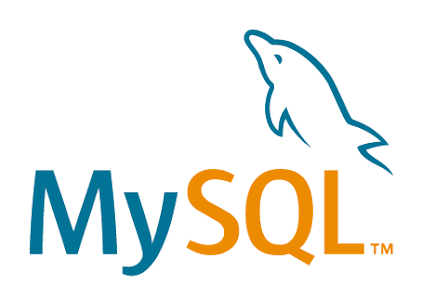
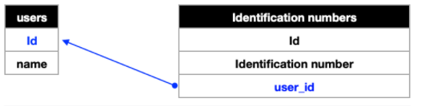
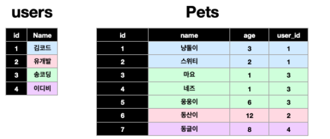
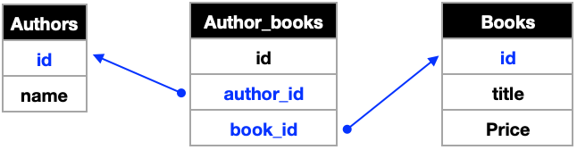

### ***🎀난위도: ★★★😁***

**🎈학습 목표~! (wecode notion 참고)🧨**

**데이터베이스(Database)의 개념을 이해합니다.**

**관계형 데이터베이스 (RDBMS)가 무엇이며, 왜 사용하는지 이해합니다.**

**테이블(Table)이 무엇인지 이해하고, Column, Row를 설명할 수 있습니다.**

**테이블(Table)의 관계 - One to One, One to Many, Many to Many 관계의 예시를 나열할 수 있습니다.**

**Primary Key 와 Foreign Key 의 관계를 설명하고, 테이블에 지정할 수 있습니다.**

**관계형 데이터베이스와 비관계형 데이터베이스의 차이를 알 수 있습니다.**

**ERD 구성도로 데이터 관계를 모델링 할 수 있습니다.**

### ***🎈데이터베이스??? DBMS???? 뭐지????🤨***

**\* 쉽게 얘기하자면 데이터베이스는 데이터+베이스(저장소), DBMS(데이터 관리도구)**

- 컴퓨터 시스템에 저장된 정보나 데이터를 모두 모아 놓은 집합
- 수 많은 데이터들을 관리하기 위한 수단으로 데이터베이스가 사용됨
- 데이터베이스는 데이터의 추가, 삭제, 검색, 수정, 이동 등의 기능있음 (CRUD)
- 우리가 흔히 사용하는 오라클, MySQL, MS SQL 등이 대표적인 관계형 데이터베이스입니다.
- 그리고 이 데이터베이스를 관리하는 도구가 DBMS(DataBase Management System)
- DBMS는 SQL언어와 데이터베이스를 연결해주는 도구입니다.
- DBMS의 종류는 매우 다양하며 그 중 가장 많이 사용되는 DBMS는 RDBMS(관계형 데이터베이스: Relational DBMS)입니다.


*데이터 저장소&nbsp;*

### ***🎈아 알겠고 근데 왜 데이터를 베이스에 저장함??? 굳이?? 🤨WHY🙄***

**\* 안전성, 기능성 신뢰성 데이터보존 체계적관리 등~!**

**1. 데이터를 오랜기간 저장 및 보존하기 위해서 데이터 베이스를 사용합니다.**

- 작은 어플리케이션에서도 물론 데이터를 잠깐동안 임시로 저장할 수는 있습니다. 그러나 우리가 저장하지 않은 데이터는 컴퓨터를 껐다 켜면 사라지죠? 메모리에 존재하는 데이터는 오래 보존이 되지 않습니다. 어플리케이션이 종료되면 메모리에 있던 데이터들은 다시는 읽어들일 수 없습니다. 따라서, 필요한 자료를 계속 보존하기 위해 데이터베이스를 사용합니다.

**2. 데이터를 체계적으로 보존하고 관리하기 위해 사용합니다.**

- 데이터는 많이 오래 저장한다고만해서 좋지 않습니다. 필요할 때 언제든 내가 원하는 자료를 쉽게 읽어낼 수 있어야만 의미 있는 정보라고 할 수 있습니다.
- 데이터베이스에는 데이터가 아무렇게나 어질러 저장되지 않고 체계적으로 정리되어 입력됩니다. 다시 찾고자 할 때 어렵지 않게 정보를 얻을 수 있습니다. 위 영화 데이터도 표 모양으로 깔끔하게 날짜별로 저장되어 있죠? 이렇듯 데이터를 체계적으로 정리하여 보관하기 위해 데이터베이스를 사용합니다.

### ***🎈관계형과 비관계형의 차이점 ! 같은 데이터인데 뭐가 다른거지??? 🤑🤑🤑🤑***

**\* 우리가 지금 주로 사용하는거는 관계형이니까 SQL은 필수겠지?! ㅋㅋ**

**1. 관계형 데이터베이스 (MySQL)**

- 데이터 사이의 관계에 기초를 둔 데이터베이스 시스템
- 각각의 테이블들이 서로 상호관련성 을 가지고 서로 연결되어 있음.
- 각각의 테이블들이 완전히 독립적인 대상이 아니라, 테이블 A와 테이블 B가 서로 연관되어 있고, 서로 관련이 있다는 뜻입니다.
- 테이블에 데이터를 저장합니다. 표는 행과 열로 구성됩니다. 여기서 행은 각 엔티티를 나타내지 만 열은 속성을 나타냅니다.
- 표준화하여 데이터 중복성을 최소화 할 수 있습니다.
- SQL (Structured Query Language)은 관계형 데이터베이스의 데이터를 쿼리하는 데 유용
- 복잡한 쿼리를 수행하는 데 도움이됩니다. 또한 유연성을 제공하고 데이터를 분석하는 데 도움

**2. 비관계형데이터베이스 (MongoDB)**

- BigData와 같은 많은 양의 데이터를 저장하는 데 효과적임
- 유지 보수 비용을 줄이기 위해 데이터를 여러 시스템에 클러스터링하는 것도 가능
- 대기 시간을 줄이고 처리량을 향상시킴
- SQL을 사용하지 않음




*관계형 데이터베이스와 비관계형 데이터베이스 예시*

### ***🎈mySQL에서 몰랐던 용어 총 정리~!~!😁😂***

**1. 테이블=릴레이션=엔티티**

**2. 열=컬럼=필드**

**3. 행 = 로우 = 레코드**

**4. 인덱스**

**5. 트리거 Trigger**

### ***🎈FK PK 의 차이점!!!! 무조건 중요~!!!😁😊***

**\* PK는 테이블의 고유 인덱스 FK는 테이블끼리 관계를 맺기위한 PK 짝퉁**

**1. PK (Primary Key)**

- 주 식별자 키로 모든 데이터를 식별하는 칼럼! 즉 이 고유의 번호로 테이블의  
  데이터 값을 가져올수 있다는 말
- 중복 불가, Null 불가~! 고유의 번호기때문에 없거나 중복되서는 않됨~!
- 함수적 종속관계
- increment 자동 숫자 증가 옵션 넣어줘야됨!

**2. FK (Foreign Key)**

- 외부 식별자 키로 테이블간의 관계가 어떠한지 체크할수있다(1대1,다대다,1대다)
- 두 테이블 간의 종속이 필요한 관계이면 그 접점이 되는 칼럼을 FK로 지정하여 서로 참조할 수   
  있도록 관계를 맺어준다
- FK로 정의된 테이블이 자식 테이블이고 참조되는 테이블을 부모 테이블이라고 한다
- 자식 테이블에 데이터를 삽입할 때 부모 테이블의 참조하는 컬럼에 없는 값을 삽입하면 위와 같이 오류가 발생한다.
- ON DELETE CASCADE : 참조되는 부모 테이블의 행에 대한 DELETE를 허용하는데 부모 테이블의   
  행이 지워지면 자식 테이블의 행도 같이 지워진다
- ON DELETE SET NULL : 참조되는 부모 테이블의 행에 대한 DELETE를 허용하지만   
  부모 테이블의 행이 지워지면 자식 테이블의 행은 NULL 값으로 설정된다.

```sql
create table emp(
eno varchar2(4),
ename varchar2(10),
job varchar2(6),
mgr varchar2(4),
hdate date,
sal number,
dno varchar2(2),
constraint emo_eno_pk primary key (eno), // CONSTRAINT 제약_조건_이름 PRIMARY KEY (컬럼)
constraint emp_eno_fk foreign key (dno) references dept (dno) 
// CONSTRAINT 제약_조건_이름 FOREIGN KEY (컬럼) REFERENCES 참조할_테이블 (참조할_컬럼)
);
```

### ***🎈그럼 테이블 사이에 관계가 어떻게 되는거임????😁😎***

**1. One To One**

- 테이블 A의 로우와 테이블 B의 로우가 정확히 일대일 매칭이 되는 관계를 one to one 관계
- A테이블의 PK와 B테이블의 FK가 정확히 하나씩 매칭되는것!
- 즉 하나의 A 데이터는 하나의 B 데이터와 연결되고 하나의 B 데이터 또한 하나의 A 데이터와 연결됨!  
  (이말의 뜻을 이해하면 끝!)



*1대1 매칭*

**2. One To Many**

- 테이블 A의 로우가 테이블 B의 여러 로우와 연결이 되는 관계
- A테이블의 PK 하나와 B테이블의 FK 여러개가 매칭되는것!
- 즉 하나의 A 데이터는 여러개의의 B 데이터와 연결되고 하나의 B 데이터 또한 하나의 A 데이터와 연결됨!  
  (이말의 뜻을 이해하면 끝!)
- 하나의 로우에 해당하는 테이블이 One이고, 여러 로우에 해당하는 테이블이 Many



*1대다 매칭*

**3.  Many To Many**

- 테이블 A의 여러 로우가 테이블 B의 여러 로우와 연결이 되는 관계를 many to many
- 한 작가는 여러 권의 책을 쓸 수 있고 한 책에도 작가는 여러명이 될 수 있음
- 즉 하나의 A 데이터는 여러개의의 B 데이터와 연결되고 하나의 B 데이터 또한 여러개의 A 데이터와 연결됨!  
  (이말의 뜻을 이해하면 끝!)
- 정규화 1법칙 (테이블의 행 하나에는 딱 하나의 데이터만 들어가야 함!
- 중복된 데이터를 줄여야됨!
- 중간 테이블에  id (PK) 가 존재하는 이유는 고유칼럼으로 식별하기 위해 씀!



*다대다 중간의 테이블은 중복제거, 정규화 1법칙을 따랐기 때문에 만들어진것*

### ***🎈# 데이터베이스에서 정규화가 뭐임??? 🤔***

**\* 기본 목표는 테이블 간에 중복된 데이타를 허용하지 않는다는 것이다. 중복된 데이터를 허용하지 않음으로써 무결성(Integrity)를 유지할 수 있으며, DB의 저장 용량 역시 줄일 수 있다.**

**참고한곳 : <https://mangkyu.tistory.com/110>**

|  |  |
| --- | --- |
| 종류 | 뭥미??? |
| 제1 정규화 | 테이블의 컬럼이 원자값(Atomic Value, 하나의 값, 데이터값)을 갖도록 테이블을 분해하는 것 |
| 제2 정규화 | 제1 정규화를 진행한 테이블에 대해 완전 함수 종속을 만족하도록 테이블을 분해하는 것이다.  여기서 완전 함수 종속이라는 것은 기본키의 부분집합이 결정자가 되어선 안된다는 것을 의미한다. **즉 테이블을 여러개로 분류한다는 말~!** |
| 제3 정규화 | **제2 정규화를 진행한 테이블에 대해 이행적 종속을 없애도록 테이블을 분해하는 것**이다. 여기서 이행적 종속이라는 것은 A -> B, B -> C가 성립할 때 A -> C가 성립되는 것을 의미한다. |
| BCNF 정규화 | 제3 정규화를 진행한 테이블에 대해 모든 결정자가 후보키가 되도록 테이블을 분해하는 것 |

### ***#참고한 사이트***

**1. 관계형과 비관계형의 차이점**

<https://ko.strephonsays.com/what-is-the-difference-between-relational-and-nonrelational-database>
