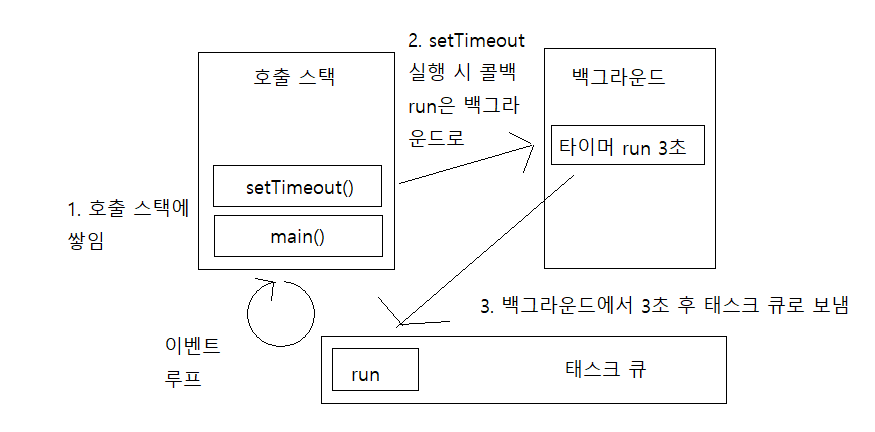
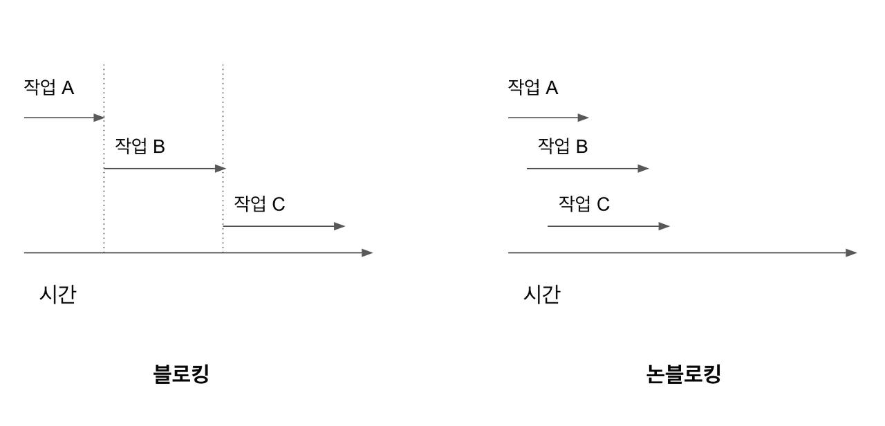
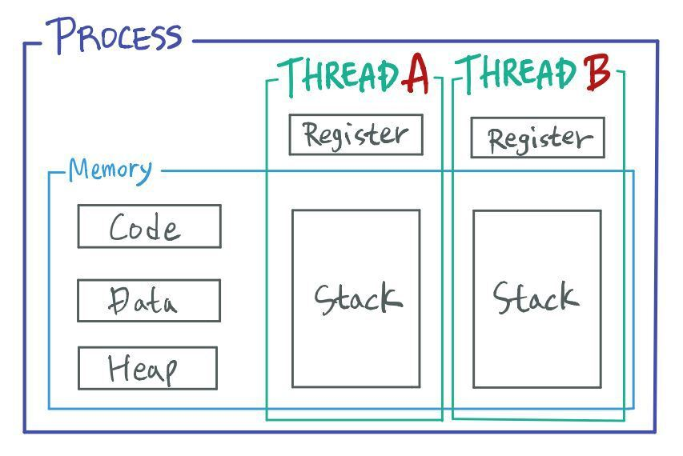
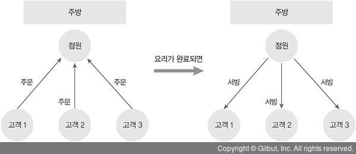

### ***난위도 : ★★★★🤐***

**🤩실행컨텍스트 이벤트루프 프로토타입 중요!!!!🤩**

**참고 : <https://zibu-story.tistory.com/127>**

**2. 싱글스레드인데 싱글스레드로 동작하는거 아닌 이유를 설명할수있다**

**3. 프로세스와 스레드의 관계를 설명할수 있다**

**4. 블로킹이랑 논 블로킹이랑 차이점을 설명할수있다**

**5. 이벤트 루프가 어떻게 돌아가는지 왜 비동기가 나중에 실행되는지 설명할수있다.**

**6. 노드가 싱글스레드+논 블로킹 방식을 선호하지만 멀티스레드+논**

**블로킹 방식이 더 나은 이유를 설명할수 있다.**


*디자이너 기획자 개발자 짤*

### ***🎈# node.js 란 뭐임????특징 총정리~!🎐🎑***

**참고 : <https://nodejs.org/ko/docs/>**

- Chrome V8 Javascript 엔진으로 빌드된 Javascript 런타임(**서버는 아님!)**
- 자바스크립트는 실행 속도 때문에 브라우저상에서만 실행했는데 Chrome V8이 나오면서 실행환경에 문제가 생기지 않았고 터미널상에서 동작할 수 있게 되었다
- V8과 더불어 libuv라는 라이브러리를 사용함   
  (libuv는 c와 c++로 구현되있지만 노드가 알아서 V8과 연결해줌)
- 하나의 Javascript언어로 웹 브라우저와 서버를 동시에 만들수 있음
- XML 대신 JSON 형식으로 데이터를 주고 받을 숭 있음

**\* 서버란????**

네트워크를 통해 클라이언트에 정보나 서비스를 제공하는 컴퓨터 또는 프로그램

보통 클라이언트의 요청에 응답을 함

(클라이언트 란? : 요청을 보내는 브라우저, 데스크톱 프로그램 등등)

### ***🎈# 이벤트기루프 실행 방법 특징~!✨🧨***

- 이벤트 발생할때 미리 지정해둔 작업을 수행하는 방식(ex fetch .then)
- 함수 호출부분을 발견했다면 호출한 함수를 호출스택(call stack)에 넣는다
- 코드가 종료될 때까지 이벤트 처리를 반복하므로 이를 이벤트 루프라고 부름
- 백그라운드랑 테스트 큐는 멀티쓰레드 방식이고 기본적으로 c++언어로 구성되있음(자바스크립트 언어가 아님)
- **이벤트 루프** : 이벤트 발생 시 호출할 콜백 함수들을 관리하고 호출된 콜백 함수의 실행 순서를 결정하는 역활을 담당
- **백그라운드** : setTimeout 같은 타이머나 이벤트 리스너들이 대기하는 곳, 동시 실행 가능 멀티 쓰레드  
  (백그라운드에 들어갈수 있는 얘들 setTimeout, .then , 등)
- **태스트 큐** : 이벤트 발생후 백그라운드에서는 태스크 규로 타이머나 이벤트 리스너의 콜백을 보냅니다. 정해진 순서대로 콜백들이 줄을 서 있으므로 콜백 큐라고도 한다.



*이벤트 루프 과정*

### ***🎈# 이벤트 루프 실행 절차 ( 위에 이미지 참고하면됨!)🤗🤩🤔***

**\* 주의 : 호출 스택에 콜백들이 많으면 setTimeout에서 지정한 시간대로 실행 않될수도 있음,**  
**setTimeout을 0초로 놔둬도 기본적으로HTML5 브라우저 상에서는 4ms 지연이 있음)**

1. 콜백이 하나씩 호출스택에 쌓임
2. 비동기적인 함수 setTimeout은 실행시 백그라운드로 타이머랑 같이 이동함
3. 백그라운드에서 3초를 센후 테스트 큐로 보내짐 (큐는 하나만 존재하는게 아닌 여러개일 수도 있음)
4. 호출스택이 전부 비워지면 테스트 큐에 콜백을 호출스택으로 올림
5. 올린 콜백을 호출 스택에서 실행함

```javascript
//호출스택 백그라운드 테스트큐 생각해서 어떤게 먼저 실행되는지 확인 ( 밑에있는거 계속 수련하기)
function onMore() {
	console.log('one more')
}
function run () {
    console.log('run run')
    setTimeout(() => {
        console.log('wow')
    },0)
    new Promise((resolve) => {
      resolve('hi');
    })
    .then(console.log);
    oneMore();
}
setTimeout(run, 5000)

//실행 순서 : run run -> one more -> hi -> wow
```

### ***🎈# 주요 용어! 정리~!!🎎🎏🎟***

**I/O** : 작업을 동시에 처리될 수 있고 파일 시스템 접근이나 네트워크 요청과 같은 입력과 출력을 의미함

**논 블로킹** : 이전 작업이 완료될 때까지 대기하지 않고 짧은 시간내에 다음 작업을 수행함을 뜻함

동시 실행이 아니라 작업 순서를 바꿔주는것일뿐



*블로킹 + 논블로킹*

### ***🎈# 프로세스와 스레드의 차이 그에따른 멀티스레딩, 멀티 프로세싱🎑🎠🎡***

- **프로세스** : 운영체제에서 할당하는 작업 단위 , 노드나 웹 브라우저 같은 프로그램은 개별적인 프로세서, 프로세스간에는 메모리등의 자원을 공유하지 않음
- **스레드** : 프로세스 내에서 실행되는 흐름 단위 , 프로세스는 스레드를 여러 개 생성해 여러 작업을 동시에 처리할 수 있음, 부모 프로세스의 자원을 공유할 수 있음 , 같은 주소의 메모리에 접근+ 데이터 공유 가능, 노드가 실행되면 하나의 프로세스 안에 여러 스레드를 생성하지만 직접 제어할 수 있는 스레드는 하나뿐임, 싱글 스레드 방식으로 서버를 관리할때 에러로 인해 멈추지 않도록 잘 관리해야됨
- **멀티 스레딩** : 하나의 프로세스 안에서 여러개의 스래드 사용, CPU 작업이 많을때 사용함, 프로그래밍이 어려움
- **멀티 프로세싱** : 여러개의 프로세스 사용, I/O 요청이 많을 때 사용, 프로그래밍이 비교적 쉬움
- **워커 스레드** : CPU 작업이 많은 경우 멀티 스레드로 사용할 수 있게 하는것   
  (대표적으로 임호화, 파일 입출력, 압축)



*메모리 구조 프로세스 스레드*

### ***🎈# 스레드 + 블로킹 상황별 예시🎑🎏***

1. **싱글 스레드, 블로킹** : 카운터 직원이 주문을 받고 주방 직원이 요리를 해서 손님한테 서빙 후 다음 손님 받음  
   **단점** : 다음 손님은 아무것도 하지 못하고 기다릴수밖에 없음
2. **싱글 스레드, 논 블로킹** :카운터 직원이 주문을 받고 다음 손님 받고 주방직원은 요리해   
   먼저 나오는것부터 손님한테 서빙( 노드가 채택하고 있는 방식임)  
   **단점** : 점원이 아프면 문제 생길수 있고 주방 직원이 주문이 많이 들어올때 버거울수도있고 주문 나오는 순서가 일치하지 않음
3. **멀티 스레드 방식, 블로킹** : 카운터 직원이 주문 기다리는데 주방직원이 여러명이라서 각 주문당 처리할수있음  
   **단점** : 손님수가 줄어들 경우 노는 주방 직원이 존재할수도 있음 , 직원을 새로 고용하거나 기존 점원을 해고하는데는 비용 발생됨



*싱글 스레드, 논 블로킹 모델*
