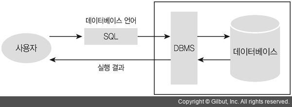
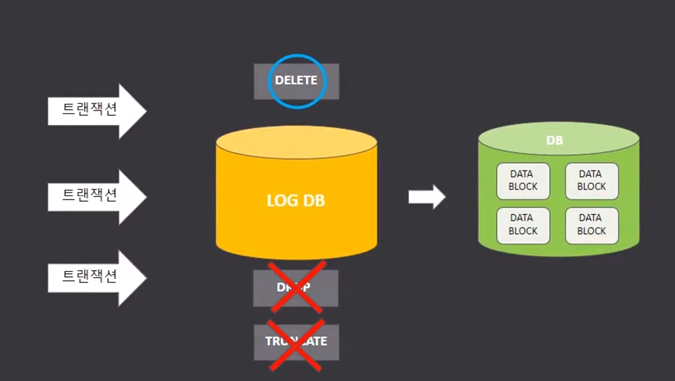
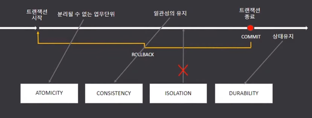
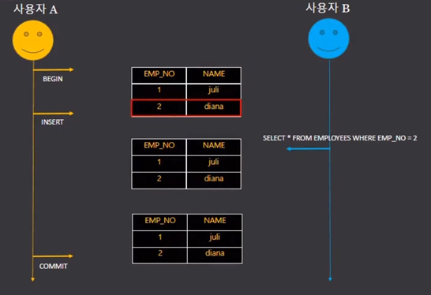
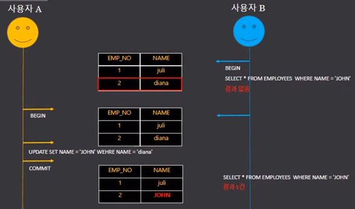
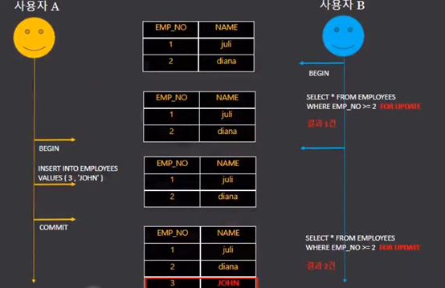
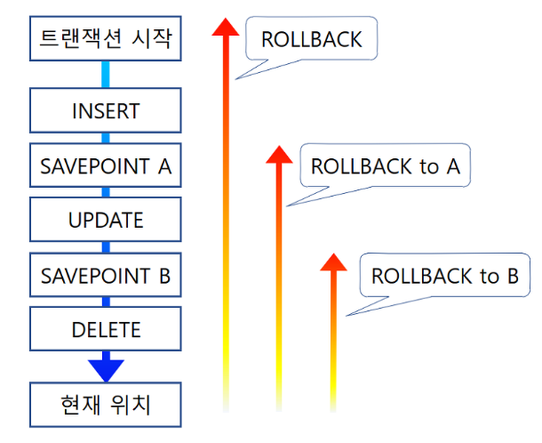

**SQL 개발자를 공부하면서 정리한 것**

**공부 방법은 패스트 캠퍼스의 강의를 듣거나 문제집을 사거나**

**유튜브를 찾아봐도 되지만 개인적으로 개념만 패스트캠퍼스로 잡으면 좋다.**

**참고로 SQL 개발자는 필기만 시험보고 6학점을 인정 받을 수 있다.**

**참고한 곳**

<https://www.youtube.com/watch?v=JxyMJNX24LY>


**📢 SQL 문을 작성할 때 DDL, DML TCL은 기본**

### **✔️Summary**

1. **SQL 정의와 종류**
2. **트팬젝션이란?**
3. **DDL (정의어)**
4. **TCL (트랜젝션 제어)**
5. **DML (조작어)**
6. **WHERE 절**
7. **함수**
8. **NULL**
9. **Group By, Oder by**
10. **터미널에서 DB 생성 및 초기 세팅 방법**

### **✔️***SQL 정의와 종류**

#### **정의**

- Structured Query Language의 약자로서 데이터베이스로부터 데이터를 조회하고   
  삭제하는 등의 작업을 수행할 때 사용하는 언어입니다.
- DBMS와 직접적으로 소통할수 있는 언어
- SQL문의 특징은 대/소문자를 구분하지 않습니다
- SQL에서 식별자나 문법언어는 대문자로 표기합니다.



*DBMS와 SQL*

#### **종류**

**DML(조작어)**

데이터를 조회하거나 검색, 변형

ex) SELECT, INSERT, UPDATE, DELETE

**DDL(정의어)**

테이블의 구조를 생성하거나 변경 삭제, 이름 변경의 작업을 수행하는 명령어

ex) CREATE, ALTER, DROP, RENAME

**DCL(제어어)**

권한을 부여하거나 회수하는 명령어

ex) GRANT, REVOKE

**TCL(트랜잭션 제어어)**

작업한 결과를 적용하거나 취소하는 명령어

ex) COMMIT, ROLLBACK

### **✔️트팬젝션이란?**

#### **정의**

- 논리적 연산 단위
- 하나의 SQL 문장 실행



#### **특성**

- **원자성(Automicity)** : 모두 성공적으로 끝나거나 실패해야 함
- **일관성** : 실행 전에 내용이 잘못된 것이 없다면 이후에도 DB에도 잘못된 내용이 있으면 안됨
- **고립성** : 실행 도중 다른 트랜잭션에 영향을 받아 결과 값이 바뀌면 안됨
- **지속성(연속성)** : 성공적으로 수행되면 갱신한 내용은 영구적으로 저장됨



#### **고립성이 낮을 때 생기는 문제**

**Dirty Read** : 값을 넣었는데 커밋이 되기 전 값을 조회할 때



**Non-Repeatable Read** : 커밋 되기 전과 후에 값이 다를 때



**Phantom Read** : 커밋 되기 전과 후에 값이 추가 되었을 때



### **✔️DDL (정의어)**

#### **타입 종류**

- **CHAR(L)** : 고정 길이, 값보다 작을 경우 공백으로 채움
- **VARCHAR2(L)** : 가변 길이, 값 만큼만 공간 차지
- **NUMBER(L,D)** : 정수 실수를 저장함, L은 정수 길이, R은 소수점 자리
- **DATE** : 날짜와 시간 정보, 년월일시분초

#### **테이블 이름 조건**

- 이름은 단수형으로 함
- 이름이 같은 테이블이 존재하면 안됨
- 테이블 내에 칼럼명이 중복되면 안됨
- SQL문 뒤에 ;로 끝나야 함
- 타입을 적어야 함
- 문자로 시작해야 하고 A-Z, a-z, 0-9, \_, $, # 문자만 허용

#### **테이블 생성 방법**

```sql
--테이블 생성
CREATE TABLE SQLD.TB_DEPT_TEMP
(
    DEPT_CD CHAR(6) NOT NULL,
    DEPT_NM VARCHAR2(150) NOT NULL,
    UPPER_DEPT_CD CHAR(6),
		CONSTRAINT DEPT_CD_KEY PRIMARY KEY(DEPT_CD),
		CONSTRAINT DEPT_CD_FOREIGN FOREIGN KEY(외래키) 
		REFERENCES 부모테이블이름(부모테이블키) ON DELETE CASCADE
);
--테이블 조회
DESC SQLD.TB_DEPT_TEMP;
```

#### **테이블 삭제 종류와 특징**

- **Thuncate** : DDL, 롤백 불가, 자동 커밋, 정의자체 완전 삭제
- **Drop** : DDL, 롤백 불가, 자동 커밋, 최초 생성된 초기 상태로 만듬
- **Delete** : DML, 롤백 가능, 수동 커밋, 데이터만 삭제

```sql
--테이블 삭제
DROP TABLE SQLD.TB_DEPT_TEMP PURGE;
--테이블 데이터 제거
TRUNCATE TABLE SQLD.TB_EMP_TEMP;
--테이블 제거
DROP TABLE SQLD.TB_EMP_TEMP CASCADE CONSTRAINT
```

#### **개별 속성 부여 및 이름 변경**

```sql
--칼럼 추가
ALTER TABLE SQLD.TB_EMP_TEMP ADD (MARRIED_YN CHAR(1));
--칼럼 제거
ALTER TABLE SQLD.TB_EMP_TEMP DROP COLUMN MARRIED_YN;
--칼럼 수정
ALTER TABLE SQLD.TB_EMP_TEMP MODIFY(MARRIED_YN CHAR(1) DEFAULT 'N' NOT NULL NOVALIDATE);
ALTER TABLE SQLD.TB_EMP_TEMP RENAME COLUMN TEL_NO TO PHONE_NO;
ALTER TABLE SQLD.TB_EMP_TEMP RENAME COLUMN PHONE_NO TO TEL_NO;
--권한 제거
ALTER TABLE SQLD.TB_EMP_TEMP DROP CONSTRAINT FK_TB_EMP_TEMP_01;
--로그 파일 기록 최소화
ALTER TABLE SQLD.TB_EMP_TEMP NOLOGGING;
--테이블 이름 변경
RENAME TB_EMP_TEMP TO TB_EMP_TEMP_02;
RENAME TB_EMP_TEMP_02 TO TB_EMP_TEMP;
```

#### **options**

- **CASCADE** : 참조 관계 있는 테이블 데이터도 삭제
- **PUGE** : 안쓰면 휴지통 쓰면 영구삭제
- **NOVALIDATE** : 현재 데이터 저장과 상관없이
- **CHECK** : 입력할 수 있는 값 종류 및 범위를 제한
- **Set null** : 참조 관계 있는 데이터 삭제 시 null 세팅
- **Restrict** : 자식에 pk가 없는 경우만 부모 칼럼 삭제
- **No action** 참조 무결성 위반에 영향 받지 않음

### **✔️TCL (트랜젝션 제어)**

**📢 자동 COMMIT DDL 문장 실행 DB를 정상적으로 종료 애플리케이션 종료**

**📢 COMMIT ROLLBACK 둘 다 데이터 무결성을 보장하기 위함**

#### **COMMIT**

트랜잭션을 완료하는 구문, 전혀 문제 없다고 판단할 경우에만 할 것, 이전과 이후로 나눔

```sql
COMMIT;
```

**COMMIT 이전**

- 이전 상태로 복구 가능
- 다른 사용자는 수행한 명령의 결과를 볼 수 없음
- 변경된 행은 잠금 설정되어 있어서 다른 사용자가 변경 불가

**COMMIT 후**

- 데이터베이스에 반영 되었기 때문에 이전 상태로 복구 불가, 삭제
- 모든 사용자가 결과 확인 가능
- 다른 사용자들이 조작 가능

#### **ROLLBACK**

COMMIT 하기 전 이전 상태로 돌아가고 싶을 때 사용(COMMIT하면 ROLLBACK 안됨)

다른 사용자들이 데이터 변경이 가능함

```sql
ROLLBACK;
ROLLBACK TO SV1;
```

#### **SAVE POINT**

POINT 정하면 롤백할 때 전체 작업을 하는 것이 아니라 POINT까지 일부분만 롤백할 수 있다.

에러가 발생한 경우 POINT까지의 트랜잭션만 롤백하고 실패한 부분에 대해서는 다시 실행

```sql
SAVEPOINT SV1;
```



### **✔️DML (조작어)**

#### **INSERT(추가)**

- **Automatic** : 부모 pk 없는 경우 부모 pk 생성후 자식 입력
- **Set null** : 부모 pk 없으면 자식 null 처리
- **Dpendent** : 부모 pk 존재 때 자식 입력 허용

```sql
INSERT INTO sqld.tb_certi t (t.certi_cd, t.certi_nm, t.issue_insti_nm) 
VALUES ('100021','SQLD합격패스','패스트캠퍼스');
```

#### **UPDATE(수정)**

```gams
UPDATE sqld.tb_certi a SET a.issue_insti_nm = '패스트캠퍼스온라인'
WHERE a.certi_cd = '100021';
```

#### **DELETE(삭제)**

- **DELETE** : 삭제되어도 용량은 감소하지 않음
- **TRUNCATE** : 삭제되면 테이블 용량 초기화

```sql
DELETE FROM sqld.tb_certi a WHERE a.certi_cd = '100021';
TRUNCATE TABLE sqld.tb_certi;
```

#### **SELECT(조회)**

**📢  DISTINCT** : 중복 데이터 제거

**실행 순서**

1. FROM
2. WHERE
3. GROUP BY
4. HAVING
5. SELECT
6. ODER BY

**설명**

DUAL 테이블 : 오라클에서 제공하는 테이블, 연산할 때 주로 사용

```sql
--전체 조회
SELECT * FROM SQLD.TB_CERTI A;
--특점 칼럼 지정 조회
SELECT a.issue_insti_nm FROM SQLD.TB_CERTI A;
--중복 제거 조회
SELECT DISTINCT a.issue_insti_nm FROM sqld.tb_certi a;
--칼럼 이름 변경 조회(ALIAS)
SELECT a.issue_insti_nm AS 발급기관명 FROM SQLD.TB_CERTI A;
--합성 연산자 조회
SELECT a.certi_nm || '(' || a.certi_cd || ')' || '-' || a.issue_insti_nm 
FROM sqld.tb_certi a;
--연산 수행
SELECT ((1+1)*3) / 6 AS 연산결과 FROM DUAL;
```

### **✔️WHERE 절**

#### **개념**

원하는 자료만 검색하기 위해 사용, 자료에 대해 제안할 수 있음

컬럼명, 비교 연산자, 문자 숫자 표현식,비교 칼럼 명이 들어감

조건식에 1=2 면 공집합이 나옴

Aias 사용 못함

```n1ql
SELECT * FROM 테이블명 WHERE 조건식;
```

#### **연산자 종류**

- **BETWEEN A AND :** B A와 B사이에 있으면 된다.
- **IN (LIST)** : 리스트에 있는 값중 하나라도 있으면 된다.
- **LIKE '비교문자열'** : 비교문자열의 형태와 일치하면 된다.   
  (와일드 카드 종류 : ‘%’ 0개 이상의 어떤 문자, ‘\_’ 1개인 단일 문자)
- **IS NULL** : 값이 NULL이면 된다

#### **문자 비교 방법**

**CHAR**

- CHAR의 특징은 비어있는 공간을 공백으로 채움 ex) CHAR(6) : ‘1234’ → ‘1234 ’
- 공백의 수만 다르다면 작은 쪽에 공백을 추가해서 같은 값으로 만듬
- 서로 다른 문자가 나올 때까지 비교

```sql
--테이블 생성
CREATE TABLE SQLD.CHAR_COMPARE
(SN CHAR(10)
, CHAR_COMPARE_4 CHAR(4)
, CHAR_COMPARE_6 CHAR(6));
--데이터 추가
INSERT INTO SQLD.CHAR_COMPARE VALUES ('1000000001', 'SQLD', 'SQLD');
INSERT INTO SQLD.CHAR_COMPARE VALUES ('1000000002', 'SQLD', 'SQLA');
COMMIT;
--같은지 비교
SELECT
REPLACE(CHAR_COMPARE_4, ' ', '_') AS CHAR_COMPARE_4
, REPLACE(CHAR_COMPARE_6, ' ', '_') AS CHAR_COMPARE_6
FROM SQLD.CHAR_COMPARE
WHERE SN = '1000000001'
AND CHAR_COMPARE_4 = CHAR_COMPARE_6;
```

**CHAR, VARCHAR**

- VARCHAR는 공백도 문자로 판단
- 서로 다른 문자가 나올 때까지 비교
- 길이가 다르다면 짧은 것이 끝날 때 까지만 비교한 후 길이가 긴 것이 크다고 판단
- 길이가 같고 다른 것이 없다면 같다고 판단

```sql
--테이블 생성
CREATE TABLE SQLD.VARCHAR_COMPARE
(SN CHAR(10)
, CHAR_COMPARE_4 CHAR(4)
, VARCHAR_COMPARE_6 VARCHAR2(6));
--데이터 추가
INSERT INTO SQLD.VARCHAR_COMPARE VALUES ('1000000001', 'SQLD', 'SQLD ');
INSERT INTO SQLD.VARCHAR_COMPARE VALUES ('1000000003', 'SQLD', 'SQLD');
INSERT INTO SQLD.VARCHAR_COMPARE VALUES ('1000000002', 'SQLD', 'SQLA ');
COMMIT;
--같은지 비교
SELECT
REPLACE(CHAR_COMPARE_4, ' ', '_') AS VARCHAR_COMPARE_4
, REPLACE(VARCHAR_COMPARE_6, ' ', '_') AS VARCHAR_COMPARE_6
FROM SQLD.VARCHAR_COMPARE
WHERE SN = '1000000001'
AND CHAR_COMPARE_4 = VARCHAR_COMPARE_6 --TRIM 함수 써서 공백 제거
;
```

**상수**

- 상수 쪽을 변수 타입과 동일하게 바꾸고 비교한다.
- 변수 쪽이 CHAR이면 CHAR타입인 경우를 적용한다.
- 변수 쪽이 VARCHAR이면 VARCHAR타입인 경우를 적용한다.

```pgsql
SELECT
REPLACE(CHAR_COMPARE_4, ' ', '_') AS VARCHAR_COMPARE_4
, REPLACE(VARCHAR_COMPARE_6, ' ', '_') AS VARCHAR_COMPARE_6
FROM SQLD.VARCHAR_COMPARE
WHERE SN = '1000000001'
AND VARCHAR_COMPARE_6 = 'SQLD'
```

### **✔️함수**

#### **단일 행 함수**

**특징**

- SELECT, WHERE, ORDER BY 절에 사용
- 각 행들에 대해 개별적으로 작용
- 여러 인자를 입력해도 하나의 결과 리턴
- 함수의 중첩 가능

**종류**

- SIGN : 양수 음수 0을 구분함 양수면 1 음수면 -1
- CEIL : 숫자보다 크거나 같은 최소 정수 반환
- FLOOR : 숫자보다 작거나 같은 최소 정수 반환
- EXTRACT : 특정 날짜나 시간 추출
- TRIM : 공백 제거
- MAX : 최대값을 구하는 함수, 공집합인 경우에도 Null이 나옴

```sql
--모르는 것
SELECT
TO_NUMBER(TO_CHAR(SYSDATE, 'SS')) AS "초출력" --초 출력
, TO_CHAR(SYSDATE, 'YYYY/MM/DD')  "TO_CHAR(SYSDATE, 'YYYY/MM/DD')" --왜 AS 안붙임?
, EXTRACT(YEAR FROM SYSDATE) AS "년 출력"
, SYSDATE - (1/24/60/60) *40 AS "30초뺀날짜"
FROM DUAL;
--CASE 문
SELECT 
CASE WHEN sal_cd = '100001' THEN '1'
ELSE '나머지'
END sal_nm
FROM tb_sal;
--DECODE 문
SELECT DECODE(sal_cd,'100001', '1', '나머지') AS sal_nm
FROM tb_sal;
```

#### **집계 함수**

**특징**

- 여러 행의 그룹당 단 하나의 결과를 돌려줌
- SELECT 절, HAVING 절, ORDER BY 절에 사용
- GROUP BY 절은 행들을 소 그룹화
- NULL 값을 가지는 행 제외
- WHERE 절에 못옴

**종류**

- ALL : DEFAULT옵션 임 생략 가능
- DISTINCT : 중복 값 제거
- COUNT(\*) : NULL 포함 행의 수, 조건절이 거짓일 경우 0 반환
- COUNT(표현식) : NULL이 아닌 행의 수
- Sum, Avg : 합계 평균 구하는 함수인데 null은 제외함

### **✔️NULL**

#### **개념**

- unknown, N/A 과 같은 의미
- 아직 정의되지 않았거나 존재하지 않는 값 0이랑 공백이랑 다름
- NULL 의 값은 = 와 비교할 수 없음
- 어떤 연산을 해도 NULL은 NULL
- SUM, AVG 등 함수에 NULL 값이 있으면 무시하고 실행
- IS NULL : NULL 인 행 조회
- IS NOT NULL : NULL이 아닌 행

#### **함수**

- NVL : 첫번째가 Null이면 두번째 값을 반환, 아니면 첫번째 반환
- NVL2 : 첫번째가 Null이 아니면 두번째 값을 반환, 맞으면 첫번째 반환
- NULLIF : 첫번째랑 두번째가 같으면 Null, 아니면 첫번째 반환
- COALESCE : Null이 아닌 첫 번째 값을 리턴

### **✔️Group By, Oder by**

#### **GROUP BY**

- GROUP BY 절을 통해 소그룹 별 기준을 정한 후, SELECT 절에 집계 함수를 사용
- NULL 값을 가지는 행 제외
- ALIAS 를 사용 못함
- WHERE 절이 우선
- HAVING은 조건절 표시
- Select 있는 칼럼으로

```sql
SELECT
A.EMP_NO
, (SELECT L.EMP_NM FROM TB_EMP L WHERE L.EMP_NO = A.EMP_NO) AS EMP_NM
, MAX(A.PAY_AMT) AS MAX_PAY_AMT
, MIN(A.PAY_AMT) AS MIN_PAY_AMT
, ROUND(AVG(A.PAY_AMT), 2) AS AVG_PAY_AMT 
FROM TB_SAL_HIS A
WHERE A.PAY_DE BETWEEN '20190101' AND '20191231'
GROUP BY A.EMP_NO
HAVING(ROUND(AVG(A.PAY_AMT), 2)) >= 4700000
ORDER BY A.EMP_NO
;
```

#### **ORDER BY**

**📢**  **인덱스 정렬 힌트 : 인덱스를 스캔 후 정렬에 맞게 읽음  
ex) SELECT /\*+ INDEX\_DESC \*/ ~~~~FROM**

- 특정 컬럼을 기준으로 정렬하여 출력하는데 사용
- ALIAS 명이나 정수도 사용가능
- 기본은 오름차순
- 날짜는 빠른순
- Oracle에서는 null이 마지막, Sql에서는 null이 처음

```sql
SELECT
A.CERTI_CD
, A.CERTI_NM
, A.ISSUE_INSTI_NM
FROM TB_CERTI A
ORDER BY A.CERTI_NM DESC; --내림차순
```

### **✔️터미널에서 DB 생성 및 초기 세팅 방법**

```sql
$ mysql -u root -p //mysql 접속 root는 계정명

$ password : // 다운로드할때 설정했던 root의 비밀번호 입역

$ CREATE DATABASE 이름; # Database 를 생성하는 명령어

$ SHOW DATABASES; # 현재 MySQL 에 저장되어있는 전체 데이터베이스를 보는 명령어

$ USE 이름; # 생성한 데이터베이스에 접근하는 명령어

$ SHOW tables; # 현재 데이터베이스 안에 저장되어있는 테이블들을 보는 명령어

$ CREATE table 테이블이름 { // 테이블 생성
    칼럼명 데이터타입 부가정보(NOT NULL등)
    칼럼명 데이터타입 부가정보(NOT NULL등)
    칼럼명 데이터타입 부가정보(NOT NULL등)
}

$ INSERT INTO 테이블이름 (칼럼명) VALUES(데이터), (데이터), (데이터); // 데이터 추가

$ SELECT 칼럼명 FROM 테이블명 WHERE 조건 ; // 조건에 만족하는 칼럽 조회

$ UPDATE 테이블이름 SET 변경할것 = 값 WHERE 조건; //조건에 맞는 칼럼 해당 값으로 변경

$ DELETE FROM 칼럼명 WHERE 조건;  //조건에 맞는 칼럼삭제

$ DROP table 테이블이름; //테이블 삭제 (실패시 테이블간 종속관계 확인하기)

$ DROP 데이터베이스; //데이터베이스 삭제
```


