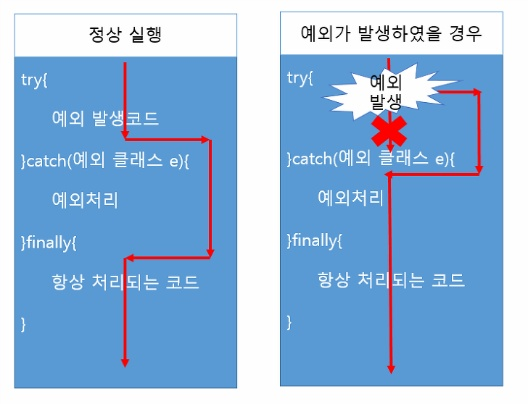

### **난위도 : 😁😂🤣😃**

**에러 status, contextype : <https://zibu-story.tistory.com/126>**

**1. export와 export default의 차이를 확실히 이해할수 있다**

**2. 동기적으로나 비동기적으로 오류를 손쉽게 잡고 예외 처리를 할수 있다.**

**3. 에러객체가 뭐가있는지 확인하고 그에따라서 에러를 던져 상위 catch에서 처리할수있다.**

**4. 에러객체에 정보를 담아서 사용자가 직접 view단에서 처리할수 있게 한다.**

**5. express 공식 문서상 node는 비동기이기때문에 try~catch로 예외처리하는것 말고 promise 객체로 예외 처리를 해줘야된다**



*에러 발생시 상황*

### ***🎈# export와 export default의 차이점😋😎***

**export는 여러개를 내보낼때 사용하는것, export default는 단일값 딱하나만 내보낼때 사용함**

**A라는 모듈(파일)에서 B라는 모듈의 변수or함수를 쓰기위해 사용함**

**\* export를 사용해서 값 함수 내보내고 import로 받기**

```javascript
//export.js

export let a = 3; // 하나씩 export 할수있음
export let b = () => {console.log(a)}
export {a as A, b}; //한번에 export 할수있음

//import.js

import {A, b as B} from './export.js' // 똑같이 {}를 써서 가져올수있음
console.log(A); // 3출력됨
```

**\* export default 사용해서 값을 내보내고 import로 받기**

```javascript
// export.js 

let a = 3;
let b = () => {console.log(a)};
let c = [a, b];
export default a // 단일값으로 내보낼때
//let d = { b, c}
//export default d // 다수의 값을 내보낼때
export default {b, c} // 위에 주석이랑 같은말 즉, 객체로 묶어서 내보낸다는 말

//import.js

import {default as D} from '../export.js' // 단일값으로 내보낼때
import D from '../export.js' // {default as } 는 생략가능
//값 사용
D.b(); // 출력 3
console.log(D.c[0]) //출력 3
```

### ***🎈# 에러 오류 예외처리 뭐임????🎡🛒🧶***

**\* 참고 : <https://ebbnflow.tistory.com/268>**

**에러(Error)와 오류(Exception) 두 가지 종류가 있는데, '에러'는 메모리 부족, 스택오버플로우 등 발생하게 되면 복구하기 쉽지 않은 심각한 오류를 말하고, '예외'는 발생하더라도 수습할 수 있을 정도의 심각하지 않은 오류를 말합니다. 따라서 우리는 '예외 처리'를 통해 프로그램이 동작하지 않는 상황을 막을 수 있게 되는 것입니다.**

### ***🎈# 예외 처리하는 방법(동기식)🎏🎐***

**예외 처리하는 이유 :  자바크립트는 기본적으로 싱글스레드 기반이기때문에 사용자 실수or 서버오류등 발생하면**

**다음꺼를 실행 안하고 작업이 중단됨 그리고 터미널상에 에러 메세지를 발생시키는 것보다는 사용자가 볼수 있겠음 view단에서 처리해줘야된다.**

|  |  |
| --- | --- |
| 예외시 사용 | 뭥미??? |
| try | 에러가 발생할것 같은 부분을 try안에 넣고 중첩해서 try를 여러번 쓸수도 있음 |
| catch(err) | try부분에서 에러가 발생하면 작업을 중단하고 즉시 catch 구역으로 넘어가 에러를 처리함 throw로 에러를 상위 catch로 던져줄수 있고 err.massage로 해당 에러를 콘솔에 출력할수도 있다 |
| finally | 에러가 발생하든 안하든 무조건 실행되는 구역 |
| throw | catch단에서 에러를 처리못하고 그보다 상위catch에서 에러를 처리하고싶을때 사용함  에러를 던져준다고 말함 |
| new Error( ' message ' ) | 사용자가 임의로 설정하는 에러객체, 소괄호 안에는 해당 에러 메세지를 적을수 있고 err.massage로 접근 가능하다 |
| err.name, err.massage | err.name은 해당 에러객체가 뭔지 확인 가능하고 err.massage는 해당 에러객체의 부가적인 설명?을 확인할수있다 |

```javascript
// childErr.js

export let array = (a) => {
	try {
    	if(a > 0) {
        	return a;
        }else {
        	new Error('a의 값은 양수입니다') // 사용자 임의 에러 발생
        }
    } catch(err) {
    	throw err; // 에러 던지기

    }finally {
    	console.log('childErr 마무리');
    }
}

// parentErr.js

import { array } from '../array.js'
try {
	console.log(array(10)); // 에러방생 안함
    console.log(array(-1); // 에러발생 catch 실행
} catch(err) {
	console.error( err.massage);
}finally {
	console.log('parentErr 마무리');
}
```

### ***🎈# 예외 처리하는 방법 (비동기식)🎉🎊***

**try 문 안에 비동기 함수 setTimeout이 있다고 가정한다면 try는 동기적 실행이고 setTimeout은 비동기이기 때문에**

**에러를 잡을수 없다. 그래서 이경우 setTimeout 안에 try~catch로 예외 처리를 해줘야 된다**

**fetch 같은경우 직접 예외 처리하는 코드가 있으며 async같은경우 반환값이 promise이기때문에**

**동일하게 .catch 로 처리해준다.**

**\* 참고 :** **<https://zibu-story.tistory.com/127>**

```javascript
//catch~ finally
fetch('https://www.error.www')
    .then((response) => response.text())
    .then((result) => { console.log(result); }) //fullfilled일때
    .catch((error) => { console.log('Hello'); throw new Error('test'); }) //reject일때
    .then((result) => { console.log(result); })
    .then(undefined, (error) => { })
    .catch((error) => { console.log('JS'); })
    .then((result) => { console.log(result); })
    .finally(() => { console.log('final'); });
```

### **🎈# 에러객체 종류 ~!!🎊🎑🎐**

**\* 참고 : <https://developer.mozilla.org/ko/docs/Web/JavaScript/Reference/Global_Objects/Error>**

|  |  |
| --- | --- |
| 객체 종류 | 뭥미???? |
| RangeError | 숫자 변수나 매개변수가 유효한 범위를 벗어났음을 나타내는 오류 인스턴스를 생성합니다. |
| ReferenceError | 잘못된 참조를 했음을 나타내는 오류 인스턴스를 생성합니다. |
| SyntaxError | 코드를 분석하는 중 잘못된 구문을 만났음을 나타내는 오류 인스턴스를 생성합니다. |
| TypeError | 변수나 매개변수가 유효한 자료형이 아님을 나타내는 오류 인스턴스를 생성합니다. |
| Error() | 에러 인스턴스 new로 사용자가 임의로 종류 상관없이 에러를 만들수 있음 |
