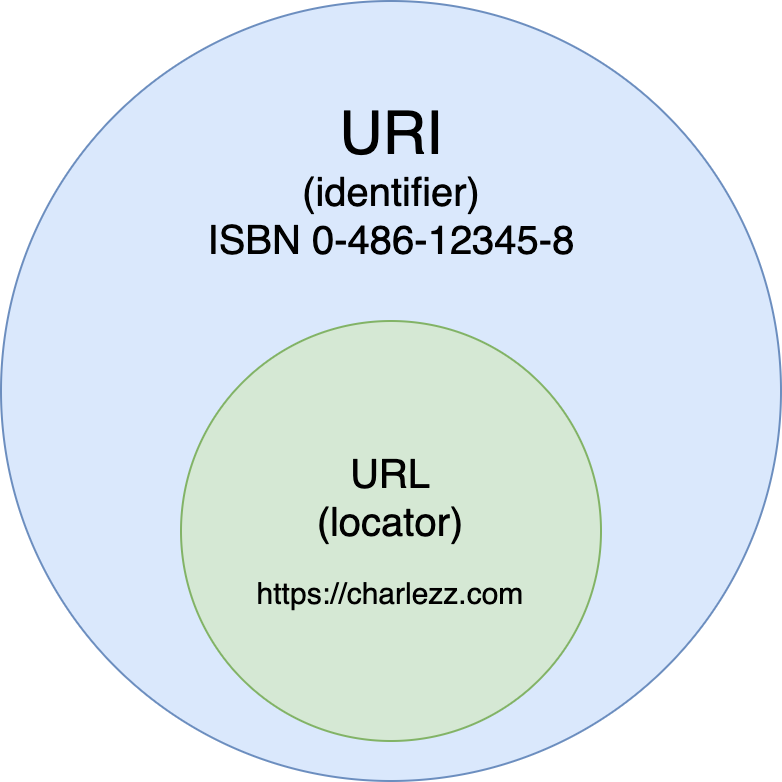

### ***난위도 : ★★★🧨✨🎉***

**빽단에서 서버로 보낼때 RestAPI 규칙을 참고해서 보내야되고**

**URI도 형식에 맞춰야된다.**

**(급박하게 쓴 글이라서 나중에 수정할 생각~!)**

### ***🎈# CRUD는 뭐임???? 꼭알아야됨~!!! 🎃🧧🎑***

**\*같이 알면 좋은것 : <https://zibu-story.tistory.com/127>**

**대부분의 컴퓨터 소프트웨어가 가지는 기본적인 데이터 처리 기능인 Create(생성), Read(읽기), Update(갱신), Delete(삭제)를 묶어서 일컫는 말이다. 사용자 인터페이스가 갖추어야 할 기능(정보의 참조/검색/갱신)을 가리키는 용어로서도 사용**

|  |  |  |
| --- | --- | --- |
| 이름 | 조작 | SQL |
| Create | 생성 | INSERT |
| Read | 읽기(또는 인출) | SELECT |
| Update | 갱신 | UPDATE |
| Delete | 삭제(또는 파괴) | DELETE |

### ***🎈# HTTP 메소드 종류 뭐가있음???🧶🧵🎨***

**\* Rest Pull 에서 Get, Post, Put, Path, Delete에 따라서 표기하는 방법이 다르다**

|  |  |
| --- | --- |
| HTTP 메소드 종류 | 뭥미??? |
| Get (조회) | - body를 쓰지 않는 대신 Query String Parameters로 url창 뒤에  값을 넣어 보내준다 - 서버에게 resource를 보내달라고 요청합니다.  - 서버(혹은 DB)의 resource는 클라이언트로 전달만 될 뿐 변경되지 않습니다. - 웹브라우저 주소창에 주소를 입력하면 이 신호는 항상 get으로 요청 |
| Post (추가) | - 서버에게 resource를 보내면서 생성해 달라고 요청합니다.  - 회원가입을 하면 DB에 새로운 회원정보가 등록되고, 사진을 업로드 하면 그 사진이 웹사이트에 등록됩니다. - fetch의 두번째 파라미터로 JSON 객체를 body, method는 post를 적어서 보내야됨 - url에 고유 id값을 주고 두번째 파라미터로 JSON 객체를 body, method는 post를 적어서 보내야됨 |
| Put (전체수정) | - 서버에게 resource의 업데이트 하거나 resource가 없다면 새로운 resource를 생성해 달라고 요청합니다.  - 회원정보 수정 등에 사용됩니다. - Put인지 Path인지 헷깔릴때는 Put을 쓰면 된다. |
| Path (부분수정) | - 서버에게resource의 업데이트를 요청합니다.  - 회원정보 수정 |
| Delete (삭제) | - delete는 body가 필요없음 서버에게 resource의 삭제를 요청합니다. |

```bash
//get방식
fetch('https://learn.codeit.kr/api/members/3')//Id값이 3인 정보만 출력
    .then((response) => response.text())
    .then((result) => {console.log(result);});

//post방식
let newMember = {//새로운 객체
    name : 'Jery',
    email : 'jery@naver.com',
    departmemt : 'engineering'
};
fetch('https://learn.codeit.kr/api/members', {//옵션객체 안쓰면 get방식
    method : 'POST',//형식
    body : JSON.stringify(newMember) //자바스크립트 객체 -> JSON객체
})
    .then((response) => response.text())
    .then((result) => {console.log(result);});

//put방식
let memberA = {//새로운 객체
    name : 'Alice',
    email : 'alice@codeitmall.kr',
    departmemt : 'marketing'
};
fetch('https://learn.codeit.kr/api/members/2', {//id값이 2번인 곳에 접근 수정
    method : 'PUT',//형식
    body : JSON.stringify(memberA) //자바스크립트 객체 -> JSON객체
})
    .then((response) => response.text())
    .then((result) => {console.log(result);});

//delete방식
fetch('https://learn.codeit.kr/api/members/2', {//id값이 2번인 곳에 접근 수정
    method : 'DELETE',//delete와 get같은경우 body가 필요없음
})
    .then((response) => response.text())
    .then((result) => {console.log(result);});
```

### ***🎈# RestAPI란 뭐임????😋🙂***

- REST란 REpresentational State Trasfer의 약어로 웹을 이용할 때 제약 조건들을 정의하는 소프트웨어 아키텍처 스타일입니다.
- HTTP URL을 통해 자원(Resource)을 명시하고 HTTP Method(GET, POST, PUT, DELETE)를 통해서 해당 자원(URL)에 대한 CRUD(Create, Read, Update, Delete)를 적용하는 것을 의미합니다.
- 한마디로 HTTP의 장점을 살리고자 하는 통신 규약이라 할 수 있습니다.
- 로이 필딩(Roy Fielding)의 2000년 박사학위 논문에서 소개되었으며 RESTful API는 이러한 규약을 바탕으로 리소스 중심으로 설계하고 기능에 맞게 HTTP Method 사용하여 설계된 API입니다.

### 🎈***# REST 특징 6가지~! 나도 처음 들어봄 그냥 흙깃~!😋***

- **인터페이스 일관성** : 일관적인 인터페이스로 분리되어야 합니다.
- **무상태** : 각 요청 간 클라이언트의 context, 세션과 같은 상태 정보를 서버에 저장하지 않습니다.
- **캐시 처리 가능** : 클라이언트는 응답을 캐싱할 수 있어야 합니다. 캐시를 통해 대량의 요청을 효율적으로 처리할 수 있습니다.
- **계층화** : 클라이언트는 대상 서버에 직접 연결되어있는지, Proxy를 통해서 연결되었는지 알 수 없습니다.
- **Code on demand** : 자바 애플릿이나 자바스크립트의 제공을 통해 서버가 클라이언트를 실행시킬 수 있는 로직을 전송하여 기능을 확장시킬 수 있습니다.
- **클라이언트/서버 구조** : 아키텍처를 단순화시키고 작은 단위로 분리함으로써 클라이언트-서버의 각 파트가 독립적으로 구분하고 서로 간의 의존성을 줄입니다.

### ***🎈# REST API 설계 Rulse 및 예시🎠🧶***

- **소문자를 사용한다.**

  ```shell
  //X
  http://cocoon1787.tistory.com/users/Post-Comments
  //0
   http://cocoon1787.tistory.com/users/post-comments
  ```
- **언더바( \_ ) 대신 하이픈( - )을 사용한다.**

  ```shell
  //X
  http://cocoon1787.tistory.com/users/post_comments
  //O
  http://cocoon1787.tistory.com/users/post-comments
  ```
- **마지막에 슬래시를 포함하지 않는다.**

  ```shell
  //X
  http://cocoon1787.tistory.com/users/
  //O
  http://cocoon1787.tistory.com/users
  ```
- **행위를 포함하지 않는다.**

  ```shell
  //X
  http://cocoon1787.tistory.com/users/post/1
  //O
   http://cocoon1787.tistory.com/users/1
  ```
- **파일 확장자는 URL에 포함시키지 않는다.**

  ```shell
  //X
   http://cocoon1787.tistory.com/users/photo.jpg
   //O
   http://cocoon1787.tistory.com/users/photo
  ```

### ***🎈# URL과 URI의 명확한 차이점!! (맨토님 꼭 알아야된다고 얘기함)🙄😏***

**URI** :  특정 리소스를 식별하는 **통합 자원 식별자(Uniform Resource Identifier)**를 의미한다. 웹 기술에서 사용하는 논리적 또는 물리적 리소스를 식별하는 고유한 문자열 시퀀스다.

**URL** :  흔히 웹 **주소**라고도 하며, 컴퓨터 네트워크 상에서 리소스가 **어디 있는지 알려주기** 위한 규약이다. URI의 서브셋이다.



### ***🎈#pathParmeter QeryParameter의 차이점🎃🎊***

**딱 정리! :  resource를 식별**하고 싶으면 **Path Variable**을 사용하고,  
**정렬이나 필터링**을 한다면 **Query Parameter**를 사용하는 것

```shell
/products?id=13  # 페이지는 고정되있고 그상태로 id가 13인 상품만 조회한다
/products/13  # 페이지는 상세페이지로 이동후 id가 13인 상품을 조회한다
```

### ***🎈# 참고한 URL~!!!🧵🎟***

**1. URL , URI 의 차이점**

<https://www.charlezz.com/?p=44767>

**2. pathParmeter QeryParameter의 차이점**

<https://ryan-han.com/post/translated/pathvariable_queryparam/>


