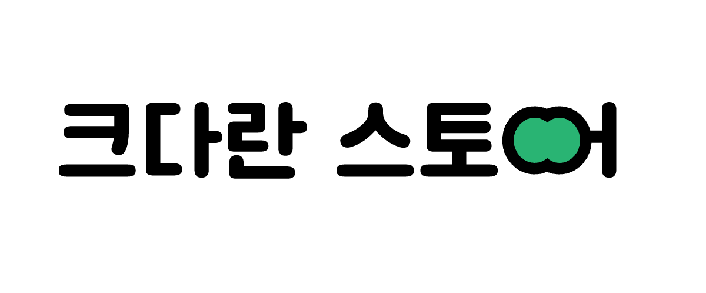

### ***난위도 : 최최상상상***

**프로젝트 마무리하면서 최종 정리 및 회고록 작성하는데**

**놀라운게 어떻게 내가 이런 많은 기능을 짧은 기간내에 완성시킬수 있느냐**

**하는것이다.**

**그 방법은 벼랑끝에 몰리면 되는것이고 이러한 부분을 wecode에서 잘 만든것같다**

**(결국 죽어라 안하면 안된다는거)**

**\* 회고록이 처음이고 스토리 텔링처럼 줄줄이 써내려가려고 했는데**

**wecode 부트캠프 1차 프로젝트를 궁금해 하는 사람이 본다는 가정하에 글을 쓴점 양해 바란다.**

**클론한 사이트 ( aws로 배포 )**

**<http://52.79.242.181/>**



*1차 프로젝트 로고*


*1차 프로젝트 케릭터*

### ***✔️ 2주동안  내가  구현한  API  및  맡은 구역 (프론트 엔드 + 빽엔드)***

**\* Util 은 중복되는 부분있어서 모듈로 빼다보니 구현하게 됬음, 회원탈퇴도 예정에는 없었음**

**1. 프론트** : 제품 상세페이지

- 상품 ID에 따른 동적 라우팅 구현
- 상품 상세 API와 연계하여, 상품 정보 동적 구현
- 옵션 클릭 시, 상품 수량 및 가격 변동 기능 구현
- 좋아요 기능 구현
- 사용 후기 구현 (별점)
- 호버, 버튼 클릭, Set time out시 썸네일 이미지 변경 기능 구현
- Ref를 사용하여 클릭시 해당위치 스크롤 이동

**2. 빽엔드** : 회원가입 API

- 회원가입 API
  - 전달받은 값 유효성 체크 유틸 구현 및 사용
  - 회원가입시 토큰발행하여 자동 로그인 구현
- 아이디 중복 검사 및 체크 API
- 회원탈퇴 API
  - 비밀번호 복호화 및 일치여부 체크 후 Hard Delete 데이터 삭제
- Util(Error Generator, Format Checker)
  - 비동기 오류처리를 위한 wrapper함수 유틸화
  - Error throw 및 에러메시지 부여하는 함수 유틸화
  - user input 데이터 정규표현식으로 체크하는 메서드 유틸화

### ***✔️  프로젝트 진행상황 및 스케쥴 공유~!!***

**\* 팩트 체크**

**1. 프로젝트 기간에는 최대한 많이 모이는게 좋다(한 90% 는 모인것같음)**

**2. 월요일날 프로젝트 시작이라고 표기되있지만 실질적인 시작은 금요일이다.**

**3. 실질적으로 코딩을 하는 기간은 프론트엔드 3일 빽엔드 2일이다**

**4. 팀원들과 소통을 안하면 merge의 지옥에 빠질것이다**

|  |  |  |  |
| --- | --- | --- | --- |
| **Frontend** | | **Backend** | |
| **기간** | **내용** | **기간** | **내용** |
| **10/01** **(금요일) at. 종로** | - 초기세팅 및 프로젝트 자세한 맨토 설명 - 세팅 완료한거 깃헙 레파지토리에 push하기 - 역활분담하고 맨토 코맨 | **10/09~10/10** **(토요일,일요일)** | - 최최종 추가 merge까지 병합 - 빽엔드 API 재분배 - schema.prisma 코드 작성하기 - list랑 detail에서 쓸 무료 jpg 파일 링크로 찾기 |
| **10/02~10/03** **(토요일,일요일) at. 홍대** | - 데이터 ORM 짜기  - 초기세팅한거 전부 pull 받기 | **10/11~ 10/12** **(월요일,화요일) at. 서울 스퀘어** | - 빽엔트 API 이슈에 맞게 기능 구현하기 - 맨토 코드리뷰 - Wrapper+Util 에 들어갈 모듈 구성하기 - Refactoring 하기 |
| **10/04~10/06** **(월요일,화요일,수요일) at. ??** | - 프론트엔드 HTML SCSS세팅 - 컴포넌트 나누기 - 이슈별로 브랜치 생성 및 기능 구현 | **10/13** **(수요일) at. 홍대** | - 빽엔드 기능 구현한것부터 merge 시키기 - 무료이미지 파일 다시 찾기 |
| **10/07** **(목요일)  at. ??** | - 프론트 엔드 마무리 - 맨토 코드 리뷰 - Refactoring - push 올린거 최종 merge 시키기 | **10/14** **(목요일) at. 을지로** | - 프론트엔드+빽엔드 병합시키기 - insert 문으로 데이터 테이블에 전부 넣기 - 프론트엔드 fetch로 데이터 요청하기 구현 - 오류나는 부분 없게 싹다 마무리 짓기 - 최종 마무리 |
| **10/08** **(금요일) at. 종로** | - 프론트엔드 최종 마무리 (merge 않된것 시키기) - 맨토 Q&A 시간 - 최종 팀원들과 진행상황 공유하기 | **10/15** **(금요일) at. 종로** | - 오후 3시까지 ppt 작성 및 발표 하는거 맨트 짜기 - 모든 준비 마무리 짓기 |

### ***✔️  프로젝트 하면서 사용한 기술 스텍 총 정리~!!***

**\* 개선해야될 기술 스텍**

**- RestfulAPI**

**- Express**

**- Bcrypt**

**- Cookies**

|  |  |
| --- | --- |
| **분야** | **기술 스택** |
| **Frontend** | - JavaScript  - Scss - React - React Router - HTML |
| **Backend** | - Node.js  - Express - Prisma - Nodemon - Mysql - Bcrypt - Json Web Token  - Cookies - Layered Pattern - Restful-API |
| **Common** | - Git - GitHub - Prettier - Eslint - Postman |
| **Comunication** | - Slack - Zoom - Notion |

### ***✔️ 프로젝트하면서 못한것들 , 그리고 알게된것들~!!***

**\* 이렇게 많은 기능을 구현하지 못한채 1차 프로젝트는 끝났지만 한편으로는 하고 싶은 부분은 확실하게**

**마스터 한것같아 다행이다 그중에 가장 인상깊고 진짜 잘 알게 된 부분은 바로 Ref 이다.**

**진짜 진짜 1주일동안 관\*님(맨토)한테 계속 물어봤고 신경도 많이 써주셔서 머리속에 못처럼 꽉 박혀서 기분이 좋다.**

**(깨닭았을때는 유레카를 외치고 싶을정도로... ㅋㅋㅋㅋ)**

1. **부족한 부분, 하고 싶었는데 하지못한 기능**

- **쿠키랑 토큰의 활용** : 사용방법은 이해했고 직접 써보기도 했지만 로그아웃때나 인증 인가 하는 부분에대해  
  어떻게 처리해야될지 생각해봐야 될것같다.
- **회원 삭제 수정** : 회원 삭제시 Soft Delete, Hard Delete 가 있고 Soft Delete는 회원 테이블에 칼럼을 isDelete로 두고 삭제시  
  true 로 값을 변경하도록 구현해야되는데 아직 실현시키지는 못했다.
- **외부 API 활용하기**: 원래 상세페이지상에 카카오 공유하기 버튼을 구현하려고 했었고 이부분은 2차때 마저 구현하려고 한다
- 장바구니 기능 구현 : 데이터 ORM 부터 어떻게 해야되는지 구성해봐야 될것같다
- 리스트 좋아요랑 디테일 좋아요 연동시키기 :이거는 state 값을 저장? 해야될것같다.
- **구매하기 기능**(이거는 외부 API의 한부분임, 네이버 페이 등등)

2. **깨닭은것중 중요한거(알게된것**

- **Ref  사용 하는 방법:** ref를 component에 선언하여 사용하는 방법, 부모 컨포넌트에서 자식 컨포넌트로 ref 전달 방법, 다수의 ref를 객체로 관리하는 방법( refs라는 이름으로 사용하면 않됨, 이름 주의), scrollIntoView를 사용하여 코드를 줄이는 방법, observer랑 차이점
- **mouse 호버 이벤트 종류** (네이버 검색하면 다나옴)
- **정규화로 사용자 예외처리 wrapper 만드는 법** (위에 참고 코드 확인할것!)
- 장바구니의 상품 갯수같은경우 따로 자식 컨포넌트에서 state를 관리해줘야 되며 갯수 증가 감소 할때마다 fetch로 계속 백엔드에 데이터 요청을해서 update 해줘야된다

### ***✔️ 1차 프로젝트 한후 느낀점 후기***

드디어 1차 프로젝트가 끝났다 느낀점도 많고 처음 생각했던것보다 깨닭은게 많아서 약간 회고록 식으로 이야기를 풀어나가려고 한다. 우선 프로젝트 시작하기 전 주에는 가장 걱정됬던 부분은 이제까지 혼자 레파지토리를 쓰고 코딩을 했는데 협업? 개념으로 깃헙도 같이 쓰고 코드도 공유해야된다는게 살짝 실감이 않났다. 즉 소통을 계속 해야된다는 부분이고 일방적인 부분으로 코드를 써내려 갈수 없다는 것이다. 팀원들이 이해하도록 설명해야되고 코드도 모두가 이해할수 있게 코드를 짜야된다.

나는 이부분이 가장 어렵고 지금도  반성하고 싶은 부분중 하나이다. 스타트업때는 나의 주장을 얘기하고 추진해나갔는데 지금은 팀원들이랑 조율해야되고 한편으로는 숙일땐 숙여야된다. 그리고 리팩토링할때 변수 이름 짓는 부분인데 코드는 남들이 이해할수 있게 짜지만 이름 때문에 간혹 어떤 기능인지 헷깔릴때도 있는것같다. (장현님한테 대부분 코맨 받는것이 변수명이다... ㅠ)

2차때는 이 두 부분 소통 , 남들이 이해할 수 있는 코드 짜기 좀 더 개선해보려고 한다.

그리고 처음에 오히려 나의 할당량을 알고 그부분을 최대한 끝내는게 중요했는데 어찌됬든 내가 시간적 여유가 있어야지 팀원들을 도와줄수 있기 때문에 초반에 최대한 빨리 마무리 짓는게 좋은것같다.(이건 진자 꿀팁!)

사장의 마인드로 바라보는 관점은 지금 생각해도 아주아주 중요한것같다. 단**순히 이 프로젝트에서 view나 데이터가 잘나오게 코드짜면되지 라고 생각하면 오산이다. 사용자 관점에서 어떻게 컨포넌트를 짜고 데이터를 효율적으로 줘야지 이득인가를 생각해보면 다양한 관점에서 여러가지 문제점들이 보이게된다** 한다  그리고 실제 이 웹사이트를 시중에 런칭 한다면 어떠한 부분을 수정하고 구현해야되는지 더 직관적으로 눈에 들어오고 팀원들이랑 회의하기 집중하기 더 수월해 질것이다.

마지막으로 오늘 타다라는 다큐멘터리를 봤는데 보면서 2가지를 가장 많이 생각했다. 첫번째는 **폐업 까지 한 회사에 남는 직원들의 믿음을 어떻게 준거지? 그에 대한 대답은 대표의 자질**에 있을것이다. 하나의 프로젝트 더라도 나를 신뢰하고 안하고는 큰 차이가 있고 이렇게 만드는것은 나의 행동 하나하나에서 나올것이다. 회사에 취업하더라도 나에대해 믿음을 어떻게 갖게 하는지 생각해봐야될것같다. 그리고 두번째는 소비자에게 어떻게 기업의 이미지를 각인시켰는지에 대한 부분이다. 이부분은 **차별화된 플렛폼이 UI나 개발적인 측면에서 정확히 알고 성공할꺼라는 확신때문에 이미지가 각인**된것같다. 예를들어 타다에는 매칭되기전 목적지를 알려주는 카카오택시와 다르게 매칭된후 목적지를 알려주는 API 기능이 있다. 이렇게 소비자와 여러측면으로 프로젝트에 임해야되고

이부분을 다른 개발자들에게도 알려주고 싶은 마음이다.

**세상에 개발을 잘하는 사람을 많다. 그중에 깊게 생각하는 자질이 있는 사람은 별로 없는것같다. 그부분이 기업이 원하는 실력있는 개발자 인것같다.**

### ***✔️ Self 질의 응답~! ( 개인적으로 프로젝트 보고 궁금할것 같은것들 정리함 )***

1. **질문** : 버튼 클릭시 스크롤 이동에서(changePositionScroll 함수)왜 이동하는 위치를 상수로 처리했나요?  
   **Re** : Ref로 사용하여 수정할수 있으며 여러 위치를 배열로 state에 담아 사용하려고했는데 오류가 떠서 차후에 맨토님이랑 조율후 수정할 예정입니다
2. **질문** : userRouter.js 에서 아이디 중복, 회원삭제 부분은 왜 post로 하셨나요?  
   **Re**: 아이디 중복에는 회원 id, 회원삭제에는 회원 id pw 를 프론트 에서 빽으로 전달해주는데 중요한 정보이기에 때문에 body에 담아 post 메소드로 처리했습니다.
3. **질문** : 공유하기 버튼 햄버거 버튼에서 마우스 호버 했다가 나올때 택스트가 안없어지는데 구현한 목적은 무엇인가요?  
   **Re**: 햄버거 버튼을 나와 텍스트로 이동하려면 호버가 풀려서 해당 텍스트가 없어집니다. 이부분을 해결하기 위해 햄버거에서 나올때는 텍스트가 유지되고 햄버거에서 텍스트로 바로가서 나올때는 텍스트가 없어지도록 구현했습니다  
   ( 사용한 이벤트 : onMouseEnter, onMouseLeave)

### ***✔️  이거는 무조건 공유 각! 셀프 칭찬과 함께 잘했다고 생각한 코드***

**\* 공유하고 싶은것중 10 : 1 의 경쟁률을 뚫고 추첨된것들~!**

**1. ref의 사용 방법(상위 부모에 component에 객체생성, 자식컨포넌트로 전달, 스크롤 이동하는 함수)**

```javascript
ProductDetail.js

...
this.multiRefs = {
      topRef: React.createRef(),
      infoRef: React.createRef(),
      reviewRef: React.createRef(),
    };
...

//수정전
  changePositionScroll = whereMovePosition => {
    const movePosition = this.multiRefs[whereMovePosition]?.current
      ? this.multiRefs[whereMovePosition].current.offsetTop
      : 0;
    const moveSroll = movePosition => {
      const position = { top: movePosition, left: 0, behavior: 'smooth' };
      window.scrollTo(position);
    };
    if (whereMovePosition === 'infoRef') moveSroll(movePosition);
    else if (whereMovePosition === 'reviewRef') moveSroll(movePosition);
    else moveSroll(movePosition);
  };

//수정후
changePositionScroll = whereMovePosition => {
    this.multiRefs[whereMovePosition]?.current.scrollIntoView({
      behavior: 'smooth',
    });
    this.setState({
      isInfoColor: whereMovePosition === 'infoRef',
      isReviewColor: whereMovePosition === 'reviewRef',
    });
  };

  ...

  ProductInfo.js
  ...
  <h1 className="reviewTitle" ref={this.props.forwardRef.reviewRef}>
          REVIEW
        </h1>
  ...
  export default React.forwardRef((props, ref) => {
  return <ProductInfo {...props} forwardRef={ref} />;
});
...
```

**2. 선택한 상품 옵션 정보나 리뷰, 장바구니등 배열구현, 그 배열안에 있는 한 요소의 프로퍼티의 값이 바뀔때**

**(관\*님이 직접 코맨 해주심)**

```javascript
ProductDetail.js

...
choiceOptionChange = e => {
    const { choiceOptionArray, productData } = this.state;
    const resultOption = productData.productOption.find(option => {
      return option.id === Number(e.target.value);
    });
    const { id, name, quantity } = resultOption;
    const isExist = choiceOptionArray.some(option => option.id === id);
    if (isExist) return;
    this.setState({
      choiceOptionArray: [
        ...choiceOptionArray,
        {
          id,
          name,
          quantity,
          choiceCount: 0,
        },
      ],
    });
  };
  ...

  //수정전
   increaseCounter = id => {
    this.setState({
      choiceOptionArray: this.state.choiceOptionArray.map(option => {
        if (option.id === id) {
          if (option.choiceCount >= option.quantity) {
            alert('재고량을 다시 확인하세요');
            return option;
          }
          return { ...option, choiceCount: option.choiceCount + 1 };
        } else {
          return option;
        }
      }),
    });
  };

  //수정후
  increaseCounter = id => {
    const { choiceOptionArray } = this.state;
    const selectedIndex = choiceOptionArray.findIndex(
      option => option.id === id
    );
    const newOptions = [...choiceOptionArray];
    const selectedOption = newOptions[selectedIndex];
    if (selectedOption.choiceCount >= selectedOption.quantity) {
      alert('재고량을 다시 확인하세요');
      return;
    }
    newOptions[selectedIndex] = {
      ...selectedOption,
      choiceCount: selectedOption.choiceCount + 1,
    };
    this.setState({
      choiceOptionArray: newOptions,
    });
  };
...
```

**3. state에 boolean으로 관리되는 부분 role 이라는 인자를 받는 함수로 구현**

```javascript
ProductDetail.js
changeStateEventShow 는 role 이라는 인자를 받아 해당 역활(좋아요, 메뉴 위치, 공유하기버튼) 등
boolean으로 처리되는부분 함수화해서 관리

//수정전
changeStateEventShow = role => {
    const { isLikedProduct, isMovePositionMenu, isSharedLinkMenu } = this.state;
    if (role === 'like') {
      this.setState({
        isLikedProduct: !isLikedProduct,
      });
    } else if (role === 'move') {
      this.setState({
        isMovePositionMenu: !isMovePositionMenu,
      });
    } else {
      this.setState({
        isSharedLinkMenu: !isSharedLinkMenu,
      });
    }

//수정후
changeStateEventShow = role => {
    const { isLikedProduct, isMovePositionMenu, isSharedLinkMenu } = this.state;
    this.setState({
      isLikedProduct: role === 'like' && !isLikedProduct,
      isMovePositionMenu: role === 'move' && !isMovePositionMenu,
      isSharedLinkMenu: role === 'share' && !isSharedLinkMenu,
    });
  };
```

**4. 프론트에서 회원가입 버튼 클릭시 boby에 담은 데이터 빽엔드에서 회원가입 정보 예외처리**

```javascript
formatCheckUser.js
정규화로 띄어쓰기, 한글, 특수문자등 검사하는 객체로 만들고 
밑에는 그외 글자 길이 포함여부 등 예외 처리를 할 수 있다

const checkColumnPattern = str => {
  return {
    space: str.search(/\s/) != -1,
    special: /[~!@#$%'"`^&*()_,.\-=[+|<>?:{}]/.test(str),
    korea: /[ㄱ-ㅎ|ㅏ-ㅣ|가-힣]/.test(str),
    number: /[0-9]/.test(str),
    english: /[a-zA-Z]/.test(str),
  };
};

const CheckFormatColumn = (value, key) => {
  const checkPattern = checkColumnPattern(value);
  const isPatternColumn = {
    username:
      value.length < 5 ||
      checkPattern.space ||
      checkPattern.special ||
      checkPattern.korea,
    email:
      value.substring(value.length - 4, value.length) !== '.com' ||
      !value.includes('@') ||
      checkPattern.space ||
      checkPattern.korea,
    phoneNumber:
      value.substring(0, 3) !== '010' ||
      value.length !== 11 ||
      checkPattern.space ||
      checkPattern.special ||
      checkPattern.korea ||
      checkPattern.english,
    password:
      value.length < 8 ||
      checkPattern.space ||
      !checkPattern.special ||
      checkPattern.korea ||
      !checkPattern.english,
    realName:
      value.length > 4 ||
      checkPattern.space ||
      checkPattern.special ||
      checkPattern.number ||
      checkPattern.english,
  };
  return !isPatternColumn[key];
};
```

**5. 에러 statusCode에 따른 message 처리 Wrapper**

```javascript
errorGenerator.js
에러 state를 인자로 받아 해당 메세지를 반환하는 객체를 만든다

const DEFAULT_HTTP_STATUS_MESSAGES = {
  400: 'Bad Requests',
  401: 'Unauthorized',
  403: 'Forbidden',
  404: 'Not Found',
  409: 'Duplicate',
  500: 'Internal Server Error',
  503: 'Temporary Unavailable',
};

//수정전
const errorGenerator = (statusCode = 500, message) => {
  const err = new Error(message || DEFAULT_HTTP_STATUS_MESSAGES[statusCode]);
  err.statusCode = statusCode;
  throw err;
};

//수정후
const errorGenerator = (statusCode = 500, message) => {
  console.log(`statusCode : ${statusCode} ${typeof statusCode}`);
  if (typeof statusCode !== 'number') {
    DEFAULT_HTTP_STATUS_MESSAGES[statusCode] =
      '스테이터스 코드 타입이 잘못되었습니다';
  }
  if (!DEFAULT_HTTP_STATUS_MESSAGES[statusCode]) {
    DEFAULT_HTTP_STATUS_MESSAGES[statusCode] = '정의되지 않은 상태번호입니다';
  }
  const err = new Error(message || DEFAULT_HTTP_STATUS_MESSAGES[statusCode]);
  err.statusCode = statusCode;
  throw err;
};
```

**6.  프론트가 빽에게 데이터 요청할때 올바른 명세서**

```shell
{

    "message": "CREATED",
    "data":
        {
            "id": 11,
            "name": "짱짱맨볼팬",
            "price": "100000",
            "point": "0.2",
            "quantity": "20",
            "imageUrl": "이미지",
            "descriptionImageUrl": "이미지",
            "origin":"위코드",
            "manufacturer": "우창님",
            "brand": "크다란",
            "shippingFee": "3000",
            "productOption": [
              {
                "id": 1,
                "name": "빨강",
                "quantity": 10
              },{
                "id": 2,
                "name": "노랑",
                "quantity": 10
              },{
                "id": 3,
                "name": "파랑",
                "quantity": 10
              },{
                "id": 4,
                "name": "초록",
                "quantity": 10
            }],
            "productImage": [
              {
                "id": 1,
                "imageUrl":"이미지"
              },{
                "id": 2,
                "imageUrl":"이미지"
              },{
                "id": 3,
                "imageUrl":"이미지"
              },{
                "id": 4,
                "imageUrl":"이미지"
            }]
        }

}
```

**7. 빽이 프론트에게 statusCode massage 주는 형식 예시**

```shell
1. 아이디 중복체크
Router : user/signup/username
method : post
body : username
return : username
- 회원가입 유저가 한명도 없을때
message : USERNAME_DOSES_NOT_EXIST
statusCode : 400
- 아이디 중복체크 성공
message : AVAILABLE_ID
statusCode : 201

2. 회원가입 버튼 클릭시
Router : user/signup
method : post
body : realName username password email phoneNumber isAgreedServicePolicy isAgreedCollectPrivate isAgreedPhoneMarketing isAgreedEmailMarketing
return : id realName username
- 회원가입 성공
message : SIGN_UP_SUCCESS
statusCode : 201
쿠키 : 토큰 발행정보
- 회원가입 유저가 한명도 없을때
message : ${칼럼}_DOSES_NOT_EXIST
statusCode : 409

3. 회원 삭제시
Router : user/signip/delete
method : post
body : username password
return : message
- 회원 이 없을 경우
message : USER_IS_NOT_EXIST
statusCode : 401
- 회원 삭제 성공시
message : SUCCESS_DELETE_USER
statusCode : 201
- 비밀번호 compare 실패시
message : PASSWORD_IS_NOT_SAME
statusCode : 401

3. 초기 예외처리
- req.body 에 값이 없을때 
message : 칼럼이름+_DOSES_NOT_EXIST
statusCode : 400
- req.body 가 주어진 형식에 맞지 않을때
message : IS_NOT_칼럼이름_FORMAT
statusCode : 400
* 체크형식
- realName 체크 형식 : 공백x , 특수문자x, 숫자x, 영어x, 4글자 이하
- username 체크 형식 : 공백x , 특수문자x, 한글x, 5글자 이상
- email 체크 형식 : 공백x , 한글x,  마지막에 .com 포함해야됨, @ 포함해야됨
- phoneNumber 체크 형식 : 공백x , 특수문자x, 한글x, 영어x, 010 맨 앞에 포함, 11글자만
- password 체크 형식 : 공백x , 특수문자o(1개이상), 숫자x, 영어o(1개이상), 8글자 이상
```

### ***✔️  프로젝트 참고 링크~!!***

**1. 프론트 엔드 깃험 레파지토리**

<https://github.com/wecode-bootcamp-korea/fullstack2-1st-keudaran-studio-frontend>

[🔗 GitHub - wecode-bootcamp-korea/fullstack2-1st-keudaran-studio-frontend](https://github.com/wecode-bootcamp-korea/fullstack2-1st-keudaran-studio-frontend) — Contribute to wecode-bootcamp-korea/fullstack2-1st-keudaran-studio-frontend development by creating an account on GitHub.

**2. 빽엔드 깃헙 레파지토리**

<https://github.com/wecode-bootcamp-korea/fullstack2-1st-keudaran-studio-backend>

[🔗 GitHub - wecode-bootcamp-korea/fullstack2-1st-keudaran-studio-backend](https://github.com/wecode-bootcamp-korea/fullstack2-1st-keudaran-studio-backend) — Contribute to wecode-bootcamp-korea/fullstack2-1st-keudaran-studio-backend development by creating an account on GitHub.

**3. 클론 한 사이트**

<http://www.jogumanstore.com/>

[🔗 조구만 스토어](http://www.jogumanstore.com/) — 당신의 일상에 은근히 침투해 조구만 행복을 드리는 조구만 스토어입니다.


