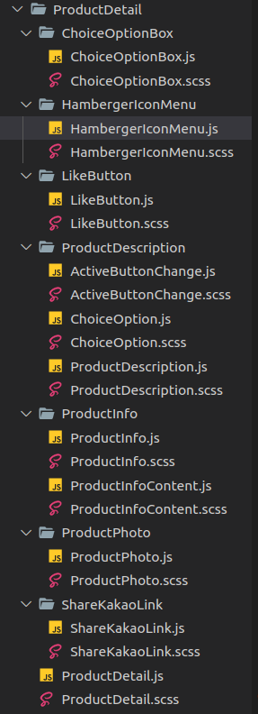

## ***난위도 : 최상.....ㅠㅠ***

**CSS....HTML..... 코드량 .... 폭발.... ㄷㄷ**

**생각을 많이 할꺼냐 코드를 많이 쳐볼꺼냐 에 따라 역활을 결정하는게 좋다고 생각하고**

**코드를 많이치면 오히려 다른 외부 API나 구현할수 있는 기능이 줄어든것**

**같다. 이부분 참고해서 선택하면 좋을듯.**

**프로젝트 후기는 따로 정리해서 게시글 올리겠음**



*프론트 컨포넌트 나눈것*

### ***✔️프젝 시작  HTML CSS 죽어라 쓰는날 (코드량......ㅠㅠ)***

**\* 일정** : 프로젝트 주가 들어가기전 토요일, 일요일은 빽엔드 데이터 모델링을 짠다

그리고 월요일에는 맨토의 모델링 리뷰가 있고 화요일에 HTML SCSS 코드를 다 작성했고

수요일 에는 컴포넌트 분리 및 기본 기능 구성 , 목요일에는 심화기능 구성을 한것같다.

되도록이면 목요일까지 끝내는게 좋다 왜냐하면 금요일은 맨토 코드리뷰가 있고

주말에는 빽엔드를 시작해야되기 때문이다.

- **평일**
  - [x] 학점은행제 어디까지 했는지 확인하기
  - [x] 취업지원제도 4회차꺼 수당 받았는지 전화해서 체크하기
  - [x] pr 올린거 맨토님 리뷰 받고 수정하기
  - [x] msi 컴퓨터에 왜 학점은행 강의를 못듣는지 전화해서 물어보기
  - [ ] 다른 사람들꺼 회고록 보면서 작성하기
  - [x] description 부분 구현하기
  - [ ] 학점은행 5회차 강의 다 듣기
  - [ ] 학점은행 중간고사 시험 테스트 하기
  - [x] 취업지원제도 지원 2회 하기
  - [x] 예\*님꺼 피어리뷰하기
  - [x] 좋아요 색깔 구현하고 merge 하기
  - [ ] 밑에 메뉴 클릭시 해당 메뉴로 스크롤 이동
  - [x] 밑에 내용부분 네이버 디자인 구현하기
  - [x] 다 끝나면 옵션 추가하는 부분 구현하기
  - [ ] 장바구니 구매하기 누르면 정보 취합해서 백엔드로 보내주기
- **주말**
  - [x] 노션에 정리한거 TIL 업로드하기
  - [x] forwardRef로 ref를 전달해준다 문법 찾아보기
  - [x] 햄버거바의 하위로 menu를 넣고 fixed와 absolute를 구성한다
  - [x] ref를 component에서 바로 객체로 묶어서 전달해주면 빈배열이나옴 이부분 관\*님이 해결 예시본 준다고함
  - [x] ref 관\*님이 얘기해준거 TIL 작성하기
  - [ ] 우\*님한테 JSON 데이터 구성해서 주기
  - [ ] 백단 한거 pull 받기
  - [ ] 백단 회원가입 질문 커뮤니티에 올리기

### ***✔️🤷‍♂️알게된것들~~ (해답 아래 T스토리 링크 클릭)***

- 프로젝트하기전 백이랑 프론트 초기세팅을 한다
- 초기세팅 후 팀원들과 각자 역활은 분담후 깃헙에 이슈를 생성한다
- 이슈 생성 후 데이터 모델링 먼저 팀원끼리 완료한다
- 이슈는 기능별로 브랜치당 하나로 구현하는게 좋다
- 프론트와 백엔드 깃헙 레파지토리가 각각 다르기때문에 초반에는 깃헙에 pr을 올린다
- 모델링이 끝나면 각각 HTML SCSS 세팅 밑 컴포넌트 분류부터한다
- 주의사항! 모든 얘기는 팀원들끼리 얘기해야되며 공용파일은 되도록이면 팀원 상의후 건든다
- onMouseEnter, onMouseEnter를 이용하면 호버기준으로 이벤트를 다룰수있다
- sticky 를 쓰면 스크롤해도 Nav가 없어지지 않고 상단에 고정 시킬수 있다
- Nav랑 footer 같은 경우는 페이지마다 다 쓰이는게 아니라 경로를 빈배열로 묶는다  

  ```html
   <Switch>
        <Route exact path="/login-wongu" component={loginWongu} />
        <>
          <TopNav />
          <Route exact path="/list-wongu" component={listWongu} />
          <Route exact path="/detail-wongu" component={detailWongu} />
          <Footer />
        </>
        </Switch​
  ```
- ref를 문법을 통해 this.변수명.current 하면 해당 맨 top에서 해당 위치까지의 값을 구할수 있고 이부분은 scroll에 넣으면 바로 됨(단, 위치를 상수로 넣으면 브라우저마다 위치가 다르기때문에 current로 설정해야된다)
- ref를 자식 컴포넌트로 넘겨주기 위해 forwardRef 를 사용해야된다 문법은 공부할것
- 햄버거바를 호버시 밑에 메뉴창이랑 브라우저상 위치에 고정하려면 fixed 쓰고 하위 메뉴바로 absolute를 쓰면 된다
- 이미지는 저작권 때문에 네이버나 구글에 무료 이미지 검색해서 그걸로 써야된다.
- font에 관한 부분이나 fontawesome은 공통 된 부분을 사용하는것이 좋다.
- scss 에서 경로및 클래스명 을 잘 지어야지 나중에 팀원들꺼 mege 할때 충돌이 나지 않는다.

### ***✔️아직 안풀린 궁금한 의문점들~! 누가좀 알려줭~~~!!🤨🤔***

- [ ] detail페이지 같은경우 처음에 한번에 레이아웃을 짜는게 좋을것같아서 코드를 이슈마다 적었는데 괜찮은 방법인지
- [ ] 만약 전에 이슈에서 작업한 내용을 다른이슈에서도 건드는 일이 발생한다면 팀원 모두 코드를 코쳐야되는지
- [ ] 상단 description 부분 구매하기 클릭시 데이터를 서버로 전달하는 방법
- [x] 옵션박스 선택하면 다른 부분도 다 렌더링 되게하기
- [x] 옵션 선택 창에서는 하단에 있는 정보가 안나오게 구현하기
- [ ] 선택한 옵션이 밑에 추가 되겠음 구현하기
- [ ] ...props 로 자식 컴포넌트로 넘길때 속성 값 적는 부분 축약하는것 장현님한테 물어보기

### ***✔️질의 응답~! 개많이 물어봄~!😆😄***

- **질문 (회원가입 API 구성)** : 제가 빽엔드 작업하는 부분이 회원가입인데 API, 이슈, route 를 어떤식으로 구성해야될지 궁금증이 생겨서 질문을 올립니다 (생각한 기능 : 같은 아이디 있는지 체크, 비밀번호+비밀번호 확인 같은지 체크, 이메일에 @ + .com 있는지 체크, 번호에 010 들어가있는지 + 총 11자리 인지 체크, 필수 통의 했는지 체크 등등)  
  **1. 방법** : 아이디 비밀번호 이메일 번호 등 다 적고 회원가입 버튼을 클릭하면 프론트 단에서 fetch로 빽단에 post 요청 (fetch는 단 한번 쓰고 body에 담아있는 데이터로 유효성 검사)   
  **- 장점** : 요청과 응답이 한번씩만 일어나서 좋다   
  **- 단점** : 모든 데이터를 한번에 써야지만 유효성 검사를 빽단에서 할수 있다  
  **2. 방법** : 아이디 쓰고 fetch로 get 요청, 비밀번호+비밀번호 확인 쓰고 fetch로 get 요청 ...... 다 한번씩 fetch 요청후 마지막 회원가입 누르면 post 요청 (아이디에 관한 API 비밀번호에 관한 API 다 따로 있어서 아이디만 써도 유효성 검증이 됨)   
  **- 장점** : 하나씩 빽단에 요청하고 검증하니까 안정성이 좋다?   
  **- 단점** : 여러번 fetch를 써서 자원소모가 크다?
- **질문** : 사진을 5초 시간이 지남에 따라 자동으로 변하게 하고 싶어서 setInterval를 componentDidMount에 넣었는데 render 부분에 console로 보니까 5초마다 모든 부분이 랜더됩니다 혹시 이렇게 componentDidMount에 넣는게 맞나요?   
  **답** : componentDidMount에서 하는게 맞음
- **질문** : 전체 레이아웃 구성후 merge 하면 새로운 브런치를 팠을때 기존에 코드를 수정하게 되서 충돌나는데 올바른 방법있는지 처음에 전체 레이아웃을 구성하는게 맞는건지   
  **답:** merge를 무서워 하지말지

### ***✔️ 역활분담 (팀원끼리 짜는거, 프론트엔드 )***

- 신기\* - [상세] 후기(혹은 문의)
- 이욱\* - [로그인/회원가입] 로그인/회원가입
- 이예\* - [메인] nav, footer
- 이은\* - [메인] 상품 리스트 컴포넌트
- 성지\* - [상세] 제품 상세
- 김시\* - [메인] 이미지 슬라이더 컴포넌트

### ***✔️🎃참고한 링크 목록emf***

**1. 카카오톡 공유하기 기능**  
<https://ellismin.com/2020/09/share-kakao/>

[🔗 [React]: 리액트로 카카오톡 공유 버튼 구현하기](https://ellismin.com/2020/09/share-kakao/) — 1. 어플리케이션 등록하기 아직 어플리케이션이 kakao developers에 등록이 되어있지 않으면 kakao developers 에서 앱을 등록해 줍니다. 2. JavaScript키 리액트로 카카오톡 공유를 구현하기 위해선 JavaScript

**2. 1차 프로젝트 깃헙 레파지토리 프론트**

<https://github.com/wecode-bootcamp-korea/fullstack2-1st-keudaran-studio-frontend>

[🔗 GitHub - wecode-bootcamp-korea/fullstack2-1st-keudaran-studio-frontend](https://github.com/wecode-bootcamp-korea/fullstack2-1st-keudaran-studio-frontend) — Contribute to wecode-bootcamp-korea/fullstack2-1st-keudaran-studio-frontend development by creating an account on GitHub.


