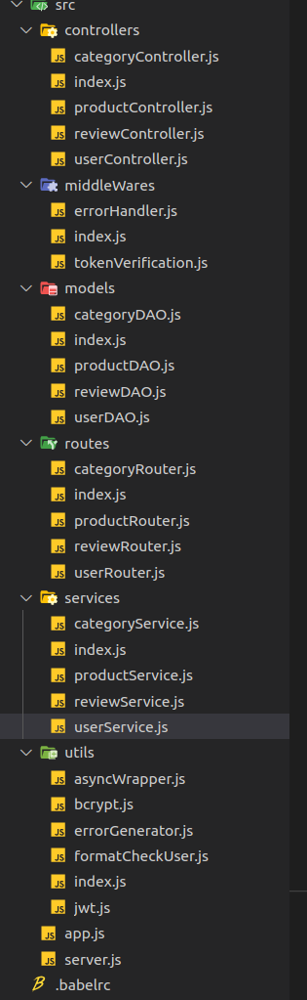

## ***난위도 : 최최상상***

**(언제 끝나....ㅠ)**

**프론트는 코드작성의 반복이라면 빽은 예외처리 한후 또 다른 예외처리....**

**전반적으로 express를 알아야되고 토큰, 암호화 복호화까지 사용하기 때문에**

**모른다면 Foundation 빽엔드를 다시 공부하는게 좋다.**

*전체 폴더 모듈 구조*

### ***✔️프젝 빽엔드 시작... 시간 부족...ㅠㅠ***

**일정 : 1차 프로젝트 빽엔드 주가 시작하기 전 토요일하고 일요일에는**

**프리즈마로 데이터 구현하고 API 분담하는거 다시 맞춰봄**

**그리고 월 화 수 까지 빽엔드 API 기능 구현하고 수요일에 맨토 와 함께 리팩토링**

**목요일날은 팀원들꺼 merge해서 풀빽 맞춰보고 기능 정상 작동하는지 테스트 해봄**

**금요일날은 프로젝트 발표 ppt 구성 및 전체 발표가 있고 토요일 일요일에는 회고록 및 영상**

**Read.me 수정하기**

- **평일**
  - [ ] lg 고객센터 전화해서 gram AS 저절로 다운되거나 소리 사운드 저절로 움직이는거 얘기하기
  - [ ] 1차 프로젝트 프론트편 TIL 작성
  - [ ] 회고록 TIL 작성하기
  - [x] createUser 데이터에 저장하는거 오늘안으로 마무리 짓기
  - [ ] refactoring 하기
  - [ ] 시간있으면 이메일 인증 로직 구현하기
  - [ ] 리뷰 css 수정하기
  - [ ] 구매하기 html css 구현하기
  - [ ] 전체적인 리팩토링 한번에 하기
  - [ ] 기철님 카테고리+상품 , 이미지 병합 하는거 도와주기
  - [ ] TIL 작성하기
- **주말**
  - [x] 노션에 정리한거 TIL 업로드하기
  - [ ] 프로젝트 1주차 TIL 작성하기(노션에있는거 정리
  - [ ] 프로젝트 2주차 TIL 작성하기(노션에있는거 정리
  - [ ] 프로젝트 후기 회고록 작성하기(느낀점, Q&A , 공유하고싶은 코드, 링크, 섰던 툴
  - [ ] Ref에 대해 정리하고 TIL
  - [ ] list 햄버거바 구현하던가 하니면 카카오 공유하기 기능 구현
  - [ ] classRoom 과제 수행하

### ***✔️🤷‍♂️알게된것들~~ (해답 아래 T스토리 링크 클릭)***

- 빽에서 가장 우선으로 하는거는 예외처리랑 프론트가 원하는 데이터를 주는것이다
- 예외처리 방법중 정규화를 이용하면 회원가입 로그인 예외처리를 쉽게 할수있다
- middleWare , util을 따로 구성하면 다른 팀원들도 편하게 쓸수있다
- 에러 났을때 status 코드에따라 errorMassage를 가공해주는 errorGenerator를 만들어 주는게 좋다
- 회원가입 탈퇴, 아이디 중복검사, 회원가입은 전부 post로 처리해줘야된다(사용자 정보가 들어가있기 때문에 쿼리 스트링보다는 boby에 담아주는것이 가장 안전하다)
- 동일한 코드가 반복되거나 조건문이 3개이상 나온다면 코드를 줄일 수 있다(객체화해서 사용하기)
- 네이버 로그인이나 네이버 공유하기등 외부 API는 프론트에서 대부분 구성한다
- 테이블 삭제 후 마일 생성 안하고 마이그레션 하려면 npx prisma migrate dev

### ***✔️아직 안풀린 궁금한 의문점들~! 누가좀 알려줭~~~!!🤨🤔***

- 아이디 체크하는 API 를 따로 만든다고하면 post 요청으로 아이디 체크 완료하면 테이블에 boolean 값을 집어 넣는게 어떰
- err를 발생시에 안에 데이터를 넣어서 구분 짓는 방법 어떰? 아니면 따로 구분짓는 방법이 있음?

### ***✔️질의 응답~! 개많이 물어봄~!😆😄***

**\* 질문** : 제가 빽엔드 작업하는 부분이 회원가입인데 API, 이슈, route 를 어떤식으로 구성해야될지3.  궁금증이 생겨서 질문을 올립니다   
(생각한 기능 : 같은 아이디 있는지 체크, 비밀번호+비밀번호 확인 같은지 체크, 이메일에 @ + .com 있는지 체크, 번호에 010 들어가있는지 + 총 11자리 인지 체크, 필수 통의 했는지 체크 등등)  
**1. 방법** : 아이디 비밀번호 이메일 번호 등 다 적고 회원가입 버튼을 클릭하면 프론트 단에서 fetch로 빽단에 post 요청   
(fetch는 단 한번 쓰고 body에 담아있는 데이터로 유효성 검사)   
**장점** : 요청과 응답이 한번씩만 일어나서 좋다   
**단점** : 모든 데이터를 한번에 써야지만 유효성 검사를 빽단에서 할수 있다  
**2. 방법** : 아이디 쓰고 fetch로 get 요청, 비밀번호+비밀번호 확인 쓰고 fetch로 get 요청 ...... 다 한번씩 fetch 요청후 마지막 회원가입 누르면 post 요청 (아이디에 관한 API 비밀번호에 관한 API 다 따로 있어서 아이디만 써도 유효성 검증이 됨)  
**장점** : 하나씩 빽단에 요청하고 검증하니까 안정성이 좋다?  
**단점** : 여러번 fetch를 써서 자원소모가 크다?

\* **답변** : 한글자 입력할 때마다 중복 계정인지 계속 업데이트 되는 … 아무튼 이렇게 API 계속 계속 호출할 수도 있습니다 개인적으로는 이메일 입력창 옆에 중복확인 버튼을 배치해서 그때만 API 호출해서 확인하는 과정이 어떨까 싶네요   
비밀번호 + 비밀번호확인 같은지는 사실 백엔드로 fetch를 보내지 않고도 프론트단에서 input으로 변경된 state 끼리만 비교해도 충분하다고 생각합니다   
핸드폰 번호는 해당 번호로 본인인증을 하기 전까지는 중복된 번호를 허용해도 되지 않을까… 하는 생각을 해봅니다. 왜냐하면 혹시나 겹치는 번호를 새로운 사람이 받아서 사용할 수도 있으니까요?

**\* 참고해서 API 나눈것**   
**1. 필수**   
- 아이디 체크박스 하나 만들고 클릭시 fetch 로 get 요청 중복체크   
- 회원가입 클릭시 정보가 넘어오고 비어있는 값이 있는 경우 에러메세지 전송 (프론트 단에서 포커싱으로 처리해도 됨)   
**2. 선택**   
- 이메일 인증하기 체크박스 클릭시 해당 이메일로 메일이 전송되고 인증하기 누르면 체크박스가 완료로 바뀌기  
(naver API 사용해야됨)   
**참고** : [https://velog.io/@neity16/NodeJs-이메일-인증-구현nodemailer-](https://velog.io/@neity16/NodeJs-이메일-인증-구현nodemailer) .휴대폰 번호를 입력하고 인증하기를 누르면  문자가 가고 인증번호 확인후 체크박스가 완료로 바뀌기(어렵...ㅠ)   
**참고** : <https://velog.io/@josworks27/휴대폰-인증-로직-구현하기>

### ***✔️ 역활분담 (팀원끼리 짜는거, 빽엔드)***

**1. Nav→ 은\***

- 메인카테고리 데이터 받아오기 API
- 서브카테고리 데이터 받아오기 API

**2. List  →  기\***

- 서브카테고리 데이터 받아오기API(네브에서 받아서쓸지 만들지 결정필요)
- 리스트데이터 정렬 기준 맞춰서 받아오기API → 기\*

**3. Detail → 욱\***

- 제품상세 데이터 받아오기 API

**4. Review → 시\***

- 리뷰데이터 가져오기API(get)
- 리뷰데이터 저장하기API(post)

**5. SignUp  → 지\***

- 아이디 중복체크 API
- 비밀번호 확인 API
- email 확인 API
- 전화번호 확인 API
- 회원가입 API

**6. Login → 예\***

- 로그인 API

**7. 추가 API(구현 힘들면 목데이터로 돌리기)**

- 메인페이지 베스트 리뷰 API
- MD's Pick API
- 아이디 비번 찾기 API(본인인증?ㅋㅋㅋ)

### ***🎃참고한 링크 목록emf***

**1. 회원가입 API 구성시 참고본**

 <https://velog.io/@hjulee12/Nodejs-practice.-데이터베이스-모델링-및-blog-API-구현>

[🔗 Node.js | User(회원가입) API 구현](https://velog.io/@hjulee12/Nodejs-practice.-데이터베이스-모델링-및-blog-API-구현) — Node.js - 회원가입 API 구현

**2. 깃헙 빽엔드 레파지토리**

<https://github.com/wecode-bootcamp-korea/fullstack2-1st-keudaran-studio-backend>

[🔗 GitHub - wecode-bootcamp-korea/fullstack2-1st-keudaran-studio-backend](https://github.com/wecode-bootcamp-korea/fullstack2-1st-keudaran-studio-backend) — Contribute to wecode-bootcamp-korea/fullstack2-1st-keudaran-studio-backend development by creating an account on GitHub.
