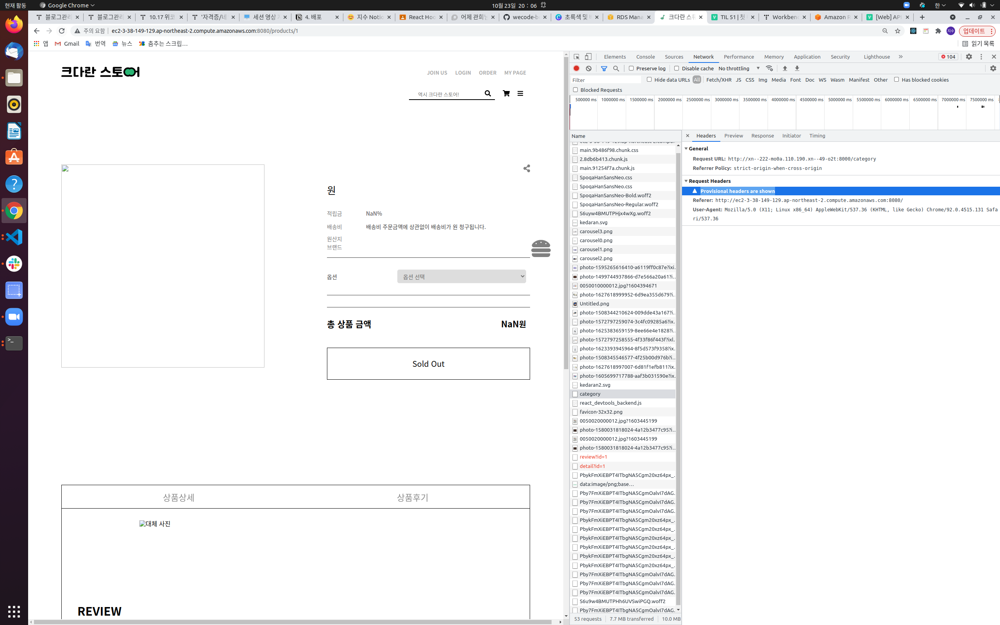

## ***난위도 : 우오아온으ㅏㅇ~!***

**프젝 마지막주~!!!**

리팩토링, aws배포, 함수형컴포넌트 등등 새로운거를배우고

기존에 것을 털어내는 주차이긴하지만 프젝이 끝났다고

긴장을 늦춰서는 않된다~!!!

2차프젝이 기다리고있으니...


### ***✔️프젝 마무리 (Refactoring, aws 배포)***

- 평일
  - 10/18(at.홍대)
    - [x] 오전 프론트 self-refactoring 및 Q&A 취합 오후 맨토 코맨
    - [x] 회고록 TIL 마저 작성하기
    - [x] 세션 영상 다시보고 option 선택시 배열에 담는거 수정하기(spread 연산자 활용하기)
    - [x] 세션 영상 다시보고 선택한 option의 갯수 증가 감소시키는 setState 작성하기
    - [x] reduce로 이용해서 TotalPrice 다시 작성하기
    - [x] ref 작성한 함수 세션 영상 보고 scrollIntoView() 함수 써서 다시 작성하기
  - 10/19(at.홍대)
    - [x] 오전 빽엔드 self-refactoring 및 Q&A 취합 오후 맨토 코맨
    - [x] 학점은행제 인강 마지막까지 듣기
    - [x] 내일 배울 unit 예습해보기
  - 10/20(at.종로)
    - [x] unnit test 세션 듣기
    - [x] 프론트 util이랑 빽엔드 API에 util test 적용해보기
  - 10/21(at.종로)
    - [x] 오전 hook 세션 듣기
    - [x] 몬스터 때려잡기 함수형 컨포넌트(hook)적용해서 해보기
    - [x] 회고록 작성한거 다른사람들꺼랑 비교해서 고칠꺼 있는지 보기
    - [x] ref에 대해 알게된부분 TIL 작성하기
    - [x] 이력서 작성하고 다운받아서 classroom에 제출하기
  - 10/22(at.서울)
    - [x] useEffect 에서 의존성 배열을 쓸때 안쓸때 윌언마운트 확인하기
    - [ ] 우분투에서 gif 파일 사용할수 있는 방법 숙지하고 되게하기
    - [x] 설치할때 -y -dev —save 가 무슨뜻인지 확인하기
    - [x] 블로그 카테고리에 프로젝트 정리 부분 업로드하기
    - [x] AWS영상 다시보고 인스턴스 구성하는 방법 찾아보기
- 주말
  - 10/23
    - [x] aws 배포 완료하기
  - 10/24
    - [ ] React 초세팅 및 함수형 컴포넌트 연습해보기 line style도
    - [ ] 개인노션에 적은 할일 일정 정리한거 TIL 에 업로드 하기

### ***✔️🤷‍♂️알게된것들~~ (해답 아래 T스토리 링크 클릭)***

- 장바구니에서 갯수가 구매랑 이어지는 중요한 데이터라서 변화시 계속 빽엔드로 fetch 요청을 보내야되고 빽에서는 update 처리를 해줘야된다
- ref 사용 방법
  - ref를 state에 선언해서 사용
  - 부모컨포넌트에서 자식컴포넌트로 ref 전달방법
  - 다수의 ref를 객체로 관리하는 방법 (refs로 사용하면 않됨,이름주의)
  - scrollIntoView로 사용하여 코드 가독성있게 줄이는 방법
  - observer 와 차이점
- useEffect에 의존성 배열을 추가 안하면 수정될때마다 계속 실행되고   
  의존성 빈배열을 추가하면 딱 1번 실행되고(DidMount)   
  의존성 배열에 값을넣어 추가하면 그 값이 변경될때마다 실행됨
- npm install —save : save 옵션을 붙이면 package.json의 dependencies에 추가되고 다음 프로젝트 다운 받은뒤 npm install 하면 함께 설치됨   
  npm install -g : 패키지를 프로젝트가 아닌 시스템의 node\_modules 폴더에 설치한다.   
  npm install —save-dev : 모듈을 설치할 때 package.json 내의 devDependencies 항목에 설치한 모듈과 버전을 넣는 것
- aws 는 배포할때 필요하며 deploy로 프론트 빽엔드 데이터 를 관리하는 공간? 을 만들어서 서버 실행없이 url로 들어가면 페이지가 나오겠음 하는것? ㅇ다  
  해결한 방법: 우선 개발자 도구상 source로 들어가서 어느부분에 에러가 났는지 확인하고 콘솔상 에러를 확인한다 만약 콘솔상 에러가 안뜨면 실제 API의 경로를 입력해 요청을 보내고 데이터가 잘 들어오는지 확인하고  
  참고 사이트 : <https://velog.io/@dabin0219/TIL-51-첫-배포-AWS>

### ***✔️질의 응답~! 개많이 물어봄~!😆😄***

- 브라우저에서 계속 뜨는 의문의 에러  

  

  질문 : 에러내용과 TIL 을 확인한 결과 메모리 누수? 때문에 useEffect로 초기화 시켜줘라? 라고 하는것 같은데 나의 코드에서 어떻게 적용해야될지 잘 모르겠다.  
  서칭한 TIL : <https://velog.io/@ohgoodkim/-에러노트-Cant-perform-a-React-state-update-on-an-unmounted-component>
- 갯수 증가(increase) 갯수 감소(decrease) 에대해 추가 질문 있습니다  
  관희님 혹시 어제 세션하실때 얘기하신 주옥 같은 말 참고해서 수정한번 해봤는데 increase decrease 부분 이렇게 쓰는게 맞나요? 그리고 decreace랑 increase 함수 두개를 가만히 놓고 보니까 +, - 말고는 비슷해서 하나의 함수로 축약해도 되나요? 인자로 name을 받아서 해도 될것같은데 뭔가 따른사람이 볼때는 헷깔릴수도 있을것 같다는 생각을 했습니다  
  Re 관희님 : 우선 가독성을 고려하셨다는 것만으로도 너무 좋습니다! 이 부분은 다른 분들도 보셨으면 좋겠어서 커뮤니티 채널에 질문 올려주실 수 있나요? 거기서 답변 달겠습니다  

  ```javascript
  //코드

  increaseCounter = id => {
      this.setState({
        choiceOptionArray: this.state.choiceOptionArray.map(option => {
          if (option.id === id) {
            if (option.choiceCount >= option.quantity) {
              alert('재고량을 다시 확인하세요');
              return option;
            }
            return { ...option, choiceCount: option.choiceCount + 1 };
          } else {
            return option;
          }
        }),
      });
    };
    decreaseCounter = id => {
      const MIN_LIMIT_OPTION_NUM = 1;
      this.setState({
        choiceOptionArray: this.state.choiceOptionArray.map(option => {
          if (option.id === id) {
            if (option.choiceCount < MIN_LIMIT_OPTION_NUM) {
              alert('1개 이상 선택해야됩니다');
              return option;
            }
            return { ...option, choiceCount: option.choiceCount - 1 };
          } else {
            return option;
          }
        }),
      });
    };

    //추가수정

    plusMinusCounter = (id, name) => {
      const MIN_LIMIT_OPTION_NUM = 1;
      this.setState({
        choiceOptionArray: this.state.choiceOptionArray.map(option => {
          if (option.id === id) {
            if (
              option.choiceCount < MIN_LIMIT_OPTION_NUM &&
              option.choiceCount >= option.quantity
            ) {
              alert('재고량과 1개이상 선택하세요');
              return option;
            }
            return {
              ...option,
              choiceCount:
                name === 'plus' ? option.choiceCount + 1 : option.choiceCount - 1,
            };
          } else {
            return option;
          }
        }),
      });
    };
  ```

  - 답변 :우선은 두 함수를 합치면 코드의 양은 줄어드나 그 만큼 조건문이 생기기 때문에 가독성 측면에서 분리하는 것이 더 좋을 것 같습니다. 그리고 map 함수 안에서 많은 로직이 들어가 있어서 아래와 같이 한 번 더 리팩토링 해봤습니다. 제가 저를 리팩토링했네요! ㅋㅋㅋ 한 번 참고해 보시죠!  

    ```javascript
    increaseCounter = id => {
      const { choiceOptionArray } = this.state;

      const selectedIndex = choiceOptionArray.findIndex(option => option.id === id);
      const newOptions = [...choiceOptionArray];
      const selectedOption = newOptions[selecetedIndex];

      if (selectedOption.choiceCount >= selectedOption.quantity) {
        alert('재고량을 다시 확인하세요');
        return;
      }

      newOptions[selectedIndex] = {...selectedOption, choiceCount: selectedOption.choiceCount + 1 }

      this.setState({
        choiceOptionArray: newOptions,
      }) 
    }​
    ```

### ***✔️🎃참고한 링크 목록emf***

- 회원가입 API 구성시 참고본 <https://velog.io/@hjulee12/Nodejs-practice.-데이터베이스-모델링-및-blog-API-구현>


